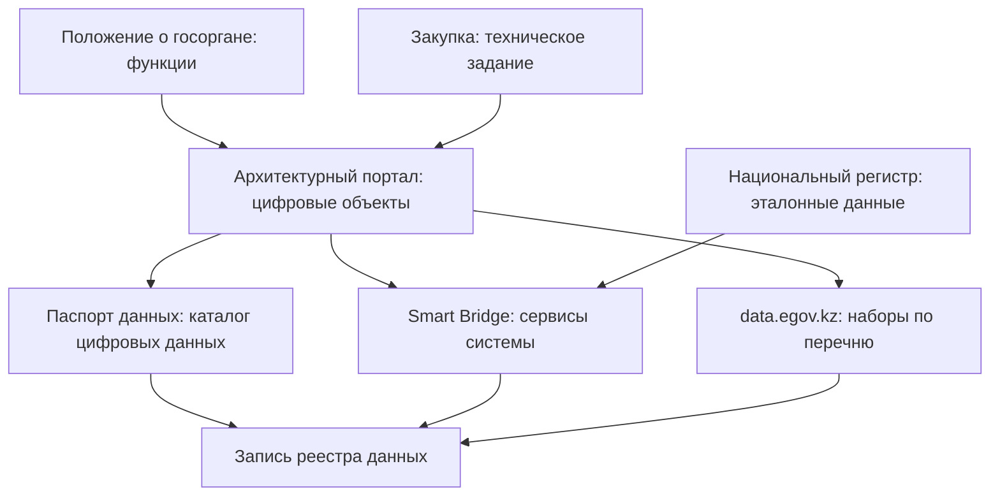

# Казахстан

В Казахстане для инвентаризации данных уже есть то, что в других странах собирают по частям: закон называет цифровые объекты и эталонные данные, владельцы систем сами учитывают их на архитектурном портале, а интеграционная платформа Smart Bridge показывает в открытом каталоге, какая система какие сведения отдаёт. С 12 июля 2026 года действует Цифровой кодекс: он сменил термины во всём законодательстве и сделал национальные регистры единым источником достоверных сведений. С 6 октября 2026 года действуют требования по управлению цифровыми данными: на том же портале ведут каталог цифровых данных, а у каждого цифрового объекта должен быть паспорт данных. Стратегия Digital Qazaqstan до 2029 года обещает инвентаризацию и архитектурный аудит государственных информационных систем с решением по каждой: развивать, объединить, перенести или вывести из эксплуатации. Поэтому опись ведомства начинают не с анкеты, а с открытого реестра систем на govarch.kz, каталога сервисов Smart Bridge и перечня открытых данных на data.egov.kz; анкета уточняет то, чего в них нет. Открыта при этом только часть: паспорта данных, документация систем и аналитическая платформа Smart Data Ukimet доступны внутри государства.

В индексе развития электронного правительства ООН Казахстан в 2024 году занял 24-е место, в 2022-м — 28-е; обзор 2026 года на 25 октября 2026 года не вышел. Сведения главы проверены 25 октября 2026 года, если не сказано иное. Нормативные акты сверены 24 и 25 октября 2026 года по информационно-правовой системе «Әділет»; 25 октября adilet.zan.kz из сети проверки не открылся, и тексты сверены по её копии на zakon.uchet.kz.

## Коротко

| Что ищут | Где | Что даёт | Чего не даёт |
|----------|-----|----------|--------------|
| **[Полномочия и акты](#правовая-основа)** | adilet.zan.kz; проекты — legalacts.egov.kz; функции государственных органов — govarch.kz | Положения о государственных органах, акты о системах, регистрах и формах сбора | Что на самом деле лежит в системе |
| **[Учёт систем](#где-учитывают-системы)** | Архитектурный портал govarch.kz | Открытый реестр: 162 системы центральных государственных органов и 55 — местных исполнительных органов, с владельцем, регистрационным номером и статусом | Документацию систем и паспорта данных |
| **[Каталог данных](#каталог-цифровых-данных)** | Тот же портал, паспорта данных цифровых объектов | Виды данных в базах, связи между ними, основные данные | В открытой части портала каталога нет |
| **[Обмен данными](#каталог-сервисов-smart-bridge)** | Каталог сервисов Smart Bridge, sb.egov.kz | Какая система какие сведения отдаёт, владелец, есть ли персональные данные, кому доступен сервис | Сами данные и состав баз целиком |
| **[Эталонные данные](#национальные-регистры)** | Национальные регистры | Где лежит единственный достоверный источник сведений о людях, организациях, недвижимости | Открытого перечня регистров не найдено |
| **[Опубликованное](#государственные)** | data.egov.kz | 3920 наборов; у каждого ведомства — доля размещённых наборов от утверждённых в перечне | То, что не попало в перечень; программный интерфейс — только с ключом |
| **Формы сбора** | Приказы «Об утверждении форм, предназначенных для сбора административных данных» на adilet.zan.kz | Что ведомство собирает, с кого и как часто | Где хранятся ответы |
| **Статистика, бюджет, закупки** | stat.gov.kz и «Талдау», budget.egov.kz, zakup.gov.kz | Показатели и методики, расходы, технические задания и подрядчики | Записи; системы, созданные без закупок |



## Правовая основа

С 12 июля 2026 года отношения в цифровой среде регулирует Цифровой кодекс. Одновременно вступил в силу закон о поправках, который переименовал закон «Об информатизации» в закон «О кибербезопасности» и заменил термины во всём законодательстве. В документах, принятых раньше, — в положениях о системах, контрактах, отчётах, приказах о формах — встречаются прежние термины, поэтому документы ищут по обоим вариантам.

| До 12 июля 2026 года | С 12 июля 2026 года |
|----------------------|---------------------|
| Информационная система | Цифровая система |
| Электронный информационный ресурс | Цифровой ресурс |
| Объект информатизации | Цифровой объект |
| «Электронное правительство» | «Цифровое правительство» |
| Архитектурный портал «электронного правительства» | Архитектурный портал цифровых объектов государства. Сайт govarch.kz 25 октября 2026 года ещё называл себя по-старому |
| Перечень критически важных объектов информационно-коммуникационной инфраструктуры | Перечень критически важных цифровых объектов |
| Закон «Об информатизации» № 418-V | Закон «О кибербезопасности» — тот же № 418-V |
| Требования по управлению данными — постановление Правительства от 07.11.2024 № 925 | Требования по управлению цифровыми данными — постановление Правительства от 22.09.2026 |

Акты, важные для инвентаризации:

- **Цифровой кодекс Республики Казахстан** от 09.01.2026 № 255-VIII, в редакции от 21.10.2026; изменён, в частности, законом от 23.07.2026 № 352-VIII.
  - Цифровые объекты (статья 20): цифровые записи, активы, ресурсы, программное обеспечение, системы, платформы, объекты цифровой инфраструктуры, продукты цифровых данных. Их идентифицируют, описывают и учитывают в классификаторе цифровых объектов, который ведёт уполномоченный орган. Правила формирования и ведения классификатора утверждены приказом министра в августе 2026 года; сам классификатор на 25 октября 2026 года опубликованным не найден.
  - Цифровой ресурс — упорядоченные цифровые данные и записи вместе с программами для их обработки (статья 24); цифровая система — связанный комплекс цифровых ресурсов (статья 28). Владелец системы и владелец ресурсов в ней могут быть разными лицами.
  - Административные цифровые данные — данные, которые государственные органы, государственные юридические лица и квазигосударственный сектор формируют при исполнении функций и оказании услуг (статья 18). Их качество определяет орган государственной статистики.
  - Национальные регистры — цифровые ресурсы с эталонными данными, единый источник достоверных сведений (статья 19). Если данные есть в регистре, государственные цифровые объекты должны брать их оттуда.
  - Доступ оператора «цифрового правительства» к данным государственных органов для аналитики — по требованиям к управлению цифровыми данными, которые утверждает правительство (статья 16).
  - Портал открытых данных (статья 17): обладатели информации обязаны размещать на нём открытые данные, доступ к ним бесплатный и без дискриминации, в том числе через программный интерфейс.
  - Архитектурный портал цифровых объектов государства (статья 71) и архитектурно-координационный центр (статья 72).
  - Прекращение эксплуатации цифрового объекта — со сменой сведений на архитектурном портале (статья 89); архивирование записей, документации и исходных кодов (статья 90) ([«Исчезнувшие системы и веб-архивы»](../04-sources/06-legacy.md#где-искать-преемника)).
- **Закон «О внесении изменений и дополнений в некоторые законодательные акты Республики Казахстан по вопросам цифровизации, транспорта и предпринимательства»** от 09.01.2026 № 256-VIII — вступил в силу вместе с кодексом, кроме отдельных норм. Переименовал закон № 418-V и заменил термины в других законах.
- **Закон «О кибербезопасности»** от 24.11.2015 № 418-V, в редакции от 25.08.2026. До 12 июля 2026 года назывался «Об информатизации» и регулировал создание, учёт и эксплуатацию объектов информатизации, электронных информационных ресурсов и информационных систем. Эти нормы из него исключены, остались требования кибербезопасности, в том числе к цифровым объектам «цифрового правительства».
- **Требования по управлению цифровыми данными** — постановление Правительства от 22.09.2026, в силе с 6 октября 2026 года; номер постановления из сети проверки установить не удалось. Каталог цифровых данных, паспорта данных, менеджер по данным ([«Каталог цифровых данных»](#каталог-цифровых-данных)). По проекту, который публиковало Бюро национальной статистики, постановление отменяет требования по управлению данными 2024 года.
- **Постановления о ролях**: оператор «цифрового правительства» — АО «Национальные информационные технологии» (постановление от 08.05.2026 № 374); архитектурно-координационный центр — РГП «Центр поддержки цифрового правительства» (постановление от 14.05.2026 № 398). Оба — в силе с 12 июля 2026 года.
- **Закон «О доступе к информации»** от 16.11.2015 № 401-V — открытые данные и информация с ограниченным доступом (статья 1), общественно значимая информация, доступ к которой не ограничивают (статья 6), запрос информации и ответ за 15 календарных дней (статья 11) ([«Вопрос чужому владельцу»](../03-process/04-questionnaires.md#вопрос-чужому-владельцу)).
- **Закон «О персональных данных и их защите»** от 21.05.2013 № 94-V, в редакции от 14.09.2026. Право на удаление, обезличивание и ограничение обработки персональных данных закреплено и в статье 41 Цифрового кодекса.
- **Перечень критически важных цифровых объектов** — утверждает уполномоченный орган в сфере обеспечения кибербезопасности (статья 33 Цифрового кодекса).
- **Общенациональная стратегия Digital Qazaqstan до 2029 года** — указ Президента от 09.06.2026 № 1311. Для инвентаризации в ней важны инвентаризация и архитектурный аудит государственных информационных систем с целевым статусом для каждой, не меньше 10 отраслевых хранилищ данных — «озёр данных», методологическая координация управления данными органом государственной статистики, принцип «один источник — многократное использование» и национальный стандарт качества данных: полнота, достоверность, сопоставимость, актуальность, согласованность и непротиворечивость.
- **Концепция цифровой трансформации, развития отрасли ИКТ и кибербезопасности на 2023–2029 годы** — постановление Правительства от 28.03.2023 № 269, действует. В разделе об управлении данными — анализ метаданных 128 баз данных ([пример](#пример)).
- **Карты цифровой трансформации** — в 2025 году утверждены 20 карт, они охватывают 72 сферы государственного управления: шаги по реинжинирингу процессов и управлению данными в ведомствах. Карты выложены на govarch.kz.

## Реестры и платформы

### Где учитывают системы

Государственного реестра информационных систем в законе «Об информатизации» в последней редакции до реформы, от 24 июня 2026 года, нет: из реестров в нём упоминается только реестр доверенного программного обеспечения и продукции электронной промышленности. Сведения об объектах информатизации «электронного правительства» и техническую документацию к ним государственные органы размещали на архитектурном портале «электронного правительства» (статья 31 в редакции до 12 июля 2026 года). Теперь эту роль выполняет архитектурный портал цифровых объектов государства (статья 71 Цифрового кодекса). Сведения о цифровых объектах и документацию к ним размещают и поддерживают в актуальном виде государственные органы, государственные юридические лица, квазигосударственный сектор и другие организации, которые участвуют в исполнении государственных функций. Портал предназначен для мониторинга, анализа и планирования в сфере цифровизации.

Портал работает по адресу govarch.kz, и у него есть открытая часть. Ведёт его, судя по контактам на сайте, Центр поддержки цифрового правительства — архитектурно-координационный центр по статье 72. 25 октября 2026 года без входа на портале были видны:

| Раздел | Что в нём | Как использовать |
|--------|-----------|------------------|
| **Реестр систем** | Системы центральных государственных органов — 162, местных исполнительных органов — 55. У каждой — наименование, аббревиатура, владелец, регистрационный номер, версия, статус. Отдельно — интернет-ресурсы центральных органов (8) и информационно-коммуникационные услуги (4 у центральных и 5 у местных органов) | Перечень систем владельца — заготовка записей реестра данных; регистрационный номер — в поле «информационная система» ([«Расширенный состав»](../03-process/05-registry.md#расширенный-состав)) |
| **Государственные функции** | Эталонная карточка функции, перечень функций государственных органов в XLSX | Полномочия владельца: функция ведёт к системе и данным ([«От полномочия к набору»](../03-process/03-owners-and-mandates.md#от-полномочия-к-набору)) |
| **Оптимизация систем** | Сводные документы об оптимизации систем центральных и местных органов, PDF и XLSX | Сверить с реестром: системы, которые объединяют, переносят или выводят, — кандидаты в связанные записи |
| **Карты цифровой трансформации** | Карты министерств и ведомств в PDF | Планы ведомств по данным и процессам |
| **Архитектура** | Доменная модель, концептуальная модель данных, карта процессов | Словарь предметных областей для группировки наборов |

Документацию отдельных систем и каталог цифровых данных в открытой части найти не удалось: их видят зарегистрированные пользователи — организации, которые сами вносят сведения. Для внешней инвентаризации реестр систем — список того, о чём спрашивать владельца; для внутренней — основа описи: ведомство видит на портале свои объекты целиком.

Число систем в реестре меньше, чем в документах о них: Концепция 2023 года говорит о массивах данных «более чем в 400 информационных системах» государственных органов. Разница — повод проверить, какие системы в реестр не попали: квазигосударственного сектора, выведенные, ещё не зарегистрированные.

### Каталог цифровых данных

Требования по управлению цифровыми данными, утверждённые 22 сентября 2026 года, ввели в государстве то, что эта книга называет реестром данных ([«Реестр данных»](../03-process/05-registry.md)):

- **Каталог цифровых данных** — систематизированный перечень сведений о видах цифровых данных и связях между ними. Его формируют на архитектурном портале архитектурно-координационный центр и организации и обновляют при каждом изменении структуры или источников данных.
- **Паспорт цифровых данных** — описание данных одного цифрового объекта. Из паспортов складывается каталог. Паспорт и описание данных, которые ещё не оцифрованы, согласуют менеджер по цифровым данным организации и центр. Для новых и развиваемых объектов паспорт составляют до ввода объекта в промышленную эксплуатацию.
- **Ответственные.** Организации назначают ответственного за управление цифровыми данными в курируемой отрасли и менеджера по данным, который следит за соблюдением требований и за тем, чтобы базы наполнялись полными и актуальными сведениями.
- **Эталонные данные** определяют организации вместе с центром; по ним проверяют другие данные на противоречия.

По проекту постановления, каталог нужен в том числе чтобы сформировать перечень открытых данных государственных органов для портала открытых данных. Значит, перечень открытых данных можно сверять с каталогом: что из каталога не попало в перечень и почему.

Паспорт данных — готовая запись реестра для внутренней инвентаризации, но не полная. В нём есть состав и структура данных, а режим доступа, условия использования и проверка качества могут быть описаны иначе, чем в книге. Поэтому при описи ведомства паспорта выгружают и сопоставляют с 14 атрибутами записи ([«Минимальный состав»](../03-process/05-registry.md#минимальный-состав)), а пробелы дозаполняют. Для внешней инвентаризации каталог закрыт: о нём спрашивают менеджера по данным владельца.

### Платформы

| Платформа | Что это | Цифры | Что даёт инвентаризации |
|-----------|---------|-------|-------------------------|
| **Smart Bridge** | Интеграционная платформа: связывает государственные базы данных между собой и с банками, операторами связи, бизнесом | 4671 интеграция, 11 377 организаций, 2953 сервиса — 2091 государственный и 862 негосударственных (пресс-служба министерства, март 2026 года); в открытой статистике каталога 25 октября 2026 года — 12 899 организаций и 36 617 заявок | Открытый каталог сервисов ([ниже](#каталог-сервисов-smart-bridge)) |
| **QazTech** | Платформа разработки государственных систем: единые стандарты и готовые инструменты | В промышленной эксплуатации с июля 2025 года. С 1 января 2026 года государственным органам запрещено создавать ИТ-проекты вне QazTech. В 2026 году на платформу переводят 39 систем, 10 уже работали на ней в августе 2026 года; на ней запущен портал eGov 3.0 | Системы на одной платформе проще описать единообразно; перенос системы — повод обновить её запись |
| **eGov** | Портал и сервисы цифрового правительства | Больше 15 млн зарегистрированных пользователей и больше 508 млн оказанных услуг за всё время (апрель 2026 года); 1467 государственных услуг, 90,4% из них онлайн (стратегия, июнь 2026 года) | Перечень услуг: за каждой — системы и сведения, которые она использует |
| **eGov Mobile** | Мобильное приложение | 6,4 млн активных пользователей в месяц, больше 11,7 млн пользователей всего (итоги 2025 года) | — |
| **Smart Data Ukimet** | Аналитическая платформа: собирает данные государственных систем для показателей и проактивных услуг | Больше 100 ключевых показателей; проактивные услуги в 2025 году получили больше 4,5 млн граждан (стратегия, июнь 2026 года). Вход на sdu.gov.kz — только по учётной записи | Какие показатели из каких систем считаются — у оператора; по требованиям 2026 года организации вносят в неё отраслевые показатели |
| **Национальная платформа ИИ** | Платформа ИИ-агентов и языковых моделей для государственных органов, ai.nitec.kz; разработчик — АО «Национальные информационные технологии» | Больше 50 ИИ-агентов; доступ к больше чем 120 государственным базам данных (март 2026 года) | Перечень баз, к которым подключены модели, — тоже инвентаризация ([«Что особенного»](#что-особенного)) |

### Каталог сервисов Smart Bridge

Сервис Smart Bridge — способ, которым одна система отдаёт сведения другой: справку о человеке по ИИН, об организации по БИН, о недвижимости. Каталог сервисов на sb.egov.kz открыт без входа, а сведения о сервисах отдаются и через программный интерфейс без ключа. У сервиса видны:

- название и описание на русском и казахском языках;
- организация-владелец с БИН и система-владелец;
- отраслевая категория и метки;
- протокол — SOAP или REST, синхронный ли сервис;
- передаёт ли сервис персональные данные;
- кому доступен — всем или только государственным органам;
- дата публикации.

Поиск по каталогу 25 октября 2026 года нашёл 3055 опубликованных сервисов 204 организаций-владельцев. Это нижняя граница: каталог отдаёт сервисы по поисковому запросу, а не списком целиком. У 652 сервисов отмечено, что они передают персональные данные, 112 доступны только государственным органам. Больше всего сервисов у Министерства труда и социальной защиты населения — 335, Комитета государственных доходов — 325, Министерства юстиции — 229, Государственной корпорации «Правительство для граждан» — 201, Министерства внутренних дел — 191. Описания и метки есть не у всех: у части сервисов вместо описания — техническое имя. Схемы запросов и контакты в открытой части не показаны.

Как использовать:

- **Сервис — след системы и набора.** Если система отдаёт справку о транспортных средствах, в ней есть реестр транспортных средств. Сервисы владельца сравнивают с его системами в реестре govarch.kz: сервис без системы в реестре и система без сервисов — вопросы владельцу.
- **Сервис — не набор.** Он отдаёт сведения по одному запросу, а не базу целиком. Набор записывают отдельно, сервис — как способ доступа к нему, со своим режимом: «только государственным органам» — это ограничение доступа ([«Условия доступа»](../03-process/06-access.md#условия-доступа)).
- **Признак персональных данных** — готовое значение поля реестра; его сверяют с описанием сервиса.
- **Число сервисов — не мера данных.** Ведомство делит обмен на сервисы по-разному, как и наборы на портале ([«Порталы открытых данных»](../04-sources/02-government.md#порталы-открытых-данных)).

### Национальные регистры

Эталонные данные закреплены законом: национальный регистр — единый источник достоверных сведений для государственных функций, услуг и статистики, и если сведения в нём есть, государственные системы берут их оттуда (статья 19 Цифрового кодекса). Перечень и состав регистров определяет уполномоченный орган по согласованию с органом государственной статистики. До кодекса ту же роль играли базовые государственные базы данных — о физических лицах, юридических лицах, регистр недвижимости, электронное лицензирование, — и в документах до июля 2026 года регистры ищут под этими названиями.

Открытого перечня национальных регистров на 25 октября 2026 года не найдено. Регистры находят по актам о них, по реестру систем на govarch.kz и по сервисам Smart Bridge: регистр отдаёт сведения многим системам, и у его владельца много сервисов. Эталон ищут первым ([«Как читать полномочия»](../03-process/03-owners-and-mandates.md#как-читать-полномочия)), а копии его сведений в других системах записывают со ссылкой на эталон ([«Один набор под разными именами»](../03-process/05-registry.md#один-набор-под-разными-именами)).

## Где искать данные

### Государственные

| Что | Где | Что видно на 25 октября 2026 года |
|-----|-----|-----------------------------------|
| **Портал открытых данных** | data.egov.kz | 3920 наборов: у центральных государственных органов — 1062, у местных исполнительных органов — 1167, у квазигосударственного сектора — 1691. Больше всего наборов у Агентства по стратегическому планированию и реформам — 297 — и Министерства финансов — 101. По каждому издателю — доля размещённых наборов от утверждённых в перечне и доля актуальных; у набора — тип публикации: по перечню, проактивно или по запросу пользователей. Программный интерфейс выдаёт данные только с ключом |
| **Статистика** | Бюро национальной статистики Агентства по стратегическому планированию и реформам, stat.gov.kz; информационно-аналитическая система «Талдау», taldau.stat.gov.kz | Показатели, методики, публикации; ряды показателей в «Талдау». Бюро определяет качество административных данных (статья 18 Цифрового кодекса) |
| **Формы сбора сведений** | Приказы ведомств «Об утверждении форм, предназначенных для сбора административных данных» на adilet.zan.kz | Состав, периодичность, кто сдаёт ([«Статистика и формы сбора сведений»](../04-sources/02-government.md#статистика-и-формы-сбора-сведений)) |
| **Национальный банк** | Репозиторий открытых данных, data.nationalbank.kz | 7 категорий, 31 подкатегория и 239 форм: денежно-кредитная статистика, внешний сектор, финансовый сектор, ценные бумаги, платёжные системы, финансовая стабильность, результаты опросов; есть программный интерфейс |
| **Геоданные** | Геопортал национальной инфраструктуры пространственных данных, map.gov.kz | 458 открытых ресурсов — 452 набора и 6 карт; программный интерфейс без ключа |
| **Бюджет** | «Открытые бюджеты», budget.egov.kz | Бюджеты и их исполнение, отчёты бюджетных программ |
| **Закупки** | Единая платформа закупок zakup.gov.kz (прежний адрес goszakup.gov.kz перенаправляет на неё); коды единого номенклатурного справочника товаров, работ и услуг | Технические задания на создание и развитие систем, подрядчики ([«Госзакупки»](../04-sources/02-government.md#госзакупки)) |
| **Нормативные акты** | Информационно-правовая система «Әділет» adilet.zan.kz; государственный реестр нормативных правовых актов law.gov.kz; проекты — «Открытые НПА» legalacts.egov.kz; сайт Мажилиса parlam.kz; «Судебный кабинет» office.sud.kz; международные договоры — Министерство иностранных дел mfa.gov.kz | Полномочия, акты о системах и регистрах, формы сбора |
| **Сайты государственных органов** | Разделы портала gov.kz; публичные части систем — на своих доменах и поддоменах, например data.egov.kz и legalacts.egov.kz | Разделы, отчёты, следы систем ([«Сайты и домены»](../04-sources/02-government.md#сайты-и-домены)) |

Портал открытых данных — часть «Открытого правительства» вместе с «Открытыми бюджетами», «Открытыми НПА», «Открытым диалогом» dialog.egov.kz и оценкой эффективности государственных органов evaluation.egov.kz; общий вход — open.egov.kz.

### Общественные

- **Wikidata** — черновик перечня организаций-владельцев: министерства Казахстана с сайтами и датами получают одним запросом. Адреса там устарели: у трёх министерств записаны домены, которых больше нет или у которых нет адреса ([«Wikidata, Википедия и OpenStreetMap»](../04-sources/03-public.md#wikidata-википедия-и-openstreetmap)).
- **Международные организации** — Всемирный банк, ООН, ВОЗ, ОЭСР. Их оценки расходятся с национальными по методике: население Казахстана у Всемирного банка на середину 2025 года на 1,7% больше, чем у Бюро национальной статистики на 1 января 2026 года ([«Международные организации»](../04-sources/03-public.md#международные-организации)).
- **Поисковики по наборам данных** находят о Казахстане в основном копии и международные показатели: в Dateno 25 октября 2026 года было 14 155 наборов о Казахстане, 7958 из них — от международных организаций, а data.egov.kz, stat.gov.kz и «Талдау» в индексе нет ([«По странам»](../04-sources/05-dataset-search.md#по-странам)).
- **DBpedia, OpenStreetMap, научные репозитории** (re3data.org) и **HDX** — 124 набора о Казахстане.

### Коммерческие

- **Раскрытие информации** эмитентов — на сайте Казахстанской фондовой биржи kase.kz; финансовая отчётность организаций публичного интереса — в депозитарии финансовой отчётности dfo.kz.
- **Кредитные бюро** — Первое кредитное бюро, 1cb.kz: отчёты и агрегаты по кредитной нагрузке, а не сведения о заёмщиках.
- **Операторы фискальных данных** — например, Kazakhtelecom OFD, oofd.kz: чеки онлайн-касс передают налоговой службе, поэтому агрегаты по чекам сначала ищут у неё.
- **Сервисы проверки контрагентов** — например, Adata, adata.kz: суды, санкционные списки, закупки, налоговый рейтинг по БИН; первоисточники приходится устанавливать самим.
- **Банки, операторы связи, финтех** получают государственные сведения через Smart Bridge: в каталоге сервисов видно, какие сервисы доступны всем, а какие — только государственным органам.

Подробнее — в главе [«Коммерческие данные»](../04-sources/04-commercial.md).

### Отраслевой пример: нефть, газ, недра

| Кто | Где |
|-----|-----|
| **Государство** | Министерство энергетики — раздел портала gov.kz (gov.kz/memleket/entities/energo); Комитет геологии geology.gov.kz; Министерство экологии и природных ресурсов ecogeo.gov.kz; Казгидромет kazhydromet.kz |
| **Компании и ассоциации** | Ассоциация KAZENERGY kazenergy.com; «КазМунайГаз» kmg.kz; операторы крупных месторождений; раскрытие эмитентов на kase.kz |
| **Международные** | Международное энергетическое агентство |

6 октября 2026 года на заседании правительства Министерству энергетики поручили до конца года провести цифровую инвентаризацию ключевых объектов отрасли и утвердить единые требования к составу, качеству и передаче отраслевых данных. Для отраслевой описи это значит, что требования к данным и перечень объектов появятся в актах министерства: их ищут на adilet.zan.kz и legalacts.egov.kz.

### Проверка адресов

25 октября 2026 года из сети, где проверялась книга, открылись data.egov.kz, stat.gov.kz, taldau.stat.gov.kz, legalacts.egov.kz, zakup.gov.kz, gov.kz, egov.kz, sb.egov.kz, budget.egov.kz, dialog.egov.kz, govarch.kz, map.gov.kz, nationalbank.kz и data.nationalbank.kz, parlam.kz, office.sud.kz, kazhydromet.kz, kazenergy.com, kmg.kz, kase.kz, dfo.kz, 1cb.kz и adata.kz; goszakup.gov.kz перенаправлял на zakup.gov.kz. Не ответили adilet.zan.kz (открывался 23 октября 2026 года), geology.gov.kz, ecogeo.gov.kz, law.gov.kz и mfa.gov.kz — их нужно перепроверить из казахстанской сети. У energo.gov.kz 24 октября 2026 года не было адреса в системе доменных имён: сайт министерства — на портале gov.kz.

### Портал за минуту

У трёх открытых источников есть программные интерфейсы без ключа:

```bash
# Smart Bridge: сколько организаций и заявок на подключение, публикацию и изменение сервисов
curl "https://sb.egov.kz/api/v1/public/stats/overall"
# data.egov.kz: наборы по издателям — центральные органы, местные органы, квазигосударственный сектор
curl "https://data.egov.kz/datasets/getstatisticsbycgogovagencies"
curl "https://data.egov.kz/datasets/getstatisticsbymiogovagencies"
curl "https://data.egov.kz/datasets/getstatisticsbyquasiorganizations"
# Геопортал НИПД: сколько открытых ресурсов (поле total)
curl "https://map.gov.kz/api/v2/resources?page_size=1"
# Национальный банк: категории репозитория открытых данных
curl "https://data.nationalbank.kz/api/v1/data/categories"
```

Запросы проверены 25 октября 2026 года. В ответе data.egov.kz у каждого издателя — сколько наборов всего, сколько размещено и сколько актуально; издателей без наборов по перечню сравнивают с владельцами в границах инвентаризации.

## Как провести инвентаризацию

### Чем владеем: опись государственного органа

| Шаг | Где | Что даёт реестру |
|-----|-----|------------------|
| **1. Функции** | Положение о государственном органе на adilet.zan.kz; перечень функций на govarch.kz | Полномочия: какие данные орган обязан вести ([«Где искать полномочия»](../03-process/03-owners-and-mandates.md#где-искать-полномочия)) |
| **2. Системы** | Реестр на govarch.kz; внутри органа — его объекты на портале целиком | Перечень систем с регистрационными номерами и статусами |
| **3. Паспорта данных** | Каталог цифровых данных на архитектурном портале; менеджер по данным | Состав и структура данных каждой системы, основные и эталонные данные |
| **4. Сервисы** | Каталог Smart Bridge | Что системы отдают и кому, персональные данные, доступ «только государственным органам» |
| **5. Формы сбора** | Приказы о формах административных данных | Что орган собирает с граждан и организаций, периодичность |
| **6. Опубликованное** | Перечень открытых данных и data.egov.kz | Ссылки для выгрузки, формат, даты; что из перечня не размещено или не актуально |
| **7. Закупки** | zakup.gov.kz | Состав данных из технических заданий, подрядчики, предшественники систем |
| **8. Опрос** | Менеджер по данным, владельцы систем и подразделения | То, чего нет в документах: таблицы вне систем, копии, качество ([«Опросные листы и интервью»](../03-process/04-questionnaires.md)) |

Внутри органа шаги 2 и 3 дают почти готовую опись, и главная работа — сверка. Система есть в реестре, а паспорта у неё нет; паспорт есть, а сервисов нет, хотя данные нужны другим; набор есть на data.egov.kz, а в каталоге его вида данных нет — каждое такое расхождение записывают и выясняют ([«Как методы проверяют друг друга»](../02-approaches/02-methods.md#как-методы-проверяют-друг-друга)).

### Где найти нужное

1. **Опубликованное** — data.egov.kz, «Талдау», репозиторий Национального банка, геопортал. Это быстро, но портал показывает только перечни.
2. **Кто ведёт** — план и формы статистики, положения о государственных органах, перечень функций на govarch.kz.
3. **Где лежит** — реестр систем на govarch.kz и сервисы Smart Bridge: по ним видно, в какой системе нужные сведения и есть ли национальный регистр.
4. **Запрос владельцу** — по закону «О доступе к информации», ответ за 15 календарных дней. В запросе называют систему и её регистрационный номер с портала, сервис Smart Bridge и вид данных — так ответ «данных нет» становится маловероятным.
5. **Если закрыто** — международные оценки и коммерческие источники, с пометкой о методике и о том, что первоисточник закрыт ([«Три слоя данных»](../04-sources/01-three-layers.md)).

## Что особенного

- **Учёт систем и каталог данных закреплены в законе и ведутся владельцами.** Сведения на архитектурный портал вносят и обновляют сами организации, паспорта данных согласует их менеджер по данным. Это то устройство, которое книга советует для любого реестра: ответственный ведёт свои записи ([«Результат и поддержка»](../03-process/08-result-and-upkeep.md)).
- **Инвентаризация — задача стратегии.** Digital Qazaqstan требует инвентаризации и архитектурного аудита государственных систем с решением по каждой; Министерству энергетики поручена цифровая инвентаризация отрасли. Цель здесь — сократить число систем и перейти к отраслевым хранилищам данных: от неё зависит, что описывать подробно ([«Зачем: цели»](../01-basics/02-goals.md)).
- **Эталон определён законом.** Для любого набора о людях, организациях и недвижимости сначала выясняют, есть ли национальный регистр: тогда остальные системы хранят копии, и это записывают ([«Что инвентаризируют»](../01-basics/04-what-is-inventoried.md)).
- **Платформа уже есть.** Интеграционная, аналитическая платформы и архитектурный портал позволяют вести реестр данных как часть архитектуры, а не отдельную таблицу ([«От таблицы до каталога»](../06-tools/01-from-spreadsheet-to-catalog.md)).
- **Данные для ИИ — одна из целей.** В июле 2025 года запущен суперкомпьютер на графических процессорах NVIDIA H200 мощностью 2 экзафлопса в вычислениях FP8; в списке TOP500 он — Alem.Cloud, 20,48 петафлопса на тесте LINPACK, 86-е место в ноябре 2025 года и 104-е в июне 2026-го. В 2025 году представлены казахоязычные языковые модели KazLLM и AlemLLM. Национальная платформа ИИ подключена к больше чем 120 государственным базам данных: чтобы знать, какие данные идут в модели, нужен их реестр с владельцем, режимом доступа и отметкой о персональных данных ([«ИИ в инвентаризации»](../02-approaches/03-ai.md)).
- **Качество — у статистики.** Качество административных данных определяет орган государственной статистики, он же по стратегии ведёт эталонные данные и координирует управление данными методически ([«Качество данных»](../03-process/07-quality.md#рамки-и-стандарты-качества)).
- **DCAT-AP для data.egov.kz** — переход портала на этот стандарт сделал бы описания совместимыми с международными каталогами ([«Стандарты описания»](../05-frameworks/02-metadata-standards.md)).

## Пример

Концепция цифровой трансформации 2023 года приводит итоги анализа метаданных — таблиц и полей — 128 баз данных 32 государственных органов, из них 21 центрального и 11 местных исполнительных. Проанализировано 84 523 таблицы и 969 203 поля. У 107 баз из 128 качество метаданных — 90% и больше. Но обследование 2021 года нашло поле «адрес проживания» в 907 полях 177 таблиц 11 баз данных пяти государственных органов, и какое значение — первоисточник, неизвестно.

Пример показывает три вещи:

- **Метод.** Опись полей баз — это инвентаризация информационных систем до уровня полей ([«Инвентаризация информационных систем»](../02-approaches/02-methods.md#2-инвентаризация-информационных-систем)). Она находит дубли, которых не видно ни в реестре систем, ни на портале.
- **Качество метаданных — не качество данных.** Метаданные описаны хорошо, а какой адрес верный, не знает никто ([«Качество данных»](../03-process/07-quality.md)).
- **Решение — эталон.** Адрес — сведение для национального регистра: одна запись реестра для эталона, остальные 906 полей — копии со ссылкой на него.

## Частые ошибки

| Ошибка | Что происходит | Как исправить |
|--------|----------------|---------------|
| **Поиск только по новым терминам** | Не находятся акты, контракты и отчёты до июля 2026 года | Искать и по «информационной системе», и по «цифровой системе»; прежние названия — в синонимы записи |
| **Ссылка на закон «Об информатизации» как на действующий** | В реестре — исключённые нормы об информационных системах | Сверить с Цифровым кодексом; закон № 418-V теперь «О кибербезопасности» ([чек-лист](../10-appendices/04-checklists.md#перед-ссылкой-на-нормативный-акт)) |
| **data.egov.kz — все данные ведомства** | На портале только наборы из перечней и проактивные | Сравнить с реестром систем, сервисами Smart Bridge и формами сбора |
| **Сервис Smart Bridge записан как набор** | В реестре сотни «наборов» — справки по одному запросу | Набор — отдельно, сервис — как способ доступа к нему |
| **Копия регистра записана как первоисточник** | Расходятся сведения о людях и организациях | Выяснить, есть ли национальный регистр, и записать связь с ним |
| **Сайт министерства — из Wikidata или старого документа** | Ссылки на исчезнувшие домены вроде mz.gov.kz | Брать адрес с gov.kz, прежние — в синонимы ([«Исчезнувшие системы и веб-архивы»](../04-sources/06-legacy.md)) |
| **Сайт проверен из-за рубежа** | «Не работает» adilet.zan.kz или law.gov.kz, хотя он закрыт только для зарубежных адресов | Проверять из казахстанской сети и записывать сеть проверки |

## Ограничения

- Открыта только часть учёта: реестр систем и сводные документы на govarch.kz, каталог сервисов Smart Bridge и статистика data.egov.kz. Каталог цифровых данных, паспорта, документация систем, Smart Data Ukimet и программный интерфейс data.egov.kz требуют учётной записи или ключа.
- Открытого перечня национальных регистров и классификатора цифровых объектов на 25 октября 2026 года не найдено; номер постановления о требованиях по управлению цифровыми данными из сети проверки не установлен.
- Цифры о платформах взяты из сообщений министерства, оператора и стратегии на разные даты и с первичной статистикой платформ не сверены. Подсчёт сервисов Smart Bridge по поиску — нижняя граница.
- Реестр на govarch.kz показывает системы центральных и местных государственных органов; системы квазигосударственного сектора в открытой части отдельно не видны.
- adilet.zan.kz, law.gov.kz и сайты ряда ведомств из сети проверки не открылись; тексты актов сверены по копиям правовой системы.

## Источники

- [Kazakhstan — E-Government Development Index](https://publicadministration.un.org/egovkb/en-us/Data/Country-Information/id/87-Kazakhstan) — UN E-Government Knowledgebase: 24-е место в 2024 году, 28-е в 2022-м; [Data Center](https://publicadministration.un.org/egovkb/en-us/Data-Center) — последний выпуск обзора 2024 года, 25 октября 2026 года. [Kazakhstan Soars to 24th Place in Global E-Government Ranking](https://astanatimes.com/2024/09/kazakhstan-soars-to-24th-place-in-global-e-government-ranking/) — The Astana Times, сентябрь 2024 года.
- [Цифровой кодекс Республики Казахстан](https://adilet.zan.kz/rus/docs/K2600000255) от 09.01.2026 № 255-VIII, статьи 16–20, 24, 28, 33, 41, 71, 72, 89, 90 и 106, в редакции от 21.10.2026; опубликован 10 января 2026 года; 25 октября 2026 года сверен по [копии на zakon.uchet.kz](https://zakon.uchet.kz/rus/docs/K2600000255). [В Казахстане вступил в силу Цифровой кодекс](https://www.gov.kz/memleket/entities/maidd/press/news/details/1257769?lang=ru) — Министерство искусственного интеллекта и цифрового развития, 14 июля 2026 года.
- [Закон Республики Казахстан от 09.01.2026 № 256-VIII](https://adilet.zan.kz/rus/docs/Z2600000256), статья 1 (пункт 93 — поправки в закон № 418-V) и статья 2.
- [Закон Республики Казахстан «О кибербезопасности»](https://adilet.zan.kz/rus/docs/Z1500000418) от 24.11.2015 № 418-V: действующая редакция от 25.08.2026; редакция от 24.06.2026 под названием «Об информатизации» (статьи 1 и 31) — на вкладке «История изменений» той же страницы.
- [Закон «О доступе к информации»](https://adilet.zan.kz/rus/docs/Z1500000401) от 16.11.2015 № 401-V; [закон «О персональных данных и их защите»](https://adilet.zan.kz/rus/docs/Z1300000094) от 21.05.2013 № 94-V.
- Постановления Правительства от 08.05.2026 [№ 374](https://zakon.uchet.kz/rus/docs/P2600000374) — оператор «цифрового правительства» и от 14.05.2026 [№ 398](https://zakon.uchet.kz/rus/docs/P2600000398) — архитектурно-координационный центр.
- [Требования по управлению цифровыми данными приняли в Казахстане](https://www.zakon.kz/pravo/6532997-trebovaniya-po-upravleniyu-tsifrovymi-dannymi-prinyali-v-kazakhstane.html) — Zakon.kz, 28 сентября 2026 года: постановление от 22 сентября 2026 года, в силе с 6 октября; [проект постановления «Об утверждении требований по управлению цифровыми данными»](https://stat.gov.kz/upload/medialibrary/fcc/xwmnhvr3oxplzr62ioz53y1g3pk8cmfg/%D0%9E%D0%B1%20%D1%83%D1%82%D0%B2%D0%B5%D1%80%D0%B6%D0%B4%D0%B5%D0%BD%D0%B8%D0%B8%20%D1%82%D1%80%D0%B5%D0%B1%D0%BE%D0%B2%D0%B0%D0%BD%D0%B8%D0%B9%20%D0%BF%D0%BE%20%D1%83%D0%BF%D1%80%D0%B0%D0%B2%D0%BB%D0%B5%D0%BD%D0%B8%D1%8E%20%D1%86%D0%B8%D1%84%D1%80%D0%BE%D0%B2%D1%8B%D0%BC%D0%B8%20%D0%B4%D0%B0%D0%BD%D0%BD%D1%8B%D0%BC%D0%B8.pdf) — Бюро национальной статистики, пункты 8–14. [Как будут вести классификатор цифровых объектов](https://www.zakon.kz/pravo/6528814-kak-budut-vesti-klassifikator-tsifrovykh-obektov-novye-pravila.html) — Zakon.kz, 21 августа 2026 года.
- [Общенациональная стратегия масштабной цифровизации и тотального внедрения технологий искусственного интеллекта «Digital Qazaqstan» до 2029 года](https://cdb.kz/sistema/pravovaya-baza/ob-utverzhdenii-obshchenatsionalnoy-strategii-masshtabnoy-tsifrovizatsii-i-totalnogo-vnedreniya-tekh/) — указ Президента от 09.06.2026 № 1311; [сообщение о подписании указа](https://www.akorda.kz/ru/glavoy-gosudarstva-podpisan-ukaz-ob-utverzhdenii-obshchenacionalnoy-strategii-masshtabnoy-cifrovizacii-i-totalnogo-vnedreniya-tehnologiy-iskusstvennogo-intellekta-digital-qazaqstan-do-2029-goda-952946) — Акорда.
- [Концепция цифровой трансформации, развития отрасли информационно-коммуникационных технологий и кибербезопасности на 2023–2029 годы](https://adilet.zan.kz/rus/docs/P2300000269) — постановление Правительства от 28.03.2023 № 269, раздел 2, параграф 2 «Управление данными»; сверено по копии на zakon.uchet.kz 25 октября 2026 года.
- Карты цифровой трансформации: [Утверждены 20 карт цифровой трансформации](https://www.zakon.kz/obshestvo/6494859-utverzhdeny-20-kart-tsifrovoy-transformatsii-kazakhstan-sistematiziruet-perekhod-k-umnomu-upravleniyu.html) — Zakon.kz, 20 октября 2025 года; [поручение завершить карты за месяц](https://kapital.kz/tehnology/138937/zavershit-rabotu-nad-kartami-cifrovoj-transformacii-za-mesyac-poruchil-premer.html) — Kapital.kz, 18 июля 2025 года; [раздел карт](https://www.govarch.kz/ru/digital-transformation-maps) на govarch.kz.
- Архитектурный портал: [реестр систем центральных государственных органов](https://www.govarch.kz/ru/infosys/iscgo), [местных исполнительных органов](https://www.govarch.kz/ru/infosys/ismio), [государственные функции](https://www.govarch.kz/ru/gov-functions), [документы по системам](https://www.govarch.kz/ru/is-documents), 25 октября 2026 года.
- [Каталог сервисов Smart Bridge](https://sb.egov.kz/) и его программный интерфейс — [общая статистика](https://sb.egov.kz/api/v1/public/stats/overall) и поиск сервисов вида `https://sb.egov.kz/api/v1/public/admin-panel/getPassportsBySearch/<слово>`, 25 октября 2026 года; [Smart Bridge: цифровая инфраструктура взаимодействия государства и бизнеса](https://kapital.kz/tehnology/145821/smart-bridge-cifrovaya-infrastruktura-vzaimodejstviya-gosudarstva-i-biznesa.html) — Kapital.kz, 11 марта 2026 года, по данным пресс-службы министерства.
- QazTech и eGov: [Новую версию портала eGov 3.0 запустили в Казахстане](https://kazpravda.kz/n/novuyu-versiyu-portala-egov-30-zapustili-v-kazahstane/) — «Казахстанская правда», 11 августа 2026 года; [Цифровую экосистему Казахстана переведут на единую суверенную платформу](https://kapital.kz/tehnology/139581/cifrovuyu-ekosistemu-kazahstana-perevedut-na-edinuyu-suverennuyu-platformu.html) — Kapital.kz, 11 августа 2025 года; [Госорганам запретят создавать IT-проекты вне QazTech с 2026 года](https://kapital.kz/tehnology/143169/gosorganam-zapretyat-sozdavat-it-proekty-vne-qaztech-s-2026-goda.html) — Kapital.kz, 10 декабря 2025 года; итоги 2025 года — [новость egov.kz](http://web.archive.org/web/20260311112738/https://egov.kz/cms/ru/news/2025_results) от 30 декабря 2025 года и двадцатилетие eGov — [новость egov.kz](http://web.archive.org/web/20260413185524/https://egov.kz/cms/ru/news/celebrates_20th_anniversary) от 13 апреля 2026 года, по копиям в Internet Archive.
- ИИ: [В Казахстане запустили самый мощный суперкомпьютер в Центральной Азии](https://digitalbusiness.kz/2025-07-09/v-kazahstane-zapustili-samiy-moshchniy-superkompyuter-v-tsentralnoy-azii/) — Digital Business, 9 июля 2025 года; [Alem.Cloud](https://top500.org/site/51106) — TOP500; [национальная платформа ИИ](https://ai.nitec.kz/) — АО «Национальные информационные технологии»; [В Казахстане представили национальную платформу ИИ](https://kapital.kz/tehnology/146318/v-kazahstane-predstavili-nacionalnuyu-platformu-ii.html) — Kapital.kz, 27 марта 2026 года.
- Отрасль: [В Правительстве рассмотрели исполнение поручений Президента по реализации мероприятий стратегии Digital Qazaqstan](https://primeminister.kz/ru/news/v-pravitelstve-rassmotreli-ispolnenie-porucheniy-prezidenta-po-realizacii-meropriyatiy-strategii-digital-qazaqstan-31961) — primeminister.kz, 6 октября 2026 года.
- Открытые данные, 25 октября 2026 года: [data.egov.kz](https://data.egov.kz/) — статистика размещения по издателям; [репозиторий открытых данных Национального банка](https://data.nationalbank.kz/); [геопортал НИПД](https://map.gov.kz/); [«Открытое правительство»](https://open.egov.kz/).
- Главы [«Государственные данные»](../04-sources/02-government.md), [«Общественные данные»](../04-sources/03-public.md), [«Коммерческие данные»](../04-sources/04-commercial.md), [«Поиск наборов данных»](../04-sources/05-dataset-search.md) — данные о Казахстане на 25 октября 2026 года; приложение [«Нормативная база»](../10-appendices/02-legal-framework.md#казахстан).
- Проверка адресов — 23, 24 и 25 октября 2026 года.
