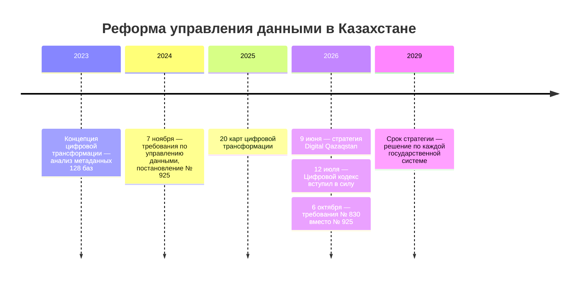

# Казахстан

В Казахстане опись государственных данных закреплена в законе и ведётся самими владельцами. Системы учитывают на архитектурном портале govarch.kz, у реестра систем есть открытая часть, а с октября 2026 года там же ведут каталог цифровых данных из паспортов данных. Куда уходят сведения, видно по открытому каталогу сервисов интеграционной платформы Smart Bridge. Поэтому опись начинают с реестра систем, каталога сервисов и портала data.egov.kz, а анкета уточняет остальное.

Сведения проверены 25 октября 2026 года, если не указано иное.

## Коротко

```mermaid
---
config:
  flowchart:
    wrappingWidth: 320
    nodeSpacing: 20
    rankSpacing: 20
---
flowchart LR
  subgraph OUT["Видно снаружи"]
    direction TB
    A["Акт: adilet.zan.kz"] ~~~ S["Учёт систем: реестр на govarch.kz"] ~~~ E["Обмены: каталог сервисов Smart Bridge"] ~~~ D["Персональные данные: отметка у сервиса"] ~~~ Z["Закупки: zakup.gov.kz"] ~~~ P["Портал: data.egov.kz"]
  end
  subgraph IN["Только внутри"]
    direction TB
    S2["Учёт систем: документация систем"] ~~~ C["Каталог данных: паспорта данных"]
  end
  OUT ~~~ IN
  classDef inside stroke-dasharray: 5 4
  class S2,C inside
```



Пунктирная рамка — сведения, которые видят только организации, заполняющие портал. Те же семь элементов в других странах — на странице [«Шесть стран в сравнении»](./00-overview.md).

## Правовая основа

С 12 июля 2026 года цифровую среду регулирует Цифровой кодекс, и он сменил термины во всём законодательстве. Документы, принятые раньше, ищут и по прежним словам: информационная система — теперь цифровая система, электронный информационный ресурс — цифровой ресурс, объект информатизации — цифровой объект, «электронное правительство» — «цифровое правительство». Закон «Об информатизации» № 418-V теперь называется «О кибербезопасности», норм об учёте систем в нём больше нет.

| Акт простыми словами | Что требует | Что даёт описи |
|----------------------|-------------|----------------|
| **Цифровой кодекс** (2026) | Сведения о цифровых объектах вносят на архитектурный портал; национальные регистры — единственный источник достоверных сведений | Перечень систем владельца и эталон для сведений о людях, организациях, недвижимости |
| **Требования по управлению цифровыми данными** (постановление № 830, 2026) | Каталог цифровых данных из паспортов данных, менеджер по данным в каждой организации | Почти готовую запись реестра для внутренней описи |
| **Закон о доступе к информации** (2015) | Ответ на запрос — за 15 календарных дней | Путь к сведениям, которых нет в открытых источниках |
| **Стратегия Digital Qazaqstan** (до 2029 года) | Инвентаризация и архитектурный аудит государственных систем с решением по каждой | Цель описи: сократить и объединить системы |
| **Концепция цифровой трансформации** (2023–2029) | Управление данными, анализ метаданных баз | Образец описи до полей ([«Пример»](#пример)) |

Номера статей, редакции и постановления о ролях — в приложении [«Нормативная база»](../09-appendices/02-legal-framework.md#казахстан).



## Реестры и платформы

### Где учитывают системы

Сведения о цифровых объектах и документацию к ним вносят и поддерживают сами государственные органы, государственные юридические лица и квазигосударственный сектор — на архитектурном портале цифровых объектов государства (статья 71 Цифрового кодекса). Ведёт портал, судя по контактам на govarch.kz, Центр поддержки цифрового правительства. Без входа на портале видны:

- **реестр систем** — 162 системы центральных государственных органов и 55 — местных исполнительных органов, у каждой — владелец, регистрационный номер, версия и статус;
- **государственные функции** — перечень функций органов в XLSX: от функции идут к системе и данным ([«От полномочия к набору»](../03-process/03-owners-and-mandates.md#от-полномочия-к-набору));
- **оптимизация систем** — сводные документы о системах, которые объединяют, переносят или выводят;
- **карты цифровой трансформации** министерств и **архитектура** — доменная модель, концептуальная модель данных, карта процессов.

Документацию систем и каталог цифровых данных видят только зарегистрированные организации. Для внешней описи реестр систем — список того, о чём спрашивать владельца; для внутренней — основа описи: орган видит свои объекты целиком. Регистрационный номер из реестра идёт в поле «информационная система» записи ([«Расширенный состав»](../03-process/05-registry.md#расширенный-состав)).

Систем в реестре меньше, чем в документах о них: Концепция 2023 года говорит о массивах данных «более чем в 400 информационных системах» государственных органов. Разница — повод проверить, какие системы в реестр не попали: квазигосударственного сектора, выведенные, ещё не зарегистрированные.

### Каталог цифровых данных

Требования по управлению цифровыми данными ввели в государстве то, что книга называет реестром данных ([«Реестр данных»](../03-process/05-registry.md)):

- **каталог цифровых данных** — перечень видов цифровых данных и связей между ними; его ведут на архитектурном портале и обновляют при каждом изменении структуры или источников данных;
- **паспорт цифровых данных** — описание данных одного цифрового объекта; из паспортов складывается каталог. Для новых систем паспорт составляют до ввода в промышленную эксплуатацию;
- **менеджер по данным** в каждой организации согласует паспорта с архитектурно-координационным центром и следит, чтобы базы наполнялись полными и актуальными сведениями;
- **неоцифрованные данные** — бумажные, в электронных таблицах — описывают по отдельной форме;
- **эталонные данные** организации определяют вместе с центром.

Паспорт — готовая запись для внутренней описи, но устроен иначе, чем запись реестра: его единица — система с таблицами и столбцами, а не набор. Форма паспорта — приложение 1 к требованиям:

| Атрибут реестра | В паспорте данных |
|-----------------|-------------------|
| **Организация-владелец** | Есть: наименование организации |
| **Наименование** | Наименование цифрового объекта — системы, а не набора |
| **Описание** | В общей части нет; назначение таблиц и столбцов — в описании структуры |
| **Периодичность обновления** | Есть: периодичность, график и порядок обновления |
| **Режим доступа** | Есть, но два значения: «ограниченный доступ» и «доступ без ограничений» |
| **Условия использования** | Перечень актов о внесении, потреблении данных и доступе к ним |
| **Дата изменения** | Нет; есть дата создания паспорта |
| **Идентификатор, ответственный, контакты, ссылка для выгрузки, формат, дата публикации, отметка о контроле качества** | Нет; качество оценивают по своим критериям |

Сверх 14 атрибутов паспорт даёт то, что книга относит к расширенному составу: источники данных по акту и фактические, пользователей по акту, объект описания (люди, организации, имущество), уровень межведомственного использования, способ ведения — бумажный, электронный или смешанный, — класс данных, жизненный цикл (первоисточник ли данные, как их передают) и структуру до столбцов с отметками мастер-данных (`isMD`) и государственной услуги (`isGosService`). При описи органа паспорта выгружают, сопоставляют с [минимальным составом](../03-process/05-registry.md#минимальный-состав) и дозаполняют пробелы.

Требования действуют для государственных органов, государственных юридических лиц и квазигосударственного сектора, кроме специальных государственных органов, и делают опись постоянной. Метаданные делят на функциональные, технические и операционные. По паспортам строят концептуальную модель данных предметной области и проверяют её каждый месяц, 5-го числа. Качество контролируют по десяти критериям: точность, полнота, взаимосвязанность, сопоставимость, актуальность, уникальность, достоверность, своевременность, ясность и доступность. Если от данных отказываются, меняют сведения в каталоге, а данные архивируют или уничтожают.

**Продукт цифровых данных** — ещё один вид цифровых объектов по кодексу: агрегированный, формализованный результат обработки цифровых данных, пригодный для использования, обмена и оборота. На платформе обмена продукт не должен позволять идентифицировать людей и включает метаданные о составе, структуре, назначении и условиях использования, а перечень продуктов ведут владельцы платформ. Для описи продукты — тоже записи реестра, а перечни на платформах — источник записей.

Каталог нужен в том числе для перечня открытых данных государственных органов, поэтому перечень на data.egov.kz сверяют с каталогом: что из каталога не попало в перечень и почему. Организациям доступ к каталогу бесплатный, а сведения о видах данных, сформированные по общедоступной информации, бесплатно получают граждане и компании. Значит, снаружи о каталоге можно спросить менеджера по данным владельца.

### Каталог сервисов Smart Bridge

Smart Bridge — интеграционная платформа: через её сервисы одна система отдаёт сведения другой — справку о человеке по ИИН, об организации по БИН, о недвижимости. Каталог сервисов на sb.egov.kz открыт без входа. У сервиса видны описание, организация-владелец с БИН и система-владелец, отрасль, протокол, передаёт ли сервис персональные данные, кому доступен — всем или только государственным органам, дата публикации.

Поиск по каталогу 25 октября 2026 года нашёл 3055 опубликованных сервисов 204 организаций — это нижняя граница: каталог отдаёт сервисы по запросу, а не списком. У 652 сервисов отмечены персональные данные, 112 доступны только государственным органам. Больше всего сервисов у Министерства труда и социальной защиты населения — 335 — и Комитета государственных доходов — 325. Схем запросов и контактов в открытой части нет. По сообщению министерства в марте 2026 года, через платформу работают 2953 сервиса — 2091 государственный и 862 негосударственных.

Как использовать:

- **Сервис — след системы и набора.** Если система отдаёт справку о транспортных средствах, в ней есть их реестр. Сервисы владельца сравнивают с его системами на govarch.kz: сервис без системы и система без сервисов — вопросы владельцу.
- **Сервис — не набор.** Он отдаёт сведения по одному запросу, а не базу. Набор записывают отдельно, сервис — как способ доступа со своим режимом: «только государственным органам» — ограничение ([«Условия доступа»](../03-process/06-access.md#условия-доступа)).
- **Отметка о персональных данных** — готовое значение поля реестра; его сверяют с описанием сервиса.

### Национальные регистры

Национальный регистр — единый источник достоверных сведений для государственных функций, услуг и статистики; если сведения в нём есть, государственные системы берут их оттуда (статья 19 Цифрового кодекса). До кодекса ту же роль играли базовые государственные базы данных — о физических лицах, юридических лицах, регистр недвижимости, электронное лицензирование, — и в документах до июля 2026 года регистры ищут под этими названиями. Открытого перечня регистров не найдено: их находят по актам, по реестру систем и по сервисам Smart Bridge — у владельца регистра много сервисов. Копии сведений регистра в других системах записывают со ссылкой на эталон ([«Один набор под разными именами»](../03-process/05-registry.md#один-набор-под-разными-именами)).

### Госзакупки

Технические задания на создание и развитие систем и подрядчиков находят на единой платформе закупок zakup.gov.kz (прежний адрес goszakup.gov.kz перенаправляет на неё), ИТ-закупки — по кодам единого номенклатурного справочника товаров, работ и услуг. Как искать — в главе [«Государственные данные»](../04-sources/02-government.md#госзакупки).

### Платформы

- **Smart Data Ukimet** — аналитическая платформа: собирает данные государственных систем для показателей и проактивных услуг, то есть услуг, которые оказывают без заявления. Вход на sdu.gov.kz — только по учётной записи; какие показатели из каких систем считаются, знает оператор.
- **Национальная платформа ИИ** ai.nitec.kz — ИИ-агенты для государственных органов с доступом к больше чем 120 государственным базам данных (март 2026 года). Перечень баз, к которым подключены модели, — тоже опись: у каждой нужны владелец, режим доступа и отметка о персональных данных ([«ИИ в инвентаризации»](../02-approaches/03-ai.md)).
- **eGov** — 1467 государственных услуг, 90,4% из них онлайн (стратегия, июнь 2026 года): за каждой услугой — системы и сведения, которые она использует.
- **Классификатор цифровых объектов** по статье 20 кодекса: правила его ведения утверждены в августе 2026 года, сам классификатор опубликованным не найден.

## Где искать данные

### Государственные

- **Портал открытых данных** data.egov.kz — 3920 наборов: у центральных органов 1062, у местных исполнительных органов 1167, у квазигосударственного сектора 1691. По каждому издателю видна доля размещённых наборов от утверждённых в перечне и доля актуальных. Портал входит в «Открытое правительство» open.egov.kz вместе с «Открытыми бюджетами» budget.egov.kz и «Открытыми НПА» legalacts.egov.kz.
- **Статистика** — Бюро национальной статистики, stat.gov.kz, и система «Талдау», taldau.stat.gov.kz. Бюро определяет качество административных данных (статья 18 Цифрового кодекса).
- **Формы сбора** — приказы ведомств «Об утверждении форм, предназначенных для сбора административных данных» на adilet.zan.kz: состав, периодичность, кто сдаёт.
- **Национальный банк** — репозиторий открытых данных data.nationalbank.kz: 7 категорий, 31 подкатегория, 239 форм.
- **Геоданные** — геопортал национальной инфраструктуры пространственных данных map.gov.kz: 458 открытых ресурсов.
- **Нормативные акты** — adilet.zan.kz, проекты — legalacts.egov.kz; сайты органов — разделы портала gov.kz.
- **Отрасли** — например, нефть и газ: Министерство энергетики (раздел gov.kz), Комитет геологии geology.gov.kz, KAZENERGY kazenergy.com, «КазМунайГаз» kmg.kz. 6 октября 2026 года министерству поручили до конца года провести цифровую инвентаризацию ключевых объектов отрасли и утвердить требования к отраслевым данным: их будут искать в актах министерства.

Каталог Smart Bridge, data.egov.kz, геопортал и репозиторий Национального банка отдают сведения через программные интерфейсы без ключа. В ответе data.egov.kz у каждого издателя — сколько наборов всего, сколько размещено и сколько актуально: издателей без наборов сравнивают с владельцами в границах описи. Сами данные портал отдаёт только с ключом.

<details>
<summary>Проверить самому</summary>

```bash
# Smart Bridge: сколько организаций и заявок
curl "https://sb.egov.kz/api/v1/public/stats/overall"
# data.egov.kz: наборы по издателям — центральные органы, местные органы, квазигосударственный сектор
curl "https://data.egov.kz/datasets/getstatisticsbycgogovagencies"
curl "https://data.egov.kz/datasets/getstatisticsbymiogovagencies"
curl "https://data.egov.kz/datasets/getstatisticsbyquasiorganizations"
# Геопортал: сколько открытых ресурсов (поле total)
curl "https://map.gov.kz/api/v2/resources?page_size=1"
# Национальный банк: категории репозитория
curl "https://data.nationalbank.kz/api/v1/data/categories"
```

</details>

### Общественные

- **Wikidata** — черновик перечня министерств с сайтами; адреса там устарели, у трёх министерств записаны несуществующие домены ([«Wikidata, Википедия и OpenStreetMap»](../04-sources/03-public.md#wikidata-википедия-и-openstreetmap)).
- **Международные организации** — Всемирный банк, ООН, ВОЗ, ОЭСР; их оценки расходятся с национальными по методике ([«Международные организации»](../04-sources/03-public.md#международные-организации)).
- **Поисковики наборов** находят о Казахстане в основном копии: в Dateno — 14 155 наборов, 7958 из них от международных организаций, а data.egov.kz, stat.gov.kz и «Талдау» в индексе нет ([«По странам»](../04-sources/05-dataset-search.md#по-странам)); в HDX — 124 набора.

### Коммерческие

- **Раскрытие информации** эмитентов — kase.kz; отчётность организаций публичного интереса — депозитарий dfo.kz.
- **Кредитное бюро** 1cb.kz и **операторы фискальных данных**, например oofd.kz: агрегаты, первоисточник которых — у государства.
- **Сервисы проверки контрагентов**, например adata.kz: первоисточники устанавливают сами ([«Коммерческие данные»](../04-sources/04-commercial.md)).
- **Банки, операторы связи, финтех** получают государственные сведения через Smart Bridge — это видно в каталоге сервисов.

## Как провести инвентаризацию

### Чем владеем: опись государственного органа

Порядок шагов и что каждый даёт реестру — на странице [«Шесть стран в сравнении»](./00-overview.md#чем-владеем-общий-порядок). Где их пройти в Казахстане:

| Шаг | Где | Видно снаружи? |
|-----|-----|----------------|
| **1. Полномочия** | Положение об органе на adilet.zan.kz; перечень функций на govarch.kz | ● да |
| **2. Учёт систем** | Реестр на govarch.kz; внутри — объекты органа целиком | ◐ частично |
| **3. Каталог данных** | Паспорта данных на архитектурном портале; менеджер по данным | ○ нет |
| **4. Обмены** | Каталог сервисов Smart Bridge | ● да |
| **5. Персональные данные** | Отметка у сервисов Smart Bridge; описаний обработки в открытом доступе нет | ◐ частично |
| **6. Формы сбора** | Приказы о формах административных данных | ● да |
| **7. Закупки** | zakup.gov.kz | ● да |
| **8. Опубликованное** | Перечень открытых данных и data.egov.kz | ● да |
| **9. Опрос** | Менеджер по данным, владельцы систем, подразделения | — |

Внутри органа шаги 2 и 3 дают почти готовую опись, и главная работа — сверка. Система есть в реестре, а паспорта у неё нет; паспорт есть, а сервисов нет, хотя данные нужны другим; набор есть на data.egov.kz, а его вида данных нет в каталоге. Каждое расхождение записывают и выясняют ([«Как методы проверяют друг друга»](../02-approaches/02-methods.md#как-методы-проверяют-друг-друга)).

### Где найти нужное

Общий порядок — на странице [«Шесть стран в сравнении»](./00-overview.md#где-найти-нужное-общий-порядок). Что в Казахстане иначе:

- **Сначала эталон.** Для сведений о людях, организациях и недвижимости выясняют, есть ли национальный регистр: тогда другие системы держат копии.
- **Где лежит — по реестру и сервисам.** По реестру систем и каталогу Smart Bridge видно, в какой системе нужные сведения и кому они уже отдаются.
- **Запрос** — по закону о доступе к информации, ответ за 15 календарных дней. В запросе называют систему с регистрационным номером, сервис Smart Bridge и вид данных: так ответ «данных нет» становится маловероятным.

## Что особенного

- **Эталон определён законом.** Национальный регистр — единственный источник достоверных сведений, и его ищут первым ([«Как читать полномочия»](../03-process/03-owners-and-mandates.md#как-читать-полномочия)).
- **Качество — у статистики.** Качество административных данных определяет орган государственной статистики, он же по стратегии координирует управление данными методически ([«Рамки и стандарты качества»](../03-process/07-quality.md#рамки-и-стандарты-качества)).
- **У описи есть цель.** Стратегия требует решения по каждой системе — развивать, объединить, перенести или вывести — и не меньше 10 отраслевых хранилищ данных. От этой цели зависит, что описывать подробно ([«Зачем: цели»](../01-basics/03-goals.md)).
- **Реестр становится частью архитектуры.** Портал, интеграционная и аналитическая платформы позволяют вести реестр данных не отдельной таблицей ([«От таблицы до каталога»](../06-tools/01-from-spreadsheet-to-catalog.md)).

## Пример

Концепция цифровой трансформации 2023 года приводит итоги анализа метаданных — таблиц и полей — 128 баз данных 32 государственных органов: 84 523 таблицы и 969 203 поля. У 107 баз из 128 качество метаданных — 90% и больше. Но обследование 2021 года нашло поле «адрес проживания» в 907 полях 177 таблиц 11 баз пяти органов, и какое значение — первоисточник, неизвестно.

Пример показывает три вещи:

- **Метод.** Опись полей баз — это [инвентаризация информационных систем](../02-approaches/02-methods.md#2-инвентаризация-информационных-систем) до уровня полей. Она находит дубли, которых не видно ни в реестре систем, ни на портале.
- **Качество метаданных — не качество данных.** Метаданные описаны хорошо, а какой адрес верный, не знает никто ([«Качество данных»](../03-process/07-quality.md)).
- **Решение — эталон.** Адрес — сведение для национального регистра: одна запись реестра для эталона, остальные 906 полей — копии со ссылкой на него.

## Частые ошибки

| Ошибка | Что происходит | Как исправить |
|--------|----------------|---------------|
| **Поиск только по новым терминам** | Не находятся акты, контракты и отчёты до июля 2026 года | Искать и по «информационной системе», и по «цифровой системе»; прежние названия — в синонимы записи |
| **Сервис Smart Bridge записан как набор** | В реестре сотни «наборов» — справки по одному запросу | Набор — отдельно, сервис — как способ доступа к нему |
| **Копия регистра записана как первоисточник** | Расходятся сведения о людях и организациях | Выяснить, есть ли национальный регистр, и записать связь с ним |

Сквозные ошибки — в главе [«Практики и антипаттерны»](../08-practices/01-practices-and-anti-patterns.md).

## Ограничения

- Открытого перечня национальных регистров и классификатора цифровых объектов на 25 октября 2026 года не найдено.
- Как требования № 830 работают на практике — сколько паспортов составлено, — из открытых источников не видно.
- Цифры о платформах взяты из сообщений министерства, оператора и стратегии на разные даты и с первичной статистикой платформ не сверены. Подсчёт сервисов Smart Bridge по поиску — нижняя граница.
- Системы квазигосударственного сектора в открытой части реестра отдельно не видны.

## Источники

- [Цифровой кодекс Республики Казахстан](https://adilet.zan.kz/rus/docs/K2600000255) от 09.01.2026 № 255-VIII, статьи 16–20, 24, 28, 30, 31, 33, 41, 71, 72, 89, 90, в редакции от 21.10.2026; 25 октября 2026 года сверен по [копии на zakon.uchet.kz](https://zakon.uchet.kz/rus/docs/K2600000255). [В Казахстане вступил в силу Цифровой кодекс](https://www.gov.kz/memleket/entities/maidd/press/news/details/1257769?lang=ru) — Министерство искусственного интеллекта и цифрового развития, 14 июля 2026 года.
- [Закон от 09.01.2026 № 256-VIII](https://adilet.zan.kz/rus/docs/Z2600000256) — поправки в закон № 418-V; [закон «О кибербезопасности»](https://adilet.zan.kz/rus/docs/Z1500000418) от 24.11.2015 № 418-V, редакции от 25.08.2026 и от 24.06.2026; [закон «О доступе к информации»](https://adilet.zan.kz/rus/docs/Z1500000401) от 16.11.2015 № 401-V, статья 11.
- [Постановление Правительства от 22.09.2026 № 830](https://adilet.zan.kz/rus/docs/P2600000830) «Об утверждении требований по управлению цифровыми данными», пункты 2, 6, 8–14, 19, 20, 26, 27, 29, 79–83, приложения 1 и 2 — текст и форма паспорта сверены по adilet.zan.kz 26 октября 2026 года; [Требования по управлению цифровыми данными приняли в Казахстане](https://www.zakon.kz/pravo/6532997-trebovaniya-po-upravleniyu-tsifrovymi-dannymi-prinyali-v-kazakhstane.html) — Zakon.kz, 28 сентября 2026 года; [Как будут вести классификатор цифровых объектов](https://www.zakon.kz/pravo/6528814-kak-budut-vesti-klassifikator-tsifrovykh-obektov-novye-pravila.html) — Zakon.kz, 21 августа 2026 года.
- [Стратегия «Digital Qazaqstan» до 2029 года](https://cdb.kz/sistema/pravovaya-baza/ob-utverzhdenii-obshchenatsionalnoy-strategii-masshtabnoy-tsifrovizatsii-i-totalnogo-vnedreniya-tekh/) — указ Президента от 09.06.2026 № 1311; [сообщение Акорды](https://www.akorda.kz/ru/glavoy-gosudarstva-podpisan-ukaz-ob-utverzhdenii-obshchenacionalnoy-strategii-masshtabnoy-cifrovizacii-i-totalnogo-vnedreniya-tehnologiy-iskusstvennogo-intellekta-digital-qazaqstan-do-2029-goda-952946).
- [Концепция цифровой трансформации на 2023–2029 годы](https://adilet.zan.kz/rus/docs/P2300000269) — постановление Правительства от 28.03.2023 № 269, параграф «Управление данными»; [Утверждены 20 карт цифровой трансформации](https://www.zakon.kz/obshestvo/6494859-utverzhdeny-20-kart-tsifrovoy-transformatsii-kazakhstan-sistematiziruet-perekhod-k-umnomu-upravleniyu.html) — Zakon.kz, 20 октября 2025 года.
- Архитектурный портал, 25 октября 2026 года: реестры систем [центральных органов](https://www.govarch.kz/ru/infosys/iscgo) и [местных исполнительных органов](https://www.govarch.kz/ru/infosys/ismio), [государственные функции](https://www.govarch.kz/ru/gov-functions), [документы по системам](https://www.govarch.kz/ru/is-documents), [карты цифровой трансформации](https://www.govarch.kz/ru/digital-transformation-maps).
- [Каталог сервисов Smart Bridge](https://sb.egov.kz/), [общая статистика](https://sb.egov.kz/api/v1/public/stats/overall) и поиск сервисов `https://sb.egov.kz/api/v1/public/admin-panel/getPassportsBySearch/<слово>`, 25 октября 2026 года; [Smart Bridge: цифровая инфраструктура взаимодействия государства и бизнеса](https://kapital.kz/tehnology/145821/smart-bridge-cifrovaya-infrastruktura-vzaimodejstviya-gosudarstva-i-biznesa.html) — Kapital.kz, 11 марта 2026 года.
- [Национальная платформа ИИ](https://ai.nitec.kz/); [В Казахстане представили национальную платформу ИИ](https://kapital.kz/tehnology/146318/v-kazahstane-predstavili-nacionalnuyu-platformu-ii.html) — Kapital.kz, 27 марта 2026 года.
- [Поручение о цифровой инвентаризации отрасли](https://primeminister.kz/ru/news/v-pravitelstve-rassmotreli-ispolnenie-porucheniy-prezidenta-po-realizacii-meropriyatiy-strategii-digital-qazaqstan-31961) — primeminister.kz, 6 октября 2026 года.
- Открытые данные, 25 октября 2026 года: [data.egov.kz](https://data.egov.kz/), [репозиторий Национального банка](https://data.nationalbank.kz/), [геопортал](https://map.gov.kz/), [«Открытое правительство»](https://open.egov.kz/).
- Главы [«Государственные данные»](../04-sources/02-government.md), [«Общественные данные»](../04-sources/03-public.md), [«Поиск наборов данных»](../04-sources/05-dataset-search.md); приложение [«Нормативная база»](../09-appendices/02-legal-framework.md#казахстан).
- Как проверяли. Адреса — 23–25 октября 2026 года. 25 октября из сети проверки не открылись adilet.zan.kz, law.gov.kz, mfa.gov.kz, geology.gov.kz и ecogeo.gov.kz, тексты актов сверены по zakon.uchet.kz; 26 октября adilet.zan.kz открылся. У energo.gov.kz нет адреса: сайт министерства — на gov.kz. Государственные сайты Казахстана проверяют из казахстанской сети.
