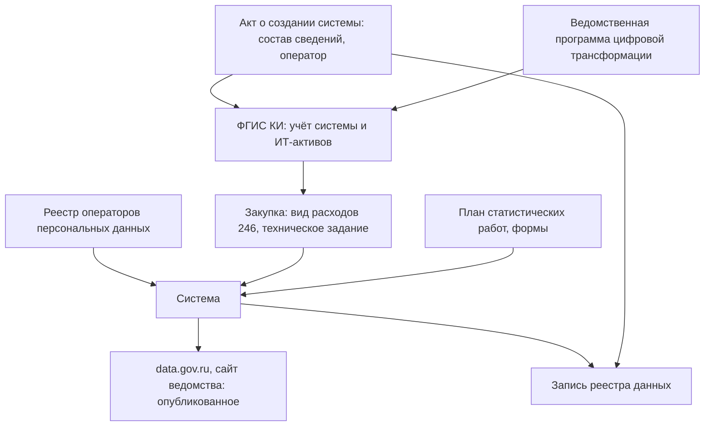

# Россия

В России учёт государственных информационных систем централизован: его ведут в федеральной государственной информационной системе координации информатизации (ФГИС КИ), но для внешнего исследователя он закрыт. С 1 сентября 2026 года закон № 149-ФЗ в редакции закона № 568-ФЗ различает федеральные и региональные государственные системы и «иные информационные системы государственных органов» — системы для обеспечения собственной деятельности органа, которые не являются государственными. Их тоже учитывают в ФГИС КИ, а эксплуатировать систему без учёта нельзя. С 2025 года федеральные органы учитывают там же свои ИТ-активы. Планы информатизации отменены в 2020 году и заменены ведомственными программами цифровой трансформации, а с 1 сентября 2027 года технологической платформой по закону станет «Гостех». Поэтому снаружи систему находят по следам в открытых источниках: в закупках — контракт остаётся самым подробным открытым документом о системе, — в реестре операторов персональных данных, в федеральном плане статистических работ, в нормативных актах и на сайтах ведомств. Многие государственные сайты не открываются из-за рубежа, и адреса проверяют из российской сети.

В индексе развития электронного правительства ООН Россия в 2024 году заняла 43-е место, в 2022-м — 42-е; обзор 2026 года на 25 октября 2026 года не вышел. Сведения главы проверены 23–25 октября 2026 года, если не сказано иное. Из сети проверки большинство российских государственных сайтов не открылось, и тексты актов сверены по сайту Президента России kremlin.ru, системам «Гарант» и «КонсультантПлюс» и по legalacts.ru. Подробности об актах — в приложении [«Нормативная база»](../09-appendices/02-legal-framework.md#россия).

## Коротко

| Что ищут | Где | Что даёт | Чего не даёт |
|----------|-----|----------|--------------|
| **[Полномочия и акты](#правовая-основа)** | pravo.gov.ru, kremlin.ru, справочные правовые системы; законопроекты — sozd.duma.gov.ru | Положения о ведомствах, акты о создании систем с составом сведений и оператором | Что на самом деле лежит в системе |
| **[Учёт систем](#фгис-ки)** | ФГИС КИ, gis.gov.ru | Государственные и иные системы органов, ИТ-активы, ведомственные программы цифровой трансформации | Внешнему пользователю на практике недоступна |
| **[Описания систем с персональными данными](#реестр-операторов-персональных-данных)** | Реестр операторов персональных данных Роскомнадзора, pd.rkn.gov.ru | Цели обработки, категории данных и субъектов, основания, где находится база | Системы без сведений о людях |
| **[Метаданные государственных данных](#нсуд)** | ЕИП НСУД: реестр информационных ресурсов, модель государственных данных, реестр видов сведений | Описание состава и обладателей государственных данных | Открытой части не найдено |
| **Формы сбора** | Федеральный план статистических работ | Кто какую статистическую информацию формирует, как часто и к какому сроку | Записи и где лежат ответы |
| **[Опубликованное](#где-искать-данные)** | data.gov.ru, открытые данные Росстата, ЕМИСС fedstat.ru | Наборы и показатели | Свежесть: многие наборы опубликованы давно и не обновлялись |
| **[Закупки и расходы](#расходы-на-ит-в-госзакупках)** | zakupki.gov.ru; виды расходов 242 и 246, коды ОКПД2 | Технические задания, состав данных, подрядчики, история модернизаций | Системы, созданные без закупок |

## Правовая основа

С 1 сентября 2026 года действует закон от 29.12.2025 № 568-ФЗ. Он изменил прежде всего статью 13 закона № 149-ФЗ о видах информационных систем, а статью 14 о государственных системах — в частностях. Для инвентаризации важно, что изменилось:

| Что | С 1 сентября 2026 года | Что значит для инвентаризации |
|-----|------------------------|-------------------------------|
| **Государственные системы** (статья 13, часть 1) | Федеральные — на основании федеральных законов, актов Президента и Правительства; требования к актам Правительства о них устанавливает Правительство (постановление от 09.06.2026 № 712). Региональные — на основании законов и актов субъектов федерации | Основание системы ищут среди актов этого уровня и записывают в поле «нормативный акт» |
| **Иные информационные системы государственных органов** (статья 13, части 1.1 и 1.2) | Системы для организационного, информационного, документационного, финансового и технического обеспечения деятельности органа. Не являются государственными, создаются правовыми актами самих органов. Требования к ним — постановление от 13.08.2026 № 1007 | Тоже записи реестра: в них лежат кадровые, финансовые, документационные данные органа. Их статус — не «ГИС», но учёт в ФГИС КИ обязателен |
| **Оператор** (статья 14, часть 5) | Если иное не установлено, оператор — заказчик создания системы | Владелец данных и оператор системы по-прежнему могут быть разными лицами ([«Владелец, оператор, ответственный»](../03-process/03-owners-and-mandates.md#владелец-оператор-ответственный)) |
| **Удалённые средства** (статья 13, часть 5.1) | Государственные и иные системы могут использовать программы, базы данных и технические средства по сети; правила — постановление от 18.08.2026 № 1024, компоненты — на территории России | Место хранения данных — у поставщика облачной инфраструктуры; его записывают рядом с оператором |

Акты, важные для инвентаризации:

- **Закон № 149-ФЗ** «Об информации, информационных технологиях и о защите информации» от 27.07.2006 — статьи 13 и 14 в редакции закона № 568-ФЗ; часть 4 статьи 8 — информация, доступ к которой нельзя ограничить; статья 9 — ограничение доступа только федеральным законом ([«Доступ и ограничения»](../03-process/06-access.md#что-закрыть-нельзя)).
- **Постановление от 06.07.2015 № 676** — требования к созданию, развитию, вводу в эксплуатацию, эксплуатации и выводу из эксплуатации государственных систем и к хранению данных из них; изменено постановлением от 01.07.2026 № 813 с 1 сентября 2026 года. При выводе системы правовой акт определяет порядок, сроки и режим хранения её ресурсов ([«Исчезнувшие системы и веб-архивы»](../04-sources/06-legacy.md#где-искать-преемника)).
- **Постановление от 13.08.2026 № 1007** — требования к созданию и эксплуатации иных информационных систем государственных органов, в силе с 1 сентября 2026 года. Стандарты для систем по «фасетам» — группам классификационных признаков — публикуют на портале ФГИС КИ; эксплуатировать систему без учёта в ФГИС КИ не допускается (пункт 20).
- **Постановление от 14.11.2015 № 1235** — положение о ФГИС КИ, изменено в том числе постановлениями от 04.07.2026 № 845 и от 16.09.2026 № 1172.
- **Постановление от 01.07.2024 № 900** — порядок учёта ИТ-активов в ФГИС КИ: реестр событий с ИТ-активами и реестр ИТ-активов. Федеральные органы исполнительной власти и органы управления внебюджетными фондами ведут учёт с 1 января 2025 года; прежний учёт систем по постановлению № 644 2012 года отменён.
- **Постановление от 10.10.2020 № 1646** — положение о ведомственных программах цифровой трансформации, с 2025 года — и о реестре расходов на ИТ; последнее изменение — постановлением от 17.12.2025 № 2047, с 3 января 2026 года. Отменило постановление № 365 о планах информатизации, которое утратило силу с 14 октября 2020 года.
- **Закон от 10.06.2026 № 166-ФЗ** «О технологической платформе создания, развития и эксплуатации информационных систем» — вступит в силу 1 сентября 2027 года; с этого дня технологической платформой по закону станет единая цифровая платформа «Гостех» (часть 2 статьи 7).
- **Постановление от 14.05.2021 № 733** — положение о единой информационной платформе национальной системы управления данными (ЕИП НСУД), в редакции от 17.12.2025 ([«НСУД»](#нсуд)).
- **Закон № 152-ФЗ** «О персональных данных» — статья 22 о реестре операторов; статья 13.1 о составах персональных данных, полученных в результате обезличивания, введена законом от 08.08.2024 № 233-ФЗ и действует с 1 сентября 2025 года. Государственной системой для них назначена ЕИП НСУД (постановление от 28.05.2025 № 740).
- **Закон № 8-ФЗ** «Об обеспечении доступа к информации о деятельности государственных органов и органов местного самоуправления» — запрос информации, ответ за 30 дней, отсрочка не больше чем на 15 дней (статья 18) ([«Вопрос чужому владельцу»](../03-process/04-questionnaires.md#вопрос-чужому-владельцу)).
- **Распоряжение от 06.05.2008 № 671-р** — Федеральный план статистических работ, в редакции от 02.10.2026 ([«Статистика и формы сбора сведений»](../04-sources/02-government.md#статистика-и-формы-сбора-сведений)).
- **Закон о государственной тайне** № 5485-1 и законы о тайнах — основания ограничения доступа.

## Реестры и платформы

### ФГИС КИ

Федеральная государственная информационная система координации информатизации — главное место учёта систем. Заказчик и оператор — Минцифры России. В ФГИС КИ учитывают государственные и иные информационные системы и ИТ-активы, в ней разрабатывают, согласуют и отслеживают ведомственные и региональные программы цифровой трансформации. Общедоступную информацию система по положению распространяет, в том числе в форме открытых данных.

На практике снаружи учёт не виден:

- доступ — по адресу gis.gov.ru (пункт 18 положения), вход для уполномоченных лиц — через ЕСИА;
- 25 октября 2026 года gis.gov.ru перенаправлял на страницу входа login.gis.gov.ru, в адресе которой клиент — help.eskigov.ru, и отвечал ошибкой 403; прежний портал portal.eskigov.ru отвечал 403, а 23 октября — 404. В Internet Archive портал portal.eskigov.ru открывался до февраля 2024 года;
- открытых данных из системы найти не удалось.

Сколько систем в учёте сейчас, открыто не публикуется. В октябре 2018 года в системе были сведения о 341 ФГИС 79 федеральных органов власти. В конце 2024 года аппарат вице-премьера называл больше 4000 государственных систем — федеральных и региональных. Счётная палата в 2022 году насчитала у 67 органов 1142 системы, из них 630 ФГИС, а 62% систем не имели статуса государственной.

Для внешней инвентаризации из этого следуют два правила. Число систем из ФГИС КИ без даты и источника не используют. Систему ищут по следам: закупкам, реестру операторов персональных данных, актам о создании, сайтам и поддоменам ([«Государственные данные»](../04-sources/02-government.md#как-использовать-при-инвентаризации)). Внутри ведомства ФГИС КИ — основа описи «чем владеем»: в ней лежат учётные сведения о его системах и ИТ-активах.

### Иные системы и ИТ-активы

С 1 сентября 2026 года у государственного органа два вида систем — государственные и иные. Иные — системы документооборота, кадров, бухгалтерии, внутренние порталы — раньше часто вообще не попадали в инвентаризацию данных, хотя в них лежат сведения, о которых спрашивают: кто работает в органе, как исполняются поручения, сколько тратится. Теперь у каждой такой системы есть акт органа и запись в ФГИС КИ. Для реестра данных это значит:

- **Тип записи** — «иная информационная система государственного органа», а не ГИС: от статуса зависят требования, но не то, что данные надо описать ([«Что считать записью»](../03-process/05-registry.md#что-считать-записью)).
- **Основание** — правовой акт самого органа, а не федеральный закон или постановление Правительства.
- **Сверка** — системы органа из ФГИС КИ сравнивают с наборами в его реестре: система без наборов — пробел описи.

### Ведомственные программы цифровой трансформации

Программа показывает, какие системы ведомство создаёт, развивает и выводит, с расходами и показателями. Утверждённую программу размещают на портале ФГИС КИ в течение трёх рабочих дней (пункт 26 положения о программах), а часть ведомств публикует их и приказами — например, программу Федерального казначейства утвердили приказом от 09.01.2023 № 2. Для инвентаризации программа — список систем ведомства на три года и подсказка о преемниках: какую систему заменяют и чем.

### НСУД

Национальная система управления данными (НСУД) строится с 2019 года — концепция утверждена распоряжением от 03.06.2019 № 1189-р. Её ядро — федеральная государственная система ЕИП НСУД, оператор — Минцифры России. В положении о ней (постановление № 733) есть почти все понятия инвентаризации данных:

| Понятие в постановлении № 733 | Что это | Что в книге |
|-------------------------------|---------|-------------|
| **Реестр информационных ресурсов** | Сведения об информационных ресурсах и системах органов и организаций государственного сектора | Реестр данных и учёт систем ([«Реестр данных»](../03-process/05-registry.md)) |
| **Модель государственных данных** | Описание состава, структуры и взаимосвязи государственных данных и их обладателей | Схема данных и владельцы |
| **Реестр видов сведений** | Перечень видов сведений межведомственного электронного взаимодействия | Сервисы, через которые система отдаёт данные |
| **Витрина данных** | Компонент системы, который загружает, хранит и отдаёт государственные данные другим органам | Способ доступа к набору |
| **Карта данных** | Совокупность уникальных ключей для сопоставления сведений витрин разных систем | Не то, что карта данных в книге: здесь — ключи для связи записей, а не карта источников ([«Карты данных»](../02-approaches/04-data-maps.md)) |

В составе ЕИП НСУД — подсистема ведения метаданных и управления справочниками и реестрами, портал управления данными, подсистема обработки обезличенных данных; с 15 декабря 2025 года через неё оценивают и качество данных (приказ Минцифры от 16.06.2025 № 533). Открытой части с реестром информационных ресурсов или моделью данных найти не удалось. Внутри государства ЕИП НСУД — готовый источник для описи: в ней описаны данные, которые органы отдают через витрины. Снаружи о ней спрашивают обладателя данных.

### Реестр операторов персональных данных

Реестр Роскомнадзора на pd.rkn.gov.ru общедоступен, кроме сведений о средствах защиты (статья 22 закона № 152-ФЗ). У оператора видны цели обработки, для каждой цели — категории данных и субъектов и правовое основание, где находится база данных, кто по договору обрабатывает данные в государственных и муниципальных системах. По копии в Internet Archive от 12 октября 2026 года в реестре были сведения о 2 657 308 операторах. Для государственного органа это описание его систем со сведениями о людях — то, чего нет в открытой части ФГИС КИ ([«Описания систем с персональными данными»](../04-sources/02-government.md#описания-систем-с-персональными-данными)). Набор открытых данных реестра в Internet Archive последний раз сохранён 1 апреля 2023 года; есть ли он сейчас, из сети проверки установить не удалось.

### Региональные реестры

Региональные реестры государственных систем есть в ряде субъектов федерации. Из примеров 2018–2019 годов реестр Камчатского края исчез вместе с доменом, а у реестра Санкт-Петербурга прежний адрес отвечает ошибкой 404. Региональные программы цифровой трансформации согласуют и отслеживают в ФГИС КИ, как и ведомственные.

### Сводка

| Что | Состояние на октябрь 2026 года |
|-----|-------------------------------|
| **ФГИС КИ** | Учёт государственных и иных систем, ИТ-активов и программ цифровой трансформации; gis.gov.ru — вход для уполномоченных лиц, из сети проверки — ошибка 403 |
| **ЕИП НСУД** | Реестр информационных ресурсов, модель государственных данных, витрины, обезличенные данные; открытой части не найдено |
| **«Гостех»** | Единая цифровая платформа — положение утверждено постановлением от 16.12.2022 № 2338; с 1 сентября 2027 года — технологическая платформа по закону № 166-ФЗ |
| **Реестр операторов персональных данных** | Открыт; 2 657 308 операторов по копии от 12 октября 2026 года |
| **Портал открытых данных** data.gov.ru | Оператор — Минэкономразвития России. Закрыт в марте 2023 года для переноса на «Гостех», вновь открыт 15 июля 2025 года с 5826 наборами, 84% из них впервые опубликованы в 2019 году или раньше. По копии ответа программного интерфейса портала в Internet Archive от 10 октября 2026 года — 7008 опубликованных наборов |
| **Статистика** | Росстат, rosstat.gov.ru: 1609 массивов открытых данных по копии от 23 сентября 2026 года. ЕМИСС, fedstat.ru: 8861 показатель 61 ведомства по копии от 8 декабря 2025 года. ЕМИСС заменит государственная система «Цифровая аналитическая платформа» Росстата (постановление от 02.08.2025 № 1163); публиковать данные на её сайте по правилам постановления от 20.06.2026 № 763 начнут с 1 января 2028 года — срок перенесён постановлением от 23.09.2026 № 1219 |
| **Госзакупки** | Единая информационная система в сфере закупок zakupki.gov.ru; общественный проект «Госзатраты» clearspending.ru |
| **Нормативные акты** | Официальный портал pravo.gov.ru, сайт Президента kremlin.ru; законопроекты — система обеспечения законодательной деятельности Госдумы sozd.duma.gov.ru |

## Расходы на ИТ в госзакупках

В бюджетной классификации на 2026 год расходы на ИТ разделены на два вида: 242 «Закупка товаров, работ, услуг в сфере информационно-коммуникационных технологий» — все ИТ-расходы, кроме государственных систем, и 246 «Закупка товаров, работ, услуг в целях создания, развития, эксплуатации и вывода из эксплуатации государственных информационных систем». Порядок применения классификации — приказ Минфина от 24.05.2022 № 82н. Вид 246 сразу выделяет контракты на государственные системы, но коды ставят неаккуратно: по наблюдениям 2018–2019 годов большая часть ИТ-расходов шла по виду 244 «Прочая закупка». Поэтому ИТ-контракты ищут и косвенно: по контрактам с ИТ-компаниями, по кодам ОКПД2 (например, 62.01.11 — услуги по проектированию и разработке информационных технологий для прикладных задач), по полному и прежним названиям системы.

Контракт на систему — самый подробный открытый документ о ней: техническое задание описывает данные, которые система должна хранить, интеграции и перенос данных из прежней системы, а акты — что сделано ([«Госзакупки»](../04-sources/02-government.md#госзакупки)).

## Где искать данные

### Государственные

- **Портал открытых данных** data.gov.ru — опубликованное, но не всё и не свежее: дату изменения смотрят у каждого набора ([«Порталы открытых данных»](../04-sources/02-government.md#порталы-открытых-данных)).
- **Статистика** — Росстат и ЕМИСС; Федеральный план статистических работ показывает, кто из 54 субъектов официального статистического учёта какую информацию формирует.
- **Регистры** — например, ЕГРЮЛ на egrul.nalog.ru и открытые данные ФНС России на nalog.gov.ru.
- **Бюджет и закупки** — zakupki.gov.ru, единый портал бюджетной системы budget.gov.ru.
- **Сайты органов власти и домены.** Ведомства переезжают на домены gov.ru: nalog.ru перенаправляет на nalog.gov.ru. Поддомены при переезде проверяют отдельно: перенаправление главного сайта не значит, что за ним переехали сервисы ([«Что случилось с адресом»](../04-sources/06-legacy.md#что-случилось-с-адресом)). Списки государственных доменов — например, [реестр государственных доменов](https://github.com/infoculture/govdomains/) «Информационной культуры».
- **Подведомственные учреждения, унитарные предприятия, госкорпорации** — у них много данных, но их системы часто вне закона № 149-ФЗ и регулируются внутренними регламентами; доступ к данным обычно закрыт или платный.

### Общественные

- **«Госзатраты»** clearspending.ru — контракты из zakupki.gov.ru, собранные заново; 25 октября 2026 года сайт открылся, когда первоисточник из сети проверки не ответил ([«Общественные данные»](../04-sources/03-public.md)).
- **Национальный цифровой архив** ruarxive.org — копии исчезнувших государственных сайтов и данных, в том числе data.gov.ru на начало 2022 года ([«Исчезнувшие системы и веб-архивы»](../04-sources/06-legacy.md)).
- **Хаб открытых данных** и Wikidata; поисковики по наборам данных видят российские национальные каталоги плохо: data.gov.ru, открытых данных Росстата и ЕМИСС в индексе Dateno нет ([«По странам»](../04-sources/05-dataset-search.md#по-странам)).

### Коммерческие

- **Раскрытие информации** эмитентов — e-disclosure.ru «Интерфакса», Московская биржа.
- **Регулируемые отрасли** — банки, операторы фискальных данных, удостоверяющие центры, платёжные системы, бюро кредитных историй: их данные — копии того, что они передают государству, или агрегаты.
- **Отраслевые сервисы** — например, справочник лекарств rlsnet.ru ([«Коммерческие данные»](../04-sources/04-commercial.md)).

25 октября 2026 года из сети проверки открылись clearspending.ru, nalog.gov.ru, ruarxive.org и github.com/infoculture/govdomains; egrul.nalog.ru перенаправлял на свою главную страницу; e-disclosure.ru и fedstat.ru ответили ошибкой 403; data.gov.ru, rosstat.gov.ru, zakupki.gov.ru, pravo.gov.ru, sozd.duma.gov.ru, minzdrav.gov.ru, pd.rkn.gov.ru и budget.gov.ru не ответили.

## Как провести инвентаризацию

### Чем владеем: опись федерального органа

| Шаг | Где | Что даёт реестру |
|-----|-----|------------------|
| **1. Полномочия** | Положение о ведомстве; указ о структуре федеральных органов | Какие данные орган обязан вести ([«Где искать полномочия»](../03-process/03-owners-and-mandates.md#где-искать-полномочия)) |
| **2. Системы и ИТ-активы** | Сведения органа в ФГИС КИ — государственные и иные системы | Перечень систем с актами о создании, операторами, статусом |
| **3. Программа цифровой трансформации** | ВПЦТ на портале ФГИС КИ | Что создают, развивают и выводят; преемники |
| **4. Данные для обмена** | Витрины и виды сведений в ЕИП НСУД и СМЭВ | Что системы отдают другим органам |
| **5. Персональные данные** | Уведомление органа в реестре Роскомнадзора | Цели, категории, основания, место базы |
| **6. Формы сбора** | Федеральный план статистических работ, приказы о формах | Периодичность, состав сведений |
| **7. Закупки** | zakupki.gov.ru, виды расходов 242 и 246 | Состав данных из технических заданий, подрядчики |
| **8. Опубликованное** | data.gov.ru, сайт и поддомены ведомства | Ссылки, форматы, даты |
| **9. Опрос** | Подразделения и операторы систем | Таблицы вне систем, копии, качество ([«Опросные листы и интервью»](../03-process/04-questionnaires.md)) |

Учётные сведения ФГИС КИ — о системах и активах, а не о данных: состав данных в них описан не всегда. Поэтому шаги 4–7 нужны и внутри ведомства. Расхождения — находки: система есть в ФГИС КИ, а в уведомлении об обработке персональных данных её нет; закупка на систему есть, а в учёте её нет; иная система ведёт данные, которые положение о ведомстве относит к государственным функциям.

### Где найти нужное

1. **Опубликованное** — data.gov.ru, Росстат, ЕМИСС, открытые данные ведомств, [поиск наборов](../04-sources/05-dataset-search.md).
2. **Кто собирает** — Федеральный план статистических работ, положения о ведомствах.
3. **Где лежит** — реестр операторов персональных данных, закупки по названию системы и заказчику, акты о создании систем, поддомены сайта ([«Сайты и домены»](../04-sources/02-government.md#сайты-и-домены)).
4. **Запрос владельцу** — по закону № 8-ФЗ, ответ за 30 дней. В запросе называют систему, акт о ней и контракт.
5. **Если закрыто** — копии у общественных проектов и в архивах, коммерческие источники, с пометкой, что первоисточник закрыт ([«Три слоя данных»](../04-sources/01-three-layers.md)).

## Что особенного

- **Учёт есть, но закрыт.** Сведения о системах государство собирает централизованно и подробно, но внешняя инвентаризация видит их только по следам. Открытое описание систем — реестр операторов персональных данных и закупки.
- **Не все системы органа — государственные.** С 1 сентября 2026 года системы обеспечения деятельности — «иные». В реестре данных они нужны не меньше: статус системы определяет требования к ней, а не то, есть ли в ней данные.
- **Понятия НСУД совпадают с инвентаризацией.** Реестр информационных ресурсов и модель государственных данных — то же, что реестр данных и схема в этой книге, но «карта данных» в НСУД означает другое.
- **Закупки — главный открытый источник о системах.** Вид расходов 246 выделяет государственные системы, а техническое задание описывает их данные.
- **Опубликованное устаревает.** Портал открытых данных не работал больше двух лет, а после перезапуска 84% его наборов были впервые опубликованы в 2019 году или раньше ([«Пример: data.gov.ru»](../04-sources/06-legacy.md#пример-datagovru)).

## Частые ошибки

| Ошибка | Что происходит | Как исправить |
|--------|----------------|---------------|
| **В реестр — только ГИС** | Пропадают системы документооборота, кадров, финансов, внутренние порталы | Описывать и иные информационные системы органа: с 1 сентября 2026 года их учитывают в ФГИС КИ |
| **Число систем без даты и источника** | В отчёте — цифра 2018 года как сегодняшняя | Указывать дату и источник: 341 ФГИС в октябре 2018 года, больше 4000 систем в конце 2024 года |
| **Ссылка на планы информатизации** | В реестре — отменённое постановление № 365 | Ведомственные программы цифровой трансформации по постановлению № 1646 ([чек-лист](../09-appendices/04-checklists.md#перед-ссылкой-на-нормативный-акт)) |
| **Поиск ИТ-контрактов только по виду расходов** | Пропадают контракты, проведённые по виду 244 | Искать и по ОКПД2, названию системы, заказчику и подрядчику |
| **«Карта данных» НСУД принята за карту данных книги** | Ключи сопоставления записей принимают за перечень источников | Различать: в НСУД — ключи, в книге — вопросы и источники |
| **Сайт проверен из-за рубежа** | «Сайт не работает», хотя он закрыт только для зарубежных адресов | Проверять из российской сети и записывать сеть проверки |

## Ограничения

- ФГИС КИ, ЕИП НСУД и реестр видов сведений СМЭВ снаружи недоступны; о составе учёта в них судят по положениям и сообщениям, а не по самим сведениям.
- Из сети проверки не открылись data.gov.ru, rosstat.gov.ru, zakupki.gov.ru, pravo.gov.ru, pd.rkn.gov.ru и budget.gov.ru; часть цифр взята из копий страниц в Internet Archive с их датами.
- Число государственных систем открыто не публикуется; цифры 2018, 2022 и 2024 годов получены разными способами и не сравнимы.
- Акты о создании систем и программы цифровой трансформации показывают, что задумано, а не что работает.

## Источники

- [Russian Federation — E-Government Development Index](https://publicadministration.un.org/egovkb/en-us/Data/Country-Information/id/141-Russian-Federation) — UN E-Government Knowledgebase: 43-е место в 2024 году, 42-е в 2022-м; 25 октября 2026 года.
- Федеральный закон от 27.07.2006 № 149-ФЗ; закон от 29.12.2025 № 568-ФЗ, статьи 1 и 2: [текст на сайте Президента России](http://kremlin.ru/acts/bank/52812); опубликован в «Российской газете» 12 января 2026 года.
- Постановления Правительства, 25 октября 2026 года: [от 13.08.2026 № 1007](https://legalacts.ru/doc/postanovlenie-pravitelstva-rf-ot-13082026-n-1007-ob-utverzhdenii/), пункты 2–4 и 20; [от 01.07.2024 № 900](https://legalacts.ru/doc/postanovlenie-pravitelstva-rf-ot-01072024-n-900-o-porjadke/); [от 14.11.2015 № 1235](https://base.garant.ru/71252176/), пункты 4, 16–20 положения; [от 10.10.2020 № 1646](https://base.garant.ru/74749576/) в редакции постановления от 17.12.2025 № 2047; [от 06.07.2015 № 676](https://base.garant.ru/71120998/) с изменениями постановления от 01.07.2026 № 813; [от 14.05.2021 № 733](https://legalacts.ru/doc/postanovlenie-pravitelstva-rf-ot-14052021-n-733-ob-utverzhdenii/) в редакции от 17.12.2025; [от 16.12.2022 № 2338](https://base.garant.ru/405980325/) — положение о «Гостехе»; [от 09.06.2026 № 712](https://ppt.ru/obzory/vstupaet-v-silu/postanovlenie-pravitelstva-rf-09-06-2026-712) и [от 18.08.2026 № 1024](https://ppt.ru/obzory/vstupaet-v-silu/postanovlenie-pravitelstva-rf-18-08-2026-1024) — обзоры ppt.ru.
- Постановление № 365: [«Гарант»](https://base.garant.ru/198333/) — отметка об утрате силы; [постановление № 1646](https://legalacts.ru/doc/postanovlenie-pravitelstva-rf-ot-10102020-n-1646-o-merakh/) на legalacts.ru.
- [Федеральный закон от 10.06.2026 № 166-ФЗ](http://kremlin.ru/acts/bank/53300) «О технологической платформе создания, развития и эксплуатации информационных систем», статья 7.
- [Федеральный закон от 08.08.2024 № 233-ФЗ](http://kremlin.ru/acts/bank/50967) — статья 13.1 закона № 152-ФЗ; распоряжение от 03.06.2019 № 1189-р — [концепция НСУД](https://legalacts.ru/doc/rasporjazhenie-pravitelstva-rf-ot-03062019-n-1189-r-ob-utverzhdenii/).
- Федеральный закон от 09.02.2009 № 8-ФЗ, [статья 18](https://www.consultant.ru/document/cons_doc_LAW_84602/bc8f145b9b0cf81ba35eefedf48e421cf362e0a5/), часть 6, в редакции от 31.07.2025.
- Виды расходов на 2026 год — [242](https://its.1c.ru/db/content/budcosts/src/2026/242.htm) и [246](https://its.1c.ru/db/content/budcosts/src/2026/246.htm), справочник 1С.
- Число систем: [Правительство РФ выбрало приоритетные ГИС](https://www.comnews.ru/content/237358/2025-01-24/2025-w04/1008/pravitelstvo-rf-vybralo-prioritetnye-gis) — ComNews, 24 января 2025 года; [Риски ГИСов: Счётная палата оценила цифровые системы госорганов](https://profile.ru/scitech/riski-gisov-schetnaya-palata-ocenila-cifrovye-sistemy-gosorganov-1151723/) — «Профиль», 30 августа 2022 года.
- Портал открытых данных и статистика: [Минэкономразвития готовит перезапуск портала data.gov.ru](https://ppt.ru/news/tsifrovye-servisy/minekonomrazvitiya-gotovit-perezapusk-portala-data-gov-ru) — ppt.ru, июль 2025 года; [о закрытии портала](https://www.kommersant.ru/doc/5889649) — «Коммерсантъ», 24 марта 2023 года; [о замене ЕМИСС цифровой аналитической платформой](https://www.kommersant.ru/doc/7941315) — «Коммерсантъ», 5 августа 2025 года; копии data.gov.ru, rosstat.gov.ru/opendata, fedstat.ru и pd.rkn.gov.ru в Internet Archive — с датами в тексте.
- Бегтин И. Каталоги данных — глава [«Жизненный цикл каталога»](https://github.com/ivbeg/data-catalogs-book/blob/main/docs/09-practices/03-lifecycle.md) о data.gov.ru.
- Отчёт о сверке фактов прежней версии книги — [archive/AUDIT-2026-10-23.md](https://github.com/ivbeg/data-inventory/blob/main/archive/AUDIT-2026-10-23.md).
- Проверка адресов — 23 и 25 октября 2026 года.
