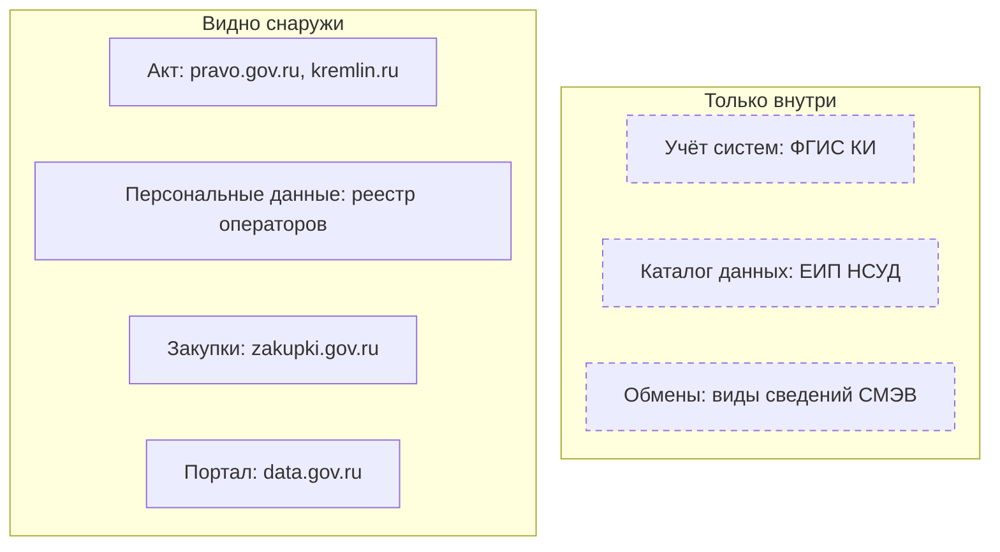
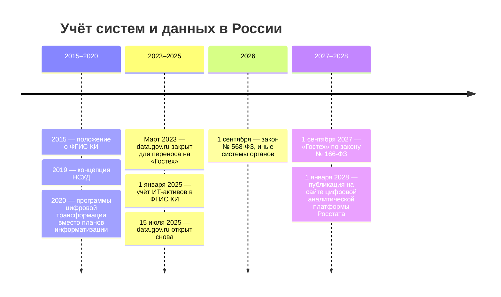

# Россия

В России учёт государственных информационных систем централизован, но для внешнего исследователя закрыт. Поэтому снаружи систему находят по следам: по акту о создании, закупке, уведомлению в реестре операторов персональных данных и опубликованным наборам. Самый подробный открытый документ о системе — контракт на её создание или развитие. Многие государственные сайты закрыты для зарубежных адресов, и их проверяют из российской сети.

Сведения проверены 23–25 октября 2026 года, если не указано иное.

Сокращения главы: ГИС — государственная информационная система, ФГИС — федеральная государственная информационная система, ФГИС КИ — федеральная государственная информационная система координации информатизации, НСУД — национальная система управления данными, ЕСИА — единая система идентификации и аутентификации (вход в государственные системы и на портал госуслуг), СМЭВ — система межведомственного электронного взаимодействия, по которой органы обмениваются сведениями.

## Коротко

Пунктирная рамка — сведения, которые видят только уполномоченные лица государственных органов. Те же семь элементов в других странах — на странице [«Двенадцать стран в сравнении»](./00-overview.md).

## Правовая основа

| Акт простыми словами | Что требует | Что даёт описи |
|----------------------|-------------|----------------|
| **Закон об информации № 149-ФЗ** в редакции 2026 года | Различает федеральные и региональные государственные системы и «иные» системы органов; иные тоже учитывают в ФГИС КИ | В описи — все системы органа, включая кадровые и документооборот |
| **Положение о ФГИС КИ и порядок учёта ИТ-активов** (2015, 2024) | Учёт систем, ИТ-активов и программ цифровой трансформации у Минцифры России | Основа внутренней описи федерального органа |
| **Положение о ведомственных программах цифровой трансформации** (2020) | Программы вместо отменённых планов информатизации | Список систем на три года и их преемников |
| **Положение о ЕИП НСУД** (2021) | Реестр информационных ресурсов, модель государственных данных, витрины | Описание данных, которые органы отдают друг другу |
| **Закон о персональных данных № 152-ФЗ** | Общедоступный реестр операторов | Открытое описание систем со сведениями о людях |
| **Закон о доступе к информации о деятельности госорганов № 8-ФЗ** | Ответ на запрос — 30 дней, отсрочка до 15 дней | Путь к сведениям, которых нет в открытых источниках |

Если иное не установлено, оператор системы — её заказчик; владелец данных и оператор по-прежнему могут быть разными лицами ([«Владелец, оператор, ответственный»](../03-process/03-owners-and-mandates.md#владелец-оператор-ответственный)). Системы могут работать на удалённых средствах, поэтому место хранения данных — у поставщика облака — записывают рядом с оператором. Реквизиты, статьи и изменяющие акты — в приложении [«Нормативная база»](../09-appendices/02-legal-framework.md#россия).

## Реестры и платформы

### ФГИС КИ

ФГИС КИ — главное место учёта систем; заказчик и оператор — Минцифры России. В ней учитывают государственные и иные системы и ИТ-активы, разрабатывают, согласуют и отслеживают ведомственные и региональные программы цифровой трансформации. Утверждённую ведомственную программу размещают на портале ФГИС КИ в течение трёх рабочих дней; часть ведомств публикует программы и приказами — например, Федеральное казначейство (приказ от 09.01.2023 № 2). Программа — список систем ведомства на три года и подсказка о преемниках: какую систему заменяют и чем.

Снаружи учёт не виден. Вход на gis.gov.ru — для уполномоченных лиц через ЕСИА; 25 октября 2026 года адрес перенаправлял на страницу входа и отвечал ошибкой 403. Прежний портал portal.eskigov.ru в Internet Archive открывался до февраля 2024 года. Открытых данных из системы найти не удалось, хотя положение о ней их предусматривает.

Сколько систем в учёте, открыто не публикуется. В октябре 2018 года в системе были сведения о 341 ФГИС 79 федеральных органов власти. В конце 2024 года аппарат вице-премьера называл больше 4000 государственных систем — федеральных и региональных. Счётная палата в 2022 году насчитала у 67 органов 1142 системы, из них 630 ФГИС, а 62% систем не имели статуса государственной. Цифры получены разными способами, и без даты и источника их не используют.

### Иные системы и ИТ-активы

С 1 сентября 2026 года у государственного органа два вида систем — государственные и иные. Иные — документооборот, кадры, бухгалтерия, внутренние порталы — раньше часто не попадали в инвентаризацию данных, хотя в них лежат сведения, о которых спрашивают: кто работает в органе, как исполняются поручения, сколько тратится. Теперь у каждой такой системы есть акт самого органа и запись в ФГИС КИ, а эксплуатировать её без учёта нельзя. Для реестра данных это значит:

- **тип записи** — «иная информационная система государственного органа»: от статуса зависят требования к системе, а не то, нужно ли описать её данные ([«Что считать записью»](../03-process/05-registry.md#что-считать-записью));
- **основание** — правовой акт самого органа;
- **сверка** — системы органа из ФГИС КИ сравнивают с наборами в реестре: система без наборов — пробел описи.

С 1 января 2025 года федеральные органы исполнительной власти и органы управления внебюджетными фондами учитывают в ФГИС КИ и ИТ-активы — реестр активов и реестр событий с ними.

### НСУД

Национальная система управления данными строится с 2019 года. Её ядро — федеральная система ЕИП НСУД (единая информационная платформа НСУД), оператор — Минцифры России. В положении о ней есть почти все понятия инвентаризации:

| Понятие | Что это | Что в книге |
|---------|---------|-------------|
| **Реестр информационных ресурсов** | Сведения о ресурсах и системах органов и организаций государственного сектора | Реестр данных и учёт систем |
| **Модель государственных данных** | Состав, структура и связи государственных данных и их обладатели | Схема данных и владельцы |
| **Реестр видов сведений** | Виды сведений межведомственного взаимодействия | Сервисы, через которые система отдаёт данные |
| **Витрина данных** | Компонент, который хранит и отдаёт государственные данные другим органам | Способ доступа к набору |
| **Карта данных** | Уникальные ключи для сопоставления записей разных витрин | Не карта источников из главы [«Карты данных»](../02-approaches/04-data-maps.md), а ключи для связи записей |

В ЕИП НСУД есть и подсистема метаданных, справочников и реестров, обработка обезличенных данных, а с 15 декабря 2025 года — оценка качества данных. Открытой части с реестром ресурсов или моделью данных найти не удалось. Внутри государства ЕИП НСУД — готовый источник для описи; снаружи о ней спрашивают обладателя данных.

### Реестр операторов персональных данных

Реестр Роскомнадзора на pd.rkn.gov.ru общедоступен, кроме сведений о средствах защиты. У оператора видны цели обработки, для каждой цели — категории данных и субъектов и правовое основание, где находится база данных, кто по договору обрабатывает данные в государственных и муниципальных системах. По копии в Internet Archive от 12 октября 2026 года в реестре были сведения о 2 657 308 операторах. Для государственного органа это описание его систем со сведениями о людях — то, чего нет в открытой части ФГИС КИ. Без уведомления можно обрабатывать данные, например, в системах для защиты безопасности государства и общественного порядка: их в реестре не будет.

### Эталонные регистры

Общего перечня эталонных регистров, как в Казахстане, в законе нет; эталонную роль отдельным ресурсам дают отраслевые законы. Их ищут первыми, а копии их сведений в других системах записывают со ссылкой на эталон ([«Один набор под разными именами»](../03-process/05-registry.md#один-набор-под-разными-именами)):

- **ЕГРЮЛ и ЕГРИП** — организации и предприниматели, ФНС России, egrul.nalog.ru;
- **Единый государственный реестр недвижимости** — закон № 218-ФЗ называет его сводом достоверных систематизированных сведений, ведёт Росреестр;
- **Государственный адресный реестр** — сведения об адресах обязательны для органов власти (закон № 443-ФЗ); оператор федеральной информационной адресной системы (ФИАС) — ФНС России;
- **Единый федеральный регистр сведений о населении** — по закону № 168-ФЗ его ведёт налоговый орган, собирая сведения из Единого государственного реестра записей актов гражданского состояния, Социального фонда, МВД и других. Иные ресурсы приводят в соответствие с ним. Снаружи регистр закрыт.

### Расходы на ИТ в госзакупках

Контракт на систему — самый подробный открытый документ о ней: техническое задание описывает данные, которые система должна хранить, интеграции и перенос данных из прежней системы, а акты — что сделано. Контракты показывают и историю: прежние названия системы и подрядчиков, у которых могли остаться копии данных.

В бюджетной классификации на 2026 год расходы на ИТ разделены на два вида: 242 — все ИТ-закупки, кроме государственных систем, и 246 — создание, развитие, эксплуатация и вывод из эксплуатации государственных систем. Вид 246 сразу выделяет контракты на государственные системы, но коды ставят неаккуратно: по наблюдениям 2018–2019 годов большая часть ИТ-расходов шла по виду 244 «Прочая закупка». Поэтому контракты ищут и по кодам ОКПД2 (например, 62.01.11 — проектирование и разработка информационных технологий для прикладных задач). Ищут и по полному и прежним названиям системы, по заказчику — подведомственные учреждения закупают за орган — и по ИТ-подрядчикам ведомства. Системы, которые учреждения создают сами по государственным заданиям, в закупках не видны. Первоисточник — единая информационная система zakupki.gov.ru, копия — «Госзатраты» clearspending.ru. Как искать по закупкам в любой стране — в главе [«Государственные данные»](../04-sources/02-government.md#госзакупки).

### Региональные реестры

Региональные реестры государственных систем есть в ряде субъектов федерации, но адреса меняются: из примеров 2018–2019 годов реестр Камчатского края исчез вместе с доменом, а прежний адрес реестра Санкт-Петербурга отвечает ошибкой 404. Региональные программы цифровой трансформации согласуют в ФГИС КИ, как и ведомственные.

## Где искать данные

### Государственные

- **Портал открытых данных** data.gov.ru, оператор — Минэкономразвития России. После перезапуска 15 июля 2025 года на нём было 5826 наборов, 84% из них впервые опубликованы в 2019 году или раньше. По копии ответа программного интерфейса от 10 октября 2026 года — 7008 опубликованных наборов. Дату изменения смотрят у каждого набора. История портала — в главе [«Исчезнувшие системы и веб-архивы»](../04-sources/06-legacy.md#пример-datagovru).
- **Статистика.** Росстат — 1609 массивов открытых данных по копии от 23 сентября 2026 года. ЕМИСС fedstat.ru — 8861 показатель 61 ведомства по копии от 8 декабря 2025 года; её заменит государственная система «Цифровая аналитическая платформа» Росстата. Федеральный план статистических работ показывает, кто из 54 субъектов официального статистического учёта какую информацию формирует. Например, Минздрав России ежегодно к 25 марта формирует сведения о ВИЧ-инфекции, злокачественных новообразованиях и туберкулёзе по субъектам федерации. Строки упразднённых ведомств из плана не удаляют, а помечают «исключён»: разделы ФМС России и ФСКН России исключены распоряжением от 07.02.2017 № 213-р. Так видно, когда сбор прекратился и у кого искать преемника.
- **Регистры** — ЕГРЮЛ на egrul.nalog.ru и открытые данные ФНС России на nalog.gov.ru.
- **Бюджет** — единый портал бюджетной системы budget.gov.ru.
- **Сайты и домены.** Ведомства переезжают на домены gov.ru: nalog.ru перенаправляет на nalog.gov.ru. Поддомены при переезде проверяют отдельно: перенаправление главного сайта не значит, что за ним переехали сервисы ([«Что случилось с адресом»](../04-sources/06-legacy.md#что-случилось-с-адресом)). Список государственных доменов — [реестр](https://github.com/infoculture/govdomains/) «Информационной культуры».
- **Подведомственные учреждения, унитарные предприятия, госкорпорации** — их системы часто вне закона № 149-ФЗ и регулируются внутренними регламентами; доступ к данным обычно закрыт или платный.

### Общественные

- **«Госзатраты»** clearspending.ru — контракты из zakupki.gov.ru, собранные заново; 25 октября 2026 года сайт открылся, когда первоисточник из сети проверки не ответил ([«Общественные данные»](../04-sources/03-public.md)).
- **Национальный цифровой архив** ruarxive.org — копии исчезнувших государственных сайтов и данных, в том числе data.gov.ru на начало 2022 года.
- **Поисковики наборов** видят российские каталоги плохо: data.gov.ru, открытых данных Росстата и ЕМИСС в индексе Dateno нет ([«По странам»](../04-sources/05-dataset-search.md#по-странам)).

### Коммерческие

- **Раскрытие информации** эмитентов — e-disclosure.ru «Интерфакса», Московская биржа. С 2022 года раскрытие сузили: компаниям под санкциями и в ряде других случаев разрешено не раскрывать сведения о дочерних обществах, сделках и контрагентах. Поэтому отсутствие сведений бывает разрешённым законом умолчанием ([«Коммерческие данные»](../04-sources/04-commercial.md#раскрытие-информации-и-отчётность)).
- **Регулируемые отрасли** — банки, операторы фискальных данных, бюро кредитных историй, платёжные системы: их данные — копии того, что они передают государству, или агрегаты.
- **Отраслевые сервисы** — например, справочник лекарств rlsnet.ru.

## Как провести инвентаризацию

### Чем владеем: опись федерального органа

Порядок шагов и что каждый даёт реестру — на странице [«Двенадцать стран в сравнении»](./00-overview.md#чем-владеем-общий-порядок). Где их пройти в России:

| Шаг | Где | Видно снаружи? |
|-----|-----|----------------|
| **1. Полномочия** | Положение о ведомстве; указ о структуре федеральных органов | ● да |
| **2. Учёт систем** | Сведения органа в ФГИС КИ — государственные и иные системы, ИТ-активы; программа цифровой трансформации | ○ нет |
| **3. Каталог данных** | Реестр информационных ресурсов и модель данных в ЕИП НСУД | ○ нет |
| **4. Обмены** | Витрины НСУД и виды сведений СМЭВ | ○ нет |
| **5. Персональные данные** | Уведомление органа в реестре Роскомнадзора | ● да |
| **6. Формы сбора** | Федеральный план статистических работ, приказы о формах | ● да |
| **7. Закупки** | zakupki.gov.ru, виды расходов 242 и 246 | ● да |
| **8. Опубликованное** | data.gov.ru, сайт и поддомены ведомства | ● да |
| **9. Опрос** | Подразделения и операторы систем | — |

Учётные сведения ФГИС КИ — о системах и активах, а не о данных, поэтому шаги 3–7 нужны и внутри ведомства. Расхождения — находки: система есть в ФГИС КИ, а в уведомлении об обработке персональных данных её нет; закупка на систему есть, а в учёте её нет; иная система ведёт данные, которые положение о ведомстве относит к государственным функциям.

### Где найти нужное

Общий порядок — на странице [«Двенадцать стран в сравнении»](./00-overview.md#где-найти-нужное-общий-порядок). Что в России иначе:

- **Где лежит — по следам.** Учёт систем закрыт, поэтому систему ищут по реестру операторов персональных данных, закупкам по названию системы и заказчику, актам о создании и поддоменам сайта ведомства ([пример ниже](#условный-пример-система-по-следам)).
- **Запрос** — по закону № 8-ФЗ, ответ за 30 дней. В запросе называют систему, акт о ней и контракт.
- **Если первоисточник не открывается** — копии у общественных проектов и в архивах, с пометкой, что первоисточник закрыт или недоступен.

## Что особенного

- **Понятия НСУД совпадают с инвентаризацией.** Реестр информационных ресурсов и модель государственных данных — то же, что реестр данных и схема в этой книге; но «карта данных» в НСУД означает ключи для связи записей.
- **Статус системы не решает, описывать ли её данные.** Иные системы органа — не ГИС, но кадровые, финансовые и документационные данные в них нужны реестру не меньше.
- **Опубликованное устаревает.** Портал открытых данных не работал больше двух лет, а после перезапуска большинство его наборов оказались старше 2020 года.

## Условный пример: система по следам

Пример условный: система, числа и даты придуманы, но источники и ход работы — настоящие. Нужно описать данные федеральной службы, которая ведёт реестр лицензий в своей отрасли. В ФГИС КИ доступа нет, поэтому запись собирают по открытым следам.

| След | Где искали | Что нашли | Что это дало записи |
|------|------------|-----------|---------------------|
| **Акт** | pravo.gov.ru, справочные правовые системы | Постановление Правительства о ФГИС «Реестр лицензий»: оператор — служба, состав сведений, какие из них общедоступны | Система, оператор, нормативный акт, состав сведений, основание режима доступа |
| **Закупка** | zakupki.gov.ru по названию и заказчику, вид расходов 246; копия — clearspending.ru | Контракт на развитие: в техническом задании — сущности базы, интеграции через СМЭВ и ЕСИА, перенос данных из прежней системы с другим названием | Схема данных, подрядчик, предшественник — в синонимы и связанные записи |
| **Персональные данные** | Уведомление службы в реестре операторов | Цель «ведение реестра лицензий», категории данных лицензиатов, база — в центре обработки данных оператора | Отметка о персональных данных, место хранения |
| **Опубликованное** | data.gov.ru, сайт службы | Набор «Реестр лицензий» не обновлялся несколько лет; на сайте — поиск по реестру без выгрузки | Ссылка, формат, дата изменения; пробел «портал отстаёт» |

**Итоговая запись.** Наименование — «Реестр лицензий в сфере …»; владелец и оператор — служба; система — ФГИС «Реестр лицензий», прежнее название — в синонимах; нормативный акт — постановление о системе; режим доступа — «с ограничениями»: сведения о лицензиях открыты, персональные данные закрыты; ссылка — поиск на сайте службы, выгрузка на портале устарела; откуда известно — четыре источника с датами проверки. Чего следы не дали — числа записей, качества и текущей выгрузки, — спрашивают у владельца, называя в запросе акт и контракт.

## Частые ошибки

| Ошибка | Что происходит | Как исправить |
|--------|----------------|---------------|
| **В реестр — только ГИС** | Пропадают системы документооборота, кадров, финансов, внутренние порталы | Описывать и иные системы органа: с 1 сентября 2026 года их учитывают в ФГИС КИ |
| **Число систем без даты и источника** | В отчёте — цифра 2018 года как сегодняшняя | Указывать дату и источник: 341 ФГИС в октябре 2018 года, больше 4000 систем в конце 2024 года |
| **«Карта данных» НСУД принята за карту данных книги** | Ключи сопоставления записей принимают за перечень источников | Различать: в НСУД — ключи, в книге — вопросы и источники |

Сквозные ошибки — в главе [«Практики и антипаттерны»](../08-practices/01-practices-and-anti-patterns.md).

## Ограничения

- ФГИС КИ, ЕИП НСУД и реестр видов сведений СМЭВ снаружи недоступны; о составе учёта в них судят по положениям и сообщениям, а не по самим сведениям.
- Часть цифр взята из копий страниц в Internet Archive с их датами: первоисточники из сети проверки не открылись.
- Акты о создании систем и программы цифровой трансформации показывают, что задумано, а не что работает.

## Источники

- Федеральный закон от 27.07.2006 № 149-ФЗ; закон от 29.12.2025 № 568-ФЗ, статьи 1 и 2: [текст на сайте Президента России](http://kremlin.ru/acts/bank/52812); опубликован в «Российской газете» 12 января 2026 года.
- Постановления Правительства, 25 октября 2026 года: [от 13.08.2026 № 1007](https://legalacts.ru/doc/postanovlenie-pravitelstva-rf-ot-13082026-n-1007-ob-utverzhdenii/), пункты 2–4 и 20; [от 01.07.2024 № 900](https://legalacts.ru/doc/postanovlenie-pravitelstva-rf-ot-01072024-n-900-o-porjadke/); [от 14.11.2015 № 1235](https://base.garant.ru/71252176/), пункты 4, 16–20 положения; [от 10.10.2020 № 1646](https://base.garant.ru/74749576/) в редакции от 17.12.2025, пункт 26 положения; [от 06.07.2015 № 676](https://base.garant.ru/71120998/) с изменениями от 01.07.2026; [от 14.05.2021 № 733](https://legalacts.ru/doc/postanovlenie-pravitelstva-rf-ot-14052021-n-733-ob-utverzhdenii/) в редакции от 17.12.2025; [от 16.12.2022 № 2338](https://base.garant.ru/405980325/) — положение о «Гостехе»; [от 09.06.2026 № 712](https://ppt.ru/obzory/vstupaet-v-silu/postanovlenie-pravitelstva-rf-09-06-2026-712) и [от 18.08.2026 № 1024](https://ppt.ru/obzory/vstupaet-v-silu/postanovlenie-pravitelstva-rf-18-08-2026-1024) — обзоры ppt.ru. Постановление № 365 о планах информатизации — [«Гарант»](https://base.garant.ru/198333/), отметка об утрате силы.
- [Федеральный закон от 10.06.2026 № 166-ФЗ](http://kremlin.ru/acts/bank/53300), статья 7; [закон от 08.08.2024 № 233-ФЗ](http://kremlin.ru/acts/bank/50967); [концепция НСУД](https://legalacts.ru/doc/rasporjazhenie-pravitelstva-rf-ot-03062019-n-1189-r-ob-utverzhdenii/) — распоряжение от 03.06.2019 № 1189-р; закон № 8-ФЗ, [статья 18](https://www.consultant.ru/document/cons_doc_LAW_84602/bc8f145b9b0cf81ba35eefedf48e421cf362e0a5/).
- Эталонные регистры, 26 октября 2026 года: [закон от 08.06.2020 № 168-ФЗ](https://legalacts.ru/doc/federalnyi-zakon-ot-08062020-n-168-fz-o-edinom-federalnom/) в редакции от 28.11.2025, статьи 4, 8–10; [закон от 13.07.2015 № 218-ФЗ](https://legalacts.ru/doc/federalnyi-zakon-ot-13072015-n-218-fz-o/), статья 7; [закон от 28.12.2013 № 443-ФЗ](https://legalacts.ru/doc/federalnyi-zakon-ot-28122013-n-443-fz-o/), статьи 2, 7, 8; [ФНС России — оператор ФИАС](https://www.nalog.gov.ru/rn29/news/activities_fts/4640586/) — nalog.gov.ru.
- [Распоряжение от 06.05.2008 № 671-р](https://legalacts.ru/doc/rasporjazhenie-pravitelstva-rf-ot-06052008-n-671-r/) — Федеральный план статистических работ в редакции от 02.10.2026, legalacts.ru. Раскрытие информации эмитентами: [Правительство РФ определило перечень закрываемой корпоративной информации](https://www.interfax.ru/russia/910189) — «Интерфакс», 5 июля 2023 года, постановления № 351 и № 1102; действующая редакция № 1102 на октябрь 2026 года не сверена.
- Виды расходов на 2026 год — [242](https://its.1c.ru/db/content/budcosts/src/2026/242.htm) и [246](https://its.1c.ru/db/content/budcosts/src/2026/246.htm), справочник 1С.
- Число систем: [Правительство РФ выбрало приоритетные ГИС](https://www.comnews.ru/content/237358/2025-01-24/2025-w04/1008/pravitelstvo-rf-vybralo-prioritetnye-gis) — ComNews, 24 января 2025 года; [Риски ГИСов: Счётная палата оценила цифровые системы госорганов](https://profile.ru/scitech/riski-gisov-schetnaya-palata-ocenila-cifrovye-sistemy-gosorganov-1151723/) — «Профиль», 30 августа 2022 года.
- Портал открытых данных и статистика: [Минэкономразвития готовит перезапуск портала data.gov.ru](https://ppt.ru/news/tsifrovye-servisy/minekonomrazvitiya-gotovit-perezapusk-portala-data-gov-ru) — ppt.ru, июль 2025 года; [о закрытии портала](https://www.kommersant.ru/doc/5889649) — «Коммерсантъ», 24 марта 2023 года; [о замене ЕМИСС](https://www.kommersant.ru/doc/7941315) — «Коммерсантъ», 5 августа 2025 года; постановления от 02.08.2025 № 1163, от 20.06.2026 № 763 и от 23.09.2026 № 1219 — по приложению «Нормативная база»; копии data.gov.ru, rosstat.gov.ru/opendata, fedstat.ru и pd.rkn.gov.ru в Internet Archive — с датами в тексте.
- Бегтин И. Каталоги данных — глава [«Жизненный цикл каталога»](https://github.com/ivbeg/data-catalogs-book/blob/main/docs/09-practices/03-lifecycle.md) о data.gov.ru.
- Приложение [«Нормативная база»](../09-appendices/02-legal-framework.md#россия); отчёт о сверке фактов прежней версии книги — [archive/AUDIT-2026-10-23.md](https://github.com/ivbeg/data-inventory/blob/main/archive/AUDIT-2026-10-23.md).
- Как проверяли. Адреса — 23, 25 и 26 октября 2026 года. Из сети проверки не открылись data.gov.ru, rosstat.gov.ru, zakupki.gov.ru, pravo.gov.ru, sozd.duma.gov.ru, pd.rkn.gov.ru и budget.gov.ru; fedstat.ru и e-disclosure.ru ответили ошибкой 403. Тексты актов сверены по kremlin.ru, «Гаранту», «КонсультантПлюс» и legalacts.ru. Открылись clearspending.ru, nalog.gov.ru, ruarxive.org и kremlin.ru.
