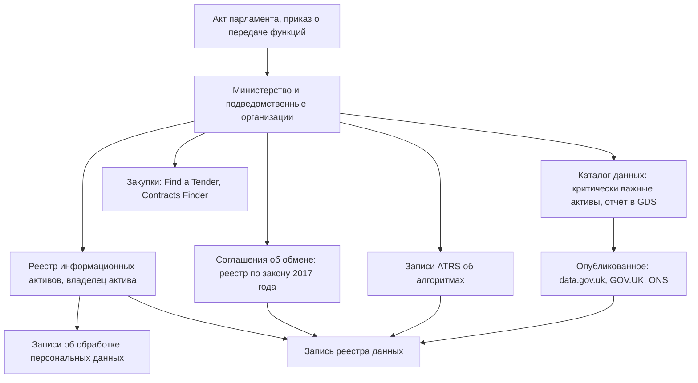

# Великобритания

В Великобритании нет единого реестра государственных данных и систем: опись ведёт каждое министерство в своём реестре информационных активов, который вырос из информационной безопасности и управления документами. С 27 мая 2026 года министерства и их подведомственные организации по политике Государственной цифровой службы (Government Digital Service, GDS) выявляют критически важные активы данных, ведут их метаданные в своих каталогах и ежегодно сообщают о них в GDS. Эти списки снаружи не видны, а опубликованные реестры активов в большинстве устарели. Зато открыты следы того, какие данные есть и куда они уходят: реестр соглашений об обмене данными по закону о цифровой экономике 2017 года, записи об алгоритмах, реестр аккредитованных исследовательских проектов, данные о крупных проектах, закупки. Портал data.gov.uk с 2026 года перестраивают в National Data Library, но его каталог неполон. Поэтому опись начинают с GOV.UK и его программного интерфейса, а границу проводят по четырём юрисдикциям: у Шотландии свои законы о свободе информации и о документах.

В индексе развития электронного правительства ООН Великобритания в 2024 году заняла 7-е место, в 2022-м — 11-е; обзор 2026 года на 25 октября 2026 года не вышел. Сведения главы проверены 25 октября 2026 года, если не сказано иное. Тексты актов сверены по legislation.gov.uk в действующих редакциях; сайт парламента parliament.uk из сети проверки ответил ошибкой 403. Подробности об актах — в приложении [«Нормативная база»](../09-appendices/02-legal-framework.md#великобритания).

## Коротко

| Что ищут | Где | Что даёт | Чего не даёт |
|----------|-----|----------|--------------|
| **[Полномочия и акты](#правовая-основа)** | legislation.gov.uk; страницы организаций на GOV.UK | Акты с редакциями, приказы о передаче функций, подведомственные организации | Что на самом деле лежит в системах |
| **[Учёт активов](#реестры-информационных-активов)** | Реестры информационных активов министерств на GOV.UK | Названия и описания активов, иногда — персональные данные и доступ | Общего списка нет; большинство реестров старше 2025 года |
| **[Критически важные активы](#критически-важные-активы-данных)** | Каталоги данных министерств, отчёты в GDS | Владелец данных, метаданные по профилю на основе DCAT, план качества | Снаружи не видны |
| **[Обмен данными](#обмен-данными-между-ведомствами)** | Реестр соглашений по закону о цифровой экономике; регистр выдачи данных NHS England | 657 соглашений: кто, кому, зачем, на какой срок | Состав передаваемых полей описан скупо |
| **[Алгоритмы](#алгоритмы-и-ии)** | Записи ATRS на GOV.UK | 153 записи с описанием данных инструмента | Только алгоритмические инструменты |
| **[Исследовательский доступ](#статистика-и-доступ-для-исследований)** | Реестр аккредитованных проектов UK Statistics Authority | 1528 проектов с защищёнными данными и средой доступа | Сами данные — только в доверенных средах |
| **[Опубликованное](#государственные)** | data.gov.uk, ONS, список аккредитованной статистики | 59 559 записей каталога, 699 аккредитованных статистик | Свежесть: не меньше 25% ссылок портала вели на ошибки |
| **[Закупки и расходы](#закупки-и-расходы)** | Find a Tender, Contracts Finder, расходы дороже £25 000 | Уведомления по всему циклу контракта, копии крупных контрактов, платежи | Системы, созданные без закупок |



## Правовая основа

Закона, который требовал бы вести реестр данных или систем государства, нет. Инвентаризацию задают три группы норм: законы о доступе к информации и о документах, законы, по которым данные передают и раскрывают, и обязательные для министерств политики GDS. Большинство актов действуют во всём Соединённом Королевстве, но у Шотландии свои законы о свободе информации и о документах.

- **Freedom of Information Act 2000** (c. 36) — закон о свободе информации: ответ не позже 20-го рабочего дня (статья 10), схема публикации с наборами данных (статья 19), исключения части II. По статье 46 министр выпускает кодекс по управлению документами; действующий подготовлен Национальным архивом в июле 2021 года. С 30 сентября 2026 года надзорный орган — Information Commission ([«Вопрос чужому владельцу»](../03-process/04-questionnaires.md#вопрос-чужому-владельцу), [«Где искать основания»](../03-process/06-access.md#где-искать-основания)).
- **Freedom of Information (Scotland) Act 2002** (asp 13) — для органов Шотландии, ответ тоже за 20 рабочих дней (статья 10). Экологическую информацию выдают по **Environmental Information Regulations 2004** (SI 2004/3391) — за 20 рабочих дней (пункт 5).
- **Public Records Act 1958** (c. 51) — документы для постоянного хранения отбирают и передают в Национальный архив не позже 20 лет после создания; держать дольше можно с одобрения министра (статья 3). **Public Records (Scotland) Act 2011** (asp 12) — органы Шотландии согласуют с хранителем документов Шотландии (Keeper of the Records of Scotland) план управления документами с ответственными лицами (статья 1).
- **Re-use of Public Sector Information Regulations 2015** (SI 2015/1415) — список основных документов для повторного использования с метаданными (пункт 16) ([«Полный реестр и общедоступная часть»](../03-process/09-result-and-upkeep.md#полный-реестр-и-общедоступная-часть)).
- **Data Protection Act 2018** (c. 12) и UK GDPR — записи об обработке (статья 30) предоставляют надзорному органу по запросу; **SI 2018/480** — сбор с контролёров и публичный реестр плательщиков.
- **Digital Economy Act 2017** (c. 30), часть 5 — обмен данными для публичных услуг (статьи 35–45), регистрации актов гражданского состояния (статья 46), взыскания долгов (статьи 48–55), борьбы с мошенничеством (статьи 56–63), исследований с аккредитацией исследователей, проектов и сред (статьи 64–73) и статистики (статьи 78–81). Статьи 79 и 80 дали Статистическому совету (UK Statistics Authority) доступ к данным органов и компаний и ввели кодекс об изменениях информационных систем (статьи 45A–45G закона о статистике 2007 года).
- **Statistics and Registration Service Act 2007** (c. 18) — официальная и аккредитованная статистика; производители — Official Statistics Order 2023 (SI 2023/878).
- **Procurement Act 2023** (c. 54) — для закупок с 24 февраля 2025 года: уведомление о контракте за 30 дней и копия контракта дороже £5 млн за 90 дней (статья 53), сведения о платежах дороже £30 000 (статья 70, с 1 апреля 2026 года), основания не публиковать (статья 94), единая онлайн-система (статья 95).
- **Local Government Transparency Code 2015** — кодекс прозрачности местного самоуправления Англии по закону 1980 года: расходы, контракты, земля и здания.
- **SI 2023/424** — приказ о передаче функций новым министерствам ([«Где искать полномочия»](../03-process/03-owners-and-mandates.md#где-искать-полномочия)).
- **Политики для министерств:** политика управления активами данных GDS от 27 мая 2026 года, модель владения данными от 16 апреля 2026 года, руководство о владельцах информационных активов (обновлено 1 октября 2025 года), стандарт **GovS 005 Digital** версии 2.2 от 1 октября 2026 года, стандарт прозрачности алгоритмов ATRS.

## Реестры и платформы

### Реестры информационных активов

Как устроены реестр информационных активов (Information Asset Register, IAR) и роль владельца актива (Information Asset Owner, IAO), рассказано в главе [«Зарубежные методики»](../05-frameworks/04-international-practice.md#реестры-информационных-активов-великобритании). Снаружи видна лишь часть реестров: поиск по GOV.UK 25 октября 2026 года нашёл 11.

| Министерство или организация | Версия на GOV.UK | Что в файле |
|------------------------------|------------------|-------------|
| **Министерство внутренних дел** (Home Office) | 15 августа 2013 года | ODS и XLS |
| **Министерство бизнеса, инноваций и навыков** (BIS, упразднено в 2016 году) | 10 ноября 2015 года | Реестр 2015 года |
| **Министерство по делам общин и местного самоуправления** (DCLG) | 11 марта 2016 года | «Опись данных» в XLSX |
| **Министерство окружающей среды** (Defra) | 27 июля 2018 года | PDF — ответ на запрос о свободе информации |
| **Офис министра по делам Шотландии** | 17 октября 2018 года | ODS |
| **Министерство иностранных дел** (FCO, с 2020 года — FCDO) | 24 мая 2019 года | CSV, 96 активов |
| **Министерство бизнеса, энергетики и промышленной стратегии** (BEIS, упразднено в 2023 году) | 19 августа 2020 года | CSV, 150 активов, у 104 — «не опубликован» |
| **Министерство транспорта** (DfT) | 19 апреля 2022 года | CSV, 89 активов, у 33 — «не опубликован» |
| **Министерство здравоохранения и социальной помощи** (DHSC) | 10 октября 2025 года | CSV, 74 категории: название и описание |
| **Управление по выводу ядерных объектов из эксплуатации** (NDA) | 8 апреля 2026 года | Таблица на странице, 497 строк |
| **Министерство бизнеса и торговли** (DBT) | 16 июля 2026 года | CSV, 73 актива; 7 удалены в июле 2026 года |

Свежих реестров три; остальные опубликованы до реорганизаций и описывают министерства, которых под этими названиями больше нет. Состав полей разный: у DfT есть персональные данные и число записей, у DHSC и DBT — только название и описание. Реестр можно запросить: Defra выдала свой в 2018 году в ответ на запрос RFI 8841. В Шотландии свой реестр публикует, например, Food Standards Scotland — CSV, загружен в сентябре 2025 года.

### Критически важные активы данных

Поверх реестров в 2023 году появился короткий список общих данных первой необходимости, с 16 апреля 2026 года — критически важных активов данных (critical data assets). Политика GDS от 27 мая 2026 года делает его обязательным для министерств и всех их подведомственных организаций; для публичных корпораций и местного самоуправления — по желанию. Метаданные ведут в своих каталогах, сообщают в GDS и пересматривают ежегодно; у каждого актива — названный владелец данных и план действий по качеству. Надзор ведёт совет директоров по данным (Chief Data Officer Council). GDS обещает сервис, в котором метаданные об активах можно будет найти внутри государства, — публичной части у него не предусмотрено.

Модель владения данными (16 апреля 2026 года) вводит роли владельца, распорядителя (steward) и хранителя (custodian) данных и предлагает три способа совместить их с владельцами информационных активов. Модель прямо спрашивает, согласованы ли реестр информационных активов, каталог данных и записи об обработке персональных данных, — это три внутренних списка, которые сверяют при описи ([«Владелец, оператор, ответственный»](../03-process/03-owners-and-mandates.md#владелец-оператор-ответственный)). GovS 005 в разделе 7.5 требует знать, какие данные есть, где они, кто за них отвечает, как к ним получают доступ и сколько хранят, а данные систем ИИ записывать с целью, происхождением, качеством и ограничениями.

Межведомственный каталог государство обещает давно. В 2022–2023 годах Центральная служба цифровых технологий и данных (CDDO) строила Data Marketplace — общий «вход» поверх каталогов министерств, без хранения самих данных; бета-версию для всех ведомств планировали на весну 2024 года. В январе 2025 года CDDO объединили с GDS, а запущен ли Data Marketplace, из публичных источников установить не удалось.

### Обмен данными между ведомствами

Соглашения об обмене по главам 1–4 части 5 закона о цифровой экономике собраны в открытом реестре digital-economy-act-register.data.gov.uk; с 14 мая 2024 года он заменил таблицу на GOV.UK. На 25 октября 2026 года в нём 657 соглашений: 186 действующих и 471 завершённое. Больше всего — по топливной бедности (321), долгам (135) и мошенничеству (50). У соглашения — цель, польза, передаваемые сведения, способ передачи, даты начала, окончания и пересмотра, срок хранения, контролёры и обработчики. Для описи это готовые связи «кто — кому — зачем — до какого срока», но состав сведений часто описан общей фразой вроде «минимальный набор данных». Записи отдаются и в JSON ([«Портал за минуту»](#портал-за-минуту)).

В здравоохранении Англии NHS England ежемесячно публикует регистр использования данных (Data Uses Register): контролёры, цель, одобренные наборы, правовое основание, коммерческая ли цель, учтён ли отказ пациентов от передачи данных, какие файлы выданы. Сайт digital.nhs.uk из сети проверки ответил ошибкой 403; описание сверено по копии в Internet Archive от 10 марта 2026 года.

### Алгоритмы и ИИ

Стандарт прозрачности алгоритмов (Algorithmic Transparency Recording Standard, ATRS) обязателен для министерств и для подведомственных организаций, которые оказывают публичные услуги или работают с гражданами напрямую. На 25 октября 2026 года на GOV.UK — 153 записи, последняя от 14 октября 2026 года. Раздел 4.3 записи описывает данные: источник, вид, объём, чувствительные атрибуты, кто собрал, с кем делятся. Например, запись Министерства бизнеса и торговли об инструменте поиска мошенничества с расходами называет набор по платёжным картам и служебным расходам — 40 000 строк с именами сотрудников, собранных компанией общих услуг UKSBS. Таких подробностей нет ни в одном опубликованном реестре активов ([«ИИ в инвентаризации»](../02-approaches/03-ai.md)).

### Крупные проекты и устаревшие системы

Реестра государственных систем нет. Ближе всего к нему данные о портфеле крупных проектов (Government Major Projects Portfolio, GMPP) Национального управления инфраструктуры и преобразования услуг (NISTA): в отчёте от 13 июля 2026 года — 189 проектов на 31 марта 2026 года, из них 22 в категории ИКТ. У проекта — министерство, описание, оценка вероятности успеха, даты и бюджет; часть полей скрыта со ссылкой на исключения закона о свободе информации — о коммерческих интересах (статья 43) и об органах безопасности (статья 23). Например, служба данных правоохранительных органов (Law Enforcement Data Service) Министерства внутренних дел идёт с 2014 года, окончание запланировано на 31 декабря 2026 года.

Обзор состояния цифрового правительства от 21 января 2025 года оценил долю устаревших систем в центральных министерствах в 2024 году в 28% — против 26% годом раньше — и признал, что полного учёта устаревших ИТ нет, а у большинства организаций нет полных реестров. GovS 005 теперь требует отслеживать устаревшие технологии и хранилища данных и держать план их замены, а руководство GDS «Managing legacy technology» (обновлено 15 октября 2026 года) перед заменой системы советует составить полный реестр её активов данных ([«Где искать преемника»](../04-sources/06-legacy.md#где-искать-преемника)).

### Персональные данные

Записи об обработке по статье 30 UK GDPR не публикуют. Открыт реестр плательщиков сбора за защиту данных — больше миллиона организаций: название, адрес, регистрационный номер, размер сбора, даты, контакт ответственного за защиту данных. Выгрузка обновляется ежедневно, описаний обработки в ней нет ([«Описания систем с персональными данными»](../04-sources/02-government.md#описания-систем-с-персональными-данными)).

### Документы и архивы

Каталог Discovery Национального архива описывает больше 37 млн документов самого архива и больше 3500 архивов страны, а веб-архив правительства (UK Government Web Archive) хранит его сайты с 1996 года ([«Веб-архивы»](../04-sources/06-legacy.md#веб-архивы)). Документы передают в архив не позже 20 лет после создания, поэтому описи и реестры старых организаций ищут там. В Шотландии отчёты об оценке планов управления документами публикует National Records of Scotland.

### Статистика и доступ для исследований

Единой программы статистических работ нет ([«Статистика и формы сбора сведений»](../04-sources/02-government.md#статистика-и-формы-сбора-сведений)). Ориентир — список аккредитованной официальной статистики Службы регулирования статистики (OSR): 699 статистик 68 производителей; больше всего у Управления национальной статистики (ONS) — 94 — и правительства Уэльса — 70. Соединённое Королевство целиком охватывают 154 статистики, остальные — Англию, Шотландию, Уэльс, Северную Ирландию или их сочетания. Аккредитацию отзывают: статистику рынка труда на основе обследования рабочей силы ONS приостановили в ноябре 2023 года и лишили аккредитации 24 августа 2026 года. Для реестра это отметка о контроле качества с датой ([«Качество данных»](../03-process/07-quality.md)).

Микроданные для исследований выдают в доверенных исследовательских средах (trusted research environments). Реестр аккредитованных проектов UK Statistics Authority на 21 октября 2026 года — 1528 проектов с 2019 года — называет у каждого защищённые данные и среду: Служба защищённых исследований ONS (Secure Research Service) — около 1120 проектов, UK Data Service — около 270, SAIL Databank в Уэльсе — 85, Агентство статистики Северной Ирландии (NISRA) — 24. Это перечень административных данных, к которым реально дают доступ. Интегрированная служба данных ONS (Integrated Data Service) должна была заменить защищённую, но с 3 октября 2025 года её сайт закрыт и новые внешние проекты она не принимает. Каталог административных данных четырёх частей страны с 23 мая 2023 года ведёт партнёрство ADR UK.

### Шотландия, Уэльс и Северная Ирландия

Границу описи проводят по юрисдикциям ([«Границы»](../03-process/02-goals-and-questions.md#границы)):

- **Политика активов данных** правительства Шотландии, Уэльса и Северной Ирландии не обязывает, но данные, которые министерства Соединённого Королевства им передают, в неё входят.
- **Запросы.** Органы Шотландии отвечают по шотландскому закону и подотчётны Шотландскому комиссару по информации; органы Уэльса, Северной Ирландии и ведомства Соединённого Королевства — по закону 2000 года.
- **Данные и регистры.** На data.gov.uk — 2976 записей OpenDataNI, хотя сам OpenDataNI насчитывал 1128 наборов. Порталы статистики свои: statistics.gov.scot, stats.gov.wales (прежний statswales.gov.wales перенаправляет на него), opendatani.gov.uk. Благотворительные организации регистрируют Charity Commission — в Англии и Уэльсе, OSCR — в Шотландии, Charity Commission for Northern Ireland — в Северной Ирландии; HM Land Registry ведёт регистр недвижимости только Англии и Уэльса.

### Сводка

| Что | Состояние на октябрь 2026 года |
|-----|-------------------------------|
| **Реестры информационных активов** | В каждом министерстве; на GOV.UK — 11, свежие — у DHSC, NDA и DBT |
| **Критически важные активы данных** | Обязательны с 27 мая 2026 года; снаружи не видны |
| **Data Marketplace** | Задуман в 2022–2023 годах; публичных сведений о запуске нет |
| **Реестр соглашений по закону 2017 года** | 657 соглашений, 186 действующих, JSON без ключа |
| **ATRS** | 153 записи |
| **Портфель крупных проектов** | 189 проектов на 31 марта 2026 года, CSV |
| **Портал открытых данных** data.gov.uk | С начала 2026 года — National Data Library, ведёт GDS в составе Министерства науки, инноваций и технологий (DSIT); каталог (directory) — 59 559 записей в программном интерфейсе, 47 349 — в поиске на сайте |
| **Исследовательский доступ** | 1528 аккредитованных проектов; Служба защищённых исследований ONS, UK Data Service, SAIL Databank, NISRA |

## Закупки и расходы

С 24 февраля 2025 года уведомления о новых закупках, кроме закупок ниже порога в Шотландии, публикуют на Find a Tender — центральной цифровой платформе по закону 2023 года. Вне Шотландии уведомления о закупках выше порога покрывают весь цикл контракта — от плана до расторжения. Копию контракта дороже £5 млн публикуют, как правило, за 90 дней; на органы Уэльса и часть органов Северной Ирландии это не распространяется (статья 53, часть 4). Для закупок, начатых раньше, сведения ниже порога ищут в Contracts Finder для Англии, Public Contracts Scotland, Sell2Wales и eTendersNI. С 1 апреля 2026 года органы отчитываются о платежах дороже £30 000 по контрактам, начатым после 31 марта 2026 года: в тестовом реестре платежей (Payments Transparency Register) на Find a Tender 25 октября 2026 года было 636 записей.

Расходы видны и без закупок: по руководству Казначейства министерства и подведомственные организации ежемесячно публикуют расходы дороже £25 000, а местные органы Англии ежеквартально — все расходы дороже £500. По строке расходов находят подрядчиков, которые обслуживают системы. ИТ-закупки ищут по кодам CPV раздела 72, по названию программы из портфеля крупных проектов, по заказчику и подрядчику ([«Госзакупки»](../04-sources/02-government.md#госзакупки)). Find a Tender и Contracts Finder отдают уведомления в стандарте OCDS без ключа.

## Где искать данные

### Государственные

| Что | Где | Что видно на 25 октября 2026 года |
|-----|-----|-----------------------------------|
| **Портал открытых данных** | data.gov.uk — National Data Library | 59 559 записей каталога, 1044 организации; больше всего записей у ONS — 5647 — и Natural England — 4785. Семь тематических подборок проверенных данных и руководство по данным. GDS в марте 2026 года писала, что не меньше 25% ссылок портала ведут на ошибки ([«Порталы открытых данных»](../04-sources/02-government.md#порталы-открытых-данных)) |
| **Статистика** | ONS, ons.gov.uk; api.beta.ons.gov.uk; список OSR | В программном интерфейсе ONS — 338 наборов, 287 из них — таблицы переписи 2021 года; остальное — файлами на сайте |
| **Компании** | Companies House | Ежемесячный бесплатный снимок данных о действующих компаниях в CSV; программный интерфейс — с бесплатным ключом |
| **Недвижимость** | HM Land Registry, use-land-property-data.service.gov.uk | 14 наборов по Англии и Уэльсу, в том числе каталог геоданных реестра и сделки (Price Paid Data); большинство бесплатны, часть — после регистрации и лицензии; национальная служба полигонов — £20 000 в год плюс НДС |
| **Геоданные и адреса** | Ordnance Survey, osdatahub.os.uk | Открытые и платные данные; по соглашению с публичным сектором (Public Sector Geospatial Agreement) с 1 апреля 2020 года на 10 лет данные OS получают больше 6000 государственных организаций. В апреле 2020 года объявлено, что идентификаторы объектов UPRN и улиц USRN станут открытыми и обязательным стандартом в государстве |
| **Благотворительность** | Charity Commission | Ежедневная выгрузка регистра Англии и Уэльса в JSON и TSV |
| **Здравоохранение** | NHS England — служба запросов данных (DARS); healthdatagateway.org | Регистр выдачи данных; в каталоге Health Data Research UK — 1404 активных описания наборов |
| **Программные интерфейсы** | api.gov.uk | 233 интерфейса 35 организаций |

### Общественные

- **WhatDoTheyKnow** проекта mySociety — запросы о свободе информации и ответы; в декабре 2023 года подан миллионный запрос. Сначала ищут чужой запрос о том же наборе ([«Вопрос чужому владельцу»](../03-process/04-questionnaires.md#вопрос-чужому-владельцу)).
- **360Giving** — стандарт открытых данных о грантах; в GrantNav 25 октября 2026 года было 1 565 468 грантов 355 грантодателей.
- **Open Data Institute** (ODI) — методики, в том числе картирование экосистем данных ([«Зарубежные методики»](../05-frameworks/04-international-practice.md#картирование-экосистем-данных-odi)).
- **UK Data Service** и каталог ADR UK — описания исследовательских и административных данных; Wikidata — черновик перечня организаций ([«Общественные проекты»](../04-sources/03-public.md#общественные-проекты)).

### Коммерческие

- **Агрегаторы сведений о компаниях** — например, OpenCorporates и сервисы проверки контрагентов — строятся на данных Companies House, первоисточник которых открыт ([«Сервисы на государственных реестрах»](../04-sources/04-commercial.md#сервисы-на-государственных-реестрах)).
- **Кредитные бюро** — Experian, Equifax, TransUnion: данные платные и закрытые; сведения открытых регистров в них — копии.
- **Адреса.** Файл почтовых адресов PAF лицензирует Royal Mail, в том числе по отдельной лицензии для публичного сектора. В реестре записывают, чей это продукт и по какой лицензии.
- **Платные государственные продукты** — национальная служба полигонов HM Land Registry, платные данные Ordnance Survey ([«Коммерческие данные»](../04-sources/04-commercial.md)).

### Проверка адресов

25 октября 2026 года из сети, где проверялась книга, открылись все адреса главы, кроме перечисленных ниже. Ошибкой 403 ответили whatdotheyknow.com, digital.nhs.uk, parliament.uk и ros.gov.uk; england.nhs.uk вернул пустой ответ, 360giving.org — страницу блокировки, statistics.gov.uk не ответил. Их нужно перепроверить из британской сети. Сервис HM Land Registry use-land-property-data.service.gov.uk открывается только с cookies: без них запрос уходит в цикл перенаправлений.

### Портал за минуту

У нескольких источников есть программные интерфейсы без ключа:

```bash
# data.gov.uk: сколько записей в каталоге (поле result.count); адрес перенаправляет на ckan.publishing.service.gov.uk
curl -L "https://data.gov.uk/api/action/package_search?rows=0"
# data.gov.uk: записи по организациям (поле search_facets.organization)
curl -L "https://data.gov.uk/api/action/package_search?rows=0&facet.field=%5B%22organization%22%5D&facet.limit=-1"
# Реестр соглашений по части 5 закона о цифровой экономике: по 20 соглашений на страницу
curl "https://www.digital-economy-act-register.data.gov.uk/agreements.json?page=1"
# Записи ATRS об алгоритмах на GOV.UK: сколько всего (поле total)
curl "https://www.gov.uk/api/search.json?filter_format=algorithmic_transparency_record&count=0"
# Опубликованные реестры информационных активов на GOV.UK
curl "https://www.gov.uk/api/search.json?q=%22information+asset+register%22&count=20&fields=title,link,public_timestamp"
# Справочник организаций GOV.UK, включая закрытые (поле details.govuk_status)
curl "https://www.gov.uk/api/organisations?page=1"
# Find a Tender: уведомления о закупках в формате OCDS за период
curl "https://www.find-tender.service.gov.uk/api/1.0/ocdsReleasePackages?limit=10&updatedFrom=2026-10-24T00:00:00"
```

Запросы проверены 25 октября 2026 года. В справочнике организаций GOV.UK было 1269 записей, 599 из них — закрытые организации: это готовый список предшественников, чьи данные ищут под старыми названиями.

## Как провести инвентаризацию

### Чем владеем: опись министерства

| Шаг | Где | Что даёт реестру |
|-----|-----|------------------|
| **1. Полномочия и границы** | legislation.gov.uk; страница министерства на GOV.UK с подведомственными организациями | Какие данные министерство обязано вести и какие организации входят в опись ([«Где искать полномочия»](../03-process/03-owners-and-mandates.md#где-искать-полномочия)) |
| **2. Реестр информационных активов** | IAR министерства, список владельцев активов | Активы с владельцами и дата версии |
| **3. Каталог данных** | Каталог министерства, отчёт о критически важных активах, директор по данным | Метаданные, владелец данных, план качества |
| **4. Персональные данные** | Записи об обработке по статье 30 UK GDPR | Системы со сведениями о людях, цели, сроки хранения |
| **5. Обмен** | Реестр соглашений по закону 2017 года, соглашения министерства | Что, кому и зачем отдают |
| **6. Алгоритмы** | Записи ATRS | Наборы, на которых работают инструменты ИИ |
| **7. Системы и проекты** | Портфель крупных проектов, учёт устаревших систем, контракты | Системы, подрядчики, планы замены |
| **8. Опубликованное** | GOV.UK, data.gov.uk, статистика, api.gov.uk | Ссылки, форматы, даты, битые ссылки |
| **9. Опрос** | Владельцы активов и данных, распорядители | Таблицы вне систем, копии, качество ([«Опросные листы и интервью»](../03-process/04-questionnaires.md)) |

Шаги 2–4 дают три внутренних списка, которые модель владения данными просит согласовать. Главная работа — сверка: актив есть в реестре, но не в каталоге; набор описан в записи ATRS, а в реестре активов его нет; соглашение об обмене действует, а передаваемых данных нет ни в одном списке. Каждое расхождение записывают и выясняют ([«Как методы проверяют друг друга»](../02-approaches/02-methods.md#как-методы-проверяют-друг-друга)).

### Где найти нужное

1. **Опубликованное** — data.gov.uk, ONS, регистры, api.gov.uk, порталы Шотландии, Уэльса и Северной Ирландии.
2. **Кто ведёт** — полномочия, реестры информационных активов, список аккредитованной статистики.
3. **Где лежит и куда уходит** — реестр соглашений, реестр исследовательских проектов, регистр NHS England, записи ATRS, контракты.
4. **Запрос владельцу** — по закону о свободе информации, ответ за 20 рабочих дней; в Шотландии — по шотландскому закону. Можно запросить и сам реестр активов. В запросе называют актив, соглашение или проект.
5. **Если закрыто** — доступ для исследований через аккредитацию и доверенные среды, архивы и коммерческие источники, с пометкой, что первоисточник закрыт ([«Три слоя данных»](../04-sources/01-three-layers.md)).

## Что особенного

- **Опись выросла из безопасности и архивов.** В центре — информационный актив и его владелец-руководитель, а не набор открытых данных. Политика 2026 года добавила владельца данных и план качества, но не отменила IAO ([«Зарубежные методики»](../05-frameworks/04-international-practice.md#реестры-информационных-активов-великобритании)).
- **Учёт централизуют политикой, а не законом.** Требования к активам данных и GovS 005 обязательны для министерств, но публичной части у центрального учёта нет — в отличие от открытого реестра систем Казахстана ([«Казахстан»](./01-kazakhstan.md#где-учитывают-системы)).
- **Следы обмена открыты лучше, чем сами данные.** Реестр соглашений, реестр исследовательских проектов, регистр NHS England и записи ATRS показывают, какие данные есть, у кого и на каком основании их получают.
- **Реестры публикуют, но не обновляют.** Из 11 реестров на GOV.UK восемь старше 2025 года. На data.gov.uk у Министерства бизнеса и торговли, созданного в 2023 году, нет ни одной записи, а у упразднённого предшественника — 246 ([«Результат и поддержка»](../03-process/09-result-and-upkeep.md)).
- **Четыре юрисдикции.** Политики Соединённого Королевства для Шотландии, Уэльса и Северной Ирландии не обязательны, у Шотландии свои законы, у каждой части — свои порталы и регистры.
- **Качество статистики проверяют публично.** Аккредитацию дают и отзывают с датами — это готовая отметка о качестве для реестра ([«Рамки и стандарты качества»](../03-process/07-quality.md#рамки-и-стандарты-качества)).

## Пример

Министерство бизнеса и торговли (DBT) по открытым спискам на 25 октября 2026 года:

| Список | Что в нём о DBT |
|--------|-----------------|
| **Реестр информационных активов**, 16 июля 2026 года | 73 актива, только название и описание; среди них «Опросы», «Анализ и статистика», «Финансовые данные и отчётность» |
| **Записи ATRS** | 6 записей; в одной — набор по платёжным картам и расходам, 40 000 строк, с именами сотрудников |
| **Реестр соглашений по закону 2017 года** | 4 соглашения, все завершены; в названии первого, 2021 года, ещё стоит BEIS |
| **Портфель крупных проектов** | 4 проекта, в том числе преобразование Post Office в категории ИКТ |
| **Реестр аккредитованных исследовательских проектов** | Обследование инноваций Великобритании: 26 проектов под названием «DBT: UK Innovation Survey» и 19 — под именем BEIS |
| **data.gov.uk** | У DBT 0 записей; у упразднённых BEIS — 246, BIS — 43 |

Пример показывает три вещи:

- **По реестру активов наборы не найти.** Обследования инноваций и набора по платёжным картам в нём нет по названию: они, видимо, внутри общих «Опросов», «Анализа и статистики» или «Финансовых данных». Это выясняют у владельца, а запись реестра данных уточняют по другим спискам.
- **Один набор живёт под разными именами.** После реорганизации 2023 года одно обследование записано за двумя министерствами; прежние названия идут в синонимы ([«Один набор под разными именами»](../03-process/05-registry.md#один-набор-под-разными-именами)).
- **Портал не говорит, у кого данные сейчас.** Записи предшественников остаются под их именами, и владельца находят по справочнику организаций GOV.UK.

## Частые ошибки

| Ошибка | Что происходит | Как исправить |
|--------|----------------|---------------|
| **Опубликованный реестр активов принят за текущий** | В опись попадают активы упразднённого министерства | Смотреть дату версии, сверять с приказами о передаче функций, запросить текущий реестр |
| **Поиск только на data.gov.uk** | Пропадают данные вне каталога, найденное ведёт на битые ссылки | Искать на GOV.UK, в статистике, регистрах, api.gov.uk; ссылку проверять при записи |
| **National Data Library принята за каталог всех данных государства** | Ждут закрытых и внутренних данных | Подборки — открытые данные; обязательной публикации в планах NDL нет, критически важные активы — во внутренних каталогах |
| **Шотландия описана по английским правилам** | Запрос идёт не по тому закону, регистры ищут не там | Шотландский закон о свободе информации, OSCR, Public Contracts Scotland, statistics.gov.scot |
| **Список OSR принят за всю статистику** | Пропадает статистика без аккредитации и отозванная | Список — только аккредитованная статистика; отзыв записывать с датой |
| **Новые закупки ищут в Contracts Finder** | Не находятся закупки, начатые после 24 февраля 2025 года | Новые закупки — на Find a Tender |
| **Сайт проверен из-за рубежа** | «Не работает» digital.nhs.uk или whatdotheyknow.com | Проверять из британской сети и записывать сеть проверки |

## Ограничения

- Внутренние списки — каталоги данных министерств, отчёты о критически важных активах, записи об обработке персональных данных, полные реестры активов — снаружи недоступны; сколько активов выявлено по политике 2026 года, не опубликовано.
- Состояние Data Marketplace в 2025–2026 годах из публичных источников не установлено.
- Поиск по GOV.UK находит только реестры с названием «information asset register»; реестры на сайтах подведомственных организаций могли не попасть в таблицу.
- Числа data.gov.uk зависят от способа подсчёта; подсчёт проектов по средам приблизителен — одна среда записана под несколькими названиями.
- whatdotheyknow.com, digital.nhs.uk, england.nhs.uk, parliament.uk и 360giving.org из сети проверки не открылись; регистр NHS England описан по копии от 10 марта 2026 года.
- Из местного самоуправления описан только кодекс прозрачности Англии.

## Источники

- [United Kingdom — E-Government Development Index](https://publicadministration.un.org/egovkb/en-us/Data/Country-Information/id/182-United-Kingdom-of-Great-Britain-and-Northern-Ireland) — UN E-Government Knowledgebase: 7-е место в 2024 году, 11-е в 2022-м; последний обзор в разделе отчётов — 2024 года. 25 октября 2026 года.
- Законы, 25 октября 2026 года, legislation.gov.uk: [Freedom of Information Act 2000, section 46](https://www.legislation.gov.uk/ukpga/2000/36/section/46); [Freedom of Information (Scotland) Act 2002, section 10](https://www.legislation.gov.uk/asp/2002/13/section/10); [Environmental Information Regulations 2004, regulation 5](https://www.legislation.gov.uk/uksi/2004/3391/regulation/5); [Public Records Act 1958, section 3](https://www.legislation.gov.uk/ukpga/Eliz2/6-7/51/section/3); [Public Records (Scotland) Act 2011, sections 1](https://www.legislation.gov.uk/asp/2011/12/section/1) и [5](https://www.legislation.gov.uk/asp/2011/12/section/5); [Digital Economy Act 2017, part 5](https://www.legislation.gov.uk/ukpga/2017/30/part/5); [Procurement Act 2023, sections 53](https://www.legislation.gov.uk/ukpga/2023/54/section/53), [70](https://www.legislation.gov.uk/ukpga/2023/54/section/70), [94](https://www.legislation.gov.uk/ukpga/2023/54/section/94) и [95](https://www.legislation.gov.uk/ukpga/2023/54/section/95).
- [Code of Practice on the Management of Records issued under section 46](https://www.gov.uk/government/publications/code-of-practice-on-the-management-of-records-issued-under-section-46-the-freedom-of-information-act-2000) — The National Archives, 15 июля 2021 года; [Local government transparency code 2015](https://www.gov.uk/government/publications/local-government-transparency-code-2015) — пункты 9 и 35, обновлено 29 января 2025 года; [Guidance for publishing spend over £25,000](https://www.gov.uk/government/publications/guidance-for-publishing-spend-over-25000) — HM Treasury, 2013, обновлено 24 ноября 2017 года.
- Политики GDS, 25 октября 2026 года: [Data asset management policy in government](https://www.gov.uk/government/publications/data-asset-management-policy-in-government/data-asset-management-policy-in-government), 27 мая 2026 года; [Data ownership in government](https://www.gov.uk/government/publications/data-ownership-in-government/data-ownership-model), 16 апреля 2026 года; [Government Functional Standard GovS 005: Digital](https://www.gov.uk/government/publications/government-functional-standard-govs-005-digital/government-functional-standard-govs-005-digital-html), версия 2.2 от 1 октября 2026 года, разделы 6.3–6.4 и 7.5; [Managing legacy technology](https://www.gov.uk/guidance/managing-legacy-technology), обновлено 15 октября 2026 года; [State of digital government review](https://www.gov.uk/government/publications/state-of-digital-government-review/state-of-digital-government-review), 21 января 2025 года.
- Data Marketplace и CDDO: [Discovering data across government](https://cddo.blog.gov.uk/2023/09/13/discovering-data-across-government) — блог CDDO, 13 сентября 2023 года; [страница CDDO на GOV.UK](https://www.gov.uk/government/organisations/central-digital-and-data-office) — статус «объединена с GDS».
- Реестры информационных активов на GOV.UK, 25 октября 2026 года: [DBT](https://www.gov.uk/government/publications/department-for-business-and-trade-information-asset-register), [DHSC](https://www.gov.uk/government/publications/department-of-health-and-social-care-information-asset-register), [NDA](https://www.gov.uk/government/publications/nuclear-decommissioning-authority-information-asset-register), [DfT](https://www.gov.uk/government/publications/department-for-transport-information-asset-register), [BEIS](https://www.gov.uk/government/publications/beis-information-asset-register), [FCO](https://www.gov.uk/government/publications/foreign-commonwealth-office-information-asset-register), [Defra](https://www.gov.uk/government/publications/defra-information-asset-register), [Home Office](https://www.gov.uk/government/publications/information-asset-register), [DCLG](https://www.gov.uk/government/publications/dclg-data-inventory), [BIS](https://www.gov.uk/government/publications/bis-information-asset-register-2015), [Office of the Secretary of State for Scotland](https://www.gov.uk/government/publications/office-of-the-secretary-of-state-for-scotland-information-asset-register); [FSS Information Assets Register](https://www.foodstandards.gov.scot/open-data-portal/fss-information-assets-register-list-of-assets) — Food Standards Scotland.
- [Register of information sharing agreements under chapters 1, 2, 3 and 4 of part 5 of the Digital Economy Act 2017](https://www.digital-economy-act-register.data.gov.uk/) — счёт по фильтрам и JSON, 25 октября 2026 года; [страница реестра на GOV.UK](https://www.gov.uk/government/publications/register-of-information-sharing-agreements-under-chapters-1-2-3-and-4-of-part-5-of-the-digital-economy-act-2017) — история обновлений.
- [Data Uses Register](https://web.archive.org/web/20260310193205/https://digital.nhs.uk/services/data-access-request-service-dars/data-uses-register) — NHS England, копия в Internet Archive от 10 марта 2026 года.
- [Algorithmic Transparency Recording Standard Hub](https://www.gov.uk/government/collections/algorithmic-transparency-recording-standard-hub) и [поиск записей ATRS](https://www.gov.uk/api/search.json?filter_format=algorithmic_transparency_record&count=0) — 153 записи; запись [DBT: Expenses Fraud Detector](https://www.gov.uk/algorithmic-transparency-records/dbt-expenses-fraud-detector), раздел 4.3. 25 октября 2026 года.
- [NISTA Major Projects Annual Report 2025-26](https://www.gov.uk/government/publications/nista-major-projects-annual-report-2025-26) — 13 июля 2026 года, данные в CSV.
- [Register of fee payers](https://ico.org.uk/about-the-ico/what-we-do/register-of-fee-payers/) и [выгрузка реестра](https://ico.org.uk/about-the-ico/what-we-do/register-of-fee-payers/download-the-register/) — 25 октября 2026 года.
- Статистика и исследования, 25 октября 2026 года: [List of accredited official statistics](https://osr.statisticsauthority.gov.uk/accredited-official-statistics/) — OSR, список и список отозванных от 19 октября 2026 года; [Public Registers: Accredited Researchers and Accredited Projects](https://uksa.statisticsauthority.gov.uk/digitaleconomyact-research-statistics/better-useofdata-for-research-information-for-researchers/list-of-accredited-researchers-and-research-projects-under-the-research-strand-of-the-digital-economy-act/) — UK Statistics Authority, реестр проектов от 21 октября 2026 года; [ONS shares an update on the future of the Secure Research Service and the Integrated Data Service](https://www.adruk.org/news-publications/news-blogs/ons-shares-an-update-on-the-future-of-the-secure-research-service-and-the-integrated-data-service/) — ADR UK, 15 июля 2025 года, дополнено 3 октября 2025 года; [New ADR UK Data Catalogue](https://www.adruk.org/news-publications/news-blogs/article/new-adr-uk-data-catalogue-makes-it-easier-to-find-and-access-data/) — 23 мая 2023 года; [программный интерфейс ONS](https://api.beta.ons.gov.uk/v1/datasets); [Health Data Research Gateway](https://healthdatagateway.org/) — программный интерфейс.
- National Data Library: [About](https://www.data.gov.uk/about/) и [Roadmap](https://www.data.gov.uk/roadmap) — план на июнь 2026 года; [What's changing on data.gov.uk and why](https://dataingovernment.blog.gov.uk/2026/03/25/whats-changing-on-data-gov-uk-and-why/) — GDS, 25 марта 2026 года; программный интерфейс каталога [ckan.publishing.service.gov.uk](https://ckan.publishing.service.gov.uk/api/action/package_search?rows=0). 25 октября 2026 года.
- Закупки, 25 октября 2026 года: [Find a Tender](https://www.find-tender.service.gov.uk/) — раздел «About Find a Tender»; [Payments Transparency Register](https://payments-transparency-register.supplier-information.find-tender.service.gov.uk/); [Contracts Finder](https://www.contractsfinder.service.gov.uk/) — программный интерфейс OCDS.
- Регистры, 25 октября 2026 года: [Free Company Data Product](https://download.companieshouse.gov.uk/en_output.html) — Companies House; [Use land and property data](https://use-land-property-data.service.gov.uk/) — HM Land Registry; [Public Sector Geospatial Agreement](https://www.ordnancesurvey.co.uk/customers/public-sector/public-sector-geospatial-agreement) — Ordnance Survey, и [Government announces new 10 year Public Sector Geospatial Agreement](https://www.gov.uk/government/news/government-announces-new-10-year-public-sector-geospatial-agreement-with-ordnance-survey) — 1 апреля 2020 года; [Full register download](https://register-of-charities.charitycommission.gov.uk/en/register/full-register-download) — Charity Commission; [API Catalogue](https://www.api.gov.uk/); [PAF Licensing](https://www.poweredbypaf.com/) — Royal Mail.
- [Records management plans](https://nrscotland.gov.uk/records-and-archives/records-management-plans) — National Records of Scotland; [Discovery](https://discovery.nationalarchives.gov.uk/) — The National Archives; [OpenDataNI](https://admin.opendatani.gov.uk/api/3/action/package_search?rows=0) — программный интерфейс. 25 октября 2026 года.
- [Departments, agencies and public bodies](https://www.gov.uk/government/organisations) и [справочник организаций](https://www.gov.uk/api/organisations) — GOV.UK, 25 октября 2026 года.
- Общественные данные: [A million public requests on WhatDoTheyKnow](https://www.mysociety.org/2023/12/04/a-million-public-requests-on-whatdotheyknow/) — mySociety, 4 декабря 2023 года; [GrantNav](https://grantnav.threesixtygiving.org/) — 360Giving, 25 октября 2026 года.
- Главы [«Зарубежные методики»](../05-frameworks/04-international-practice.md#реестры-информационных-активов-великобритании), [«Государственные данные»](../04-sources/02-government.md) и приложение [«Нормативная база»](../09-appendices/02-legal-framework.md#великобритания).
- Проверка адресов — 25 октября 2026 года.
