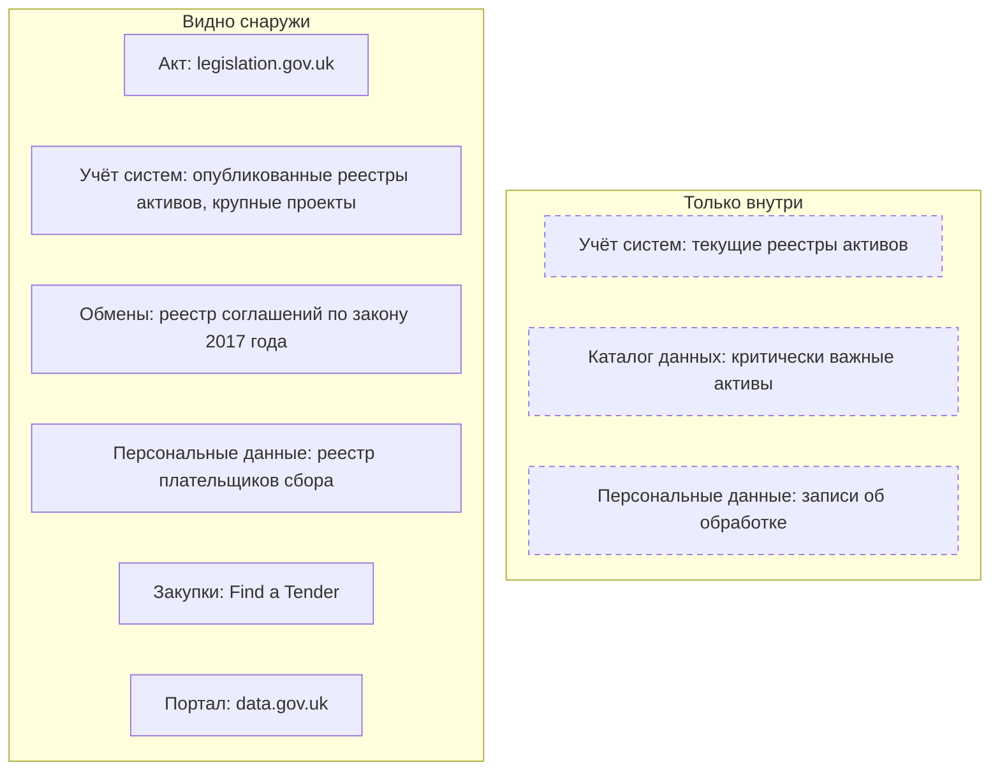

# Великобритания

В Великобритании нет единого реестра государственных данных и систем: опись ведёт каждое министерство в своём реестре информационных активов, а с 2026 года — ещё и список критически важных активов данных. Эти списки снаружи не видны, а опубликованные реестры в большинстве устарели. Зато открыты следы того, какие данные есть и куда они уходят: соглашения об обмене данными, записи об алгоритмах, исследовательские проекты, крупные ИТ-проекты и закупки. Поэтому опись начинают с GOV.UK и этих списков, а границу проводят по четырём юрисдикциям: у Шотландии свои законы о доступе и о документах.

Сведения проверены 25 октября 2026 года, если не указано иное.

## Коротко



Пунктирная рамка — сведения, которые видят только министерства и Государственная цифровая служба (Government Digital Service, GDS). Те же семь элементов в других странах — на странице [«Шесть стран в сравнении»](./00-overview.md).

## Правовая основа

Закона, который требовал бы вести реестр данных или систем государства, нет. Инвентаризацию задают законы о доступе и документах, законы о передаче данных и обязательные для министерств политики GDS.

| Акт простыми словами | Что требует | Что даёт описи |
|----------------------|-------------|----------------|
| **Законы о свободе информации** (2000; в Шотландии — 2002) | Ответ за 20 рабочих дней, схема публикации с наборами данных | Можно запросить и сам реестр активов |
| **Закон о публичных документах** (1958) | Документы для хранения передают в Национальный архив не позже 20 лет после создания | Описи упразднённых организаций — в архиве |
| **Регламент о повторном использовании информации** (2015) | Список основных документов для повторного использования с метаданными | Общедоступная часть реестра активов |
| **Закон о цифровой экономике** (2017), часть 5 | Обмен данными для услуг, взыскания долгов, борьбы с мошенничеством, исследований и статистики — по соглашениям в открытом реестре | Связи «кто — кому — зачем — до какого срока» |
| **Закон о закупках** (2023) | Уведомления по всему циклу контракта, копии контрактов дороже £5 млн | Подрядчики и история систем |
| **Политики GDS и стандарт GovS 005** (2026) | Критически важные активы данных с владельцами, учёт устаревших систем | Внутренний каталог министерства |

Реквизиты, статьи и шотландские акты — в приложении [«Нормативная база»](../09-appendices/02-legal-framework.md#великобритания).

## Реестры и платформы

### Реестры информационных активов

Опись в британских министерствах выросла не из открытых данных, а из информационной безопасности и управления документами. Поэтому в центре — информационный актив и его владелец (Information Asset Owner) — руководитель, который отвечает за актив и его запись в реестре министерства (Information Asset Register). Роль ввёл обзор обращения с данными 2008 года, руководство Кабинета министров о ней обновлено 1 октября 2025 года; министерства публикуют списки своих владельцев активов. Национальный архив предлагает поля реестра — название, что это, где хранится, владелец, объём, персональные данные, кто и как получает доступ, с кем и по какому соглашению делятся, формат, срок хранения, риски и ценность — и шаблон в Excel: несколько десятков активов ведут в таблице, сотни — в базе данных. Регламент 2015 года требует публиковать список основных документов для повторного использования, по возможности машиночитаемо; Национальный архив включает в этот список и неопубликованное, а модельная схема публикации для министерств требует выложить реестр, если он составлен для регламента.

Снаружи видна лишь часть реестров: поиск по GOV.UK нашёл 11. Большинство описывают министерства, которых под этими названиями больше нет:

| Версия | Чей реестр | Министерство существует? |
|--------|------------|--------------------------|
| 2013 | Министерство внутренних дел (Home Office) | Да |
| 2015 | Министерство бизнеса, инноваций и навыков (BIS) | Нет, упразднено в 2016 году |
| 2016 | Министерство по делам общин и местного самоуправления (DCLG), «опись данных» | Нет, переименовано, сейчас — MHCLG |
| 2018 | Министерство окружающей среды (Defra) — ответ на запрос о свободе информации | Да |
| 2018 | Офис министра по делам Шотландии | Нет, с 2024 года — Scotland Office |
| 2019 | Министерство иностранных дел (FCO), 96 активов | Нет, с 2020 года — FCDO |
| 2020 | Министерство бизнеса, энергетики и промышленной стратегии (BEIS), 150 активов | Нет, упразднено в 2023 году |
| 2022 | Министерство транспорта (DfT), 89 активов | Да |
| 2025 | Министерство здравоохранения и социальной помощи (DHSC), 74 категории | Да |
| 2026 | Управление по выводу ядерных объектов из эксплуатации (NDA), 497 строк | Да |
| 2026 | Министерство бизнеса и торговли (DBT), 73 актива | Да |

Состав полей разный: у DfT есть персональные данные, число записей и отметка «опубликован» — у 33 активов из 89 в ней «нет», то есть реестр описывает и закрытое. У DHSC и DBT — только название и описание. DfT обещает обновлять реестр ежегодно, но последняя версия — 2022 года. Реестр можно запросить: Defra выдала свой в 2018 году в ответ на запрос о свободе информации. В Шотландии свой реестр публикует, например, Food Standards Scotland.

### Критически важные активы данных

Поверх реестров государство ведёт короткий список данных, без которых не обойтись. Национальная стратегия данных 2020 года обещала аудит инвентарей данных; в ноябре 2023 года министерствам поручили выделить по 10–20 общих активов данных первой необходимости к апрелю 2024 года, а 16 апреля 2026 года их переименовали в критически важные активы данных (critical data assets). Политика управления активами данных GDS от 27 мая 2026 года делает список обязательным для министерств и всех их подведомственных организаций:

- метаданные активов ведут в своих каталогах, сообщают в GDS и пересматривают ежегодно;
- у каждого актива — названный владелец данных и план действий по качеству;
- метаданные — по профилю на основе DCAT и Dublin Core: кто и когда создал, название, описание, идентификатор, версия, период данных, режим доступа, гриф и лицензия; если сведения нет, пишут «unknown», а не оставляют поле пустым;
- искать активы советуют в каталогах данных, реестрах информационных активов и реестрах соглашений об обмене;
- активы с грифами SECRET и TOP SECRET в политику не входят;
- актив — это не система: из большой системы выделяют часть полей, которая нужна другим ([«Набор данных: где провести границу»](../01-basics/02-what-is-inventoried.md#набор-данных-где-провести-границу)).

GDS обещает сервис, где метаданные активов можно будет найти внутри государства; публичной части у него не предусмотрено, и сколько активов выявлено, не опубликовано. Межведомственный каталог Data Marketplace государство строило ещё в 2022–2023 годах, но запущен ли он, из публичных источников установить не удалось.

Модель владения данными (16 апреля 2026 года) вводит роли владельца, распорядителя и хранителя данных и прямо спрашивает, согласованы ли реестр информационных активов, каталог данных и записи об обработке персональных данных. Это три внутренних списка, которые сверяют при описи ([«Владелец, оператор, ответственный»](../03-process/03-owners-and-mandates.md#владелец-оператор-ответственный)). Стандарт GovS 005 (раздел 7.5) требует знать, какие данные есть, где они, кто за них отвечает, как к ним получают доступ и сколько хранят.

### Обмен данными между ведомствами

Соглашения об обмене по части 5 закона о цифровой экономике собраны в открытом реестре digital-economy-act-register.data.gov.uk. На 26 октября 2026 года в нём 657 соглашений: 186 действующих и 471 завершённое; больше всего — о топливной бедности, долгах и мошенничестве. Так выглядит одна запись:

| Поле реестра соглашений | Значение | Поле реестра данных |
|-------------------------|----------|---------------------|
| Название | Обмен данными GOV.UK One Login Wallet между GDS и агентством водительских удостоверений DVLA для цифрового водительского удостоверения | Связь между записями |
| Контролёры | Министр транспорта, министр науки, инноваций и технологий | Владельцы |
| Основание | Public Service Delivery — Identity Verification Services | Полномочие |
| Цель | Дать владельцам удостоверений хранить цифровое удостоверение в приложении GOV.UK Wallet | Описание |
| Передаваемые сведения | «Односторонний обмен. Сведения удостоверения передаёт DVLA» | Состав — описан общей фразой |
| Способ и срок хранения | Программный интерфейс; 7 лет | Способ доступа, срок хранения |
| Даты | С 24.11.2025 по 24.11.2035, пересмотр — 24.11.2026; статус «действует» | Даты и дата проверки |

Для описи это готовые связи «кто — кому — зачем — до какого срока», но состав сведений часто описан общей фразой, как здесь. В других записях он точнее: соглашение о передаче налоговой службе сведений о смерти детей перечисляет шесть полей — имя, дату смерти, пол, дату и место рождения, обычный адрес. Записи отдаются и в JSON.

В здравоохранении Англии NHS England ежемесячно публикует регистр использования данных (Data Uses Register): кто получил какие наборы, на каком основании и с какой целью.

### Алгоритмы и ИИ

Стандарт прозрачности алгоритмов (Algorithmic Transparency Recording Standard, ATRS) обязателен для министерств и для подведомственных организаций, которые работают с гражданами напрямую. На GOV.UK — 153 записи, последняя от 14 октября 2026 года. Раздел 4.3 записи описывает данные инструмента: источник, вид, объём, чувствительные атрибуты, кто собрал, с кем делятся. Например, запись Министерства бизнеса и торговли об инструменте поиска мошенничества со служебными расходами называет набор по платёжным картам и расходам — 40 000 строк с именами сотрудников. Таких подробностей нет ни в одном опубликованном реестре активов ([«ИИ в инвентаризации»](../02-approaches/03-ai.md)).

### Госзакупки

С 24 февраля 2025 года уведомления о новых закупках публикуют на Find a Tender, кроме закупок ниже порога в Шотландии. Уведомления покрывают весь цикл контракта, копию контракта дороже £5 млн публикуют, как правило, за 90 дней, а с 1 апреля 2026 года органы отчитываются о платежах дороже £30 000. Закупки, начатые раньше, ищут в Contracts Finder, Public Contracts Scotland, Sell2Wales и eTendersNI. Министерства ежемесячно публикуют расходы дороже £25 000, местные органы Англии — дороже £500: по строке расходов находят подрядчиков, которые обслуживают системы. ИТ-закупки ищут по кодам CPV раздела 72, по названию программы из портфеля крупных проектов, по заказчику и подрядчику ([«Государственные данные»](../04-sources/02-government.md#госзакупки)).

### Другие источники

- **Крупные проекты.** Ближе всего к реестру систем — портфель крупных проектов государства: в отчёте от 13 июля 2026 года — 189 проектов, 22 из них в категории ИКТ, с министерством, описанием, датами и бюджетом.
- **Устаревшие системы.** Обзор цифрового правительства 2025 года оценил долю устаревших систем в центральных министерствах в 28% и признал, что полного их учёта нет. GovS 005 теперь требует отслеживать устаревшие технологии и хранилища данных, а руководство GDS советует перед заменой системы составить реестр её активов данных ([«Где искать преемника»](../04-sources/06-legacy.md#где-искать-преемника)).
- **Персональные данные.** Записи об обработке по статье 30 UK GDPR предоставляют надзорному органу по запросу и не публикуют. Открыт реестр плательщиков сбора за защиту данных — больше миллиона организаций, но без описаний обработки.
- **Документы и архивы.** Каталог Discovery Национального архива описывает больше 37 млн документов, веб-архив правительства хранит его сайты с 1996 года ([«Веб-архивы»](../04-sources/06-legacy.md#веб-архивы)).
- **Статистика и доступ для исследований.** Единой программы статистических работ нет; ориентир — список аккредитованной официальной статистики Службы регулирования статистики: 699 статистик 68 производителей. Реестр аккредитованных исследовательских проектов UK Statistics Authority — 1528 проектов с 2019 года — называет защищённые данные, к которым реально дают доступ, и доверенную среду, где с ними работают. Каталог административных данных четырёх частей страны ведёт партнёрство ADR UK.

### Четыре юрисдикции

Границу описи проводят по юрисдикциям ([«Границы»](../03-process/02-goals-and-questions.md#границы)). Политика активов данных GDS правительства Шотландии, Уэльса и Северной Ирландии не обязывает, кроме данных, которые им передают министерства Соединённого Королевства.

| Тема | Англия и Уэльс | Шотландия | Северная Ирландия |
|------|----------------|-----------|-------------------|
| **Запрос информации** | Закон 2000 года | Шотландский закон 2002 года, Шотландский комиссар по информации | Закон 2000 года |
| **Документы и архивы** | Закон 1958 года, Национальный архив | Закон 2011 года, планы управления документами, National Records of Scotland | В главе не разбирается |
| **Статистика и порталы** | ONS (всё Соединённое Королевство); Уэльс — stats.gov.wales | statistics.gov.scot | Агентство статистики NISRA, opendatani.gov.uk |
| **Регистры** | Charity Commission; HM Land Registry — только Англия и Уэльс | OSCR — благотворительные организации | Charity Commission for Northern Ireland |
| **Закупки** | Find a Tender; Contracts Finder (Англия), Sell2Wales; обязанность публиковать копии контрактов на органы Уэльса не распространяется | Public Contracts Scotland; ниже порога — не на Find a Tender | Find a Tender, eTendersNI; на часть органов обязанность публиковать копии не распространяется |

## Где искать данные

### Государственные

- **Портал открытых данных** data.gov.uk с 2026 года перестраивают в National Data Library; ведёт его GDS в составе Министерства науки, инноваций и технологий. В каталоге — 59 559 записей 1044 организаций (в поиске на сайте — 47 349), больше всего у ONS — 5647 — и Natural England — 4785. GDS в марте 2026 года писала, что не меньше 25% ссылок портала ведут на ошибки.
- **Статистика** — Управление национальной статистики (ONS); в его программном интерфейсе 338 наборов, 287 из них — таблицы переписи 2021 года, остальное — файлами на сайте.
- **Регистры** — Companies House (ежемесячный бесплатный снимок данных о компаниях), HM Land Registry (14 наборов по Англии и Уэльсу, в том числе сделки), Charity Commission (ежедневная выгрузка регистра). Ordnance Survey даёт геоданные: по соглашению 2020 года их на 10 лет получают больше 6000 государственных организаций.
- **Здравоохранение** — регистр использования данных NHS England; каталог Health Data Research UK — 1404 описания наборов.
- **Программные интерфейсы** — каталог api.gov.uk: 233 интерфейса 35 организаций.
- **Справочник организаций GOV.UK** — 1269 записей, 599 из них — закрытые организации: готовый список предшественников, чьи данные ищут под старыми названиями.

<details>
<summary>Проверить самому</summary>

```bash
# data.gov.uk: сколько записей в каталоге (поле result.count)
curl -L "https://data.gov.uk/api/action/package_search?rows=0"
# Реестр соглашений по закону о цифровой экономике: по 20 на страницу; запись — agreements/<номер>.json
curl "https://www.digital-economy-act-register.data.gov.uk/agreements.json?page=1"
curl "https://www.digital-economy-act-register.data.gov.uk/agreements/520.json"
# Записи ATRS на GOV.UK: сколько всего (поле total)
curl "https://www.gov.uk/api/search.json?filter_format=algorithmic_transparency_record&count=0"
# Опубликованные реестры информационных активов
curl "https://www.gov.uk/api/search.json?q=%22information+asset+register%22&count=20&fields=title,link,public_timestamp"
# Справочник организаций GOV.UK; статус — поле details.govuk_status
curl "https://www.gov.uk/api/organisations?page=1"
# Find a Tender: уведомления в формате OCDS
curl "https://www.find-tender.service.gov.uk/api/1.0/ocdsReleasePackages?limit=10&updatedFrom=2026-10-24T00:00:00"
```

</details>

### Общественные

- **WhatDoTheyKnow** проекта mySociety — запросы о свободе информации и ответы, больше миллиона запросов: сначала ищут чужой запрос о том же наборе.
- **360Giving** — открытые данные о грантах: в GrantNav 1 565 468 грантов 355 грантодателей.
- **Open Data Institute** — методики, в том числе картирование экосистем данных ([«Зарубежные методики»](../05-frameworks/04-international-practice.md)).
- **UK Data Service** и каталог ADR UK — описания исследовательских и административных данных.

### Коммерческие

- **Агрегаторы сведений о компаниях**, например OpenCorporates, строятся на данных Companies House, первоисточник которых открыт ([«Сервисы на государственных реестрах»](../04-sources/04-commercial.md#сервисы-на-государственных-реестрах)).
- **Кредитные бюро** — Experian, Equifax, TransUnion: данные платные; сведения открытых регистров в них — копии.
- **Адреса** — файл почтовых адресов PAF лицензирует Royal Mail; в реестре записывают, чей это продукт и по какой лицензии.
- **Платные государственные продукты** — национальная служба полигонов HM Land Registry (£20 000 в год плюс НДС), платные данные Ordnance Survey.

## Как провести инвентаризацию

### Чем владеем: опись министерства

Порядок шагов и что каждый даёт реестру — на странице [«Шесть стран в сравнении»](./00-overview.md#чем-владеем-общий-порядок). Где их пройти в Великобритании:

| Шаг | Где | Видно снаружи? |
|-----|-----|----------------|
| **1. Полномочия и границы** | legislation.gov.uk; страница министерства на GOV.UK с подведомственными организациями | ● да |
| **2. Учёт систем** | Реестр информационных активов, портфель крупных проектов, учёт устаревших систем | ◐ частично |
| **3. Каталог данных** | Каталог министерства, отчёт о критически важных активах, директор по данным | ○ нет |
| **4. Обмены** | Реестр соглашений по закону 2017 года, соглашения министерства | ● да |
| **5. Персональные данные** | Записи об обработке по статье 30 UK GDPR | ○ нет |
| **6. Статистика** | Список аккредитованной статистики, публикации министерства | ● да |
| **7. Закупки** | Find a Tender, Contracts Finder, расходы дороже £25 000 | ● да |
| **8. Опубликованное** | GOV.UK, data.gov.uk, api.gov.uk, записи ATRS | ● да |
| **9. Опрос** | Владельцы активов и данных, распорядители | — |

Шаги 2, 3 и 5 дают три внутренних списка, которые модель владения данными просит согласовать. Главная работа — сверка: актив есть в реестре, но не в каталоге; набор описан в записи ATRS, а в реестре активов его нет; соглашение об обмене действует, а передаваемых данных нет ни в одном списке.

### Где найти нужное

Общий порядок — на странице [«Шесть стран в сравнении»](./00-overview.md#где-найти-нужное-общий-порядок). Что в Великобритании иначе:

- **Где лежит и куда уходит** — реестр соглашений, реестр исследовательских проектов, регистр NHS England, записи ATRS: они показывают, у кого данные и на каком основании их получают.
- **Запрос** — по закону о свободе информации, ответ за 20 рабочих дней; в Шотландии — по шотландскому закону. Можно запросить и сам реестр активов. Сначала ищут чужой запрос на WhatDoTheyKnow.
- **Если закрыто** — доступ для исследований через аккредитацию проекта и доверенную исследовательскую среду.

## Что особенного

- **Учёт централизуют политикой, а не законом.** Требования к активам данных и GovS 005 обязательны для министерств, но публичной части у центрального учёта нет — в отличие от открытого реестра систем [Казахстана](./01-kazakhstan.md#где-учитывают-системы).
- **Следы обмена открыты лучше, чем сами данные.** Реестр соглашений, реестр исследовательских проектов и записи ATRS показывают, какие данные есть и у кого.
- **Качество статистики проверяют публично.** Аккредитацию дают и отзывают с датами: статистику рынка труда на основе обследования рабочей силы ONS приостановили в ноябре 2023 года и лишили аккредитации 24 августа 2026 года. Это готовая отметка о контроле качества для реестра ([«Рамки и стандарты качества»](../03-process/07-quality.md#рамки-и-стандарты-качества)).

## Пример

Министерство бизнеса и торговли (DBT) по открытым спискам на 25 октября 2026 года:

| Список | Что в нём о DBT |
|--------|-----------------|
| **Реестр информационных активов**, 16 июля 2026 года | 73 актива, только название и описание; среди них «Опросы», «Анализ и статистика», «Финансовые данные и отчётность» |
| **Записи ATRS** | 6 записей; в одной — набор по платёжным картам и расходам, 40 000 строк, с именами сотрудников |
| **Реестр соглашений по закону 2017 года** | 4 соглашения, все завершены; в названии первого, 2021 года, ещё стоит BEIS |
| **Портфель крупных проектов** | 4 проекта, в том числе преобразование Post Office в категории ИКТ |
| **Реестр исследовательских проектов** | Обследование инноваций: 26 проектов под названием «DBT: UK Innovation Survey» и 19 — под именем BEIS |
| **data.gov.uk** | У DBT 0 записей; у упразднённых BEIS — 246, BIS — 43 |

Пример показывает три вещи:

- **По реестру активов наборы не найти.** Обследования инноваций и набора по платёжным картам в нём нет по названию: они, видимо, внутри общих «Опросов» или «Финансовых данных». Это выясняют у владельца.
- **Один набор живёт под разными именами.** После реорганизации 2023 года одно обследование записано за двумя министерствами; прежние названия идут в синонимы ([«Один набор под разными именами»](../03-process/05-registry.md#один-набор-под-разными-именами)).
- **Портал не говорит, у кого данные сейчас.** Записи предшественников остаются под их именами, и владельца находят по справочнику организаций GOV.UK.

## Частые ошибки

| Ошибка | Что происходит | Как исправить |
|--------|----------------|---------------|
| **Опубликованный реестр активов принят за текущий** | В опись попадают активы упразднённого министерства | Смотреть дату версии, сверять с приказами о передаче функций, запросить текущий реестр |
| **National Data Library принята за каталог всех данных государства** | Ждут закрытых и внутренних данных | Подборки — открытые данные; критически важные активы — во внутренних каталогах |
| **Шотландия описана по английским правилам** | Запрос идёт не по тому закону, регистры ищут не там | Шотландский закон о свободе информации, OSCR, Public Contracts Scotland, statistics.gov.scot |

Сквозные ошибки — в главе [«Практики и антипаттерны»](../08-practices/01-practices-and-anti-patterns.md).

## Ограничения

- Сколько критически важных активов выявлено по политике 2026 года, не опубликовано; состояние Data Marketplace не установлено.
- Поиск по GOV.UK находит только реестры с названием «information asset register»; реестры на сайтах подведомственных организаций могли не попасть в таблицу.
- Числа data.gov.uk зависят от способа подсчёта: программный интерфейс и поиск на сайте дают разное.
- Из местного самоуправления описан только кодекс прозрачности Англии, из архивов Северной Ирландии — ничего.

## Источники

- Законы на legislation.gov.uk, 25 октября 2026 года: [Freedom of Information Act 2000, section 46](https://www.legislation.gov.uk/ukpga/2000/36/section/46); [Freedom of Information (Scotland) Act 2002, section 10](https://www.legislation.gov.uk/asp/2002/13/section/10); [Public Records Act 1958, section 3](https://www.legislation.gov.uk/ukpga/Eliz2/6-7/51/section/3); [Public Records (Scotland) Act 2011, sections 1](https://www.legislation.gov.uk/asp/2011/12/section/1) и [5](https://www.legislation.gov.uk/asp/2011/12/section/5); [Re-use of Public Sector Information Regulations 2015, regulation 16](https://www.legislation.gov.uk/uksi/2015/1415/regulation/16); [Digital Economy Act 2017, part 5](https://www.legislation.gov.uk/ukpga/2017/30/part/5); [Procurement Act 2023, sections 53](https://www.legislation.gov.uk/ukpga/2023/54/section/53), [70](https://www.legislation.gov.uk/ukpga/2023/54/section/70), [94](https://www.legislation.gov.uk/ukpga/2023/54/section/94) и [95](https://www.legislation.gov.uk/ukpga/2023/54/section/95).
- Реестры активов: [The role of information asset owners in government](https://www.gov.uk/government/publications/information-asset-owner-role-guidance) — Кабинет министров, обновлено 1 октября 2025 года; [Identifying Information Assets and Business Requirements](https://cdn.nationalarchives.gov.uk/documents/information-management/identify-information-assets.pdf) — Национальный архив, февраль 2017 года, раздел 5; [definition document для министерств](https://ico.org.uk/for-organisations/foi/publication-schemes-a-guide/definition-documents/) — модельная схема публикации, 2021; реестры на GOV.UK, 25 октября 2026 года: [DBT](https://www.gov.uk/government/publications/department-for-business-and-trade-information-asset-register), [DHSC](https://www.gov.uk/government/publications/department-of-health-and-social-care-information-asset-register), [NDA](https://www.gov.uk/government/publications/nuclear-decommissioning-authority-information-asset-register), [DfT](https://www.gov.uk/government/publications/department-for-transport-information-asset-register), [BEIS](https://www.gov.uk/government/publications/beis-information-asset-register), [FCO](https://www.gov.uk/government/publications/foreign-commonwealth-office-information-asset-register), [Defra](https://www.gov.uk/government/publications/defra-information-asset-register), [Home Office](https://www.gov.uk/government/publications/information-asset-register), [DCLG](https://www.gov.uk/government/publications/dclg-data-inventory), [BIS](https://www.gov.uk/government/publications/bis-information-asset-register-2015), [Office of the Secretary of State for Scotland](https://www.gov.uk/government/publications/office-of-the-secretary-of-state-for-scotland-information-asset-register); [FSS Information Assets Register](https://www.foodstandards.gov.scot/open-data-portal/fss-information-assets-register-list-of-assets). Статус министерств — [справочник организаций GOV.UK](https://www.gov.uk/api/organisations), 26 октября 2026 года.
- Политики GDS, 25 октября 2026 года: [National Data Strategy](https://www.gov.uk/government/publications/uk-national-data-strategy/national-data-strategy), 2020; [Identify and record critical data assets](https://www.gov.uk/government/publications/identify-and-record-critical-data-assets), обновлено 16 апреля 2026 года; [Record metadata to describe critical data assets](https://www.gov.uk/government/publications/record-metadata-to-describe-critical-data-assets); [Data asset management policy in government](https://www.gov.uk/government/publications/data-asset-management-policy-in-government/data-asset-management-policy-in-government), 27 мая 2026 года; [Data ownership in government](https://www.gov.uk/government/publications/data-ownership-in-government/data-ownership-model), 16 апреля 2026 года; [GovS 005: Digital](https://www.gov.uk/government/publications/government-functional-standard-govs-005-digital/government-functional-standard-govs-005-digital-html), версия 2.2 от 1 октября 2026 года; [Managing legacy technology](https://www.gov.uk/guidance/managing-legacy-technology); [State of digital government review](https://www.gov.uk/government/publications/state-of-digital-government-review/state-of-digital-government-review), 21 января 2025 года; [Discovering data across government](https://cddo.blog.gov.uk/2023/09/13/discovering-data-across-government) — блог CDDO, 2023.
- [Реестр соглашений по главам 1–4 части 5 Digital Economy Act 2017](https://www.digital-economy-act-register.data.gov.uk/) — счёт по JSON, записи [520](https://www.digital-economy-act-register.data.gov.uk/agreements/520.json) и [452](https://www.digital-economy-act-register.data.gov.uk/agreements/452.json), 26 октября 2026 года; [Data Uses Register](https://web.archive.org/web/20260310193205/https://digital.nhs.uk/services/data-access-request-service-dars/data-uses-register) — NHS England, копия от 10 марта 2026 года.
- [Algorithmic Transparency Recording Standard Hub](https://www.gov.uk/government/collections/algorithmic-transparency-recording-standard-hub); запись [DBT: Expenses Fraud Detector](https://www.gov.uk/algorithmic-transparency-records/dbt-expenses-fraud-detector), раздел 4.3.
- [NISTA Major Projects Annual Report 2025-26](https://www.gov.uk/government/publications/nista-major-projects-annual-report-2025-26) — 13 июля 2026 года; [Register of fee payers](https://ico.org.uk/about-the-ico/what-we-do/register-of-fee-payers/); [Discovery](https://discovery.nationalarchives.gov.uk/); [Records management plans](https://nrscotland.gov.uk/records-and-archives/records-management-plans) — National Records of Scotland.
- Статистика и исследования: [List of accredited official statistics](https://osr.statisticsauthority.gov.uk/accredited-official-statistics/) — OSR, 19 октября 2026 года; [Accredited Researchers and Accredited Projects](https://uksa.statisticsauthority.gov.uk/digitaleconomyact-research-statistics/better-useofdata-for-research-information-for-researchers/list-of-accredited-researchers-and-research-projects-under-the-research-strand-of-the-digital-economy-act/) — реестр от 21 октября 2026 года; [New ADR UK Data Catalogue](https://www.adruk.org/news-publications/news-blogs/article/new-adr-uk-data-catalogue-makes-it-easier-to-find-and-access-data/); [программный интерфейс ONS](https://api.beta.ons.gov.uk/v1/datasets); [Health Data Research Gateway](https://healthdatagateway.org/).
- National Data Library: [About](https://www.data.gov.uk/about/), [Roadmap](https://www.data.gov.uk/roadmap); [What's changing on data.gov.uk and why](https://dataingovernment.blog.gov.uk/2026/03/25/whats-changing-on-data-gov-uk-and-why/) — GDS, 25 марта 2026 года; [программный интерфейс каталога](https://ckan.publishing.service.gov.uk/api/action/package_search?rows=0).
- Закупки и расходы: [Find a Tender](https://www.find-tender.service.gov.uk/); [Payments Transparency Register](https://payments-transparency-register.supplier-information.find-tender.service.gov.uk/); [Contracts Finder](https://www.contractsfinder.service.gov.uk/); [Guidance for publishing spend over £25,000](https://www.gov.uk/government/publications/guidance-for-publishing-spend-over-25000); [Local government transparency code 2015](https://www.gov.uk/government/publications/local-government-transparency-code-2015).
- Регистры: [Free Company Data Product](https://download.companieshouse.gov.uk/en_output.html); [Use land and property data](https://use-land-property-data.service.gov.uk/); [Public Sector Geospatial Agreement](https://www.ordnancesurvey.co.uk/customers/public-sector/public-sector-geospatial-agreement); [Charity Commission — full register download](https://register-of-charities.charitycommission.gov.uk/en/register/full-register-download); [API Catalogue](https://www.api.gov.uk/); [PAF Licensing](https://www.poweredbypaf.com/); [OpenDataNI](https://admin.opendatani.gov.uk/api/3/action/package_search?rows=0).
- Общественные данные: [A million public requests on WhatDoTheyKnow](https://www.mysociety.org/2023/12/04/a-million-public-requests-on-whatdotheyknow/) — mySociety, 2023; [GrantNav](https://grantnav.threesixtygiving.org/) — 360Giving.
- Приложение [«Нормативная база»](../09-appendices/02-legal-framework.md#великобритания).
- Как проверяли. Тексты актов — по legislation.gov.uk в действующих редакциях. 25 октября 2026 года из сети проверки не открылись whatdotheyknow.com, digital.nhs.uk, parliament.uk и ros.gov.uk (ошибка 403), england.nhs.uk, 360giving.org и statistics.gov.uk; регистр NHS England описан по копии в Internet Archive. Сервис HM Land Registry открывается только с cookies.
