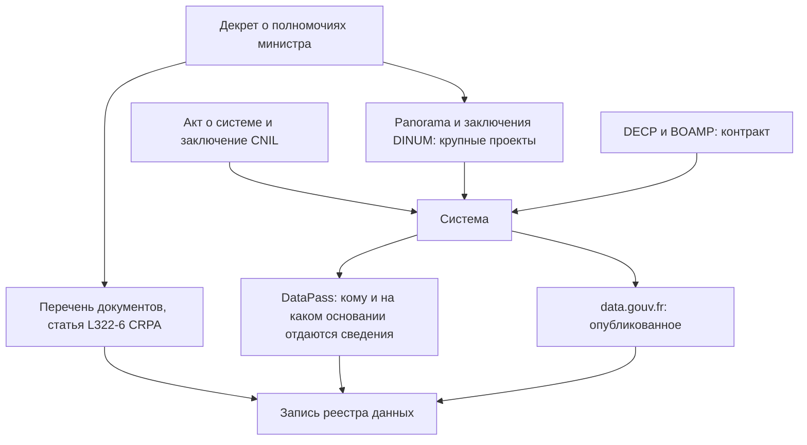

# Франция

Во Франции нет открытого реестра государственных информационных систем, зато закон требует нескольких публичных перечней, из которых опись собирают как мозаику. Каждая администрация ведёт перечень основных документов с публичной информацией и публикует регулярно обновляемые базы данных; девять баз признаны эталонными. Публикуется и то, какие администрации получают сведения друг от друга, какие и на каком основании, — это журнал разрешений DataPass. Крупные цифровые проекты перечисляет обзор DINUM, системы со сведениями о людях видны в формальностях CNIL и актах об их создании, контракты — в данных DECP. Слабое место — перечни документов: многие администрации их не ведут, а перечни министерств устаревают. Поэтому опись начинают с data.gouv.fr и перечней, сверяют с DataPass, закупками и CNIL, а недостающее запрашивают по Кодексу отношений между публикой и администрацией, ссылаясь на найденное.

В индексе развития электронного правительства ООН Франция в 2024 году заняла 34-е место, в 2022-м — 19-е; обзор 2026 года на 25 октября 2026 года не вышел. В рейтингах открытых данных она первая: в индексе OURdata ОЭСР 2025 года и в европейском Open Data Maturity 2025 года. Сведения главы проверены 25 октября 2026 года, если не сказано иное. Légifrance из сети проверки не открылся, и кодексы сверены по изданиям на codes.droit.org, собранным из Légifrance, — у каждого указана дата издания; два акта 2026 года о цифровых проектах государства сверены по копии Journal officiel в правовой базе Weka. Подробности об актах — в приложении [«Нормативная база»](../09-appendices/02-legal-framework.md#франция), методика страны — в разделе [«Политика данных Франции»](../05-frameworks/04-international-practice.md#политика-данных-франции).

## Коротко

| Что ищут | Где | Что даёт | Чего не даёт |
|----------|-----|----------|--------------|
| **[Полномочия и акты](#правовая-основа)** | Légifrance и Journal officiel; кодексы — на codes.droit.org | Декреты о полномочиях министров, акты о создании систем и регистров | Что на самом деле лежит в системе |
| **[Перечень документов](#перечни-документов-и-данных)** | Сайт администрации, data.gouv.fr | Основные документы и базы с публичной информацией, условия использования | Полноты: перечень по закону не исчерпывающий, у многих его нет |
| **[Крупные проекты](#крупные-проекты-и-заключения-dinum)** | Panorama des grands projets numériques и заключения DINUM на data.gouv.fr | 59 крупных проектов со стоимостью и сроками | Остальные системы — открытого реестра систем нет |
| **[Обмены между администрациями](#обмен-данными-между-администрациями)** | Журнал разрешений DataPass на data.gouv.fr | 30 380 разрешений: кто, какой интерфейс, какие сведения, основание | Обмены вне DataPass |
| **[Системы с персональными данными](#системы-с-персональными-данными)** | Формальности CNIL на data.gouv.fr; акты о создании систем с заключением CNIL | Цели, категории данных, кто обрабатывает | Большинство обработок без формальностей; реестр обработок — только по запросу |
| **[Опубликованное](#datagouvfr-и-эталонные-данные)** | data.gouv.fr, отраслевые порталы | 74 652 набора, 1273 программных интерфейса, девять эталонных баз | Неопубликованное: описаний с ограниченным доступом — 214 |
| **[Статистика и закрытые данные](#статистика-и-защищённый-доступ)** | Insee и 16 статистических служб министерств, программа обследований Cnis, CASD, Платформа данных здравоохранения | Обследования, административные источники статистики, каталоги закрытых баз | Сами записи — только исследователям по разрешению |
| **[Закупки](#госзакупки)** | DECP на data.gouv.fr и data.economie.gouv.fr, BOAMP, TED | Контракты от 40 000 евро с кодами CPV и поставщиками | Технические задания — у покупателя |



## Правовая основа

Почти все обязанности, полезные для инвентаризации, собраны в Кодексе отношений между публикой и администрацией (Code des relations entre le public et l'administration, CRPA): право на документы, обязательная публикация, перечень документов, эталонные данные и обмен сведениями между администрациями. Остальное — в законах о персональных данных, архивах, статистике, закупках и данных здравоохранения. Полномочия министра определяет декрет о его полномочиях, который издают после каждого формирования правительства ([«Где искать полномочия»](../03-process/03-owners-and-mandates.md#где-искать-полномочия)).

- **CRPA** — издание на codes.droit.org от 24 октября 2026 года, последнее изменение кодекса — 28 мая 2026 года:
  - статья L300-2 — административный документ — любой документ администрации «независимо от формы и носителя», в том числе статистика и исходные коды;
  - статья L312-1-1 — администрации публикуют выданные по запросам документы, документы из перечня, регулярно обновляемые базы данных и данные, публикация которых представляет общественный интерес. Порог — 50 сотрудников в эквиваленте полной занятости (статья D312-1-1-1); территориальные образования с населением менее 3500 жителей освобождены;
  - статьи L321-4 и R321-5 — девять баз эталонных данных и их производители (R321-5 — в редакции декрета n° 2024-606 от 26 июня 2024 года);
  - статьи L322-6 и R322-7 — перечень основных документов с публичной информацией, ежегодное обновление; у документа — название, предмет, дата создания, условия использования, даты и предмет обновлений;
  - статья L114-8 в редакции закона n° 2022-217 от 21 февраля 2022 года — администрации обмениваются сведениями, нужными для рассмотрения обращения, а список получателей, сведений и правовых оснований публикуется. Статья D114-9-1 (декрет n° 2026-54 от 3 февраля 2026 года) назначает, кто какие сведения отдаёт: 21 строка, 9 — о частных лицах и 12 — о предприятиях и некоммерческих организациях. Например, сведения о налоговом домохозяйстве отдаёт Генеральная дирекция государственных финансов (DGFiP), о соискателе работы — France Travail;
  - статьи R*311-12, R311-13, R343-1 и R343-3 — молчание администрации месяц означает отказ, обращение в Комиссию по доступу к административным документам (CADA) — в течение двух месяцев ([«Вопрос чужому владельцу»](../03-process/04-questionnaires.md#вопрос-чужому-владельцу)); статьи L311-5–L311-7 — что не сообщают ([«Где искать основания»](../03-process/06-access.md#где-искать-основания)).
- **Loi n° 2016-1321 du 7 octobre 2016 pour une République numérique** — закон о цифровой республике: ввёл обязательную публикацию, эталонные данные и ежегодное обновление перечня.
- **Loi n° 78-17 du 6 janvier 1978** «Информатика и свободы» и GDPR. По статье 31 закона системы государства в сферах безопасности, обороны и уголовного преследования создают приказом министра после мотивированного и опубликованного заключения CNIL. Сверено по консолидированному тексту на cnil.fr от 15 ноября 2024 года.
- **Code de l'environnement** — Экологический кодекс, издание от 7 октября 2026 года, статья L124-7: органы власти ведут бесплатные перечни категорий экологической информации с указанием, где она доступна, — второе, отдельное от CRPA основание описи.
- **Code du patrimoine** — Кодекс наследия, издание от 21 октября 2026 года: по статье L211-1 архивы — все документы, «в том числе данные»; статьи L212-2–L212-4, R212-13 и R212-14 — отбор, сроки хранения и уничтожение только с визой архивной службы ([«Архивы»](#архивы)).
- **Code de la commande publique** — Кодекс государственных закупок, издание от 10 октября 2026 года: по статье R2196-1 покупатель публикует основные данные контракта от 40 000 евро без налога на национальном портале открытых данных в течение двух месяцев после заключения или изменения; статья R3131-1 — то же для концессий.
- **Loi n° 51-711 du 7 juin 1951** — о статистике; программа обследований на 2026 год — два приказа от 27 октября 2025 года (JORF 25 ноября 2025 года) и пять дополнений к ним до 10 июля 2026 года ([«Статистика и формы сбора сведений»](../04-sources/02-government.md#статистика-и-формы-сбора-сведений)).
- **Code de la santé publique** — Кодекс здравоохранения, издание от 17 октября 2026 года: статья L1461-1 — Национальная система данных здравоохранения (SNDS), статья L1462-1 — «Платформа данных здравоохранения» (Health Data Hub), которая предоставляет данные SNDS.
- **Décret n° 2019-1088 du 25 octobre 2019** о системе информации и связи государства в редакции декрета n° 2026-193 от 18 марта 2026 года и приказ от 18 марта 2026 года (JORF 19 марта 2026 года) — заключения DINUM по крупным проектам ([«Крупные проекты и заключения DINUM»](#крупные-проекты-и-заключения-dinum)).
- **Circulaire n° 6264/SG du 27 avril 2021** — администраторы данных министерств и дорожные карты ([«Политика данных Франции»](../05-frameworks/04-international-practice.md#политика-данных-франции)).
- **Code de commerce** — Торговый кодекс, статья L123-36: Национальный реестр предприятий (RNE).

## Реестры и платформы

### Перечни документов и данных

Перечень основных документов (répertoire des informations publiques, RIP) обязателен для каждой администрации, которая производит или хранит публичную информацию. CADA в совете n° 20231374 от 20 апреля 2023 года разъяснила три вещи, важные для инвентаризации:

- перечень обязателен «без учёта размера» администрации — порог в 50 сотрудников относится к публикации документов, а не к перечню;
- исчерпывающим он быть не обязан: администрация сама решает, какие документы интересны для повторного использования;
- если перечня нет, а его запросили, CADA даёт положительное заключение и предлагает администрации его составить.

На практике перечни ведут неровно:

| Чей перечень | Что в нём | Состояние на 25 октября 2026 года |
|--------------|-----------|-----------------------------------|
| Дирекция правовой и административной информации (DILA) | Разделы по видам данных: правовые, административные, экономические и другие | Последний раздел датирован 30 октября 2019 года |
| Министерства экологического перехода и территорий | PDF на 23 страницах по статьям L322-6 CRPA и L124-7 Экологического кодекса | Версия от 8 июля 2025 года |
| Министерство Европы и иностранных дел | CSV: 16 документов с предметом, датой, лицензией, службой и адресом; назван прототипом | Версия от 25 июня 2024 года |
| Регион Центр — Долина Луары | 135 записей с ежедневным обновлением | Только опубликованные наборы — выгрузка каталога, а не опись |
| Префектуры | Общий перечень на сайте Министерства внутренних дел | interieur.gouv.fr из сети проверки ответил ошибкой 403 |

На data.gouv.fr по запросу «répertoire des informations publiques» находится пять наборов. Перечень — начало описи, а не её результат: с ним сравнивают data.gouv.fr, журнал DataPass и закупки.

### Администраторы данных министерств

По циркуляру 2021 года в каждом министерстве есть администратор данных, алгоритмов и исходных кодов (AMDAC). Список ведёт DINUM в таблице Grist, выгрузка — на data.gouv.fr. 25 октября 2026 года в нём 43 строки по 15 министерствам и службам премьер-министра: 13 администраторов, 15 заместителей, 13 общих адресов почты и две строки администратора данных государства (AGDAC) из DINUM. Последнее изменение набора — 19 октября 2026 года. Для описи министерства AMDAC — первый адресат: он знает дорожную карту и того, кто ведёт внутренний каталог.

Дорожные карты 15 министерств опубликованы в сентябре 2021 года; сводный список их мер — 514 действий в выгрузке от 19 июля 2022 года, поле статуса в нём пустое. В таблице обязательств DINUM открыть данные, исходные коды и программные интерфейсы, версия от 5 февраля 2025 года, — 90 обязательств; из 63 обязательств выложить данные выполнены 41, не выполнены 13. Невыполненное обязательство — готовый вопрос министерству.

### Крупные проекты и заключения DINUM

Открытого реестра систем нет. Ближе всего к нему — обзор крупных цифровых проектов государства Panorama des grands projets numériques, который DINUM выпускает с ноября 2016 года раз в полгода ([«Реестры информационных систем»](../04-sources/02-government.md#реестры-информационных-систем)). В 22-м выпуске от 1 декабря 2025 года — 59 проектов 12 министерств с описанием, датой начала, сроком, оценкой стоимости и бюджетной программой; оценки в сумме — около 4,5 млрд евро, больше всего проектов у Министерства юстиции — 10. Предыдущие выпуски лежат рядом, и по ним видна история проекта. Но Panorama — это проекты, а не системы: работающая система, которую не перестраивают, в обзор не попадает.

Вторая открытая часть — заключения DINUM по проектам, набор «Publication des avis DINUM (articles 3 et 7)»: последний архив выложен 22 мая 2025 года, в нём 12 заключений. До 2026 года на заключение направляли проекты дороже 9 млн евро. С 19 марта 2026 года, по декрету n° 2026-193 и приказу от 18 марта 2026 года, порог — 15 млн евро с налогами; кроме того, заключение DINUM нужно для контрактов на облачные офисные пакеты и программы как услугу у частного провайдера от 2 млн евро в год (новая статья 3 bis декрета). В обзорах следующих лет будет меньше проектов, и сравнивать их с прежними выпусками надо с учётом порога.

### Обмен данными между администрациями

Принцип «скажите нам один раз» (dites-le-nous une fois) обязывает администрации брать сведения друг у друга, а не у гражданина, а статья L114-8 CRPA — публиковать список таких обменов. Его ведёт DINUM как журнал разрешений DataPass — сервиса, через который администрации и организации получают доступ к государственным программным интерфейсам. Набор «Habilitations Datapass validées» обновляется ежемесячно; в файле от 1 октября 2026 года:

- **30 380 разрешений**, выданных с 11 июня 2018 года по 23 сентября 2026 года, у 16 290 получателей по номеру SIRET, к 60 интерфейсам и сервисам, в том числе тестовым;
- **у каждой строки** — поставщик, интерфейс, получатель, запрошенные сведения, правовое основание и дата. Например, коммуна получает через API Particulier коэффициент семейного дохода из кассы семейных пособий (CAF) по конвенции с ней, а банк подключает FranceConnect со ссылкой на Валютно-финансовый кодекс;
- **крупнейшие** — подключения мэрий к концентратору заявлений HubEE (DILA, 8406), HubEECertDC Генеральной дирекции здравоохранения (7674), FranceConnect (4443), API Particulier (2658) и API Entreprise (1363);
- **поле основания пусто** в 16 492 строках, из них 16 080 — подключения HubEE; без них основание не указано в 412 строках из 14 300.

Для описи это готовая таблица потоков: какие сведения о людях и предприятиях отдаются, кому и на каком основании. Внутри государства по ней проверяют, все ли получатели записаны в реестре как пользователи набора; снаружи — находят систему, которая держит нужные сведения. Сами интерфейсы описаны на data.gouv.fr, куда теперь перенаправляет прежний каталог api.gouv.fr: 25 октября 2026 года — 1273 описания, из них 108 с ограниченным доступом и 41 — по учётной записи.

### Системы с персональными данными

Формальности, поданные в CNIL после вступления GDPR в силу, публикуются набором на data.gouv.fr: 27 277 записей на 19 октября 2026 года. Из них 24 430 — упрощённые декларации о соответствии типовым требованиям, 2517 — разрешения на исследования, 268 — разрешения, в основном в здравоохранении, и только 60 — запросы заключений по системам государства. Поэтому государственные системы ищут иначе ([«Описания систем с персональными данными»](../04-sources/02-government.md#описания-систем-с-персональными-данными)):

- **Акты о создании.** Системы государства в сфере безопасности создают приказом после опубликованного заключения CNIL (статья 31 закона 1978 года). Названия актов однотипны: «arrêté portant création d'un traitement automatisé de données à caractère personnel dénommé…» — по этим словам их ищут в Journal officiel.
- **Повестки CNIL.** Повестки пленарных заседаний на cnil.fr называют проекты актов до их принятия: 6 марта 2025 года рассматривали проект приказа о системе «CMI Mobilités».
- **Реестр обработок.** Реестр по статье 30 GDPR государственного органа — административный документ, его выдают по запросу, скрыв сведения о безопасности. CADA подтвердила это в заключении n° 20210039 от 4 марта 2021 года о реестровой карточке и оценке воздействия системы SI-SIAO Министерства здравоохранения.

### data.gouv.fr и эталонные данные

Портал data.gouv.fr ведёт DINUM на открытой платформе udata. По сводке портала на 25 октября 2026 года — 74 652 набора, 381 347 ресурсов, 6925 организаций и 509 подключённых каталогов-источников. Значки отделяют уровни: «служба публичного сектора» — у 1058 организаций, «территориальное образование» — у 1544; у наборов — значки наборов высокой ценности (712), INSPIRE (20 268) и эталонных данных (9) ([«Наборы высокой ценности»](../05-frameworks/02-metadata-standards.md#наборы-высокой-ценности)). Что важно знать при описи:

- **Ограниченный доступ — не опись закрытого.** Из 214 описаний с ограниченным доступом 151 закрыты из-за интеллектуальной собственности, 89 опубликовала одна дирекция территорий департамента Эн, а 167 пришли из геокаталогов по протоколу CSW. Центральные администрации министерств закрытые наборы здесь почти не описывают ([«Закрытые наборы — тоже в реестре»](../03-process/06-access.md#закрытые-наборы--тоже-в-реестре)).
- **Издатель — не всегда производитель.** Девять эталонных баз обновлялись в сентябре–октябре 2026 года, но графический реестр сельскохозяйственных участков на портале издаёт Национальный институт географической информации (IGN), а производитель по статье R321-5 — Агентство услуг и платежей (ASP). Производителя берут из акта, издателя записывают как способ доступа ([«Один набор под разными именами»](../03-process/05-registry.md#один-набор-под-разными-именами)).
- **Схемы и отраслевые порталы.** На schema.data.gouv.fr — 106 схем данных, в том числе «Catalogue simplifié» для каталогов местных органов и формат DECP ([«Национальные профили и схемы»](../05-frameworks/02-metadata-standards.md#национальные-профили-и-схемы)); на transport.data.gouv.fr — 808 наборов по его программному интерфейсу.
- **Запросы и ИИ.** На форуме data.gouv.fr в разделе запросов данных — 142 темы. С 25 февраля 2026 года наборы ищут и читают ИИ-ассистенты через сервер MCP; публичный адрес, по описанию в репозитории, работает без ограничений доступа ([«ИИ в инвентаризации»](../02-approaches/03-ai.md#что-уже-умеют-инструменты)).

### Статистика и защищённый доступ

Статистическая служба публичного сектора — Insee и 16 статистических служб министерств (services statistiques ministériels, SSM); их список — приложение к декрету n° 2009-250 от 3 марта 2009 года. На 1 января 2026 года в публичной статистике работали 6938 человек, из них 4990 — в Insee. Для описи важны:

- **программа обследований Cnis** — какие обследования проводятся, кем, как часто и обязателен ли ответ ([«Статистика и формы сбора сведений»](../04-sources/02-government.md#статистика-и-формы-сбора-сведений));
- **каталог Insee** catalogue-donnees.insee.fr и его программный интерфейс Melodi — 163 набора с периодичностью, режимом доступа и производителем;
- **каталоги закрытых данных.** Центр защищённого доступа к данным (CASD) 25 октября 2026 года сообщал о 581 источнике и 2081 проекте; в списке источников около 40 производителей — от Insee и статистических служб до Национальной кассы медицинского страхования и Банка Франции. Платформа данных здравоохранения ведёт национальный перечень баз данных здравоохранения: 52 базы по фильтру каталога. Записи получают только исследователи по разрешению, но каталоги отвечают на вопрос «есть ли такие данные и у кого» ([«Где найти нужное»](../02-approaches/01-two-approaches.md#где-найти-нужное)).

### Архивы

По Кодексу наследия данные — тоже архивы. Сроки хранения документов и данных и их судьбу — уничтожить, сдать в архив или хранить у себя — администрация определяет соглашением с межминистерской архивной службой Франции, а уничтожить что-либо без визы архивной службы нельзя (статьи R212-13 и R212-14). Отсюда две подсказки: данные выведенной из эксплуатации системы ищут в архивной службе министерства или в архиве департамента ([«Где искать преемника»](../04-sources/06-legacy.md#где-искать-преемника)), а соглашения о сроках хранения перечисляют, какие документы и данные администрация производит, — это список для опроса.

### Госзакупки

С 1 января 2024 года покупатели публикуют основные данные контрактов (données essentielles de la commande publique, DECP) прямо на data.gouv.fr. Министерства экономики сводят их в единый файл ([«Госзакупки»](../04-sources/02-government.md#госзакупки)):

- 25 октября 2026 года в сводном наборе «decp-2022-marches-valides» на data.economie.gouv.fr — 726 792 записи с датами заключения по 22 октября 2026 года; ещё 28 257 записей не соответствуют формату и выложены отдельно, чтобы покупатели их исправили;
- у записи — покупатель и поставщик по SIRET, предмет, код CPV, процедура, сумма, срок и источник; крупнейший из 15 источников — поток PES Marché Генеральной дирекции государственных финансов (337 398), платформа закупок государства PLACE — 62 110;
- с кодами CPV раздела 72 — ИТ-услуги — 15 099 записей, из них 8501 заключены с 2025 года.

Объявления о закупках публикует BOAMP, который ведёт DILA: в его открытых данных 1 720 280 объявлений со 2 марта 2015 года. Крупные закупки — ещё и в европейской базе TED. Технических заданий в DECP нет: их ищут на платформе покупателя по номеру процедуры.

### Сводка

| Что | Состояние на октябрь 2026 года |
|-----|-------------------------------|
| **Перечни документов** | Обязательны для всех; у DILA последний раздел — 2019 года, у Министерства экологии — 2025 года, у МИД — прототип 2024 года |
| **Администраторы данных** | 43 строки по 15 министерствам и службам, изменено 19 октября 2026 года |
| **Крупные проекты** | Panorama: 22-й выпуск от 1 декабря 2025 года, 59 проектов; порог заключения DINUM с 19 марта 2026 года — 15 млн евро |
| **Обмены между администрациями** | DataPass: 30 380 разрешений в файле от 1 октября 2026 года; поставщики сведений — статья D114-9-1 CRPA |
| **Формальности CNIL** | 27 277 записей на 19 октября 2026 года, из них 60 запросов заключений |
| **data.gouv.fr** | 74 652 набора, 1273 программных интерфейса, 214 описаний с ограниченным доступом |
| **Статистика** | Insee и 16 SSM; Melodi — 163 набора; CASD — 581 источник |
| **Закупки** | DECP — 726 792 записи; BOAMP — 1 720 280 объявлений |
| **Нормативные акты** | Légifrance — из сети проверки ошибка 403; кодексы — на codes.droit.org; выгрузки баз Légifrance — на echanges.dila.gouv.fr/OPENDATA, программный интерфейс — через PISTE по регистрации |

## Где искать данные

### Государственные

- **data.gouv.fr** и отраслевые порталы — наборы, программные интерфейсы, эталонные данные. Перед выводом «набора нет» проверяют сайт ведомства ([«Порталы открытых данных»](../04-sources/02-government.md#порталы-открытых-данных)).
- **Справочник администраций** service-public — эталонная база организации государства: 94 128 записей о службах государства и местных органах; у записи — подчинённость, миссия, основополагающий акт, SIRET и прежнее название. По нему составляют список владельцев в границах.
- **Реестры организаций** — Sirene Insee, RNE INPI и «Справочник предприятий» annuaire-entreprises.data.gouv.fr от DINUM с поиском без ключа.
- **Выгрузки DILA** на echanges.dila.gouv.fr/OPENDATA — базы Légifrance (LEGI, JORF, CIRCULAIRES), решения CNIL, BOAMP, BODACC: по ним акты о системах ищут полнотекстово.
- **Insee, SSM, CASD, Платформа данных здравоохранения; DECP и BOAMP** — статистика, каталоги закрытых баз, контракты.
- **CNIL** — формальности и повестки заседаний; **CADA** — заключения: в сводном наборе 60 941 запись, последнее заседание в нём — 18 апреля 2024 года, «база данных» упоминается в 1386 записях. Заключения показывают, что уже запрашивали и что выдали.
- **Сайты ведомств** и их поддомены ([«Сайты и домены»](../04-sources/02-government.md#сайты-и-домены)).

### Общественные

- **Ma Dada** ассоциации Open Knowledge France — запросы документов и ответы: 52 889 запросов к 51 926 администрациям на 25 октября 2026 года ([«Вопрос чужому владельцу»](../03-process/04-questionnaires.md#вопрос-чужому-владельцу)).
- **OpenDataFrance** — ассоциация территориальных образований: схемы местных данных и обсерватория открытых данных. В сентябре 2025 года, по обсерватории, 30% территориальных образований и межкоммунальных объединений, на которые распространяется обязанность, опубликовали хотя бы один набор. Сайт ассоциации — opendatafrance.fr; прежний домен opendatafrance.net 25 октября 2026 года перенаправлял на посторонний сайт.
- **colibre.fr** (прежний адрес — decp.info) — инструменты для просмотра контрактов DECP.
- **Regards Citoyens** — данные о работе парламента: nossenateurs.fr открылся, nosdeputes.fr ответил ошибкой 500.
- **Wikidata** — 463 746 элементов с номером SIREN и 35 557 — с идентификатором справочника администраций на 25 октября 2026 года: по ним связывают организацию с её прежними названиями и сайтами ([«Общественные данные»](../04-sources/03-public.md#общественные-проекты)).

### Коммерческие

- **Pappers, Société.com, Infogreffe** — сервисы на реестрах предприятий: отчётность, руководители, связи между компаниями ([«Сервисы на государственных реестрах»](../04-sources/04-commercial.md#сервисы-на-государственных-реестрах)).
- **Платформы закупок** частных операторов, через которые покупатели проводят процедуры, — среди источников DECP: AWSolutions, Atexo, Dematis и другие. Документы процедуры ищут на платформе, указанной в объявлении.

Коммерческий сервис на реестре — копия: дату и первоисточник записывают рядом.

### Проверка адресов

25 октября 2026 года из сети проверки не открылись legifrance.gouv.fr, interieur.gouv.fr, economie.gouv.fr, pappers.fr, infogreffe.fr и data.inpi.fr (ошибка 403), piste.gouv.fr и adresse.data.gouv.fr (503), nosdeputes.fr (500); datapass.api.gouv.fr отклонил запрос без браузера (406), francearchives.gouv.fr потребовал JavaScript. Их нужно перепроверить из французской сети. Остальные адреса главы открылись — в том числе data.gouv.fr и его порталы, insee.fr, cnis.fr, casd.eu, health-data-hub.fr, cada.fr, cnil.fr, dila.gouv.fr, boamp.fr, data.economie.gouv.fr и codes.droit.org; api.gouv.fr перенаправлял на раздел программных интерфейсов data.gouv.fr.

### Портал за минуту

У большинства открытых источников есть программные интерфейсы без ключа:

```bash
# data.gouv.fr: сводка портала — наборы, ресурсы, организации, программные интерфейсы (объект metrics)
curl "https://www.data.gouv.fr/api/1/site/"
# data.gouv.fr: программные интерфейсы с ограниченным доступом (поле total)
curl "https://www.data.gouv.fr/api/1/dataservices/?access_type=restricted&page_size=1"
# data.gouv.fr: девять наборов эталонных данных
curl "https://www.data.gouv.fr/api/1/datasets/?badge=spd&page_size=20"
# schema.data.gouv.fr: все схемы данных
curl "https://schema.data.gouv.fr/schemas.json"
# Insee: каталог наборов Melodi
curl "https://api.insee.fr/melodi/catalog/all"
# Справочник администраций: сколько записей (поле total_count)
curl --compressed "https://api-lannuaire.service-public.gouv.fr/api/explore/v2.1/catalog/datasets/api-lannuaire-administration/records?limit=0"
# DECP: сколько записей о контрактах и сколько с кодами CPV 72 — ИТ-услуги
curl --compressed "https://data.economie.gouv.fr/api/explore/v2.1/catalog/datasets/decp-2022-marches-valides/records?limit=0"
curl --compressed -G "https://data.economie.gouv.fr/api/explore/v2.1/catalog/datasets/decp-2022-marches-valides/records" --data-urlencode 'where=startswith(codecpv,"72")' --data-urlencode 'limit=0'
# BOAMP: сколько объявлений
curl --compressed "https://boamp-datadila.opendatasoft.com/api/explore/v2.1/catalog/datasets/boamp/records?limit=0"
# Поиск организации по названию: SIREN, правовая форма, адрес
curl "https://recherche-entreprises.api.gouv.fr/search?q=direction%20interministerielle%20du%20numerique&per_page=1"
```

Запросы проверены 25 октября 2026 года. Журнал DataPass, список AMDAC и Panorama — файлы на data.gouv.fr: их скачивают и сводят в рабочую таблицу по номеру SIRET организации.

## Как провести инвентаризацию

### Чем владеем: опись министерства

| Шаг | Где | Что даёт реестру |
|-----|-----|------------------|
| **1. Полномочия** | Декрет о полномочиях министра и декреты об организации центральной администрации | Какие данные министерство обязано вести ([«Где искать полномочия»](../03-process/03-owners-and-mandates.md#где-искать-полномочия)) |
| **2. Ответственный** | Список AMDAC, дорожная карта министерства | Кто ведёт опись и внутренний каталог |
| **3. Перечень** | Перечень документов министерства, перечень экологической информации | Документы и базы, которые министерство уже признало публичными |
| **4. Системы** | Panorama, заключения DINUM, акты о создании систем и заключения CNIL | Крупные системы, их стоимость, сроки и основания |
| **5. Обмены** | Журнал DataPass — строки, где министерство или его службы — поставщик или получатель | Какие сведения система отдаёт и получает, кому и на каком основании |
| **6. Персональные данные** | Реестр обработок по статье 30 GDPR, формальности CNIL | Цели, категории данных и получателей у каждой обработки |
| **7. Формы и статистика** | Программа обследований Cnis, служба статистики министерства, CASD | Обследования и административные источники статистики |
| **8. Закупки** | DECP по SIRET покупателей министерства, BOAMP | Подрядчики, предметы контрактов, история систем |
| **9. Опубликованное и опрос** | data.gouv.fr по организациям министерства; опрос подразделений | Ссылки, форматы, даты; таблицы вне систем, копии, качество ([«Опросные листы и интервью»](../03-process/04-questionnaires.md)) |

Внутри министерства главная работа — сверка. Реестр обработок по статье 30 GDPR — самая подробная опись систем со сведениями о людях: её сравнивают с перечнем документов и data.gouv.fr. Расхождения — находки: система есть в журнале DataPass, а её наборов нет в перечне; контракт есть в DECP, а системы нет в реестре обработок; база ведётся по декрету о полномочиях, но её нет ни в перечне, ни на портале. Сам результат, по руководству data.gouv.fr о каталогизации, тоже административный документ: его публикуют с отметкой, какие записи можно сообщать ([«Полный реестр и общедоступная часть»](../03-process/08-result-and-upkeep.md#полный-реестр-и-общедоступная-часть)).

### Где найти нужное

1. **Опубликованное** — data.gouv.fr и отраслевые порталы, каталог Insee, [поиск наборов](../04-sources/05-dataset-search.md). Если набора нет — тема на форуме data.gouv.fr.
2. **Кто ведёт** — эталонные данные и статья D114-9-1 CRPA для сведений о людях и предприятиях, программа обследований Cnis, декреты о полномочиях.
3. **Где лежит** — журнал DataPass по нужным сведениям, Panorama, DECP по предмету контракта, формальности CNIL, каталоги CASD и Платформы данных здравоохранения; по занятости, здравоохранению и жилью — отраслевые описи Etalab 2021 года, с поправкой на их возраст ([«Политика данных Франции»](../05-frameworks/04-international-practice.md#политика-данных-франции)).
4. **Запрос владельцу** — по CRPA: молчание месяц означает отказ, затем два месяца на обращение в CADA, её заключение — за месяц. Сначала ищут чужие запросы на Ma Dada и заключения CADA, а в запросе называют перечень, разрешение DataPass или контракт.
5. **Если закрыто** — защищённый доступ через CASD или Платформу данных здравоохранения для исследований, общественные и коммерческие копии — с пометкой, что первоисточник закрыт ([«Три слоя данных»](../04-sources/01-three-layers.md)).

## Что особенного

- **Перечни по закону, но не опись.** Перечень документов обязателен для всех и с 2016 года должен обновляться ежегодно, но исчерпывающим быть не обязан, и у многих администраций его нет. Он показывает, что администрация считает публичным, а не всё, что у неё есть ([«Политика данных Франции»](../05-frameworks/04-international-practice.md#политика-данных-франции)).
- **Потоки данных публичны.** Журнал DataPass с основанием каждого обмена и статья D114-9-1 со списком поставщиков сведений — редкий случай, когда карта обменов данными внутри государства открыта. В реестре данных это поля «получатели» и «основание» ([«Расширенный состав»](../03-process/05-registry.md#расширенный-состав)).
- **Системы видны по проектам и деньгам.** Открытого учёта систем нет, но крупные проекты, заключения DINUM и контракты DECP публикуются.
- **Сильный портал — не полная опись.** data.gouv.fr — первый в Европе по Open Data Maturity 2025 года, но описаний закрытых данных на нём единицы, и большинство — геоданные служб департаментов. Закрытые базы перечисляют другие каталоги — CASD и Платформа данных здравоохранения.
- **Удалить данные без архивиста нельзя.** Данные — архивы, их уничтожение требует визы, и выведенная система оставляет след в архивной службе.

## Пример

**Перечень, которого нет.** 14 августа 2023 года заявитель обратился в CADA: префектура департамента Атлантические Пиренеи отказалась опубликовать свой перечень документов. Префект ответил, что перечни всех префектур собраны на сайте Министерства внутренних дел. CADA 12 октября 2023 года (заключение n° 20235003) проверила этот общий перечень, не нашла в нём ничего о префектуре и дала положительное заключение: составить перечень в кратчайший срок или внести сведения в общий. Она сослалась на свой совет n° 20231374 от 20 апреля 2023 года: перечень обязателен без учёта размера администрации, хотя и не обязан быть исчерпывающим.

Пример показывает три вещи:

- **Перечень можно запросить.** Его отсутствие — не ответ «данных нет», а основание для заключения CADA ([«Вопрос чужому владельцу»](../03-process/04-questionnaires.md#вопрос-чужому-владельцу)).
- **Общий перечень — не перечень каждого.** Централизованный документ проверяют по каждой организации в границах описи.
- **Решения — тоже данные.** В сводном наборе CADA 31 запись о перечнях документов, 18 из них — с 2020 года: по ним видно, кто перечня не вёл.

## Частые ошибки

| Ошибка | Что происходит | Как исправить |
|--------|----------------|---------------|
| **data.gouv.fr принят за всё, что есть** | В реестре только опубликованное; закрытые базы министерств пропадают | Сверять с перечнем документов, журналом DataPass, реестром обработок, каталогами CASD |
| **Перечень документов принят за полную опись** | Пробелы считают отсутствием данных | Перечень по закону не исчерпывающий; недостающее искать по полномочиям и системам |
| **Ищут открытый реестр систем** | Время уходит на поиск того, чего нет | Брать Panorama, заключения DINUM, DECP, акты с заключениями CNIL |
| **Порог 9 млн евро для заключения DINUM** | Неверный вывод, почему проекта нет в обзоре | С 19 марта 2026 года — 15 млн евро ([чек-лист](../09-appendices/04-checklists.md#перед-ссылкой-на-нормативный-акт)) |
| **Издатель записан как производитель** | В реестре IGN вместо ASP у графического реестра участков | Производителя брать из статьи R321-5 и акта о базе |
| **Формальности CNIL — все системы государства** | Пропадают системы безопасности и большинство обработок без формальностей | Искать акты о создании в Journal officiel и запрашивать реестр обработок |
| **Сайт проверен из-за рубежа** | «Не работает» Légifrance или сайт министерства | Проверять из французской сети; кодексы сверять по codes.droit.org с датой издания |

## Ограничения

- Légifrance из сети проверки не открылся. Кодексы сверены по изданиям codes.droit.org с датами издания; декрет n° 2026-193 и приказ от 18 марта 2026 года — по копии Journal officiel в правовой базе Weka, с официальным сайтом не сверены; закон 1978 года — по консолидированному тексту на cnil.fr от 15 ноября 2024 года.
- Открытого учёта систем нет: Panorama перечисляет проекты, а не работающие системы, и число систем государства неизвестно.
- Набор заключений CADA отстаёт: последнее заседание в сводном файле от 14 августа 2026 года — 18 апреля 2024 года.
- Числа порталов меняются ежедневно: сводка data.gouv.fr днём 25 октября 2026 года показывала 74 652 набора, а к вечеру — 74 653. Числа CASD — со страницы самого центра, Платформы данных здравоохранения — по фильтру каталога.
- Не открылись legifrance.gouv.fr, interieur.gouv.fr, piste.gouv.fr, data.inpi.fr и ряд других адресов; FranceArchives не прочитан.

## Источники

- [France — E-Government Development Index](https://publicadministration.un.org/egovkb/en-us/Data/Country-Information/id/61-France) — UN E-Government Knowledgebase: 34-е место в 2024 году, 19-е в 2022-м; [Data Center](https://publicadministration.un.org/egovkb/en-us/Data-Center) — последний выпуск обзора 2024 года; 25 октября 2026 года.
- [2025 Open Data Maturity Report](https://data.europa.eu/sites/default/files/2025-12/2025_odm_report_6.pdf) — data.europa.eu, декабрь 2025 года: Франция — 100%, первое место; рейтинг OURdata 2025 года — по главе [«Зарубежные методики»](../05-frameworks/04-international-practice.md#источники).
- Кодексы на codes.droit.org, собранные из Légifrance, 25 октября 2026 года: [CRPA](https://codes.droit.org/PDF/Code%20des%20relations%20entre%20le%20public%20et%20l'administration.pdf), издание от 24 октября 2026 года, — статьи L114-8, L114-9, D114-9-1, L300-2, L312-1-1–L312-1-3, D312-1-1-1, L321-4, R321-5, L322-6, R322-7; [Code du patrimoine](https://codes.droit.org/PDF/Code%20du%20patrimoine.pdf), издание от 21 октября 2026 года, — статьи L211-1, L211-4, L212-2–L212-4, R212-12–R212-14; [Code de l'environnement](https://codes.droit.org/PDF/Code%20de%20l'environnement.pdf), издание от 7 октября 2026 года, — статья L124-7; [Code de la commande publique](https://codes.droit.org/PDF/Code%20de%20la%20commande%20publique.pdf), издание от 10 октября 2026 года, — статьи L2196-2, R2196-1, R3131-1; [Code de la santé publique](https://codes.droit.org/PDF/Code%20de%20la%20sant%C3%A9%20publique.pdf), издание от 17 октября 2026 года, — статьи L1461-1 и L1462-1; [Code de commerce](https://codes.droit.org/PDF/Code%20de%20commerce.pdf), издание от 1 октября 2026 года, — статьи L123-36 и L123-37.
- [La loi Informatique et Libertés](https://www.cnil.fr/fr/la-loi-informatique-et-libertes) — CNIL, консолидированный текст от 15 ноября 2024 года, статья 31; [ordre du jour de la séance plénière du 6 mars 2025](https://www.cnil.fr/fr/ordre-du-jour-de-la-seance-pleniere-du-6-mars-2025) — CNIL.
- [Décret n° 2026-193 du 18 mars 2026](https://www.weka.fr/base-juridique-weka/jorf/JORFTEXT000053700822) и [arrêté du 18 mars 2026](https://www.weka.fr/base-juridique-weka/jorf/JORFTEXT000053700423) — копии JORF n° 67 от 19 марта 2026 года в базе Weka; с Légifrance не сверены.
- [Arrêtés au journal officiel du programme d'enquêtes 2026](https://www.cnis.fr/arretes-au-journal-officiel-du-programme-denquetes/enquetes-2026) — Cnis, и [приказ от 27 октября 2025 года](https://www.cnis.fr/app/uploads/2025/11/jo-initial-novembre-2025-entreprises.pdf) — JORF 25 ноября 2025 года.
- Перечни документов, 25 октября 2026 года: [Répertoire des informations publiques](https://www.dila.gouv.fr/services/repertoire-des-informations-publiques) — DILA; [перечень министерств экологии](https://www.data.gouv.fr/datasets/repertoire-des-informations-publiques-des-ministeres-de-lamenagement-du-territoire-et-de-la-transition-ecologique), версия от 8 июля 2025 года; [перечень МИД](https://www.data.gouv.fr/datasets/repertoire-des-informations-publiques-du-meae); [перечень региона Центр — Долина Луары](https://www.data.gouv.fr/datasets/repertoire-des-informations-publiques-region-centre-val-de-loire).
- [Avis et conseils de la CADA](https://www.data.gouv.fr/datasets/avis-et-conseils-de-la-cada) — сводный файл от 14 августа 2026 года: совет n° 20231374 от 20 апреля 2023 года, заключения n° 20235003 от 12 октября 2023 года и n° 20210039 от 4 марта 2021 года.
- DINUM на data.gouv.fr, 25 октября 2026 года: [список AMDAC](https://www.data.gouv.fr/datasets/liste-des-administrateurs-ministeriels-des-donnees-des-algorithmes-et-des-codes-sources); [дорожные карты министерств](https://www.data.gouv.fr/datasets/feuilles-de-route-ministerielles-sur-la-politique-de-la-donnee-des-algorithmes-et-des-codes-sources) и [список действий](https://www.data.gouv.fr/datasets/liste-des-actions-prises-par-les-ministeres-dans-le-cadre-des-feuilles-de-routes-ministerielles); [таблица обязательств](https://www.data.gouv.fr/datasets/tableau-de-suivi-des-ouvertures-de-donnees-codes-sources-et-api-publics), версия от 5 февраля 2025 года; [Panorama des grands projets numériques de l'État](https://www.data.gouv.fr/datasets/panorama-des-grands-projets-numeriques-de-letat), 22-й выпуск; [Publication des avis DINUM (articles 3 et 7)](https://www.data.gouv.fr/datasets/publication-des-avis-dinum-articles-3-et-7); [Habilitations Datapass validées](https://www.data.gouv.fr/datasets/habilitations-datapass-validees), файл от 1 октября 2026 года.
- [Traitements de données personnelles déclarés à la CNIL depuis le 25 mai 2018](https://www.data.gouv.fr/datasets/traitements-de-donnees-personnelles-declares-a-la-cnil-depuis-le-25-mai-2018) — CNIL, выгрузка от 19 октября 2026 года.
- data.gouv.fr, 25 октября 2026 года: программные интерфейсы [сводки портала](https://www.data.gouv.fr/api/1/site/), [наборов](https://www.data.gouv.fr/api/1/datasets/?access_type=restricted&page_size=1), [программных интерфейсов](https://www.data.gouv.fr/api/1/dataservices/?page_size=1) и [организаций](https://www.data.gouv.fr/api/1/organizations/?badge=public-service&page_size=1); [эталонные данные](https://www.data.gouv.fr/pages/spd/reference); [schema.data.gouv.fr](https://schema.data.gouv.fr/schemas.json); [transport.data.gouv.fr](https://transport.data.gouv.fr/api/datasets); [форум data.gouv.fr](https://forum.data.gouv.fr/c/recherche-et-ouverture-de-donnees/8); [datagouv-mcp](https://github.com/datagouv/datagouv-mcp) — описание сервера MCP.
- Статистика и защищённый доступ, 25 октября 2026 года: [Le service statistique public](https://www.insee.fr/fr/information/1302192) и [Les Services statistiques ministériels](https://www.insee.fr/fr/information/2013075) — Insee; [Effectifs des personnels de la statistique publique au 1er janvier 2026](https://www.insee.fr/fr/information/2115235) — Insee; [каталог Melodi](https://api.insee.fr/melodi/catalog/all); [CASD](https://www.casd.eu/) и [список источников](https://www.casd.eu/donnees-utilisees-sur-le-casd/); [каталог Платформы данных здравоохранения](https://www.health-data-hub.fr/catalogue-de-donnees).
- Закупки, 25 октября 2026 года: [Données essentielles de la commande publique — fichiers consolidés](https://www.data.gouv.fr/datasets/donnees-essentielles-de-la-commande-publique-fichiers-consolides) и [DECP — arrêté du 22/12/2022 — marchés](https://www.data.gouv.fr/datasets/donnees-essentielles-de-la-commande-publique-decp-arrete-du-22-12-2022-marches) — министерства экономики; [программный интерфейс DECP](https://data.economie.gouv.fr/api/explore/v2.1/catalog/datasets/decp-2022-marches-valides/records?limit=0); [открытые данные BOAMP](https://boamp-datadila.opendatasoft.com/api/explore/v2.1/catalog/datasets/boamp/records?limit=0) — DILA.
- [Выгрузки открытых данных DILA](https://echanges.dila.gouv.fr/OPENDATA/) — LEGI, JORF, CIRCULAIRES, CNIL, BOAMP, BODACC; программный интерфейс Légifrance на data.gouv.fr — [описание](https://www.data.gouv.fr/api/1/dataservices/?q=L%C3%A9gifrance), доступ через PISTE; 25 октября 2026 года.
- Справочники организаций: [справочник администраций](https://api-lannuaire.service-public.gouv.fr/api/explore/v2.1/catalog/datasets/api-lannuaire-administration/records?limit=0); [API Recherche d'entreprises](https://recherche-entreprises.api.gouv.fr/search?q=dinum&per_page=1); [Wikidata Query Service](https://query.wikidata.org/) — свойства P1616 и P6671, 25 октября 2026 года.
- Общественные проекты: [Ma Dada](https://madada.fr/) — Open Knowledge France; [Présentation de l'Observatoire](https://opendatafrance.fr/presentation-de-lobservatoire/) — OpenDataFrance; [colibre.fr](https://colibre.fr/); [Regards Citoyens](https://www.regardscitoyens.org/).
- Главы [«Зарубежные методики»](../05-frameworks/04-international-practice.md#политика-данных-франции), [«Государственные данные»](../04-sources/02-government.md#где-искать-по-странам), [«Стандарты описания»](../05-frameworks/02-metadata-standards.md#национальные-профили-и-схемы); приложение [«Нормативная база»](../09-appendices/02-legal-framework.md#франция).
- Проверка адресов — 25 октября 2026 года.
