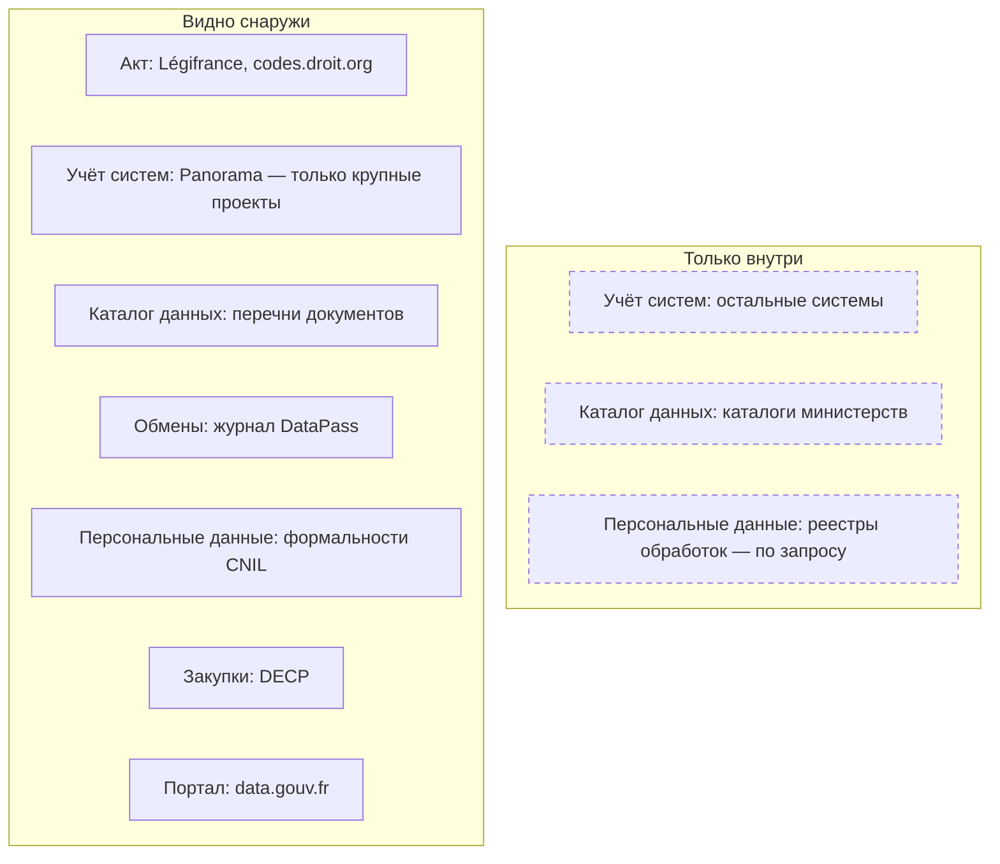
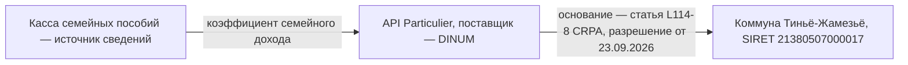

# Франция

Во Франции нет открытого реестра государственных систем, зато закон требует нескольких публичных списков, и опись собирают из них как мозаику. Перечни документов показывают, что администрация считает публичным; журнал обменов — какие сведения она отдаёт и получает; данные о контрактах и обзор крупных проектов — какие системы она строит. Слабое место — перечни: многие администрации их не ведут, а перечни министерств устаревают. Поэтому опись начинают с data.gouv.fr и перечней, сверяют с другими списками, а недостающее запрашивают по закону, называя найденное.

Сведения проверены 25 октября 2026 года, если не указано иное.

Сокращения главы: CRPA — Кодекс отношений между публикой и администрацией (Code des relations entre le public et l'administration); DINUM — Межминистерская цифровая дирекция; CNIL — Национальная комиссия по информатике и свободам, надзор за персональными данными; CADA — Комиссия по доступу к административным документам; SIRET — номер подразделения организации в реестре предприятий Sirene.

## Коротко



Пунктирная рамка — то, что видят только сами администрации; реестр обработок персональных данных выдают по запросу. Те же семь элементов в других странах — на странице [«Двенадцать стран в сравнении»](./00-overview.md).

## Правовая основа

Почти все обязанности, полезные для описи, собраны в CRPA. Полномочия министра определяет декрет о его полномочиях, который издают после каждого формирования правительства.

| Акт простыми словами | Что требует | Что даёт описи |
|----------------------|-------------|----------------|
| **CRPA: право на документы** | Документ администрации — любой, в том числе данные и исходные коды; молчание в течение месяца означает отказ, затем — обращение в CADA | Можно запросить и перечень, и реестр обработок |
| **CRPA: публикация и перечень** (закон о цифровой республике 2016 года) | Публиковать регулярно обновляемые базы данных; вести перечень основных документов и обновлять ежегодно | Перечень — начало описи |
| **CRPA: эталонные данные** | Перечень девяти баз, на которые ссылаются остальные, и их производителей | Список базовых регистров для любой отрасли |
| **CRPA: обмен между администрациями** (2022, 2026) | Публиковать список получателей, сведений и оснований; поставщики 21 вида сведений назначены декретом | Журнал обменов DataPass |
| **Закон «Информатика и свободы»** (1978) | Системы безопасности создают приказом после опубликованного заключения CNIL | Акты о системах со сведениями о людях |
| **Кодексы наследия и госзакупок** | Данные — архивы, уничтожают их только с визой архивной службы; данные контрактов от 40 000 евро публикуют | След выведенных систем, подрядчики |

Статьи, редакции и остальные акты — в приложении [«Нормативная база»](../09-appendices/02-legal-framework.md#франция).

## Реестры и платформы

### Шесть открытых списков

Каждый открытый список заполняет только часть записи реестра. Поэтому их сводят в рабочую таблицу по номеру SIRET организации:

| Поле реестра | Перечень | Panorama | DataPass | CNIL | DECP | data.gouv.fr |
|--------------|:--------:|:--------:|:--------:|:----:|:----:|:------------:|
| **Наименование, описание** | ● | ◐ | ○ | ◐ | ◐ | ● |
| **Организация-владелец** | ● | ● | ● | ● | ● | ◐ |
| **Информационная система** | ○ | ● | ● | ◐ | ◐ | ○ |
| **Основание (акт)** | ○ | ○ | ◐ | ◐ | ○ | ○ |
| **Условия, режим доступа** | ● | ○ | ◐ | ○ | ○ | ● |
| **Ссылка, формат, даты** | ◐ | ◐ | ◐ | ◐ | ◐ | ● |
| **Получатели** | ○ | ○ | ● | ○ | ○ | ○ |
| **Персональные данные** | ○ | ○ | ◐ | ● | ○ | ○ |
| **Подрядчик** | ○ | ○ | ○ | ○ | ● | ○ |

● — список заполняет поле, ◐ — частично или косвенно, ○ — нет. На data.gouv.fr издатель — не всегда владелец, а в DataPass основание пусто в половине строк.

### Перечни документов и данных

Перечень основных документов с публичной информацией (répertoire des informations publiques) обязан вести каждая администрация, которая такую информацию производит или хранит, и обновлять его ежегодно. Исчерпывающим он быть не обязан: администрация сама решает, какие документы интересны для повторного использования, — так в 2023 году ответило сенатору Министерство внутренних дел. Ещё в декабре 2020 года доклад депутата Эрика Ботореля отметил, что актуального исчерпывающего перечня публичных данных нет, как нет и полной картографии баз данных публичных организаций. Отдельно Экологический кодекс требует перечней категорий экологической информации с указанием, где она доступна.

На практике перечни ведут неровно:

- у Дирекции правовой и административной информации (DILA) последний раздел датирован 30 октября 2019 года;
- у министерств экологического перехода перечень — PDF на 23 страницах, версия от 8 июля 2025 года;
- перечень региона Центр — Долина Луары (135 записей) — выгрузка каталога опубликованного, а не опись;
- перечни префектур собраны на сайте Министерства внутренних дел, который из сети проверки не открылся.

Перечень Министерства Европы и иностранных дел — CSV от 25 июня 2024 года; само министерство назвало его прототипом. В нём 13 документов, и одна строка выглядит так:

| Поле перечня | Значение | Поле реестра |
|--------------|----------|--------------|
| Код | MEAE01 | Идентификатор |
| Название | Feuille de route des données — дорожная карта данных | Наименование |
| Предмет | Дорожная карта министерства по открытию данных, алгоритмов и исходных кодов | Описание |
| Дата создания | 27.09.2021 | Дата публикации |
| Условия | Licence ouverte version 2.0 | Условия использования |
| Дата обновления | пусто | Дата изменения — пробел |
| Служба | Direction du numérique | Ответственный |
| Адрес | Страница на numerique.gouv.fr | Ссылка |

Строка показывает, чего ждать от перечня: в нём документы — дорожные карты, отчёты, библиографии, — а не базы данных министерства, и поле даты обновления, которое требует закон, пусто. Перечень — начало описи, а не её результат: с ним сравнивают data.gouv.fr, журнал DataPass и закупки.

### Обмен данными между администрациями

Принцип «скажите нам один раз» обязывает администрации брать сведения друг у друга, а не у гражданина, а CRPA — публиковать список таких обменов. Его ведёт DINUM как журнал разрешений DataPass — сервиса, через который администрации и организации получают доступ к государственным программным интерфейсам. Одна строка журнала:



У строки семь полей: поставщик, интерфейс, SIRET и название получателя, запрошенные сведения, правовое основание и дата. В реестре данных это способ доступа к набору, его пользователь и основание передачи ([«Расширенный состав»](../03-process/05-registry.md#расширенный-состав)).

В файле от 1 октября 2026 года — 30 380 разрешений, выданных с 11 июня 2018 года по 23 сентября 2026 года, у 16 290 получателей, к 60 интерфейсам и сервисам. Больше всего подключений мэрий к концентратору заявлений HubEE (8406), к сервису свидетельств о смерти Генеральной дирекции здравоохранения (7674), к FranceConnect (4443), API Particulier (2658) и API Entreprise (1363). Поле основания пусто в 16 492 строках, в основном у подключений HubEE. Кто какие сведения обязан отдавать, назначает статья D114-9-1 CRPA: 21 вид сведений, например о налоговом домохозяйстве — Генеральная дирекция государственных финансов, о соискателе работы — France Travail.

Внутри государства по журналу проверяют, все ли получатели записаны пользователями набора; снаружи — находят систему, которая держит нужные сведения. Сами интерфейсы описаны на data.gouv.fr: 1273 описания, из них 108 с ограниченным доступом.

### Крупные проекты и заключения DINUM

Открытого реестра систем нет. Ближе всего к нему — обзор крупных цифровых проектов государства Panorama des grands projets numériques, который DINUM выпускает раз в полгода с 2016 года. В 22-м выпуске от 1 декабря 2025 года — 59 проектов 12 министерств с описанием, датой начала, сроком, оценкой стоимости и бюджетной программой; в сумме — около 4,5 млрд евро. Но Panorama — это проекты, а не системы: работающая система, которую не перестраивают, в обзор не попадает.

Вторая открытая часть — заключения DINUM по проектам. С 19 марта 2026 года заключение нужно проектам дороже 15 млн евро (раньше — 9 млн) и контрактам на облачные офисные пакеты и программы как услугу от 2 млн евро в год. В следующих выпусках проектов станет меньше, и сравнивать их с прежними надо с учётом порога.

### Системы с персональными данными

Формальности, поданные в CNIL с 2018 года, публикуются набором на data.gouv.fr: 27 277 записей на 19 октября 2026 года. Но государственных систем среди них мало: 24 430 — упрощённые декларации, 2517 — разрешения на исследования, и только 60 — запросы заключений по системам государства. Поэтому государственные системы ищут иначе:

- **акты о создании** — системы в сферах безопасности создают приказом после опубликованного заключения CNIL; названия актов однотипны — «arrêté portant création d'un traitement automatisé de données à caractère personnel dénommé…», и по этим словам их ищут в Journal officiel;
- **повестки CNIL** называют проекты актов до их принятия;
- **реестр обработок** государственного органа по статье 30 GDPR — административный документ: его выдают по запросу, скрыв сведения о безопасности. CADA подтвердила это в 2021 году.

### Госзакупки

С 2024 года покупатели публикуют основные данные контрактов (données essentielles de la commande publique, DECP) прямо на data.gouv.fr, а министерства экономики сводят их в единый файл. В сводном наборе на data.economie.gouv.fr — 726 792 записи с датами заключения по 22 октября 2026 года; ещё 28 257 записей не соответствуют формату. У записи — покупатель и поставщик по SIRET, предмет, код CPV, процедура, сумма и срок. С кодами CPV раздела 72 — ИТ-услуги — 15 099 записей, 8501 из них заключены с 2025 года. Объявления о закупках публикует бюллетень BOAMP — 1 720 280 объявлений с 2015 года, крупные закупки — ещё и европейская база TED. Технических заданий в DECP нет: их ищут на платформе покупателя по номеру процедуры ([«Государственные данные»](../04-sources/02-government.md#госзакупки)).

### data.gouv.fr и эталонные данные

Портал ведёт DINUM на открытой платформе udata: 74 652 набора, 381 347 ресурсов, 6925 организаций и 509 подключённых каталогов-источников. Значки отделяют [наборы высокой ценности](../05-frameworks/02-metadata-standards.md#наборы-высокой-ценности) (712), геоданные по европейской директиве INSPIRE (20 268) и эталонные данные (9).

Девять эталонных баз — то, на что ссылаются все остальные: реестр предприятий Sirene, реестр ассоциаций, кадастровый план, графический реестр сельскохозяйственных участков, крупномасштабная картографическая основа Национального института географической информации (IGN), национальная база адресов, справочник организации государства, классификатор профессий и официальный географический код. С этого списка удобно начинать опись любой отрасли.

Что важно при описи:

- **Ограниченный доступ — не опись закрытого.** Из 214 описаний с ограниченным доступом 167 пришли из геокаталогов, а 89 опубликовала одна дирекция территорий департамента Эн. Закрытые базы центральные администрации здесь почти не описывают ([«Закрытые наборы — тоже в реестре»](../03-process/06-access.md#закрытые-наборы--тоже-в-реестре)).
- **Издатель — не всегда производитель.** Графический реестр участков издаёт IGN, а производитель по закону — Агентство услуг и платежей. Производителя берут из акта, издателя записывают как способ доступа ([«Один набор под разными именами»](../03-process/05-registry.md#один-набор-под-разными-именами)).
- **Схемы и запросы.** На schema.data.gouv.fr — 106 схем данных, в том числе для каталогов местных органов и формата DECP ([«Национальные профили и схемы»](../05-frameworks/02-metadata-standards.md#национальные-профили-и-схемы)). На форуме портала — 142 темы с запросами данных. С февраля 2026 года наборы ищут и читают ИИ-ассистенты через сервер MCP ([«От таблицы до каталога»](../06-tools/01-from-spreadsheet-to-catalog.md#что-выбрать)).

### Администраторы данных министерств

По циркуляру премьер-министра 2021 года в каждом министерстве есть администратор данных, алгоритмов и исходных кодов (AMDAC). Список ведёт DINUM: 43 строки по 15 министерствам и службам премьер-министра, последнее изменение — 19 октября 2026 года. Для описи министерства администратор — первый адресат: он знает дорожную карту и того, кто ведёт внутренний каталог. DINUM в 2021 году потребовала, чтобы администрации знали своё «достояние данных» и вели его инвентаризацию, а в дорожной карте Министерства внутренних дел картография данных названа непрерывным процессом. Руководство data.gouv.fr по каталогизации (2026) объясняет, зачем министерству внутренний каталог: для единого информационного пункта по регламенту ЕС об управлении данными, принципа «скажите нам один раз», реестра обработок и перечня документов. Дорожные карты министерств опубликованы в сентябре 2021 года. В таблице обязательств DINUM от 5 февраля 2025 года из 63 обязательств выложить данные выполнены 41, не выполнены 13. Невыполненное обязательство — готовый вопрос министерству.

### Другие источники

- **Статистика и защищённый доступ.** Insee и 16 статистических служб министерств; программа обследований Национального совета статистической информации показывает, какие обследования проводятся, кем и как часто. Каталог Insee Melodi — 163 набора. Центр защищённого доступа к данным CASD сообщает о 581 источнике и 2081 проекте, Платформа данных здравоохранения ведёт национальный перечень баз здравоохранения — 52 базы. Записи получают только исследователи по разрешению, но каталоги отвечают на вопрос «есть ли такие данные и у кого».
- **Архивы.** Сроки хранения документов и данных администрация определяет соглашением с архивной службой, и эти соглашения — готовый список для опроса. Данные выведенной системы ищут в архивной службе министерства или департамента ([«Где искать преемника»](../04-sources/06-legacy.md#где-искать-преемника)).
- **Отраслевые описи Etalab 2021 года** — занятость (161 база 26 держателей), здравоохранение (172 базы 79 держателей), жильё и градостроительство (135 баз 43 держателей), по 28 полей у базы. Метод — кабинетное исследование, а с частью держателей — интервью, на котором они подтверждают найденное. Где интервью не было, выше вероятность ошибки в происхождении данных и владельце.

## Где искать данные

### Государственные

- **data.gouv.fr** и отраслевые порталы, например transport.data.gouv.fr — 808 наборов. Перед выводом «набора нет» проверяют сайт ведомства.
- **Справочник администраций** service-public — 94 128 записей о службах государства и местных органах с подчинённостью, миссией, основополагающим актом, SIRET и прежним названием: по нему составляют список владельцев в границах.
- **Реестры организаций** — Sirene Insee и «Справочник предприятий» annuaire-entreprises.data.gouv.fr с поиском без ключа.
- **Выгрузки DILA** на echanges.dila.gouv.fr/OPENDATA — базы Légifrance, решения CNIL, BOAMP: по ним акты о системах ищут полнотекстово.
- **CADA** — заключения: в сводном наборе 60 941 запись, «база данных» упоминается в 1386; они показывают, что уже запрашивали и что выдали.

Сводка data.gouv.fr, список интерфейсов с ограниченным доступом, эталонные данные, схемы, справочник администраций, DECP и BOAMP отдаются через программные интерфейсы без ключа. Журнал DataPass, список AMDAC и Panorama — файлы на data.gouv.fr.

<details>
<summary>Проверить самому</summary>

```bash
# data.gouv.fr: сводка портала (объект metrics)
curl "https://www.data.gouv.fr/api/1/site/"
# Программные интерфейсы с ограниченным доступом (поле total)
curl "https://www.data.gouv.fr/api/1/dataservices/?access_type=restricted&page_size=1"
# Девять наборов эталонных данных
curl "https://www.data.gouv.fr/api/1/datasets/?badge=spd&page_size=20"
# Справочник администраций: сколько записей (поле total_count)
curl --compressed "https://api-lannuaire.service-public.gouv.fr/api/explore/v2.1/catalog/datasets/api-lannuaire-administration/records?limit=0"
# DECP: сколько записей и сколько с кодами CPV 72
curl --compressed "https://data.economie.gouv.fr/api/explore/v2.1/catalog/datasets/decp-2022-marches-valides/records?limit=0"
curl --compressed -G "https://data.economie.gouv.fr/api/explore/v2.1/catalog/datasets/decp-2022-marches-valides/records" --data-urlencode 'where=startswith(codecpv,"72")' --data-urlencode 'limit=0'
# BOAMP: сколько объявлений
curl --compressed "https://boamp-datadila.opendatasoft.com/api/explore/v2.1/catalog/datasets/boamp/records?limit=0"
# Поиск организации: SIREN, правовая форма, адрес
curl "https://recherche-entreprises.api.gouv.fr/search?q=direction%20interministerielle%20du%20numerique&per_page=1"
```

</details>

### Общественные

- **Ma Dada** ассоциации Open Knowledge France — запросы документов и ответы: 52 889 запросов к 51 926 администрациям.
- **OpenDataFrance** — ассоциация территориальных образований: схемы местных данных и обсерватория. В сентябре 2025 года, по обсерватории, 30% обязанных территориальных образований опубликовали хотя бы один набор.
- **colibre.fr** — просмотр контрактов DECP; **Regards Citoyens** — данные о работе парламента.
- **Wikidata** — 463 746 элементов с номером SIREN и 35 557 — с идентификатором справочника администраций: по ним связывают организацию с прежними названиями и сайтами ([«Общественные данные»](../04-sources/03-public.md#общественные-проекты)).

### Коммерческие

- **Pappers, Société.com, Infogreffe** — сервисы на реестрах предприятий; коммерческий сервис — копия, дату и первоисточник записывают рядом ([«Сервисы на государственных реестрах»](../04-sources/04-commercial.md#сервисы-на-государственных-реестрах)).
- **Частные платформы закупок**, через которые покупатели проводят процедуры, — среди источников DECP; документы процедуры ищут на платформе из объявления.

## Как провести инвентаризацию

### Чем владеем: опись министерства

Порядок шагов и что каждый даёт реестру — на странице [«Двенадцать стран в сравнении»](./00-overview.md#чем-владеем-общий-порядок). Где их пройти во Франции:

| Шаг | Где | Видно снаружи? |
|-----|-----|----------------|
| **1. Полномочия** | Декрет о полномочиях министра, декреты об организации центральной администрации; список AMDAC | ● да |
| **2. Учёт систем** | Panorama, заключения DINUM, акты о создании систем | ◐ частично |
| **3. Каталог данных** | Перечень документов, перечень экологической информации; внутренний каталог | ◐ частично |
| **4. Обмены** | Строки журнала DataPass, где министерство — поставщик или получатель | ● да |
| **5. Персональные данные** | Реестр обработок по статье 30 GDPR, формальности CNIL | ◐ по запросу |
| **6. Формы и статистика** | Программа обследований, служба статистики министерства, CASD | ● да |
| **7. Закупки** | DECP по SIRET покупателей министерства, BOAMP | ● да |
| **8. Опубликованное** | data.gouv.fr по организациям министерства | ● да |
| **9. Опрос** | Администратор данных, подразделения, архивная служба | — |

Внутри министерства главная работа — сверка. Реестр обработок — самая подробная опись систем со сведениями о людях: её сравнивают с перечнем и data.gouv.fr. Система есть в журнале DataPass, а её наборов нет в перечне; контракт есть в DECP, а системы нет в реестре обработок; база ведётся по декрету о полномочиях, но её нет ни в перечне, ни на портале. Сам результат описи — тоже административный документ: его публикуют с отметкой, какие записи можно сообщать ([«Полный реестр и общедоступная часть»](../03-process/09-result-and-upkeep.md#полный-реестр-и-общедоступная-часть)).

### Где найти нужное

Общий порядок — на странице [«Двенадцать стран в сравнении»](./00-overview.md#где-найти-нужное-общий-порядок). Что во Франции иначе:

- **Кто ведёт** — эталонные данные и статья D114-9-1 CRPA для сведений о людях и предприятиях, программа обследований, декреты о полномочиях.
- **Где лежит** — журнал DataPass по нужным сведениям, Panorama, DECP по предмету контракта, каталоги CASD и Платформы данных здравоохранения; по занятости, здравоохранению и жилью — отраслевые описи Etalab с поправкой на их возраст.
- **Запрос** — по CRPA: молчание в течение месяца означает отказ, затем два месяца на обращение в CADA, её заключение — за месяц. Сначала ищут чужие запросы на Ma Dada и заключения CADA, а в запросе называют перечень, разрешение DataPass или контракт.

## Что особенного

- **Потоки данных публичны.** Журнал DataPass с основанием каждого обмена и статья D114-9-1 со списком поставщиков сведений — редкий случай, когда карта обменов внутри государства открыта.
- **Сильный портал — не полная опись.** data.gouv.fr — первый в Европе по Open Data Maturity 2025 года, но закрытые базы перечисляют другие каталоги — CASD и Платформа данных здравоохранения.
- **Удалить данные без архивиста нельзя.** Данные — архивы, их уничтожение требует визы, и выведенная система оставляет след в архивной службе.

## Пример

**Перечень, которого нет.** 14 августа 2023 года заявитель обратился в CADA: префектура департамента Атлантические Пиренеи отказалась опубликовать свой перечень документов. Префект ответил, что перечни всех префектур собраны на сайте Министерства внутренних дел. CADA 12 октября 2023 года проверила этот общий перечень, не нашла в нём ничего о префектуре и дала положительное заключение: составить перечень в кратчайший срок или внести сведения в общий. Она сослалась на свой совет от 20 апреля 2023 года, где разъяснила три вещи. Перечень обязателен «без учёта размера» администрации: порог в 50 сотрудников относится к публикации документов, а не к перечню. Исчерпывающим он быть не обязан. Если перечня нет, а его запросили, CADA предлагает администрации его составить.

Пример показывает три вещи:

- **Перечень можно запросить.** Его отсутствие — не ответ «данных нет», а основание для заключения CADA ([«Запрос владельцу»](../03-process/06-access.md#запрос-владельцу)).
- **Общий перечень — не перечень каждого.** Централизованный документ проверяют по каждой организации в границах описи.
- **Решения — тоже данные.** В сводном наборе CADA 31 запись о перечнях документов, 18 из них — с 2020 года: по ним видно, кто перечня не вёл.

## Частые ошибки

| Ошибка | Что происходит | Как исправить |
|--------|----------------|---------------|
| **Перечень документов принят за полную опись** | Пробелы считают отсутствием данных | Перечень не исчерпывающий; недостающее искать по полномочиям, DataPass и закупкам |
| **Издатель записан как производитель** | В реестре IGN вместо Агентства услуг и платежей у графического реестра участков | Производителя брать из акта об эталонных данных и акта о базе |
| **Формальности CNIL приняты за все системы государства** | Пропадают системы безопасности и большинство обработок без формальностей | Искать акты о создании в Journal officiel и запрашивать реестр обработок |

Сквозные ошибки — в главе [«Практики и антипаттерны»](../08-practices/01-practices-and-anti-patterns.md).

## Ограничения

- Открытого учёта систем нет: Panorama перечисляет проекты, а не работающие системы, и число систем государства неизвестно.
- Набор заключений CADA отстаёт: последнее заседание в сводном файле от 14 августа 2026 года — 18 апреля 2024 года.
- Числа порталов меняются ежедневно: сводка data.gouv.fr днём 25 октября 2026 года показывала 74 652 набора, к вечеру — 74 653.
- Матрица «шесть списков × поля реестра» — авторская: сами списки таких соответствий не дают.

## Источники

- Кодексы на codes.droit.org, собранные из Légifrance, 25 октября 2026 года: [CRPA](https://codes.droit.org/PDF/Code%20des%20relations%20entre%20le%20public%20et%20l'administration.pdf), издание от 24 октября 2026 года, — статьи L114-8, D114-9-1, L300-2, L312-1-1, D312-1-1-1, L321-4, R321-5, L322-6, R322-7, R343-1; [Code du patrimoine](https://codes.droit.org/PDF/Code%20du%20patrimoine.pdf) — статьи L211-1, R212-13, R212-14; [Code de l'environnement](https://codes.droit.org/PDF/Code%20de%20l'environnement.pdf) — статья L124-7; [Code de la commande publique](https://codes.droit.org/PDF/Code%20de%20la%20commande%20publique.pdf) — статья R2196-1; [Code de la santé publique](https://codes.droit.org/PDF/Code%20de%20la%20sant%C3%A9%20publique.pdf) — статьи L1461-1 и L1462-1.
- [La loi Informatique et Libertés](https://www.cnil.fr/fr/la-loi-informatique-et-libertes) — CNIL, консолидированный текст от 15 ноября 2024 года, статья 31; [повестка CNIL 6 марта 2025 года](https://www.cnil.fr/fr/ordre-du-jour-de-la-seance-pleniere-du-6-mars-2025); [Décret n° 2026-193](https://www.weka.fr/base-juridique-weka/jorf/JORFTEXT000053700822) и [arrêté du 18 mars 2026](https://www.weka.fr/base-juridique-weka/jorf/JORFTEXT000053700423) — копии JORF в базе Weka, с Légifrance не сверены.
- Перечни: [Répertoire des informations publiques](https://www.dila.gouv.fr/services/repertoire-des-informations-publiques) — DILA; [перечень министерств экологии](https://www.data.gouv.fr/datasets/repertoire-des-informations-publiques-des-ministeres-de-lamenagement-du-territoire-et-de-la-transition-ecologique); [перечень МИД](https://www.data.gouv.fr/datasets/repertoire-des-informations-publiques-du-meae) — файл от 25 июня 2024 года, 13 строк, разобран 26 октября 2026 года; [перечень региона Центр — Долина Луары](https://www.data.gouv.fr/datasets/repertoire-des-informations-publiques-region-centre-val-de-loire); [Pour une politique publique de la donnée](https://vie-publique.fr/files/rapport/pdf/277879.pdf) — доклад Э. Ботореля, декабрь 2020 года; [ответ на вопрос сенатора № 06976](https://www.senat.fr/questions/base/2023/qSEQ230506976.html) — JO Sénat, 31 августа 2023 года; [Cadre interministériel d'administration de la donnée](https://archive.numerique.gouv.fr/uploads/Cadre-interministeriel-donnee.pdf) — DINUM, 23 сентября 2021 года; [дорожная карта МВД](https://archive.numerique.gouv.fr/uploads/feuillederoute_mi.pdf), мера A28.
- [Avis et conseils de la CADA](https://www.data.gouv.fr/datasets/avis-et-conseils-de-la-cada) — сводный файл от 14 августа 2026 года: совет n° 20231374 от 20 апреля 2023 года, заключения n° 20235003 от 12 октября 2023 года и n° 20210039 от 4 марта 2021 года.
- DINUM на data.gouv.fr: [Habilitations Datapass validées](https://www.data.gouv.fr/datasets/habilitations-datapass-validees) — файл от 1 октября 2026 года, разобран 26 октября 2026 года; [Panorama des grands projets numériques de l'État](https://www.data.gouv.fr/datasets/panorama-des-grands-projets-numeriques-de-letat), 22-й выпуск; [Publication des avis DINUM](https://www.data.gouv.fr/datasets/publication-des-avis-dinum-articles-3-et-7); [список AMDAC](https://www.data.gouv.fr/datasets/liste-des-administrateurs-ministeriels-des-donnees-des-algorithmes-et-des-codes-sources); [дорожные карты министерств](https://www.data.gouv.fr/datasets/feuilles-de-route-ministerielles-sur-la-politique-de-la-donnee-des-algorithmes-et-des-codes-sources); [таблица обязательств](https://www.data.gouv.fr/datasets/tableau-de-suivi-des-ouvertures-de-donnees-codes-sources-et-api-publics); [опись баз данных о занятости](https://www.data.gouv.fr/datasets/inventaire-des-bases-de-donnees-relatives-a-lemploi) — Etalab, 2021; [Catalogage de données — Grist](https://guides.data.gouv.fr/autres/catalogage-de-donnees-grist).
- [Traitements de données personnelles déclarés à la CNIL depuis le 25 mai 2018](https://www.data.gouv.fr/datasets/traitements-de-donnees-personnelles-declares-a-la-cnil-depuis-le-25-mai-2018) — выгрузка от 19 октября 2026 года.
- data.gouv.fr: [сводка портала](https://www.data.gouv.fr/api/1/site/), [эталонные данные](https://www.data.gouv.fr/pages/spd/reference), [schema.data.gouv.fr](https://schema.data.gouv.fr/schemas.json), [transport.data.gouv.fr](https://transport.data.gouv.fr/api/datasets), [форум](https://forum.data.gouv.fr/c/recherche-et-ouverture-de-donnees/8), [datagouv-mcp](https://github.com/datagouv/datagouv-mcp).
- Статистика и защищённый доступ: [Les Services statistiques ministériels](https://www.insee.fr/fr/information/2013075) — Insee; [каталог Melodi](https://api.insee.fr/melodi/catalog/all); [программа обследований 2026 года](https://www.cnis.fr/arretes-au-journal-officiel-du-programme-denquetes/enquetes-2026) — Cnis; [CASD](https://www.casd.eu/) и [список источников](https://www.casd.eu/donnees-utilisees-sur-le-casd/); [каталог Платформы данных здравоохранения](https://www.health-data-hub.fr/catalogue-de-donnees).
- Закупки: [DECP — fichiers consolidés](https://www.data.gouv.fr/datasets/donnees-essentielles-de-la-commande-publique-fichiers-consolides); [программный интерфейс DECP](https://data.economie.gouv.fr/api/explore/v2.1/catalog/datasets/decp-2022-marches-valides/records?limit=0); [открытые данные BOAMP](https://boamp-datadila.opendatasoft.com/api/explore/v2.1/catalog/datasets/boamp/records?limit=0).
- Справочники и общественные проекты: [справочник администраций](https://api-lannuaire.service-public.gouv.fr/api/explore/v2.1/catalog/datasets/api-lannuaire-administration/records?limit=0); [выгрузки DILA](https://echanges.dila.gouv.fr/OPENDATA/); [Wikidata Query Service](https://query.wikidata.org/) — свойства P1616 и P6671; [Ma Dada](https://madada.fr/); [обсерватория OpenDataFrance](https://opendatafrance.fr/presentation-de-lobservatoire/); [colibre.fr](https://colibre.fr/); [Regards Citoyens](https://www.regardscitoyens.org/).
- [2025 Open Data Maturity Report](https://data.europa.eu/sites/default/files/2025-12/2025_odm_report_6.pdf) — data.europa.eu, декабрь 2025 года.
- Главы [«Зарубежные методики»](../05-frameworks/04-international-practice.md), [«Стандарты описания»](../05-frameworks/02-metadata-standards.md#национальные-профили-и-схемы); приложение [«Нормативная база»](../09-appendices/02-legal-framework.md#франция).
- Как проверяли. 25 октября 2026 года из сети проверки не открылись legifrance.gouv.fr, interieur.gouv.fr, economie.gouv.fr, pappers.fr, infogreffe.fr и data.inpi.fr (ошибка 403), piste.gouv.fr и adresse.data.gouv.fr; datapass.api.gouv.fr отклонил запрос без браузера, francearchives.gouv.fr потребовал JavaScript. Кодексы сверены по изданиям codes.droit.org с датами издания.
