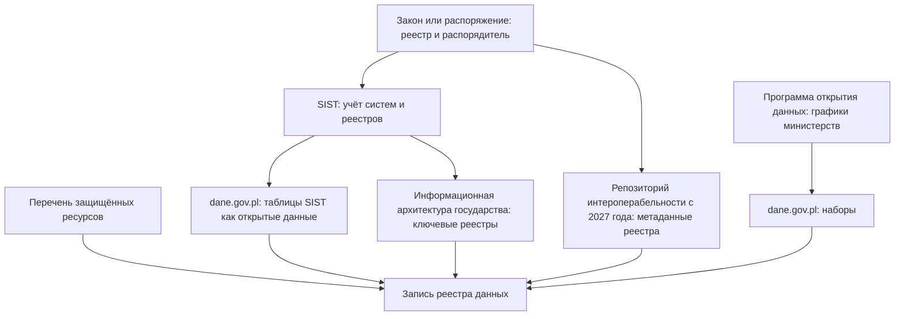

# Польша

В Польше учёт государственных систем и реестров ведёт Министерство цифровизации в системе инвентаризации SIST, а итоги учёта публикует как открытые данные: на dane.gov.pl лежат таблицы о сотнях систем органов правительственной администрации — с основанием, статусом, преемником, персональными данными и способом доступа. С 6 сентября 2025 года такая инвентаризация — обязанность по закону об информатизации: не реже раза в год министр собирает сведения о системах, публичных реестрах и обмене данными между ними. В рамках информационной архитектуры государства отдельно описаны 145 ключевых реестров. С 23 февраля 2027 года держатели реестров начнут публиковать их метаданные в репозитории интероперабельности, но для работающих реестров закон даёт сроки до 2029–2031 годов. Опубликованное собирает портал dane.gov.pl, закрытое описывает перечень защищённых ресурсов на нём же. Поэтому опись министерства начинают с его строк в таблицах SIST, списка ключевых реестров и его наборов на портале, а анкета уточняет остальное: внутренние системы, таблицы вне систем, качество.

В индексе развития электронного правительства ООН Польша в 2024 году заняла 37-е место, в 2022-м — 34-е; обзор 2026 года на 25 октября 2026 года не вышел. Сведения главы проверены 25 октября 2026 года, если не сказано иное. Акты сверены через программный интерфейс базы ELI Сейма (api.sejm.gov.pl): система правовых актов isap.sejm.gov.pl из сети проверки отвечала страницей защиты от ботов. Подробности об актах — в приложении [«Нормативная база»](../09-appendices/02-legal-framework.md#польша), методика открытия данных — в разделе [«Открытие данных в Польше»](../05-frameworks/04-international-practice.md#открытие-данных-в-польше) главы «Зарубежные методики».

## Коротко

| Что ищут | Где | Что даёт | Чего не даёт |
|----------|-----|----------|--------------|
| **[Полномочия и акты](#правовая-основа)** | ELI Сейма api.sejm.gov.pl/eli, dziennikustaw.gov.pl, monitorpolski.gov.pl; проекты — legislacja.gov.pl | Тексты с номерами, статусом, датой вступления в силу и утраты силы; акты, которые создают реестры | Что на самом деле лежит в системе |
| **[Учёт систем](#sist)** | SIST; итоги — набор «Systemy/rejestry gromadzące dane publiczne» на dane.gov.pl | 820 систем 108 органов: основание, статус, преемник, связанные реестры, персональные данные, доступ, программный интерфейс | Системы самоуправления; системы для внутренних нужд — кадры, бухгалтерия |
| **[Опись реестров](#информационная-архитектура-государства)** | Портал интероперабельности и архитектуры gov.pl/web/ia | 145 ключевых реестров с важностью, распорядителем, основанием и системой | Остальные из «более 1000» выявленных реестров |
| **[Метаданные реестров](#репозиторий-интероперабельности)** | Репозиторий интероперабельности — с 23 февраля 2027 года | Основание, структуры данных, словари, форматы, условия доступа, контакт, программный интерфейс | На 25 октября 2026 года ещё не действует |
| **[Опубликованное](#портал-данных)** | dane.gov.pl | Около 28,7 тысячи наборов, программный интерфейс без ключа, выгрузка в DCAT-AP-PL | 81% наборов — цены застройщиков |
| **[Закрытое](#защищённые-данные)** | Перечень защищённых ресурсов, dane.gov.pl/pl/dga | 1695 позиций 53 распорядителей: что есть, формат, объём | Сами данные — только по заявлению |
| **Формы сбора** | Программа статистических обследований (PBSSP) | 258 обследований на 2026 год; во второй части — данные, которые органы передают статистике из своих систем | Где лежат записи |
| **[Регистры и закупки](#государственные)** | KRS, REGON, TERYT, CEIDG, геопортал; e-Zamówienia, TED | Сведения о юридических лицах, территориях, участках; объявления и контракты | Часть доступна только с ключом или учётной записью |



## Правовая основа

Закон об информатизации определяет публичный реестр (rejestr publiczny) как упорядоченный набор данных для выполнения публичных задач, который ведут на основании закона (статья 3, пункт 5). Это основная единица описи: у реестра всегда есть акт и распорядитель. Поправка 2025 года добавила в закон учёт систем и реестров, информационную архитектуру государства и репозиторий метаданных — по частям и с разными датами.

- **Ustawa z dnia 17 lutego 2005 r. o informatyzacji działalności podmiotów realizujących zadania publiczne** — закон об информатизации, единый текст — Dz.U. 2026 poz. 1241 (по состоянию на 6 августа 2026 года и с изменениями Dz.U. 2026 poz. 160). С 6 сентября 2025 года действуют статьи 20ga–20gd об инвентаризации в [SIST](#sist) и статья 12j об информационной архитектуре государства. С 23 февраля 2027 года — статьи 12k–12n и пункт 1a статьи 14: [репозиторий интероперабельности](#репозиторий-интероперабельности), метаданные реестров, программные интерфейсы, оценка интероперабельности. Глава 3b (статьи 20p–20t) об Интегрированной аналитической платформе добавлена статьёй 51 закона об открытых данных и действует с 8 декабря 2021 года.
- **Ustawa z dnia 25 lipca 2025 r. o zmianie ustawy o informatyzacji…** — поправка, Dz.U. 2025 poz. 1158, опубликована 22 августа 2025 года, в силе с 6 сентября 2025 года, нормы о репозитории и реестрах — через 18 месяцев после опубликования (статья 17). Служит применению регламента ЕС 2024/903 «Об интероперабельной Европе»; переходные сроки — статья 14. Создала Комитет по делам цифровизации, который принял незавершённые задачи Комитета Совета министров по делам цифровизации (статьи 4 и 5).
- **Rozporządzenie Rady Ministrów z dnia 21 maja 2024 r. w sprawie Krajowych Ram Interoperacyjności…** — регламент о Национальных рамках интероперабельности и минимальных требованиях к реестрам и системам (KRI), Dz.U. 2024 poz. 773, в силе с 23 мая 2024 года; по данным ELI, утратит силу 23 февраля 2027 года. Пункт 2 части 2 параграфа 19 требует держать актуальной инвентаризацию оборудования и программ с их видом и конфигурацией. Глава 3 — требования к реестрам: типы объектов «физическое лицо», «субъект», «пространственный объект» с уникальными идентификаторами (параграф 10) и обмен через обращение к эталонным данным, а не копирование (параграф 13). Замена — проект от 29 июля 2026 года, RD313 в перечне работ Совета министров.
- **Uchwała nr 130 Rady Ministrów z dnia 9 czerwca 2026 r.** — Стратегия цифровизации государства, M.P. 2026 poz. 620. Обещает обязательную инвентаризацию всех систем и реестров администрации, включая бухгалтерские и кадровые, через SIST и его версию для самоуправления SIST JST, Каталог публичных реестров и закрепление в законе эталонных реестров.
- **Ustawa z dnia 11 sierpnia 2021 r. o otwartych danych…** — закон об открытых данных, единый текст — Dz.U. 2023 poz. 1524: программа открытия данных и графики министров (статьи 28–31), портал данных (статьи 32–34), уполномоченный по открытости данных (статьи 37–38), ответ на заявление о повторном использовании (статья 40). Программа на 2021–2027 годы — M.P. 2021 poz. 290 ([«Открытие данных в Польше»](../05-frameworks/04-international-practice.md#открытие-данных-в-польше)).
- **Ustawa z dnia 27 marca 2026 r. o zarządzaniu danymi** — закон об управлении данными, Dz.U. 2026 poz. 548, в силе с 23 июля 2026 года ([«Защищённые данные»](#защищённые-данные)).
- **Ustawa z dnia 6 września 2001 r. o dostępie do informacji publicznej** — закон о доступе к публичной информации, единый текст — Dz.U. 2022 poz. 902: сведения о реестрах, учётах и архивах — в BIP (статья 6, пункт 1, подпункт 3f; статья 8, пункт 3); ответ — за 14 дней, при продлении — не позже двух месяцев (статья 13) ([«Вопрос чужому владельцу»](../03-process/04-questionnaires.md#вопрос-чужому-владельцу)).
- **Ustawa z dnia 29 czerwca 1995 r. o statystyce publicznej** — закон о публичной статистике, единый текст — Dz.U. 2026 poz. 851: программа обследований (статья 18), реестры REGON (статья 42) и TERYT (статья 47). Программа на 2026 год — Dz.U. 2025 poz. 1842, изменена Dz.U. 2026 poz. 1136 ([«Статистика и формы сбора сведений»](../04-sources/02-government.md#статистика-и-формы-сбора-сведений)).
- **Prawo geodezyjne i kartograficzne** — закон о геодезии и картографии 1989 года, единый текст — Dz.U. 2026 poz. 1389: бесплатные наборы — статья 40a ([«Государственные»](#государственные)).
- **Ustawa z dnia 4 września 1997 r. o działach administracji rządowej** — закон об отраслях государственного управления, единый текст — Dz.U. 2026 poz. 1226 ([«Где искать полномочия»](../03-process/03-owners-and-mandates.md#где-искать-полномочия)); **Prawo zamówień publicznych** 2019 года — закон о публичных закупках, в силе с 1 января 2021 года, единый текст — Dz.U. 2026 poz. 793.

## Реестры и платформы

### SIST

Система инвентаризации ИКТ-систем (System Inwentaryzacji Systemów Teleinformatycznych, SIST) собирает сведения о системах и реестрах государственной администрации и о том, какие системы обмениваются данными. Владелец — министр цифровизации, администратор — Институт связи (Instytut Łączności — Państwowy Instytut Badawczy), вход для органов — sist.itl.waw.pl. До 2025 года инвентаризация опиралась на постановления Совета министров о программах открытия данных и интегрированной информатизации государства, а с 6 сентября 2025 года её порядок записан в законе об информатизации:

- министр не реже раза в год собирает сведения о существующих и планируемых системах, о публичных реестрах и об обмене данными между системами; системы и реестры национальной и общественной безопасности исключены (статья 20ga);
- орган, получивший уведомление, заводит учётную запись в SIST, вносит и обновляет сведения; срок — не меньше 14 дней (статья 20gb);
- в SIST хранят сведения о системах, реестрах, актах, на основании которых их ведут, и об операторах (статья 20gc);
- до 30 апреля министр представляет Совету министров годовой отчёт о том, как органы выполнили обязанность (статья 20gd).

По странице SIST на портале интероперабельности, сведения собирают дважды в год, а системы для внутренних нужд — кадровые, финансово-бухгалтерские, почту, сайты и BIP, внутренние порталы — в SIST не вносят.

**Итоги открыты.** Министерство публикует их на dane.gov.pl в наборе «Systemy/rejestry gromadzące dane publiczne» с 2017 года, раз в год, по лицензии CC0. Последний выпуск — сведения на 19 декабря 2025 года, опубликованные 23 и 24 февраля 2026 года:

- **отчёт** — в SIST 1990 учреждений и 1601 система: 303 собирают данные для внешних нужд, 1298 работают только внутри организации. Из 79 учреждений программы открытия данных 63 описали системы полностью, одно — частично, 15 не участвовали;
- **таблица систем** — 820 систем 108 органов правительственной администрации и подведомственных учреждений: идентификатор вида S00513, название, статус, преемник, дата внедрения, есть ли правовое основание и какие акты, отрасль, функции, связанные реестры. 675 систем эксплуатируются, 49 внедряются или планируются, 28 готовятся к выводу, 68 выведены или в архиве;
- **таблица открытости** — 746 систем: персональные и чувствительные данные, данные высокой ценности, число записей, запросы о доступе, что открыто и где, публикация на dane.gov.pl и в BIP, контроль качества, программный интерфейс и документация, форматы выгрузки, условия повторного использования и плата.

Опись систем государства, открытая и машиночитаемая, — редкий случай. Внутри министерства SIST — основа описи «чем владеем», снаружи таблицы заменяют то, что в других странах ищут по следам в закупках ([«Реестры информационных систем»](../04-sources/02-government.md#реестры-информационных-систем)).

### Информационная архитектура государства

Информационная архитектура государства (Architektura Informacyjna Państwa, AIP) — метод управления информатизацией на основе архитектурных моделей, принципов, стандартов и рекомендаций. С 6 сентября 2025 года министр по закону развивает её и ведёт её репозиторий с моделями (статья 12j). SIST, по пояснению портала интероперабельности, — интерфейс к этому репозиторию: из сведений SIST и карточек ИТ-проектов строят карты интероперабельности.

На портале gov.pl/web/ia опубликованы два списка — таблицами с фильтрами:

- **Ключевые публичные реестры.** В работах по AIP выявлено «больше 1000» реестров и других информационных ресурсов, ключевыми отобраны 145: 14 критических, 27 очень важных и 104 важных. У записи — полное название, важность, тематическая область, распорядитель, правовое основание, система и описание; файл списка датирован 26 августа 2025 года. Критические — эталоны для основных объектов: PESEL, реестры удостоверений личности и актов гражданского состояния, учёты транспортных средств и паспортов, KRS, REGON, CEIDG, реестр налогоплательщиков, TERYT, учёт адресов, кадастр, реестры границ и географических названий. Список собран по актам, SIST, анкете, карточкам проектов и консультациям; часть описаний устарела ([«Как методы проверяют друг друга»](../02-approaches/02-methods.md#как-методы-проверяют-друг-друга)).
- **Ключевые публичные ИТ-системы.** 137 продуктов проектов, которые в 2020–2021 годах мониторил Комитет Совета министров по делам цифровизации, с плановыми датами внедрения с 2018 по 2024 год, — снимок прошлых проектов, а не текущий реестр.

Стратегия цифровизации признаёт, что каталога метаданных публичных реестров и каталога программных интерфейсов нет, и обещает Каталог публичных реестров с учётом готовящегося репозитория интероперабельности.

### Репозиторий интероперабельности

С 23 февраля 2027 года министр ведёт в общедоступной системе репозиторий интероперабельности и следит в нём за доступностью программных интерфейсов реестров (статья 12k). В нём будут:

- **метаданные публичных реестров** — полное и краткое название, описание, орган и REGON обслуживающего учреждения, тематическая категория и статус, основание и дата создания, основание и дата прекращения, структуры данных и их смысл, форматы, словари, условия доступа и повторного использования, сроки выдачи данных, единая точка контакта;
- **сведения о программных интерфейсах** — точки доступа, документация, гарантированная доступность, что делать при её нарушении, статистика использования (часть 5 статьи 13);
- **результаты оценки интероперабельности**, которую проводят перед изменением системы или реестра (статья 12n).

Орган публикует сведения или указывает основание их секретности и отвечает за их полноту и актуальность; если реестр ведут несколько органов в одной системе, публикует оператор системы. С той же даты держатель реестра обязан вести его в информационной системе, выдавать данные через программные интерфейсы, составить список словарей и классификаторов, описать условия доступа и повторного использования и порядок сообщения о расхождениях. Самоуправление может вести реестр и не в системе, но если ведёт в системе — остальные требования для него те же (пункты 1a и 1b статьи 14).

Для работающих систем и реестров сроки растянуты (статья 14 поправки, счёт — от 6 сентября 2025 года): правительственная администрация — не позже 50 месяцев, к ноябрю 2029 года, самоуправление — 72 месяцев, к сентябрю 2031 года, остальные — 48 месяцев, к сентябрю 2029 года. Переходный срок не действует для систем и реестров, созданных или изменённых по функциям позже чем через 18 месяцев после вступления поправки в силу, то есть с марта 2027 года. Пока по регламенту KRI в репозитории на платформе ePUAP публикуют схемы XML и описания веб-сервисов (параграфы 8 и 10); регламента о новом репозитории (статья 12m) в ELI на 25 октября 2026 года нет.

Поля статьи 12k почти совпадают с расширенной записью реестра данных в этой книге ([«Расширенный состав»](../03-process/05-registry.md#расширенный-состав)): репозиторий станет готовым реестром метаданных государства.

### Портал данных

dane.gov.pl — портал данных по закону об открытых данных, оператор — Министерство цифровизации. По программному интерфейсу портала 25 октября 2026 года на нём было около 28,7 тысячи наборов и 7746 профилей поставщиков, наборы были у 6606 из них. Типы поставщиков показывают, что число наборов — не мера охвата:

| Тип поставщика | Поставщиков с наборами | Наборов |
|----------------|------------------------|---------|
| Застройщики (developer) | 5877 | 23 327 |
| Государственные органы (state) | 172 | 2471 |
| Самоуправление (local) | 373 | 2420 |
| Частные (private) | 183 | 406 |

Застройщики с июля 2025 года по закону передают цены жилья, и на них приходится 81% наборов ([«Порталы открытых данных»](../04-sources/02-government.md#порталы-открытых-данных)). По отчёту о выполнении программы открытия данных за 2025 год, на 31 декабря 2025 года 75% ресурсов портала имели не меньше трёх звёзд открытости. Отметку «данные высокой ценности по списку Еврокомиссии» 25 октября 2026 года несли 120 наборов. Каталог портала выгружается в DCAT-AP-PL, а европейский портал собирает его через программный интерфейс ([«Национальные профили и схемы»](../05-frameworks/02-metadata-standards.md#национальные-профили-и-схемы)).

### Защищённые данные

Регламент ЕС об управлении данными (Data Governance Act) требует от страны перечня защищённых данных публичного сектора ([«Полный реестр и общедоступная часть»](../03-process/09-result-and-upkeep.md#полный-реестр-и-общедоступная-часть)). Польский закон об управлении данными 2026 года устроил это так:

- единый информационный пункт ведёт министр цифровизации на портале данных (статья 3), там же — перечень ресурсов; органы публичного сектора сами вносят в него сведения (статья 4);
- заявление о повторном использовании защищённых данных подают через министра, он передаёт его органу в течение семи дней (статья 7); орган отвечает, что данных нет, делает предложение об условиях или отказывает решением (статья 9);
- компетентный орган, который помогает обезличивать и готовить безопасную среду, — председатель Главного статистического управления (статья 17); посредников данных надзирает председатель Управления по защите персональных данных (статья 19).

Сводный перечень Министерство цифровизации выкладывает на dane.gov.pl каждый день. В файле от 25 октября 2026 года — 1695 позиций 53 распорядителей, 1168 из них — Главного статистического управления. У каждой — распорядитель, название ресурса, формат и объём, а условия у всех — «определяются в предложении». По отчёту о программе, на 31 декабря 2025 года в перечне была 1781 позиция. Перечень — готовая закрытая часть реестра данных: что есть, у кого и в каком виде ([«Закрытые наборы — тоже в реестре»](../03-process/06-access.md#закрытые-наборы--тоже-в-реестре)).

### Интегрированная аналитическая платформа

По главе 3b закона об информатизации министр обеспечивает Интегрированную аналитическую платформу (Zintegrowana Platforma Analityczna, ZPA) для анализа ключевых государственных политик. Данные передают из публичных реестров и систем, персональные — псевдонимизированными, данные разных реестров можно связывать, а после анализа их удаляют. Список реестров и состав данных должен установить регламент Совета министров (часть 7 статьи 20q), а использование платформы оформляют соглашением, где названы цель, данные, реестры и системы (статья 20r). Регламента со списком реестров среди исполнительных актов закона в базе ELI на 25 октября 2026 года нет.

Проект платформы вели в 2019–2023 годах по программе «Цифровая Польша» с софинансированием 36,55 млн злотых; партнёры — три министерства, Варшавский университет и Варшавская школа экономики; сделано шесть исследований — от трудоустройства выпускников до траекторий обучения детей. По письму Министерства фондов и региональной политики от 4 февраля 2025 года, дополнением к соглашению о финансировании от 30 января 2025 года проект признан «нефункционирующим». Для описи это урок: норма закона о платформе ещё не значит, что платформа работает.

### Бюллетень публичной информации

Бюллетень публичной информации (Biuletyn Informacji Publicznej, BIP) — система официальных страниц органов, обязательная по закону о доступе к публичной информации. Орган публикует в BIP сведения о реестрах, учётах и архивах, которые ведёт, и о порядке доступа к ним. Главная страница BIP — gov.pl/web/bip: поиск органов, обязанных вести BIP, и выгрузка сведений об активных органах архивом ZIP. 25 октября 2026 года на ней было объявление: доступ к страницам BIP в системе SSDIP восстанавливают постепенно, публикация новых материалов и часть поиска недоступны.

### Сводка

| Что | Состояние на октябрь 2026 года |
|-----|-------------------------------|
| **SIST** | В законе с 6 сентября 2025 года; учёт не реже раза в год; итоги — открытые данные на dane.gov.pl, последний выпуск — на 19 декабря 2025 года |
| **Информационная архитектура государства** | В законе с 6 сентября 2025 года; списки 145 ключевых реестров и 137 ключевых ИТ-систем на gov.pl/web/ia |
| **Репозиторий интероперабельности** | Метаданные реестров и программных интерфейсов — с 23 февраля 2027 года; для работающих реестров — до 2029–2031 годов |
| **Регламент KRI** | Dz.U. 2024 poz. 773 действует до 23 февраля 2027 года; проект замены RD313 — в правительственном законодательном процессе с 4 августа 2026 года |
| **dane.gov.pl** | Около 28,7 тысячи наборов; 81% — цены застройщиков; программный интерфейс без ключа |
| **Перечень защищённых ресурсов** | 1695 позиций 53 распорядителей на 25 октября 2026 года |
| **Интегрированная аналитическая платформа** | Глава 3b закона действует с 2021 года; проект признан нефункционирующим в январе 2025 года |

## Где искать данные

### Государственные

- **Портал данных** dane.gov.pl — наборы по поставщику, без застройщиков ([«Портал данных»](#портал-данных)).
- **Статистика.** Главное статистическое управление (GUS), stat.gov.pl; программа обследований показывает, кто какое обследование ведёт и кто какие данные передаёт. Bank Danych Lokalnych, bdl.stat.gov.pl, — 172 740 переменных в 33 тематических категориях; программный интерфейс работает без ключа, но с лимитами: по ответу сервиса 25 октября 2026 года — 1000 запросов за 12 часов и 10 000 за неделю. Портал api.stat.gov.pl собирает интерфейсы GUS: REGON, TERYT, BDL, Dziedzinowe Bazy Wiedzy, SDG и другие.
- **Регистры.** Национальный судебный реестр KRS — текущая выписка по номеру через api-krs.ms.gov.pl без ключа. REGON — бесплатная веб-служба BIR1, ключ выдают по письму на regon_bir@stat.gov.pl; 25 октября 2026 года у неё было 24 157 зарегистрированных пользователей. TERYT — веб-служба ws1 после регистрации, 5343 пользователя, файлы — на eteryt.stat.gov.pl. CEIDG, реестр предпринимателей, — хранилище dane.biznes.gov.pl с учётной записью и входом через Profil Zaufany, больше 10 тысяч активных пользователей в конце 2025 года. Книги недвижимости (księgi wieczyste) — ekw.ms.gov.pl.
- **Геоданные.** geoportal.gov.pl, Главное управление геодезии и картографии. Бесплатно выдают реестры границ и географических названий, ортофотопланы, цифровую модель рельефа, топографическую базу BDOT10k, идентификаторы и геометрию участков и зданий, а с 13 февраля 2026 года — и реестр цен недвижимости (статья 40a закона о геодезии и картографии).
- **Закупки.** Объявления ниже порогов ЕС публикуют в Бюллетене публичных закупок (BZP) на платформе e-Zamówienia, ezamowienia.gov.pl, выше порогов — в TED, где ИТ-услуги помечены кодами CPV раздела 72 ([«Госзакупки»](../04-sources/02-government.md#госзакупки)).
- **Нормативные акты.** ELI Сейма — тексты и карточки актов со статусом, датами и связями «изменяет», «утратил силу», «исполнительные акты»; Dziennik Ustaw и Monitor Polski; проекты с номерами вида RD313 — legislacja.gov.pl ([«Нормативные акты»](../04-sources/02-government.md#нормативные-акты)).
- **BIP органов** — сведения о реестрах и порядке доступа к ним ([«Бюллетень публичной информации»](#бюллетень-публичной-информации)).

### Общественные

- **Sieć Obywatelska Watchdog Polska**, siecobywatelska.pl, — организация за открытость власти: по её словам, она даёт тысячи консультаций о запросах публичной информации и сотни раз ходит в суд. К ней обращаются, когда орган не отвечает на запрос.
- **Фонд Moje Państwo**, mojepanstwo.pl. 25 октября 2026 года сайт был страницей фонда со ссылками на его сервисы: rejestr.io — данные о компаниях, фондах и ассоциациях, tenders.guru — закупки, bankdanych.io — просмотр Bank Danych Lokalnych, ktoile.pl — государственная помощь предпринимателям. Прежние адреса разделов данных вида mojepanstwo.pl/dane/… отвечали ошибкой 404.
- **Европейский портал** data.europa.eu собирает около 10 тысяч наборов dane.gov.pl ([«Стандарты описания»](../05-frameworks/02-metadata-standards.md#национальные-профили-и-схемы)); Wikidata и OpenStreetMap — по правилам главы [«Общественные данные»](../04-sources/03-public.md).

### Коммерческие

- **Бюро кредитных историй.** Банки вместе с банковскими палатами вправе создавать учреждения, которые собирают и выдают сведения, составляющие банковскую тайну (часть 4 статьи 105 закона «Банковское право», единый текст — Dz.U. 2026 poz. 38); таково Biuro Informacji Kredytowej, bik.pl. Бюро экономической информации (BIG) работают по закону о предоставлении экономической информации, единый текст — Dz.U. 2025 poz. 85. Их данные — копии сведений о кредитах и долгах, которые передают банки и кредиторы.
- **Сервисы на государственных реестрах** — справки о компаниях из KRS, REGON и CEIDG; первоисточник открыт, поэтому коммерческую копию сверяют с ним ([«Коммерческие данные»](../04-sources/04-commercial.md)).
- **Частные поставщики на dane.gov.pl.** По отчёту о программе, на 31 декабря 2025 года профиль поставщика на портале был у 5579 частных организаций, в основном застройщиков.

### Проверка адресов

25 октября 2026 года из сети, где проверялась книга, открылись api.sejm.gov.pl, dziennikustaw.gov.pl, monitorpolski.gov.pl, dane.gov.pl и api.dane.gov.pl, gov.pl/web/ia, gov.pl/web/bip, sist.itl.waw.pl (страница входа), stat.gov.pl, bdl.stat.gov.pl, api.stat.gov.pl, eteryt.stat.gov.pl, wyszukiwarkaregon.stat.gov.pl, программный интерфейс api-krs.ms.gov.pl, prs.ms.gov.pl, ekw.ms.gov.pl, dane.biznes.gov.pl, geoportal.gov.pl, epuap.gov.pl, страницы проектов на legislacja.gov.pl, siecobywatelska.pl, mojepanstwo.pl, bik.pl, big.pl и ted.europa.eu. isap.sejm.gov.pl отвечал страницей защиты от ботов, поиск на legislacja.gov.pl — отказом в запросе; ezamowienia.gov.pl, rdf-przegladarka.ms.gov.pl, поиск CEIDG и rejestr.io ответили ошибкой 403; bankdanych.io, ktoile.pl и tenders.guru не ответили за 60 секунд. Их нужно перепроверить из польской сети.

### Портал за минуту

```bash
# dane.gov.pl: сколько наборов (поле meta.count)
curl "https://api.dane.gov.pl/1.4/datasets?per_page=1"
# Поставщики с типом (attributes.institution_type) и числом наборов; сортировка по id — иначе страницы повторяются
curl "https://api.dane.gov.pl/1.4/institutions?per_page=100&page=1&sort=id"
# Итоги SIST: файлы таблиц систем, открытости и отчёта за все годы
curl "https://api.dane.gov.pl/1.4/datasets/195/resources?per_page=50"
# Сводный перечень защищённых ресурсов — последний файл
curl "https://api.dane.gov.pl/1.4/datasets/4354/resources?per_page=1&sort=-created"
# Наборы высокой ценности по списку Еврокомиссии
curl "https://api.dane.gov.pl/1.4/datasets?per_page=1&has_high_value_data_from_ec_list=true"
# ELI Сейма: статус акта, дата утраты силы (repealDate), кем изменён и отменён
curl "https://api.sejm.gov.pl/eli/acts/DU/2024/773"
# KRS: текущая выписка по номеру (здесь — Polskie Koleje Państwowe S.A.)
curl "https://api-krs.ms.gov.pl/api/krs/OdpisAktualny/0000019193?rejestr=P&format=json"
# Bank Danych Lokalnych: сколько переменных (поле totalRecords)
curl "https://bdl.stat.gov.pl/api/v1/variables?format=json&page-size=1"
```

Запросы проверены 25 октября 2026 года. Таблицы SIST — файлы xlsx: строки органа сравнивают с его наборами на dane.gov.pl и с ключевыми реестрами, где он распорядитель.

## Как провести инвентаризацию

### Чем владеем: опись министерства

| Шаг | Где | Что даёт реестру |
|-----|-----|------------------|
| **1. Полномочия** | Закон об отраслях государственного управления; распоряжение председателя Совета министров о детальном объёме деятельности министра; ELI | Какие данные министерство обязано вести ([«Где искать полномочия»](../03-process/03-owners-and-mandates.md#где-искать-полномочия)) |
| **2. Системы** | Записи министерства в SIST; снаружи — таблица систем на dane.gov.pl | Перечень систем с идентификаторами, статусом, основанием, преемником и связанными реестрами |
| **3. Открытость систем** | Таблица открытости SIST | Персональные данные, число записей, способ доступа, программный интерфейс, условия и плата |
| **4. Реестры** | Список ключевых реестров на gov.pl/web/ia; BIP министерства; с 2027 года — репозиторий интероперабельности | Реестры с основанием, важностью и системой; словари и условия доступа |
| **5. Закрытое** | Перечень защищённых ресурсов на dane.gov.pl | Что закрыто, в каком формате и объёме |
| **6. Формы сбора** | Программа статистических обследований | Обследования министерства и данные, которые его системы передают статистике |
| **7. Опубликованное** | Наборы министерства на dane.gov.pl; графики и отчёты по программе открытия данных | Ссылки, форматы, даты; что обещано и что сделано |
| **8. Закупки** | BZP на платформе e-Zamówienia, TED | Состав данных из технических заданий, подрядчики |
| **9. Опрос** | Уполномоченный по открытости данных, владельцы систем и подразделения | Системы для внутренних нужд, таблицы вне систем, качество ([«Опросные листы и интервью»](../03-process/04-questionnaires.md)) |

Шаги 2–5 дают почти готовую опись, и главная работа — сверка. Ключевой реестр министерства есть в списке AIP, а системы для него в SIST нет; система в SIST отмечена «публикует на dane.gov.pl», а наборов у министерства на портале нет; ресурс есть в перечне защищённых, а система, где он лежит, не описана. Отдельно проверяют, чего в SIST нет по правилам: кадровых, бухгалтерских и документационных систем, — их добавляют по анкете ([«Что считать записью»](../03-process/05-registry.md#что-считать-записью)).

### Где найти нужное

1. **Опубликованное** — dane.gov.pl с фильтром по поставщику, Bank Danych Lokalnych и Dziedzinowe Bazy Wiedzy, геопортал, data.europa.eu ([«Поиск наборов данных»](../04-sources/05-dataset-search.md)).
2. **Кто собирает** — программа статистических обследований, закон об отраслях, распорядители в списке ключевых реестров.
3. **Где лежит** — таблицы SIST: система, орган, есть ли персональные данные, как получить доступ, ссылка на программный интерфейс; перечень защищённых ресурсов — если данные закрыты.
4. **Запрос владельцу** — по закону о доступе к публичной информации, ответ за 14 дней, при продлении — не позже двух месяцев; на заявление о повторном использовании — те же сроки (статья 40 закона об открытых данных). Для защищённых данных — заявление через министра цифровизации по закону об управлении данными. В запросе называют систему и её идентификатор из SIST и реестр из списка AIP.
5. **Если закрыто** — заявление о повторном использовании защищённых данных по закону об управлении данными, коммерческие источники, общественные проекты — с пометкой, что первоисточник закрыт ([«Три слоя данных»](../04-sources/01-three-layers.md)).

## Что особенного

- **Опись систем государства — открытые данные.** Таблицы SIST с 2017 года публикуются на dane.gov.pl по лицензии CC0. Это то, что книга советует для реестра: полная часть внутри, общедоступная — открытыми данными ([«Полный реестр и общедоступная часть»](../03-process/09-result-and-upkeep.md#полный-реестр-и-общедоступная-часть)).
- **Учёт систем и реестров стал законом.** С 2025 года SIST — обязанность с годовым отчётом Совету министров, а Стратегия 2026 года распространяет её на внутренние системы и самоуправление ([«Зачем: цели»](../01-basics/03-goals.md)).
- **Метаданные реестров — обязанность держателя, но не сразу.** Держатель сам публикует и поддерживает запись о реестре, но для работающих реестров срок — до 2029–2031 годов, если систему не меняют раньше.
- **Открытое и закрытое — на одном портале.** На dane.gov.pl рядом лежат наборы, итоги SIST и перечень защищённых ресурсов. Вместе они дают три части реестра: опубликованное, системы и закрытое ([«Доступ и ограничения»](../03-process/06-access.md#где-искать-основания)).
- **Большие числа портала надо очищать.** Четыре из пяти наборов — цены застройщиков; без фильтра по типу поставщика охват государства завышен.
- **Норма о платформе — ещё не платформа.** Глава закона об Интегрированной аналитической платформе действует, а проект признан нефункционирующим: акт показывает, что задумано, а не что работает ([«Нормативные акты»](../04-sources/02-government.md#нормативные-акты)).

## Пример

Таблица систем SIST на 19 декабря 2025 года — 820 строк. Три наблюдения показывают, как с ней работать.

- **Поле «основание» требует сверки.** У 304 систем, или 37%, указано, что правового основания нет, в том числе у 231 эксплуатируемой. Среди них — система реестра TERYT Главного статистического управления, хотя реестр TERYT установлен статьёй 47 закона о публичной статистике. У соседней системы REGON основание отмечено. Значит, «нет» в описи может означать «не заполнили», и основание проверяют по акту, а не по анкете ([«Качество данных»](../03-process/07-quality.md#рамки-и-стандарты-качества)).
- **Неравномерная полнота.** У Министерства финансов — 90 систем, у Министерства цифровизации — 43, у Министерства юстиции — 24, а у Министерства инфраструктуры и Канцелярии председателя Совета министров — по одной. У Министерства здравоохранения — 3, но у подведомственного Центра электронного здравоохранения — 30: учреждения описывают системы отдельно от министерства. Разница отражает то, как органы заполнили SIST, а не обязательно число их систем.
- **Открытость — по системам.** Из 746 систем таблицы открытости 532 собирают персональные данные, 137 публикуют данные на dane.gov.pl, 198 выдают их для повторного использования, у 46 доступ платный. Отсюда видно, какие системы — кандидаты на открытие, а какие — на перечень защищённых.

Для инвентаризации это значит: открытая опись экономит месяцы, но её записи — тоже ответы анкеты, и их сверяют с актами, порталом и самими данными ([«Как методы проверяют друг друга»](../02-approaches/02-methods.md#как-методы-проверяют-друг-друга)).

## Частые ошибки

| Ошибка | Что происходит | Как исправить |
|--------|----------------|---------------|
| **Число наборов dane.gov.pl как мера охвата** | Отчёт говорит о 28 тысячах наборов государства | Считать по типу поставщика: у государственных органов и самоуправления — около 4,9 тысячи |
| **Ссылка на регламент KRI 2024 после 23 февраля 2027 года** | В реестре — утративший силу акт | Проверять статус и дату утраты силы в ELI ([чек-лист](../09-appendices/04-checklists.md#перед-ссылкой-на-нормативный-акт)) |
| **«С 2027 года метаданные всех реестров будут в репозитории»** | План описи строят на данных, которых ещё нет | Учитывать переходные сроки: правительственная администрация — к ноябрю 2029 года, самоуправление — к сентябрю 2031 года |
| **Поле «основания нет» в SIST принято на веру** | В реестре — система «без основания», хотя акт есть | Сверять с актом: у TERYT основание есть в законе о статистике |
| **Список ключевых ИТ-систем как текущий** | В описи — проекты 2020–2021 годов | Брать текущие сведения из таблиц SIST и проверять статус |
| **В опись — только системы из SIST** | Пропадают кадровые, бухгалтерские и документационные системы | Дополнять анкетой: такие системы в SIST по правилам не вносят |
| **Акты ищут только в isap.sejm.gov.pl** | Из-за рубежа «система не работает» | Брать тексты и статусы через ELI Сейма и записывать сеть проверки |

## Ограничения

- Таблицы SIST охватывают правительственную администрацию, но не всю: 15 из 79 учреждений программы в 2025 году не участвовали; систем самоуправления и внутренних систем в них не видно.
- Годовой отчёт министра Совету министров по статье 20gd в открытом доступе не найден.
- Регламент о новом репозитории интероперабельности и регламент со списком реестров для Интегрированной аналитической платформы на 25 октября 2026 года в ELI не найдены; проект нового регламента KRI на 25 октября 2026 года не принят.
- Часть сайтов из сети проверки не открылась ([«Проверка адресов»](#проверка-адресов)); сведения о закупках взяты из руководств Управления публичных закупок, а не из платформы.
- Число наборов, поставщиков и позиций перечня защищённых ресурсов меняется каждый день: цифры — на 25 октября 2026 года.

## Источники

- [Poland — E-Government Development Index](https://publicadministration.un.org/egovkb/en-us/Data/Country-Information/id/135-Poland) — UN E-Government Knowledgebase: 37-е место в 2024 году, 34-е в 2022-м; [Data Center](https://publicadministration.un.org/egovkb/en-us/Data-Center) — последний выпуск обзора 2024 года, 25 октября 2026 года.
- Закон об информатизации — [карточка акта](https://api.sejm.gov.pl/eli/acts/DU/2005/565) и [единый текст Dz.U. 2026 poz. 1241](https://api.sejm.gov.pl/eli/acts/DU/2026/1241/text.pdf), статьи 3, 12j, 12k–12n, 14, 20ga–20gd, 20p–20t; [поправка Dz.U. 2025 poz. 1158](https://api.sejm.gov.pl/eli/acts/DU/2025/1158/text.pdf), статьи 1, 4, 14 и 17; глава 3b — [статья 51 закона об открытых данных](https://api.sejm.gov.pl/eli/acts/DU/2021/1641/text.html). ELI Сейма, 25 октября 2026 года.
- Регламент KRI — [карточка Dz.U. 2024 poz. 773](https://api.sejm.gov.pl/eli/acts/DU/2024/773) с датой утраты силы и [текст](https://api.sejm.gov.pl/eli/acts/DU/2024/773/text.html), параграфы 8–10, 13 и 19; [проект нового регламента, RD313](https://legislacja.gov.pl/projekt/12413150) — Правительственный законодательный процесс, и [текст проекта от 29 июля 2026 года](https://zpp.pl/storage/library/2026-08/a2cf3018520e13dfcfd1119f4a19a7b9.pdf) — копия на сайте Союза повятов Польши.
- [Стратегия цифровизации государства](https://api.sejm.gov.pl/eli/acts/MP/2026/620/text.pdf) — постановление Совета министров № 130 от 9 июня 2026 года, M.P. 2026 poz. 620, цели 1.4.3, 2.3 и 2.6.
- Законы об открытых данных ([Dz.U. 2023 poz. 1524](https://api.sejm.gov.pl/eli/acts/DU/2023/1524/text.html)), о доступе к публичной информации ([Dz.U. 2022 poz. 902](https://api.sejm.gov.pl/eli/acts/DU/2022/902/text.html)), [об управлении данными](https://api.sejm.gov.pl/eli/acts/DU/2026/548/text.pdf) (статьи 3, 4, 7, 9, 17, 19), [о публичной статистике](https://api.sejm.gov.pl/eli/acts/DU/2026/851/text.pdf) (статьи 18, 42, 47), [о геодезии и картографии](https://api.sejm.gov.pl/eli/acts/DU/2026/1389/text.pdf) (статья 40a), [«Банковское право»](https://api.sejm.gov.pl/eli/acts/DU/2026/38/text.pdf) (статья 105); карточки [закона о закупках](https://api.sejm.gov.pl/eli/acts/DU/2019/2019), [закона об экономической информации](https://api.sejm.gov.pl/eli/acts/DU/2025/85), [программы обследований на 2026 год](https://api.sejm.gov.pl/eli/acts/DU/2025/1842) и [её изменения](https://api.sejm.gov.pl/eli/acts/DU/2026/1136). ELI Сейма, 25 октября 2026 года.
- SIST: [страница системы](https://www.gov.pl/web/ia/system-inwentaryzacji-systemow-teleinformatycznych-sist) на портале интероперабельности и архитектуры; набор [«Systemy/rejestry gromadzące dane publiczne»](https://dane.gov.pl/pl/dataset/195) на dane.gov.pl — таблицы систем и открытости и отчёт SIST 2025 от 19 декабря 2025 года, 25 октября 2026 года.
- Информационная архитектура государства: [ключевые публичные реестры](https://www.gov.pl/web/ia/kluczowe-rejestry-publiczne) и [их список](https://www.gov.pl/web/ia/kluczowe-rejestry-publiczne-lista); [ключевые публичные ИТ-системы](https://www.gov.pl/web/ia/kluczowe-publiczne-systemy-it) и [их список](https://www.gov.pl/web/ia/kluczowe-publiczne-systemy-it-lista), 25 октября 2026 года.
- Интегрированная аналитическая платформа: [карточка проекта](https://www.gov.pl/web/popcwsparcie/zintegrowana-platforma-analityczna) — Centralny Ośrodek Informatyki; [письмо Министерства фондов и региональной политики от 4 февраля 2025 года](https://www.gov.pl/attachment/982051ff-de98-4777-80ea-db50d2d7e079).
- dane.gov.pl: программный интерфейс [api.dane.gov.pl](https://api.dane.gov.pl/1.4/datasets) — наборы, поставщики и их типы; [перечень защищённых ресурсов](https://dane.gov.pl/pl/dataset/4354) — файл от 25 октября 2026 года; [отчёт о выполнении программы открытия данных за 2025 год](https://www.gov.pl/attachment/1269fac7-1585-45f4-a1cf-c576dd2cb6f5) — Министерство цифровизации.
- Статистика и регистры: [Bank Danych Lokalnych](https://bdl.stat.gov.pl/api/v1/variables?format=json&page-size=1); [портал программных интерфейсов GUS](https://api.stat.gov.pl/Home/Index), страницы [REGON](https://api.stat.gov.pl/Home/RegonApi) и [TERYT](https://api.stat.gov.pl/Home/TerytApi); [программный интерфейс KRS](https://api-krs.ms.gov.pl/api/krs/OdpisAktualny/0000019193?rejestr=P&format=json); [хранилище данных CEIDG](https://dane.biznes.gov.pl/pl/portal/034872); [ортофотоплан на геопортале](https://www.geoportal.gov.pl/pl/dane/ortofotomapa-orto/), 25 октября 2026 года.
- Закупки: [Biuletyn Zamówień Publicznych — инструкция 5.1](https://media.ezamowienia.gov.pl/pod/2020/12/BZP-5.1.pdf) и [бюллетень Управления публичных закупок № 4/2021](https://www.uzp.gov.pl/__data/assets/pdf_file/0029/53579/INFORMATOR_4_2021.pdf).
- BIP — [главная страница](https://www.gov.pl/web/bip), 25 октября 2026 года.
- Общественные и коммерческие: [Sieć Obywatelska Watchdog Polska](https://siecobywatelska.pl/); [инструменты фонда Moje Państwo](https://mojepanstwo.pl/narzedzia); [BIK](https://www.bik.pl/); BIK как учреждение по части 4 статьи 105 «Банковского права» — [решение Высшего административного суда](https://orzeczenia.nsa.gov.pl/doc/4E925A1743.rtf).
- Главы [«Зарубежные методики»](../05-frameworks/04-international-practice.md#открытие-данных-в-польше), [«Государственные данные»](../04-sources/02-government.md), [«Стандарты описания»](../05-frameworks/02-metadata-standards.md#национальные-профили-и-схемы), [«Результат и поддержка»](../03-process/09-result-and-upkeep.md#полный-реестр-и-общедоступная-часть); приложение [«Нормативная база»](../09-appendices/02-legal-framework.md#польша).
- Проверка адресов — 25 октября 2026 года.
