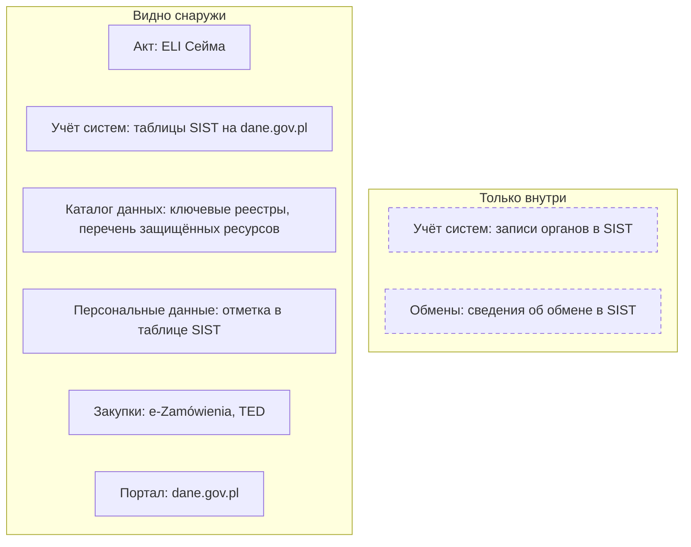
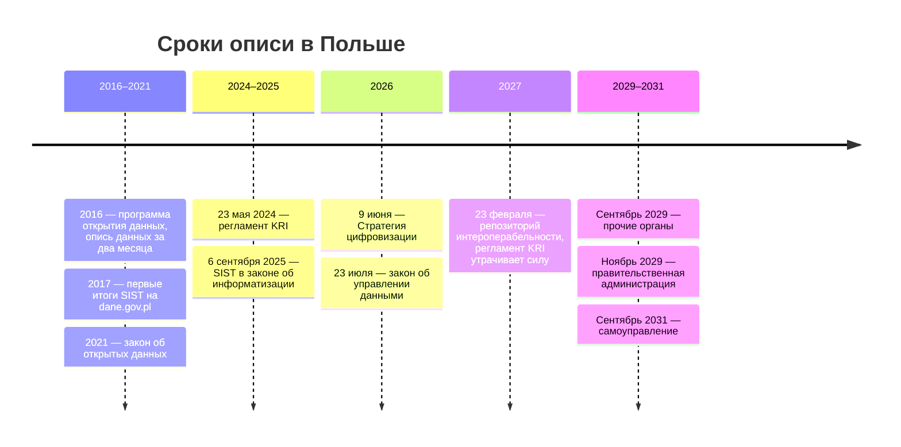
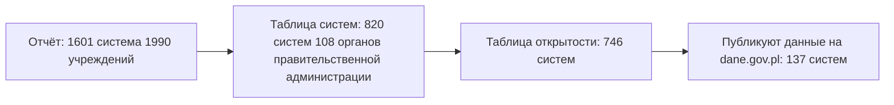

# Польша

В Польше опись государственных систем открыта: Министерство цифровизации собирает сведения о системах в системе инвентаризации SIST и публикует итоги как открытые данные на портале dane.gov.pl. С сентября 2025 года такая инвентаризация — обязанность по закону, а с 2027 года держатели публичных реестров начнут публиковать их метаданные. На том же портале лежит перечень закрытых ресурсов. Поэтому опись министерства начинают с его строк в таблицах SIST, списка ключевых реестров и его наборов на портале, а анкета уточняет внутренние системы, таблицы вне систем и качество.

Сведения проверены 25 октября 2026 года, если не указано иное.

## Коротко



Пунктирная рамка — то, что органы вносят в SIST, но в открытые таблицы не попадает. Те же семь элементов в других странах — на странице [«Шесть стран в сравнении»](./00-overview.md).

## Правовая основа

Закон об информатизации определяет публичный реестр (rejestr publiczny) как упорядоченный набор данных для публичных задач, который ведут на основании закона. Это основная единица описи: у реестра всегда есть акт и распорядитель.

| Акт простыми словами | Что требует | Что даёт описи |
|----------------------|-------------|----------------|
| **Закон об информатизации** (2005, поправка 2025 года) | Учёт систем и реестров в SIST не реже раза в год; с 2027 года — метаданные реестров в репозитории | Открытые таблицы систем, затем — реестр метаданных государства |
| **Регламент о Национальных рамках интероперабельности** (KRI, 2024) | Актуальная опись оборудования и программ; обмен через обращение к эталонным данным, а не копирование | Правило: копию записывают со ссылкой на эталон |
| **Закон об открытых данных** (2021) | Программа открытия данных, уполномоченный по открытости в министерствах, графики и отчёты | Что министерство обещало открыть и что открыло |
| **Закон об управлении данными** (2026) | Перечень защищённых ресурсов на портале, заявление о доступе — через министра | Закрытая часть реестра |
| **Закон о доступе к публичной информации** (2001) | Сведения о реестрах и архивах органа — в Бюллетене публичной информации; ответ за 14 дней | Список реестров органа |
| **Стратегия цифровизации** (2026) | Обязательная инвентаризация всех систем, включая кадровые и бухгалтерские, и Каталог публичных реестров | План расширения учёта |

Номера Dz.U., статьи и переходные нормы — в приложении [«Нормативная база»](../09-appendices/02-legal-framework.md#польша).



## Реестры и платформы

### SIST

Система инвентаризации ИКТ-систем (System Inwentaryzacji Systemów Teleinformatycznych, SIST) собирает сведения о системах и реестрах государственной администрации и о том, какие системы обмениваются данными. Владелец — министр цифровизации, администратор — Институт связи, вход для органов — sist.itl.waw.pl. С 6 сентября 2025 года порядок записан в законе. Министр не реже раза в год собирает сведения о существующих и планируемых системах, публичных реестрах и обмене между системами. Орган вносит и обновляет их в SIST, а до 30 апреля министр отчитывается перед Советом министров. Системы национальной безопасности исключены, а системы для внутренних нужд — кадровые, бухгалтерские, почту, сайты — в SIST по правилам не вносят.

**Итоги открыты.** Министерство публикует их на dane.gov.pl в наборе «Systemy/rejestry gromadzące dane publiczne» с 2017 года, по лицензии CC0. Последний выпуск — сведения на 19 декабря 2025 года, опубликованные в феврале 2026 года, — это отчёт и две таблицы. С каждым шагом охват сужается:



- **Отчёт** — все учреждения, заполнившие SIST: 303 системы собирают данные для внешних нужд, 1298 работают только внутри организации. Из 79 учреждений программы открытия данных 15 не участвовали.
- **Таблица систем** — по строке на систему: идентификатор, название, статус, преемник, дата внедрения, есть ли правовое основание и какие акты, отрасль, функции, связанные реестры. 675 систем эксплуатируются, 49 внедряются или планируются, 28 готовятся к выводу, 68 выведены или в архиве.
- **Таблица открытости** — персональные и чувствительные данные, данные высокой ценности, число записей, запросы о доступе, что открыто и где, контроль качества, программный интерфейс, форматы выгрузки, условия и плата.

Внутри министерства SIST — основа описи «чем владеем»; снаружи таблицы заменяют то, что в других странах ищут по следам в закупках. Как выглядит одна строка — в [«Примере»](#пример).

### Ключевые реестры

Информационная архитектура государства (Architektura Informacyjna Państwa) — метод управления информатизацией на основе архитектурных моделей; с 2025 года министр ведёт её по закону, а SIST служит интерфейсом к её репозиторию. На портале gov.pl/web/ia опубликован список ключевых публичных реестров: из «больше 1000» выявленных реестров ключевыми отобраны 145 — 14 критических, 27 очень важных и 104 важных. У каждого указаны распорядитель, правовое основание, система и описание. Критические — эталоны для основных объектов: PESEL (реестр населения), реестры удостоверений личности и актов гражданского состояния, учёты транспортных средств, KRS (национальный судебный реестр), REGON (реестр хозяйствующих субъектов), реестр предпринимателей CEIDG, TERYT (территориальное деление), учёт адресов, кадастр. Список собран сочетанием методов — по актам, SIST, анкете и карточкам проектов, — и часть описаний устарела ([«Как методы проверяют друг друга»](../02-approaches/02-methods.md#как-методы-проверяют-друг-друга)). Рядом лежит список 137 ключевых ИТ-систем, но это снимок проектов 2020–2021 годов, а не текущий реестр.

### Репозиторий интероперабельности

С 23 февраля 2027 года министр ведёт общедоступный репозиторий интероперабельности. Держатели публичных реестров публикуют в нём метаданные: название, описание, орган, тематическую категорию и статус, основание и даты создания и прекращения, структуры данных, словари, форматы, условия доступа и повторного использования и контакт, а также сведения о программных интерфейсах. Эти поля почти совпадают с [расширенным составом](../03-process/05-registry.md#расширенный-состав) записи в книге: репозиторий станет готовым реестром метаданных государства. Но для работающих реестров закон даёт сроки до 2029–2031 годов (см. шкалу выше), если систему не меняют раньше, а регламента о репозитории пока нет. Пока опись строят на SIST и списке ключевых реестров.

### Защищённые данные

По закону об управлении данными 2026 года единый информационный пункт ведёт министр цифровизации на портале данных, и там же — перечень защищённых ресурсов, в который органы сами вносят сведения. Заявление о повторном использовании защищённых данных подают через министра, он передаёт его органу в течение семи дней. Сводный перечень выкладывается на dane.gov.pl ежедневно: в файле от 25 октября 2026 года — 1695 позиций 53 распорядителей, 1168 из них — Главного статистического управления. У позиции — распорядитель, название ресурса, формат и объём. Это готовая закрытая часть реестра данных: что есть, у кого и в каком виде ([«Закрытые наборы — тоже в реестре»](../03-process/06-access.md#закрытые-наборы--тоже-в-реестре)).

### Госзакупки

Объявления ниже порогов ЕС публикуют в Бюллетене публичных закупок на платформе e-Zamówienia, ezamowienia.gov.pl, выше порогов — в европейской базе TED, где ИТ-услуги помечены кодами CPV раздела 72. По контракту находят состав данных из технического задания и подрядчиков ([«Государственные данные»](../04-sources/02-government.md#госзакупки)).

### Другие источники

- **Программа открытия данных.** Ещё программа 2016 года поручала исполнителям за два месяца провести инвентаризацию своих данных и назначить ответственных, которые раз в квартал ищут данные для портала. Теперь программа постоянная: уполномоченный по открытости данных в каждом министерстве ищет данные для портала, оценивает их качество и следит за метаданными, министры дважды в год сдают график новых ресурсов, а до 31 марта — отчёт. Кандидатов на открытие программа велит искать и в SIST. В 2025 году по графикам заявили 75 новых ресурсов и 16 улучшений, сделали 57 и 14: заявленное и несделанное — готовые вопросы министерству.
- **Бюллетень публичной информации** (BIP) — официальные страницы органов: в них орган публикует сведения о реестрах, учётах и архивах, которые ведёт, и о порядке доступа к ним.
- **Интегрированная аналитическая платформа** для анализа государственных политик есть в законе об информатизации с 2021 года, но её проект в 2025 году признан «нефункционирующим».

## Где искать данные

### Государственные

- **Портал данных** dane.gov.pl — около 28,7 тысячи наборов, но 81% из них — ежедневные цены жилья, которые застройщики передают по закону с июля 2025 года (23 327 наборов 5877 застройщиков). У государственных органов — 2471 набор, у самоуправления — 2420, у частных поставщиков — 406. 120 наборов отмечены как данные высокой ценности по списку Еврокомиссии; каталог выгружается в DCAT-AP-PL ([«Национальные профили и схемы»](../05-frameworks/02-metadata-standards.md#национальные-профили-и-схемы)).
- **Статистика.** Главное статистическое управление (GUS), stat.gov.pl; программа обследований на 2026 год — 258 обследований, а во второй её части — данные, которые министерства передают статистике из своих систем. Bank Danych Lokalnych — 172 740 переменных, программный интерфейс без ключа, но с лимитами.
- **Регистры.** KRS — текущая выписка по номеру через программный интерфейс без ключа; REGON и TERYT — веб-службы после регистрации; CEIDG — хранилище с учётной записью; книги недвижимости — ekw.ms.gov.pl.
- **Геоданные** — geoportal.gov.pl: бесплатно выдают реестры границ и географических названий, ортофотопланы, модель рельефа, топографическую базу, идентификаторы и геометрию участков и зданий, с февраля 2026 года — реестр цен недвижимости.
- **Нормативные акты** — программный интерфейс ELI Сейма: тексты и карточки актов со статусом, датами и связями «изменяет», «утратил силу»; проекты — legislacja.gov.pl.

Портал dane.gov.pl, ELI Сейма, KRS и Bank Danych Lokalnych отвечают через программные интерфейсы без ключа. Таблицы SIST — файлы xlsx: строки органа сравнивают с его наборами на портале и с ключевыми реестрами, где он распорядитель.

<details>
<summary>Проверить самому</summary>

```bash
# dane.gov.pl: сколько наборов (поле meta.count)
curl "https://api.dane.gov.pl/1.4/datasets?per_page=1"
# Поставщики с типом (attributes.institution_type); сортировка по id — иначе страницы повторяются
curl "https://api.dane.gov.pl/1.4/institutions?per_page=100&page=1&sort=id"
# Итоги SIST: файлы таблиц и отчётов за все годы
curl "https://api.dane.gov.pl/1.4/datasets/195/resources?per_page=50"
# Перечень защищённых ресурсов — последний файл
curl "https://api.dane.gov.pl/1.4/datasets/4354/resources?per_page=1&sort=-created"
# ELI Сейма: статус регламента KRI и дата утраты силы (repealDate)
curl "https://api.sejm.gov.pl/eli/acts/DU/2024/773"
# KRS: текущая выписка по номеру
curl "https://api-krs.ms.gov.pl/api/krs/OdpisAktualny/0000019193?rejestr=P&format=json"
```

</details>

### Общественные

- **Sieć Obywatelska Watchdog Polska** — организация за открытость власти: консультации о запросах публичной информации и суды, когда орган не отвечает.
- **Фонд Moje Państwo** — сервисы rejestr.io (компании, фонды, ассоциации), tenders.guru (закупки), bankdanych.io (просмотр Bank Danych Lokalnych).
- **Европейский портал** data.europa.eu собирает около 10 тысяч наборов dane.gov.pl.

### Коммерческие

- **Бюро кредитных историй** — Biuro Informacji Kredytowej (bik.pl) и бюро экономической информации: копии сведений о кредитах и долгах, которые передают банки и кредиторы.
- **Сервисы на государственных реестрах** — справки о компаниях из KRS, REGON и CEIDG; первоисточник открыт, коммерческую копию сверяют с ним ([«Коммерческие данные»](../04-sources/04-commercial.md)).

## Как провести инвентаризацию

### Чем владеем: опись министерства

Порядок шагов и что каждый даёт реестру — на странице [«Шесть стран в сравнении»](./00-overview.md#чем-владеем-общий-порядок). Где их пройти в Польше:

| Шаг | Где | Видно снаружи? |
|-----|-----|----------------|
| **1. Полномочия** | Закон об отраслях государственного управления; распоряжение о детальном объёме деятельности министра; ELI | ● да |
| **2. Учёт систем** | Записи министерства в SIST; снаружи — таблицы систем и открытости на dane.gov.pl | ● да |
| **3. Каталог данных** | Ключевые реестры на gov.pl/web/ia, BIP министерства; с 2027 года — репозиторий интероперабельности | ◐ частично |
| **4. Обмены** | Сведения об обмене в SIST | ○ нет |
| **5. Закрытое и персональные данные** | Перечень защищённых ресурсов; отметки в таблице открытости SIST | ● перечень защищённых; ◐ персональные данные — только отметки |
| **6. Формы сбора** | Программа статистических обследований | ● да |
| **7. Закупки** | e-Zamówienia, TED | ● да |
| **8. Опубликованное** | Наборы министерства на dane.gov.pl; графики и отчёты по программе открытия данных | ● да |
| **9. Опрос** | Уполномоченный по открытости данных, владельцы систем, подразделения | — |

Шаги 2–5 дают почти готовую опись, и главная работа — сверка. Ключевой реестр министерства есть в списке, а системы для него в SIST нет; система отмечена «публикует на dane.gov.pl», а наборов у министерства на портале нет; ресурс есть в перечне защищённых, а система, где он лежит, не описана. Кадровые, бухгалтерские и документационные системы, которых в SIST нет по правилам, добавляют по анкете ([«Что считать записью»](../03-process/05-registry.md#что-считать-записью)).

### Где найти нужное

Общий порядок — на странице [«Шесть стран в сравнении»](./00-overview.md#где-найти-нужное-общий-порядок). Что в Польше иначе:

- **Опубликованное** — dane.gov.pl только с фильтром по типу поставщика, иначе выдачу заполнят застройщики.
- **Где лежит** — таблицы SIST: система, орган, персональные данные, способ доступа, программный интерфейс; если данные закрыты — перечень защищённых ресурсов.
- **Запрос** — по закону о доступе к публичной информации, ответ за 14 дней, при продлении — до двух месяцев ([«Запрос владельцу»](../03-process/06-access.md#запрос-владельцу)); защищённые данные — заявлением через министра цифровизации. В запросе называют систему с идентификатором из SIST и реестр из списка ключевых.

## Что особенного

- **Общедоступная часть реестра — открытыми данными.** Таблицы SIST — то, что книга советует для любого реестра: полная часть внутри, общедоступная — машиночитаемо и с лицензией ([«Полный реестр и общедоступная часть»](../03-process/09-result-and-upkeep.md#полный-реестр-и-общедоступная-часть)).
- **Открытое и закрытое — на одном портале.** Наборы, итоги SIST и перечень защищённых ресурсов вместе дают три части реестра: опубликованное, системы и закрытое.
- **Норма о платформе — ещё не платформа.** Глава закона об аналитической платформе действует, а проект признан нефункционирующим: акт показывает, что задумано, а не что работает.

## Пример

Таблица систем SIST на 19 декабря 2025 года — 820 строк. Вот одна из них вместе со строкой таблицы открытости для той же системы:

| Поле SIST | Значение | Поле реестра |
|-----------|----------|--------------|
| Орган | Главное статистическое управление | Организация-владелец |
| Идентификатор, название | S02522, «Krajowy Rejestr Urzędowy Podziału Terytorialnego Kraju TERYT» | Информационная система |
| Статус, дата внедрения | Эксплуатируется, 1 января 2008 года | Статус |
| Есть правовое основание | «Нет», акты не указаны | Нормативный акт — проверить |
| Персональные данные | Нет; данные высокой ценности — да | Персональные данные |
| Записей, прирост в год | 70 000, 2000 | Объём |
| Доступ | REST API, выгрузка CSV и XML, данные на dane.gov.pl и в BIP | Ссылка, формат |
| Повторное использование | Да, без условий и платы | Условия использования |
| Обновление, контроль качества | Непрерывно; логические проверки каждого нового состояния | Периодичность, отметка о контроле качества |

Строка даёт почти всю запись, но три наблюдения по таблице показывают, как с ней работать:

- **Поле «основание» требует сверки.** «Нет» стоит у 304 систем из 820, в том числе у 231 эксплуатируемой. Среди них — TERYT, хотя реестр установлен статьёй 47 закона о публичной статистике, а у соседней системы REGON основание отмечено. Значит, «нет» может означать «не заполнили», и основание проверяют по акту ([«Как читать полномочия»](../03-process/03-owners-and-mandates.md#как-читать-полномочия)).
- **Полнота неравномерна.** У Министерства финансов — 90 систем, у Министерства цифровизации — 43, а у Министерства инфраструктуры и Канцелярии премьер-министра — по одной. У Министерства здравоохранения — 3, но у подведомственного Центра электронного здравоохранения — 30. Число отражает то, как органы заполнили SIST, а не обязательно число их систем.
- **Открытость — по системам.** Из 746 систем таблицы открытости 532 собирают персональные данные, 137 публикуют данные на dane.gov.pl, 198 выдают их для повторного использования, у 46 доступ платный. Так видно, какие системы — кандидаты на открытие, а какие — на перечень защищённых.

Открытая опись экономит месяцы, но её записи — тоже ответы анкеты, и их сверяют с актами, порталом и самими данными.

## Частые ошибки

| Ошибка | Что происходит | Как исправить |
|--------|----------------|---------------|
| **Число наборов dane.gov.pl как мера охвата** | Отчёт говорит о 28 тысячах наборов государства | Считать по типу поставщика: у государственных органов и самоуправления — около 4,9 тысячи |
| **Метаданные всех реестров ждут в репозитории с 2027 года** | План описи строят на данных, которых ещё нет | Учитывать переходные сроки до 2029–2031 годов |
| **В опись — только системы из SIST** | Пропадают кадровые, бухгалтерские и документационные системы | Дополнять анкетой: такие системы в SIST по правилам не вносят |

Сквозные ошибки — в главе [«Практики и антипаттерны»](../08-practices/01-practices-and-anti-patterns.md).

## Ограничения

- Таблицы SIST охватывают правительственную администрацию, но не всю; систем самоуправления и внутренних систем в них не видно, сведений об обмене между системами — тоже.
- Годовой отчёт министра Совету министров в открытом доступе не найден.
- Регламент о репозитории интероперабельности и регламент со списком реестров для аналитической платформы в ELI не найдены; проект нового регламента KRI не принят.
- Сведения о закупках взяты из руководств Управления публичных закупок, а не из платформы: ezamowienia.gov.pl из сети проверки не открылся.

## Источники

- Закон об информатизации — [карточка акта](https://api.sejm.gov.pl/eli/acts/DU/2005/565) и [единый текст Dz.U. 2026 poz. 1241](https://api.sejm.gov.pl/eli/acts/DU/2026/1241/text.pdf), статьи 3, 12j–12n, 14, 20ga–20gd, 20p–20t; [поправка Dz.U. 2025 poz. 1158](https://api.sejm.gov.pl/eli/acts/DU/2025/1158/text.pdf), статьи 14 и 17; регламент KRI — [карточка Dz.U. 2024 poz. 773](https://api.sejm.gov.pl/eli/acts/DU/2024/773) и [текст](https://api.sejm.gov.pl/eli/acts/DU/2024/773/text.html); [проект нового регламента, RD313](https://legislacja.gov.pl/projekt/12413150). ELI Сейма, 25 октября 2026 года.
- [Стратегия цифровизации государства](https://api.sejm.gov.pl/eli/acts/MP/2026/620/text.pdf), M.P. 2026 poz. 620; законы [об открытых данных](https://api.sejm.gov.pl/eli/acts/DU/2023/1524/text.html), [о доступе к публичной информации](https://api.sejm.gov.pl/eli/acts/DU/2022/902/text.html), [об управлении данными](https://api.sejm.gov.pl/eli/acts/DU/2026/548/text.pdf), [о публичной статистике](https://api.sejm.gov.pl/eli/acts/DU/2026/851/text.pdf), [о геодезии и картографии](https://api.sejm.gov.pl/eli/acts/DU/2026/1389/text.pdf); [программа открытия данных 2016 года](https://www.gov.pl/attachment/45667c28-3103-4dfe-87c0-cf80eea37705), задачи 9.1 и 9.2; [программа на 2021–2027 годы](https://api.sejm.gov.pl/eli/acts/MP/2021/290).
- SIST: [страница системы](https://www.gov.pl/web/ia/system-inwentaryzacji-systemow-teleinformatycznych-sist); набор [«Systemy/rejestry gromadzące dane publiczne»](https://dane.gov.pl/pl/dataset/195) — отчёт и таблицы SIST 2025, опубликованы 23 и 24 февраля 2026 года; строки и подсчёты сверены по файлам 26 октября 2026 года.
- [Ключевые публичные реестры](https://www.gov.pl/web/ia/kluczowe-rejestry-publiczne) и [их список](https://www.gov.pl/web/ia/kluczowe-rejestry-publiczne-lista); [ключевые ИТ-системы](https://www.gov.pl/web/ia/kluczowe-publiczne-systemy-it-lista), 25 октября 2026 года.
- dane.gov.pl: [программный интерфейс](https://api.dane.gov.pl/1.4/datasets) — наборы, поставщики и их типы; [перечень защищённых ресурсов](https://dane.gov.pl/pl/dataset/4354) — файл от 25 октября 2026 года; [отчёт о выполнении программы открытия данных за 2025 год](https://www.gov.pl/attachment/1269fac7-1585-45f4-a1cf-c576dd2cb6f5) — Министерство цифровизации.
- [Интегрированная аналитическая платформа](https://www.gov.pl/web/popcwsparcie/zintegrowana-platforma-analityczna) — Centralny Ośrodek Informatyki; [письмо Министерства фондов от 4 февраля 2025 года](https://www.gov.pl/attachment/982051ff-de98-4777-80ea-db50d2d7e079); [BIP](https://www.gov.pl/web/bip).
- Статистика и регистры: [Bank Danych Lokalnych](https://bdl.stat.gov.pl/api/v1/variables?format=json&page-size=1); [портал интерфейсов GUS](https://api.stat.gov.pl/Home/Index); [программный интерфейс KRS](https://api-krs.ms.gov.pl/api/krs/OdpisAktualny/0000019193?rejestr=P&format=json); [хранилище CEIDG](https://dane.biznes.gov.pl/pl/portal/034872); [геопортал](https://www.geoportal.gov.pl/pl/dane/ortofotomapa-orto/).
- Закупки: [Biuletyn Zamówień Publicznych — инструкция](https://media.ezamowienia.gov.pl/pod/2020/12/BZP-5.1.pdf); [бюллетень Управления публичных закупок № 4/2021](https://www.uzp.gov.pl/__data/assets/pdf_file/0029/53579/INFORMATOR_4_2021.pdf).
- Общественные и коммерческие: [Sieć Obywatelska Watchdog Polska](https://siecobywatelska.pl/); [инструменты фонда Moje Państwo](https://mojepanstwo.pl/narzedzia); [BIK](https://www.bik.pl/).
- Главы [«Зарубежные методики»](../05-frameworks/04-international-practice.md), [«Государственные данные»](../04-sources/02-government.md); приложение [«Нормативная база»](../09-appendices/02-legal-framework.md#польша).
- Как проверяли. Акты — через программный интерфейс ELI Сейма: isap.sejm.gov.pl отвечал страницей защиты от ботов. 25 октября 2026 года из сети проверки не открылись ezamowienia.gov.pl, поиск CEIDG и rejestr.io (ошибка 403), поиск на legislacja.gov.pl; bankdanych.io, ktoile.pl и tenders.guru не ответили за 60 секунд. 25 октября на главной BIP было объявление о постепенном восстановлении доступа к страницам.
