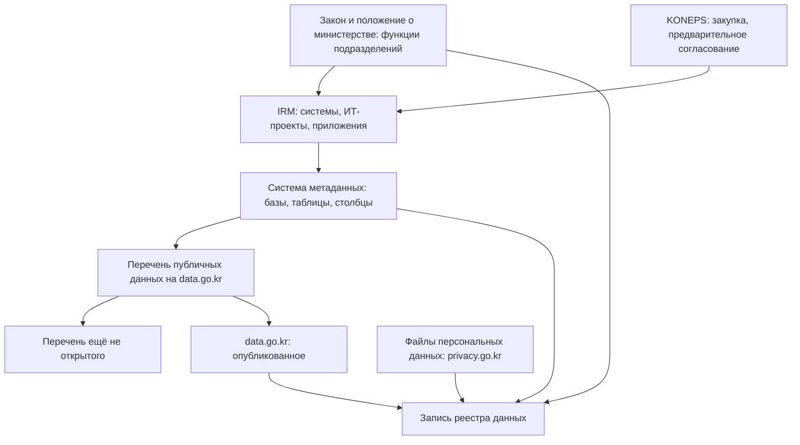

# Южная Корея

В Южной Корее опись данных государства закреплена в законах на трёх уровнях, и каждый уровень ведут сами учреждения. Перечень публичных данных учреждение регистрирует на портале data.go.kr в течение 15 дней после того, как данные созданы или получены, а Министерство внутренних дел и безопасности (행정안전부, MOIS) ищет в перечнях пропуски. Сведения о своих информационных системах, ИТ-проектах, мобильных приложениях и оборудовании учреждения вносят в систему учёта информационных ресурсов IRM. Метаданные баз данных — до таблиц и столбцов, с отметкой о персональных данных и о том, открыт ли столбец, — ведут в системах управления метаданными, связанных с центральной системой. Снаружи видна верхняя часть: каталог портала ежемесячным файлом, перечень данных, которые ещё не открыты, сводки IRM, перечни утверждённой статистики и файлов персональных данных. Сами записи IRM и системы метаданных доступны только служащим. Поэтому опись учреждения снаружи начинают с его строк в каталоге data.go.kr и в перечне ещё не открытого, а изнутри — с записей в IRM и системе метаданных. После того как 1 октября 2025 года Статистическое управление стало Министерством данных и статистики (국가데이터처), политика публичных данных, портал, проверка перечней и оценки остались у MOIS.

В индексе развития электронного правительства ООН Южная Корея в 2024 году заняла 4-е место, в 2022-м — 3-е; обзор 2026 года на 25 октября 2026 года не вышел. Сведения главы проверены 25 октября 2026 года, если не сказано иное. Тексты и редакции актов сверены по law.go.kr и его открытому программному интерфейсу; из сети проверки открылись все основные государственные сайты, кроме тех, что требуют входа. Подробности об актах — в приложении [«Нормативная база»](../09-appendices/02-legal-framework.md#южная-корея), методика страны в сравнении с другими — в главе [«Зарубежные методики»](../05-frameworks/04-international-practice.md#публичные-данные-южной-кореи).

## Коротко

| Что ищут | Где | Что даёт | Чего не даёт |
|----------|-----|----------|--------------|
| **[Полномочия и акты](#правовая-основа)** | law.go.kr и его программный интерфейс; положения о министерствах (직제) | Законы, указы, приказы с редакциями; функции каждого подразделения министерства | Что на самом деле лежит в системах |
| **[Перечень публичных данных](#перечень-публичных-данных)** | data.go.kr; ежемесячный файл каталога | Зарегистрированные наборы и программные интерфейсы с поставщиком, отделом, телефоном, периодичностью, лицензией | Данные, которые учреждение не зарегистрировало; основание набора заполнено у одной записи из пяти |
| **[Что ещё не открыто](#перечень-ещё-не-открытого)** | data.go.kr, общегосударственный перечень | 9987 наборов 534 учреждений с годом открытия | Версия от 10 февраля 2026 года не обновлялась |
| **[Учёт систем](#irm-учёт-информационных-ресурсов)** | IRM, irm.go.kr | Сводка: 2196 учреждений, 15 618 систем, 14 866 ИТ-проектов за 2025 год | Записи о системах — только служащим |
| **[Метаданные баз данных](#метаданные-баз-данных)** | Системы управления метаданными учреждений и центральная система | Базы, таблицы, столбцы, отметки о персональных данных и открытости | Снаружи не видны |
| **[Описания систем с персональными данными](#файлы-персональных-данных)** | privacy.go.kr | Файлы персональных данных учреждений: основание, цель, состав, срок хранения | Файлы безопасности, расследований, налоговых проверок |
| **[Формы сбора и статистика](#статистика)** | narastat.kr, KOSIS, MDIS | 1376 утверждённых статистик с ведомством и периодичностью; микроданные | Записи административных систем |
| **[Закупки и расходы](#закупки-и-расходы)** | KONEPS, g2b.go.kr; openfiscaldata.go.kr | Закупки ИТ-проектов, планы закупок, расходы министерств | Системы, созданные без закупок |



## Правовая основа

Почти все акты об описи данных и систем — в ведении MOIS: закон о публичных данных, закон о государственном управлении на основе ИИ и данных, закон об электронном правительстве, закон о раскрытии информации, закон о документах. Закон о защите персональных данных ведёт Комиссия по защите персональных данных (개인정보보호위원회), закон о статистике — Министерство данных и статистики. Тексты актов — на law.go.kr: у каждой редакции указаны номер, дата обнародования и дата вступления в силу.

- **Закон о предоставлении публичных данных и стимулировании их использования** (공공데이터의 제공 및 이용 활성화에 관한 법률) № 11956 от 30.07.2013, в силе с 31.10.2013; редакция — закон № 21392 от 27.02.2026, в силе с 28.08.2026. Статья 7 — базовый план на три года: пятый, на 2026–2028 годы, одобрен Комитетом по стратегии публичных данных 6 января 2026 года. Статья 9 — ежегодная оценка учреждений. Статья 12 — ответственный за предоставление публичных данных (공공데이터제공책임관), его имя публикуют на сайте. Статья 17 — предоставляют всё, кроме закрытого по закону о раскрытии информации и защищённого правами третьих лиц. Статья 18 — учреждение регистрирует перечень своих публичных данных у MOIS, а MOIS ищет пропуски и требует дорегистрировать. Статья 20 — набор исключают из перечня, если упразднены система или работа, которая его создавала, и причину публикуют. Статьи 22 и 23 — качество и стандарты. Статья 27 — запрос данных, которых нет в перечне: решение за 10 дней, продление ещё на 10. Указ к закону в редакции № 35947 от 30.12.2025: статья 13 — ранг ответственного, статья 15 — сроки регистрации. Правила к закону (시행규칙) № 652 от 08.10.2026 обновили форму регистрации перечня для Службы публичного обвинения (공소청) и Агентства расследования тяжких преступлений (중대범죄수사청), созданных 2 октября 2026 года вместо прокуратуры.
- **Закон о государственном управлении на основе ИИ и данных** (인공지능 및 데이터 기반 행정 활성화에 관한 법률). Принят как закон об управлении на основе данных № 17370 от 09.06.2020, переименован законом № 21392 с 28 августа 2026 года. Статья 8 — данные, нужные другим ведомствам, регистрируют на платформе комплексного управления данными; по запросу MOIS — за 60 дней (статья 9 указа № 36604 от 25.08.2026). Статья 16 — учреждение ведёт метаданные и схему связей своих данных (데이터관계도), MOIS сводит их в общегосударственную систему. Статья 19 — ответственный за управление на основе ИИ и данных. Статья 29 — качество данных для обучения моделей. Статья 30 — перечень сервисов, в которых учреждение применяет ИИ ([«Перечень сервисов ИИ»](#перечень-сервисов-ии)).
- **Закон об электронном правительстве** (전자정부법) — редакция закона № 21394 от 27.02.2026, в силе с 28.08.2026. Статьи 45–47 — архитектура информационных технологий (EA) государства и учреждений. Статья 54 — учреждение ведёт сведения о своих информационных ресурсах и статистику; классификацию, круг и сроки сбора задаёт MOIS (статья 66 указа). Статья 56의3 — с 2025 года учреждения присваивают системам класс важности, MOIS его утверждает. Статьи 44의2 и 44의3 — национальные эталонные данные (국가기준데이터): сведения, которыми пользуются многие ведомства, с назначенным ведомством-держателем.
- **Закон о документах государственных органов** (공공기록물 관리에 관한 법률) — редакция закона № 21066 от 01.10.2025; указ к нему в редакции № 36728 от 29.09.2026, в силе с 2 октября 2026 года. Данные административных систем — тоже документы, их описывают по системам ([«Данные систем как документы»](#данные-систем-как-документы)).
- **Закон о раскрытии информации государственными органами** (공공기관의 정보공개에 관한 법률) в редакции закона № 19408 от 16.05.2023: статья 8 — перечень информации органа, статья 8의2 — подлинники документов центральных органов без запроса, статья 9 — основания не раскрывать, статья 11 — ответ за 10 дней, продление ещё на 10 ([«Вопрос чужому владельцу»](../03-process/04-questionnaires.md#вопрос-чужому-владельцу)).
- **Закон о защите персональных данных** (개인정보 보호법) — редакция закона № 21445 от 10.03.2026, в силе с 11.09.2026. Статья 32 — регистрация файлов персональных данных государственных учреждений.
- **Закон о статистике** (통계법) — редакция закона № 21575 от 21.04.2026, в силе с 22.07.2026. Статья 18 — новую статистику ведут только после утверждения.
- **Закон об организации правительства** (정부조직법): закон № 21065 от 01.10.2025 создал Министерство данных и статистики (статья 27) и перестроил ряд министерств; редакция — закон № 21491 от 24.03.2026, в силе с 2 октября 2026 года. Статья 37 оставляет за MOIS электронное правительство ([«Где искать полномочия»](../03-process/03-owners-and-mandates.md#где-искать-полномочия)).
- **Приказы MOIS** (고시): руководство по управлению публичными данными (공공데이터 관리지침) № 2021-70 от 26.10.2021 — новой редакции на 25 октября 2026 года нет; руководство по стандартизации баз данных государственных организаций (공공기관의 데이터베이스 표준화 지침) № 2025-19 от 24.02.2025; руководство по внедрению архитектуры информационных технологий № 2024-58 от 10.07.2024; руководство по созданию и эксплуатации информационных систем № 2025-1 от 02.01.2025.

## Реестры и платформы

### Кто отвечает

Министерство данных и статистики, созданное 1 октября 2025 года из Статистического управления, ведает стандартами статистики, переписями и «общей координацией статистики и данных» (статья 27 закона об организации правительства). По положению о министерстве (указ № 36631 от 28.08.2026, статья 15) оно связывает статистику с публичными и частными данными и хранит микроданные, а публичными данными занимается только своими.

Политика публичных данных осталась у MOIS — так показывают все первоисточники на 25 октября 2026 года. В законе о публичных данных перечни, портал и оценку ведёт министр внутренних дел и безопасности (статьи 9, 18, 21). По положению о MOIS (указ № 36710 от 29.09.2026, статья 12) его управление ИИ-правительства (인공지능정부실) ведёт публичные данные, их качество и стандарты, обмен данными, архитектуру ИТ и учёт информационных ресурсов: отдел политики публичных данных (공공데이터정책과) — портал и оценку, отдел анализа и управления публичными данными (공공데이터분석관리과) — качество, стандарты, платформу обмена и системы метаданных. Итоги оценки 31 марта 2026 года и сводку IRM 3 сентября 2026 года опубликовал MOIS.

Портал и центральную систему метаданных ведёт Центр поддержки использования публичных данных (공공데이터활용지원센터) при Национальном агентстве по информационному обществу (NIA), центры обработки данных правительства — Национальная служба информационных ресурсов (국가정보자원관리원, NIRS), подведомственная MOIS.

### Перечень публичных данных

Учреждение регистрирует свои публичные данные в системе регистрации перечней на портале в течение 15 дней после того, как данные созданы или получены, изменения — в течение 10 дней; пропуски, найденные MOIS, дорегистрирует в срок до 20 дней (статья 15 указа). Что из зарегистрированного предоставлять, одобряет Комитет по стратегии, а учреждение публикует свой перечень на сайте и размещает данные на портале (статья 19 закона).

Весь каталог портал выкладывает ежемесячным файлом «Состояние открытых перечней» (목록개방현황) размером около 140 МБ. В версии на 30 сентября 2026 года по описанию на странице 96 526 строк; без ошибок удалось разобрать 92 147 записей: 80 039 файловых наборов, 11 808 программных интерфейсов и 300 стандартных наборов от 1079 поставщиков. У записи — поставщик, отдел, телефон, рубрика, периодичность, дата следующего обновления, формат, лицензия и поле «основание хранения» (보유근거). Файл даёт две проверки:

- **Основание.** Поле «основание хранения» пусто у 79,8% записей, «способ сбора» — у 91,3%. Основание набора ищут в положении о министерстве, в IRM и системе метаданных, где поле «закон и цель хранения» обязательно ([«Где искать полномочия»](../03-process/03-owners-and-mandates.md#где-искать-полномочия)).
- **Свежесть.** У 8026 файловых наборов — 10% — дата следующего обновления наступила раньше 30 сентября 2026 года, а набор не обновлён.

На 25 октября 2026 года поиск портала показывал 89 556 файловых наборов, 12 032 программных интерфейса, 300 видов стандартных наборов и 262 228 связанных наборов (연계데이터) — описаний с других государственных порталов, всего 376 828. Связанные наборы — больше двух третей, поэтому общее число без разбивки по типам с другими странами не сравнивают. У каждого набора есть описание по schema.org и DCAT без ключа ([«Национальные профили и схемы»](../05-frameworks/02-metadata-standards.md#национальные-профили-и-схемы)), программный интерфейс к самим данным — с бесплатным ключом. С 3 августа 2026 года портал в опытном режиме ищет по вопросу на обычном языке. Карта публичных данных (공공데이터맵) показывает связи наборов по рубрикам и словам; национальной карты данных (국가데이터맵) 2019 года под этим названием в меню портала нет. Ответственного учреждения находят на его сайте (статья 12 закона): набор портала с контактами исполнителей — версии 2 июля 2024 года.

### Перечень ещё не открытого

На портале опубликован общегосударственный перечень данных, которые учреждения пока не предоставляют, но обязались открыть, — по сути общедоступная часть описи ([«Полный реестр и общедоступная часть»](../03-process/09-result-and-upkeep.md#полный-реестр-и-общедоступная-часть)). В версии от 10 февраля 2026 года, по состоянию на конец января, — 9987 строк 534 учреждений: на 2026 год — 2817, на 2027-й — 4018, на 2028-й — 3152. Больше всего строк у города Сунчхон провинции Чолла-Намдо (500) и Министерства земли, инфраструктуры и транспорта (370). В строке три поля: учреждение, год, название набора — ни системы, ни отдела. Следующее обновление было назначено на 28 февраля 2026 года, но на 25 октября 2026 года новой версии не было.

Пятый базовый план (2026–2028) обещает изменить закон так, чтобы публиковались перечни всех публичных данных, кроме закрытых. На 25 октября 2026 года статья 18 в действующей редакции не изменилась.

### IRM: учёт информационных ресурсов

Система учёта информационных ресурсов (정보자원관리시스템, IRM) работает с марта 2024 года. Ей предшествовали обязательная для государственных организаций архитектура информационных технологий (с декабря 2005 года) и общегосударственный портал EA (GEAP) 2011 года, с 2015 года объединённый с системой предварительного согласования ИТ-проектов. В IRM учреждение описывает свои системы: решаемые задачи, оборудование и программы, данные, технологии.

Через IRM проходят три процедуры, полезные для описи:

- **Предварительное согласование** (사전협의). ИТ-проекты центральных органов и государственных организаций, связанные с другими ведомствами, — все новые и продолжающиеся от 1 млрд вон — согласуют с MOIS до объявления закупки; ответ — за 30 дней. Для продолжающихся проектов провинций порог — 200 млн вон, муниципалитетов — 100 млн. Проверяют прежде всего, не дублирует ли проект другие системы.
- **Оценка эксплуатации.** По использованию системы MOIS рекомендует её переделать, вывести из эксплуатации или объединить с другой ([«Где искать преемника»](../04-sources/06-legacy.md#где-искать-преемника)).
- **Класс важности.** С 2025 года учреждения относят системы к классам по значимости сервиса, числу пользователей и числу зависимых систем (статья 70의3 указа к закону об электронном правительстве).

По сводке MOIS от 3 сентября 2026 года, за 2025 год в IRM данные внесли 2196 учреждений: 56 центральных органов, 244 органа местного самоуправления, 429 органов и учреждений местного образования и 1467 государственных организаций. Учтено 14 866 ИТ-проектов, 15 618 информационных систем, 1358 мобильных приложений, 244 797 единиц оборудования и 302 136 программ. Сводка — в открытом разделе IRM и на data.go.kr набором «Статистика информационных ресурсов» с данными за несколько лет. Сама IRM — служебная система: вход по сертификату служащего или после одобрения ведомства ([«Реестры информационных систем»](../04-sources/02-government.md#реестры-информационных-систем)).

### Метаданные баз данных

Руководство по стандартизации баз данных № 2025-19 требует, чтобы каждое учреждение вело систему управления метаданными своих баз и держало её в согласии с центральной системой, которую ведёт Центр поддержки использования публичных данных (статьи 14–16). Обязательный состав (приложение 4) — это реестр данных в его самом подробном виде ([«Расширенный состав»](../03-process/05-registry.md#расширенный-состав)):

| Уровень | Обязательные поля |
|---------|-------------------|
| **Система** | Учреждение, название системы — как в IRM, закон и цель хранения, месяц создания, отдел, ответственный и его контакты, тип системы |
| **База** | Название, рубрика по классификатору функций правительства до четвёртого уровня, СУБД и операционная система, число таблиц, структурированные или нет |
| **Таблица** | Владелец схемы, названия, открыта, открыта частично или закрыта — с причиной и основанием |
| **Столбец** | Названия из общего словаря стандартных терминов, тип, ключи, есть ли персональные данные, шифруется ли, открыт ли |

Названия полей берут из общего словаря стандартных терминов (공통표준용어): с 338 терминов 6 августа 2020 года он вырос до 13 159 в сентябре 2026 года. Закон о государственном управлении на основе ИИ и данных добавил схему связей данных: MOIS сводит метаданные и схемы связей всех учреждений в общегосударственную систему (статья 16). Качество баз MOIS оценивает ежегодно (статья 22 закона о публичных данных): в 2025 году — 684 учреждения и 7416 баз по восьми показателям. Открытой части у систем метаданных нет.

### Обмен данными между ведомствами

На платформе комплексного управления данными (데이터통합관리 플랫폼) учреждения регистрируют данные, нужные другим ведомствам (статья 8 закона о государственном управлении на основе ИИ и данных); платформа собирает данные и метаданные и ищет по схемам связей (статья 18). Незарегистрированные данные ведомство запрашивает письменно, указав цель, метод анализа и срок (статья 10). 3 августа 2026 года MOIS объявил, что объединит на data.go.kr окна открытия и обмена данными. Открытой части платформы на 25 октября 2026 года не найдено.

Национальные эталонные данные назначает MOIS, а учреждения обязаны пользоваться ими в первую очередь (статьи 44의2 и 44의3 закона об электронном правительстве). Как и с национальными регистрами Казахстана ([«Казахстан»](./01-kazakhstan.md#национальные-регистры)), для сведений о людях, организациях и объектах сначала выясняют, есть ли эталон: остальные системы держат копии ([«Что инвентаризируют»](../01-basics/02-what-is-inventoried.md)).

### Перечень сервисов ИИ

С 28 августа 2026 года учреждение ведёт сведения о сервисах, в которых применяет ИИ: тип, назначение, данные — и передаёт их MOIS, а MOIS ведёт перечень и публикует его ежегодно (статья 30 закона о государственном управлении на основе ИИ и данных). Порядок ведения MOIS устанавливает приказом. На 25 октября 2026 года ни приказа на law.go.kr, ни опубликованного перечня найти не удалось. Это корейский аналог инвентаря применений ИИ в США: у набора для обучения в реестре данных стоит отмечать, в каких сервисах он используется ([«Инвентаризация для ИИ»](../02-approaches/03-ai.md#инвентаризация-для-ии)).

### Файлы персональных данных

Государственное учреждение регистрирует в Комиссии по защите персональных данных каждый файл персональных данных — название, основание и цель, состав сведений, способ обработки, срок хранения, кому данные передают регулярно (статья 32 закона). Перечень ищут на privacy.go.kr ([«Описания систем с персональными данными»](../04-sources/02-government.md#описания-систем-с-персональными-данными)), а Комиссия выкладывает на data.go.kr сводку по типам учреждений — число файлов и записей, версия от 31 августа 2026 года. Многие учреждения сами публикуют на портале наборы «Состояние файлов персональных данных». Не регистрируют файлы о национальной безопасности, расследованиях и исполнении наказаний, налоговых и таможенных проверках, разовые и засекреченные: таких систем в перечне не будет.

### Данные систем как документы

По указу к закону о документах данные административной информационной системы — «набор данных административной информации» (행정정보 데이터세트) — это электронный документ. Учреждение ведёт их по системам (статья 34의3) и заполняет для каждого набора таблицу управления: сведения об учреждении, о законе, о системе, о данных, о работе и о хранении (статья 25, часть 6). Срок хранения набора учреждение согласует с архивом. Каждый год учреждение публикует в бюллетене или на сайте новые и изменённые единицы работы с описанием и сроками хранения (статья 25, часть 5). Для описи это ещё один внутренний перечень систем с основаниями и сроками, который ведут архивисты, а не ИТ-служба: его сверяют с IRM.

### Статистика

Новую статистику ведут только после утверждения, а каждое утверждение объявляют публично (статья 18 закона о статистике). Перечень утверждённой статистики на narastat.kr 25 октября 2026 года содержал 1376 статистик с ведомством, способом сбора, периодичностью и датой утверждения, выгрузка — в Excel. Копии — на data.go.kr: перечень и график публикации ([«Статистика и формы сбора сведений»](../04-sources/02-government.md#статистика-и-формы-сбора-сведений)). Показатели — в KOSIS, микроданные — в MDIS; оба сервиса ведёт Министерство данных и статистики, у программного интерфейса KOSIS — ключ.

### Закупки и расходы

Единая система государственных закупок KONEPS (나라장터, g2b.go.kr) в новой версии работает официально с 31 марта 2025 года. Собственные системы закупок 25 государственных организаций переводят в неё: к 17 ноября 2025 года перевели 12. Объявления, контракты, планы закупок и предварительные спецификации отдаются через программные интерфейсы data.go.kr с ключом; план закупок и предварительная спецификация показывают ИТ-проект раньше контракта ([«Госзакупки»](../04-sources/02-government.md#госзакупки)). Расходы министерств — на портале «Открытые финансы» (열린재정, openfiscaldata.go.kr). Многие учреждения выкладывают на data.go.kr наборы «Состояние ИТ-проектов» — собственный список проектов с системами и подрядчиками.

### Сводка

| Что | Состояние на октябрь 2026 года |
|-----|-------------------------------|
| **Перечни публичных данных** | Регистрация в течение 15 дней, проверка MOIS на пропуски; каталог — ежемесячным файлом, 96 526 строк на 30 сентября 2026 года |
| **data.go.kr** | 89 556 файловых наборов, 12 032 программных интерфейса, 262 228 связанных наборов; описания по schema.org и DCAT без ключа |
| **Перечень ещё не открытого** | 9987 строк 534 учреждений на 2026–2028 годы; версия от 10 февраля 2026 года |
| **IRM** | 2196 учреждений, 15 618 систем, 14 866 ИТ-проектов за 2025 год; записи — для служащих |
| **Метаданные баз** | Системы учреждений и центральная система; словарь — 13 159 терминов в сентябре 2026 года; открытой части нет |
| **Оценки** | Предоставление данных за 2025 год: 684 учреждения, «хорошо» и выше — 348; качество баз: 684 учреждения, 7416 баз |
| **Перечень сервисов ИИ** | Обязателен с 28 августа 2026 года; на 25 октября 2026 года не опубликован |
| **Файлы персональных данных** | Регистрация в Комиссии; поиск на privacy.go.kr |
| **Статистика** | 1376 утверждённых статистик на narastat.kr |
| **Закупки** | KONEPS в новой версии с 31 марта 2025 года; 12 из 25 систем закупок организаций переведены к ноябрю 2025 года |

## Где искать данные

### Государственные

- **data.go.kr** — наборы и программные интерфейсы, перечень ещё не открытого, карта публичных данных, ссылки на региональные и отраслевые порталы ([«Порталы открытых данных»](../04-sources/02-government.md#порталы-открытых-данных)). Национальные приоритетные данные (국가중점데이터) — наборы высокой ценности по корейской мерке: к 2024 году открыто 217. 6 января 2026 года Комитет по стратегии утвердил ещё сотню «ИИ- и высокоценных» наборов в 11 областях, от безопасности до медицины, на три года.
- **Статистика** — narastat.kr, KOSIS, MDIS.
- **Раскрытие информации** — open.go.kr: перечни информации органов и подлинники документов центральных органов.
- **Нормативные акты** — law.go.kr.
- **Регистры** — статус регистрации предприятий Национальной налоговой службы и реестр зданий Министерства земли, инфраструктуры и транспорта отдаются через программные интерфейсы data.go.kr с ключом; выписки из реестров прав на недвижимость и юридических лиц (등기) выдаёт портал Верховного суда iros.go.kr.
- **Данные для ИИ** — AI Hub (aihub.or.kr) Национального агентства по информационному обществу по заказу Министерства науки и ИКТ: 977 открытых наборов на 25 октября 2026 года, часть — только в защищённой зоне ([«Инвентаризация для ИИ»](../02-approaches/03-ai.md#инвентаризация-для-ии)).

### Общественные

- **Центр раскрытия информации «За прозрачное общество»** (투명사회를 위한 정보공개센터, opengirok.or.kr) — общественная организация с 2008 года: запросы о раскрытии информации и полученные ответы ([«Общественные проекты»](../04-sources/03-public.md#общественные-проекты)).
- **Code for Korea** (codefor.kr) — сообщество гражданских разработчиков, созданное в феврале 2020 года после приложения о наличии масок; на сайте — список проектов и архив гражданских технологий.

### Коммерческие

- **Раскрытие информации компаний** — DART Службы финансового надзора (dart.fss.or.kr), программный интерфейс OpenDART — с ключом ([«Раскрытие информации и отчётность»](../04-sources/04-commercial.md#раскрытие-информации-и-отчётность)).
- **Финансовые данные** — платформа поддержки использования финансовых данных Института финансовой безопасности (findatamall.or.kr): продукты данных карточных компаний, банков, страховщиков и брокеров.
- **Кредитные бюро** — NICE (niceinfo.co.kr) и KCB (koreacb.com): сведения о заёмщиках и компаниях на коммерческих условиях; состав их услуг с первоисточником не сверялся.

### Проверка адресов

25 октября 2026 года из сети, где проверялась книга, открылись data.go.kr, mois.go.kr, mods.go.kr (kostat.go.kr перенаправляет на него), law.go.kr и open.law.go.kr, open.go.kr, privacy.go.kr, narastat.kr, kosis.kr, mdis.mods.go.kr, openfiscaldata.go.kr, dart.fss.or.kr и opendart.fss.or.kr, iros.go.kr, eais.go.kr, archives.go.kr, korea.kr, aihub.or.kr, nia.or.kr, kbig.kr, opengirok.or.kr, codefor.kr, findatamall.or.kr, niceinfo.co.kr и koreacb.com. g2b.go.kr открылся после перенаправления через сервер единого входа, irm.go.kr — страницей входа. У kdx.kr — Корейской биржи данных — адреса в системе доменных имён не нашлось, его нужно перепроверить из корейской сети.

### Портал за минуту

Каталог портала и правовая база отвечают без ключа:

```bash
# data.go.kr: сколько файловых наборов, программных интерфейсов и связанных наборов
curl -s "https://www.data.go.kr/tcs/dss/selectDataSetList.do?dType=FILE" | sed 's/<[^>]*>//g' | tr -s ' \t\n' ' ' | grep -o -E '(파일데이터|오픈 API|연계데이터) [0-9,]+건' | sort -u
# Описание набора по schema.org и DCAT: 15062804 — ежемесячный файл каталога, 15127106 — перечень ещё не открытого
curl -s "https://www.data.go.kr/catalog/15062804/fileData.json"
curl -s "https://www.data.go.kr/biz/dcat/metadata/15127106.do"
# Утверждённая статистика: сколько всего
curl -s "https://www.narastat.kr/pms/pub/scs/css/selectConfmStatsList.do" | sed 's/<[^>]*>//g' | tr -s ' \t\n' ' ' | grep -o -E '총 [0-9,]+ 건'
# law.go.kr: действующие законы и приказы; OC=test — значение из примеров руководства, для работы — свой ключ с open.law.go.kr
curl -s -G "https://www.law.go.kr/DRF/lawSearch.do" -d OC=test -d target=law -d type=JSON --data-urlencode "query=공공데이터"
curl -s -G "https://www.law.go.kr/DRF/lawSearch.do" -d OC=test -d target=admrul -d type=JSON --data-urlencode "query=공공데이터 관리지침"
```

Запросы проверены 25 октября 2026 года. В ответе law.go.kr у каждого акта — номер, дата обнародования, дата вступления в силу и ведомство: по ним проверяют редакцию перед ссылкой ([чек-лист](../09-appendices/04-checklists.md#перед-ссылкой-на-нормативный-акт)). Ежемесячный файл каталога берут со страницы набора 15062804 и фильтруют по полю «поставщик»: учреждение без строк — вопрос к нему, а не вывод, что данных нет.

## Как провести инвентаризацию

### Чем владеем: опись министерства

| Шаг | Где | Что даёт реестру |
|-----|-----|------------------|
| **1. Полномочия** | Закон об организации правительства; положение о министерстве (직제) и правила к нему | Функции каждого отдела по пунктам — какие данные министерство обязано вести |
| **2. Системы** | Записи министерства в IRM | Перечень систем с классом важности, ИТ-проекты, приложения |
| **3. Базы и поля** | Система управления метаданными министерства | Базы, таблицы, столбцы, основание, отметки о персональных данных и открытости |
| **4. Публичные данные** | Перечень министерства на data.go.kr и в перечне ещё не открытого | Что открыто, что обещано и к какому году |
| **5. Обмен** | Платформа комплексного управления данными; национальные эталонные данные | Что министерство отдаёт другим и где держит копии чужих эталонов |
| **6. Персональные данные** | Файлы министерства в Комиссии по защите персональных данных | Основание, цель, состав, срок хранения |
| **7. Документы** | Таблицы управления наборами данных систем; сроки хранения | Сроки хранения и правила вывода данных из систем |
| **8. Статистика и закупки** | narastat.kr; KONEPS и предварительное согласование | Формы сбора с периодичностью; состав данных из технических заданий, подрядчики |
| **9. Опрос** | Ответственный за публичные данные, ответственный за ИИ и данные, владельцы систем | Таблицы вне систем, копии, качество, сервисы ИИ ([«Опросные листы и интервью»](../03-process/04-questionnaires.md)) |

Внутри министерства шаги 2 и 3 дают почти готовую опись, и главная работа — сверка: так методы проверяют друг друга ([«Как методы проверяют друг друга»](../02-approaches/02-methods.md#как-методы-проверяют-друг-друга)). Система есть в IRM, а баз в системе метаданных у неё нет. В таблице столбцы отмечены как открытые, а в перечне на data.go.kr набора нет. Файл персональных данных зарегистрирован, а системы, где он лежит, в IRM нет. Набор есть в каталоге, но поле основания пусто, а дата следующего обновления прошла. Каждое расхождение записывают и выясняют.

### Где найти нужное

1. **Опубликованное** — поиск data.go.kr, в том числе на обычном языке, карта публичных данных, связанные наборы региональных и отраслевых порталов, AI Hub, [поиск наборов](../04-sources/05-dataset-search.md).
2. **Кто собирает** — положения о министерствах, перечень утверждённой статистики, перечни информации органов на open.go.kr.
3. **Где лежит** — перечень ещё не открытого, перечень файлов персональных данных, наборы учреждений о своих ИТ-проектах, закупки KONEPS.
4. **Запрос владельцу** — данные, которых нет в перечне, запрашивают через портал по статье 27 закона о публичных данных: решение за 10 дней, продление ещё на 10. Отказ обжалуют в Комиссию по урегулированию споров о публичных данных в течение 60 дней, проект решения она готовит за 30 дней (статья 31). Документы и сведения запрашивают по закону о раскрытии информации через open.go.kr — с тем же сроком ответа.
5. **Если закрыто** — центр решения проблем с публичными данными на портале помогает договориться с учреждением о способе открытия; данные с персональными сведениями пятый базовый план обещает выдавать в псевдонимизированном виде через специальные зоны Комиссии по защите персональных данных; защищённые зоны есть у AI Hub и K-ICT Big Data Center. Коммерческие источники записывают с пометкой, что первоисточник закрыт ([«Три слоя данных»](../04-sources/01-three-layers.md)).

## Что особенного

- **Опись — обязанность учреждения, проверка — извне.** Перечень, учёт систем и метаданные баз ведут сами учреждения, а MOIS ищет пропуски и ставит баллы. Это устройство, которое книга советует для любого реестра: записи ведут владельцы, а координатор проверяет ([«Кто отвечает после публикации»](../03-process/09-result-and-upkeep.md#кто-отвечает-после-публикации)).
- **Обещанное тоже публикуют.** Перечень ещё не открытого показывает, что данные есть и когда их ждать; учреждение, которое не выполнило обещание, видно без запроса.
- **Метаданные доходят до столбца.** Отметки о персональных данных, шифровании и открытости у каждого столбца, имена из общего словаря — это реестр в расширенном составе, совмещённый со словарём данных ([«Стандарты описания»](../05-frameworks/02-metadata-standards.md)).
- **Оценка с баллами каждый год.** По итогам 2025 года, опубликованным 31 марта 2026 года, «хорошо» и выше получили 348 учреждений из 684 — 50,9% против 40,9% годом раньше. Средний балл за систему управления — 89,5, за качество — 72,5, за открытие и использование — 59,2, а за открытие данных для ИИ — 37,8: наладить порядок проще, чем открыть данные ([«Рамки и стандарты качества»](../03-process/07-quality.md#рамки-и-стандарты-качества)).
- **ИИ — следующая цель описи.** Перечень сервисов ИИ, качество данных для обучения, «данные, готовые для ИИ» и сотня приоритетных наборов связывают опись данных с ИИ законом ([«Зачем: цели инвентаризации»](../01-basics/03-goals.md)).
- **Учреждения часто переименовывают.** Только за 2025–2026 годы появились Министерство данных и статистики, Министерство климата, энергетики и окружающей среды, Министерство интеллектуальной собственности, Служба публичного обвинения. Документы ищут по старым и новым названиям, а владельца набора записывают с датой ([«Где искать полномочия»](../03-process/03-owners-and-mandates.md#где-искать-полномочия)).

## Пример

26 сентября 2025 года в центре Национальной службы информационных ресурсов в Тэджоне загорелся машинный зал, и правительственные системы остановились. Сначала власти называли 647 пострадавших систем. 9 октября 2025 года на брифинге Центрального штаба по чрезвычайным ситуациям сообщили, что восстановили данные системы управления эксплуатацией центра (nTOPS) и после сверки с министерствами исправили список: прежний был составлен по спискам мониторинга и памяти сотрудников. Систем оказалось 709: 40 первого класса важности, 68 — второго, 261 — третьего, 340 — четвёртого. Число выросло ещё и потому, что часть систем разделили по функциям, а системы документооборота отдельных ведомств, наоборот, свели в одну. Портал раскрытия информации open.go.kr не работал до 31 октября. Все 709 систем восстановили к 30 декабря 2025 года, сначала — первого класса.

Пример показывает три вещи:

- **Опись хранят отдельно от того, что она описывает.** Полный список систем центра был в системе, которую пришлось восстанавливать вместе с остальными. Копия реестра в другом месте — часть его поддержки ([«Реестр как данные»](../06-tools/03-registry-as-data.md)).
- **Число зависит от правил счёта.** 647 и 709 — один и тот же центр, посчитанный по-разному. Что считать одной системой и одним набором, решают до подсчёта ([«Что считать записью»](../03-process/05-registry.md#что-считать-записью)).
- **Важность — атрибут записи.** Класс важности определил порядок восстановления. В реестре данных его заменяет поле о критичности набора и системы.

## Частые ошибки

| Ошибка | Что происходит | Как исправить |
|--------|----------------|---------------|
| **Публичные данные отнесены к Министерству данных и статистики** | Запрос и вопросы о перечне уходят не туда | Публичные данные, портал, перечни и оценки — у MOIS; у Министерства данных и статистики — статистика и микроданные |
| **data.go.kr принят за все данные учреждения** | В описи только зарегистрированное | Сверить с перечнем ещё не открытого, IRM, системой метаданных и файлами персональных данных |
| **Общее число наборов портала без разбивки** | 376 828 сравнивают с порталами других стран, хотя 262 228 — описания с других порталов | Брать файловые наборы и программные интерфейсы отдельно, с датой |
| **Основание набора взято из каталога** | У 80% записей поле пусто, и набор остаётся без полномочия | Брать основание из положения о министерстве, IRM или системы метаданных |
| **Перечень ещё не открытого считают свежим** | Обещания на 2026 год сверяют с перечнем на конец января | Указывать версию перечня и проверять, не открыт ли набор уже |
| **Ссылка на закон об управлении на основе данных** | В реестре — прежнее название акта и должности ответственного | С 28 августа 2026 года — закон о государственном управлении на основе ИИ и данных и ответственный за управление на основе ИИ и данных ([чек-лист](../09-appendices/04-checklists.md#перед-ссылкой-на-нормативный-акт)) |
| **Поиск по новым названиям ведомств** | Не находятся документы и наборы до реорганизации | Искать и по прежним: Статистическое управление, Министерство окружающей среды, прокуратура |

## Ограничения

- IRM, системы управления метаданными и платформа комплексного управления данными снаружи недоступны; о составе учёта судят по законам, приказам и сводкам MOIS.
- В ежемесячном файле каталога часть строк разбирается с ошибками: по описанию в нём 96 526 строк, без ошибок прочитано 92 147. Доли пустых полей и просроченных обновлений посчитаны по прочитанным записям.
- Перечень ещё не открытого и перечень ответственных исполнителей устарели — версии февраля 2026 и июля 2024 года.
- В сводной таблице пресс-релиза об оценке за 2025 год графы «отлично» (34) и «хорошо» (304) в сумме дают 338, а заголовок и строки по типам учреждений — 348; в главе — 348.
- Файлы о безопасности, расследованиях и налоговых проверках не регистрируются, и в перечне файлов персональных данных их нет.
- Коммерческий слой проверен частично: Корейская биржа данных kdx.kr из сети проверки не нашлась.

## Источники

- [Republic of Korea — E-Government Development Index](https://publicadministration.un.org/egovkb/en-us/Data/Country-Information/id/138-Republic-of-Korea) — UN E-Government Knowledgebase: 4-е место в 2024 году, 3-е в 2022-м; [Data Center](https://publicadministration.un.org/egovkb/en-us/Data-Center) — последний выпуск обзора 2024 года, 25 октября 2026 года.
- Законы, law.go.kr, 25 октября 2026 года: [закон о публичных данных](https://www.law.go.kr/법령/공공데이터의제공및이용활성화에관한법률), статьи 7, 9, 12, 17–23, 27, 31, [указ к нему](https://www.law.go.kr/법령/공공데이터의제공및이용활성화에관한법률시행령), статьи 13 и 15, и [правила](https://www.law.go.kr/법령/공공데이터의제공및이용활성화에관한법률시행규칙) в редакции № 652 от 08.10.2026; [закон о государственном управлении на основе ИИ и данных](https://www.law.go.kr/법령/인공지능및데이터기반행정활성화에관한법률), статьи 8–10, 16, 18, 19, 29, 30, и [указ к нему](https://www.law.go.kr/법령/인공지능및데이터기반행정활성화에관한법률시행령), статья 9; [закон об электронном правительстве](https://www.law.go.kr/법령/전자정부법), статьи 44의2, 44의3, 45–47, 54, 56의3, 56의4, и [указ к нему](https://www.law.go.kr/법령/전자정부법시행령), статьи 66 и 70의3; [закон о документах](https://www.law.go.kr/법령/공공기록물관리에관한법률), статья 19, и [указ к нему](https://www.law.go.kr/법령/공공기록물관리에관한법률시행령), статьи 2, 25, 34의3; [закон о раскрытии информации](https://www.law.go.kr/법령/공공기관의정보공개에관한법률), статьи 8, 8의2, 11; [закон о защите персональных данных](https://www.law.go.kr/법령/개인정보보호법), статья 32; [закон о статистике](https://www.law.go.kr/법령/통계법), статья 18; [закон об организации правительства](https://www.law.go.kr/법령/정부조직법), статьи 27 и 37.
- Положения о министерствах, law.go.kr, 25 октября 2026 года: [положение о MOIS](https://www.law.go.kr/법령/행정안전부와그소속기관직제), статья 12, и [правила к нему](https://www.law.go.kr/법령/행정안전부와그소속기관직제시행규칙), статья 9; [положение о Министерстве данных и статистики](https://www.law.go.kr/법령/국가데이터처와그소속기관직제), статья 15.
- Приказы MOIS, law.go.kr: [руководство по управлению публичными данными](https://www.law.go.kr/행정규칙/공공데이터관리지침) № 2021-70; [руководство по стандартизации баз данных](https://www.law.go.kr/행정규칙/공공기관의데이터베이스표준화지침) № 2025-19, статьи 14–16 и приложение 4. Программный интерфейс law.go.kr — [руководство](https://open.law.go.kr/LSO/openApi/guideResult.do?htmlName=lsNwListGuide), параметр OC.
- MOIS: [2025년 공공데이터 제공 운영실태 평가결과 공개](https://www.mois.go.kr/frt/bbs/type010/commonSelectBoardArticle.do?bbsId=BBSMSTR_000000000008&nttId=124895) — итоги оценки за 2025 год, 31 марта 2026 года; [2026년(2025년 기준) 행정·공공기관 정보자원 현황 발간](https://www.mois.go.kr/frt/bbs/type010/commonSelectBoardArticle.do?bbsId=BBSMSTR_000000000008&nttId=129225) — сводка IRM, 3 сентября 2026 года; [TOP 100 공공데이터로 AI 민주정부 뒷받침, 공공데이터전략위 개최](https://www.korea.kr/briefing/pressReleaseView.do?newsId=156738305) — пятый базовый план, 6 января 2026 года; [‘AI기반 공공데이터포털’ 서비스 개시](https://www.mois.go.kr/frt/bbs/type010/commonSelectBoardArticle.do?bbsId=BBSMSTR_000000000008&nttId=128360) — 3 августа 2026 года; [политика публичных данных](https://www.mois.go.kr/frt/sub/a06/b02/openData/screen.do) — хронология; [качество публичных данных](https://www.mois.go.kr/frt/sub/a06/b02/openData_3/screen.do) — оценка качества, словарь и стандарты; [учёт информационных ресурсов](https://www.mois.go.kr/frt/sub/a06/b04/infoResourceMgr/screen.do) и [предварительное согласование ИТ-проектов](https://www.mois.go.kr/frt/sub/a06/b04/eBizConsultativeGroup/screen.do); 25 октября 2026 года.
- data.go.kr, 25 октября 2026 года: [ежемесячный файл каталога](https://www.data.go.kr/data/15062804/fileData.do), версия на 30 сентября 2026 года; [перечень данных, которые предстоит открыть](https://www.data.go.kr/data/15127106/fileData.do), версия от 10 февраля 2026 года; [статистика информационных ресурсов](https://www.data.go.kr/data/3038513/fileData.do); [файлы персональных данных государственных учреждений](https://www.data.go.kr/data/15114697/fileData.do); [ответственные исполнители поставщиков](https://www.data.go.kr/data/15127104/fileData.do); [поиск наборов](https://www.data.go.kr/tcs/dss/selectDataSetList.do?dType=FILE) и [карта публичных данных](https://www.data.go.kr/tcs/opd/ndm/view.do).
- Пожар в центре обработки данных: [брифинг Центрального штаба по чрезвычайным ситуациям 9 октября 2025 года](https://www.korea.kr/briefing/policyBriefingView.do?newsId=156722144) — исправление списка до 709 систем; [брифинг 6 ноября 2025 года](https://www.korea.kr/briefing/policyBriefingView.do?newsId=156726823) — дата пожара; [восстановлено 95,3% систем](https://www.korea.kr/news/policyNewsView.do?newsId=148954103) — 6 ноября 2025 года, open.go.kr восстановлен 31 октября; [국가정보자원관리원 709개 시스템 전체 복구 완료](https://www.mois.go.kr/frt/bbs/type010/commonSelectBoardArticle.do?bbsId=BBSMSTR_000000000008&nttId=122775) — MOIS, 30 декабря 2025 года.
- Статистика и закупки: [перечень утверждённой статистики](https://www.narastat.kr/pms/pub/scs/css/selectConfmStatsList.do), 25 октября 2026 года; [KOSIS](https://kosis.kr/); [MDIS](https://mdis.mods.go.kr/); [12개 기관 전자조달시스템 차세대 나라장터로 통합 완료](https://www.korea.kr/briefing/pressReleaseView.do?newsId=156728570) — Служба государственных закупок, 17 ноября 2025 года; [차세대 나라장터 구축 유공자 포상](https://www.korea.kr/briefing/pressReleaseView.do?newsId=156684679) — официальный запуск 31 марта 2025 года; [«Открытые финансы»](https://www.openfiscaldata.go.kr/).
- Источники по слоям, 25 октября 2026 года: [open.go.kr](https://www.open.go.kr/); [privacy.go.kr](https://www.privacy.go.kr/); [AI Hub](https://www.aihub.or.kr/aihubdata/data/list.do?currMenu=115&topMenu=100) — 977 открытых наборов; [K-ICT Big Data Center](https://kbig.kr/portal/); [Центр раскрытия информации](https://www.opengirok.or.kr/); [Code for Korea](https://codefor.kr/); [DART](https://dart.fss.or.kr/) и [OpenDART](https://opendart.fss.or.kr/); [платформа финансовых данных](https://www.findatamall.or.kr/); [NICE](https://www.niceinfo.co.kr/); [KCB](https://www.koreacb.com/).
- Главы [«Зарубежные методики»](../05-frameworks/04-international-practice.md#публичные-данные-южной-кореи), [«Государственные данные»](../04-sources/02-government.md); приложение [«Нормативная база»](../09-appendices/02-legal-framework.md#южная-корея).
- Проверка адресов — 25 октября 2026 года.
