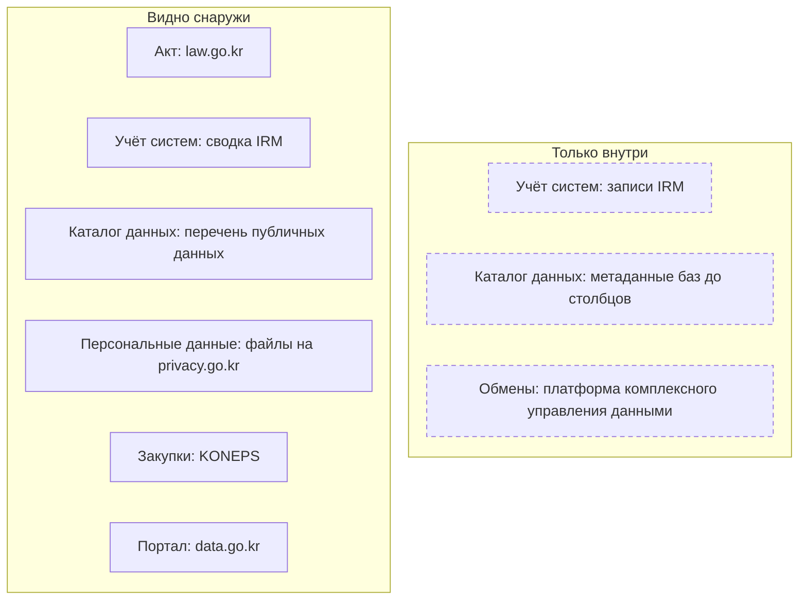
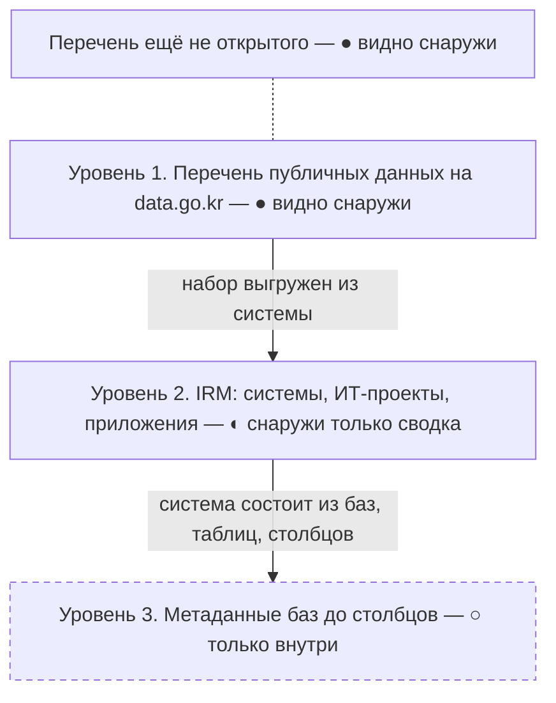

# Южная Корея

В Южной Корее опись данных государства закреплена законами на трёх уровнях, и каждый уровень ведут сами учреждения: перечень публичных данных на портале data.go.kr, учёт информационных систем в системе IRM и метаданные баз данных до столбцов. Министерство внутренних дел и безопасности (MOIS) ищет в перечнях пропуски и ежегодно ставит учреждениям баллы. Снаружи видна верхняя часть — каталог портала, перечень данных, которые ещё не открыты, и сводки учёта; записи о системах и метаданные видят только служащие. Поэтому опись снаружи начинают с каталога data.go.kr и перечня ещё не открытого, а изнутри — с IRM и системы метаданных.

Сведения проверены 25 октября 2026 года, если не указано иное. Корейские названия даны только там, где по ним ищут на портале.

## Коротко



Пунктирная рамка — то, что видят только служащие. Те же семь элементов в других странах — на странице [«Шесть стран в сравнении»](./00-overview.md).

## Правовая основа

Почти все акты об описи данных и систем — в ведении MOIS. Тексты и редакции — на law.go.kr, у каждой редакции указаны номер, дата обнародования и дата вступления в силу.

| Акт простыми словами | Что требует | Что даёт описи |
|----------------------|-------------|----------------|
| **Закон о публичных данных** (2013) | Учреждение регистрирует перечень своих публичных данных на портале, MOIS ищет пропуски и ежегодно оценивает учреждения | Перечень — общедоступная часть описи, проверенная извне |
| **Закон о государственном управлении на основе ИИ и данных** (2020, переименован в 2026) | Метаданные и схема связей данных, данные для других ведомств, перечень сервисов ИИ | Внутренний каталог и связи данных |
| **Закон об электронном правительстве** | Сведения об информационных ресурсах, классы важности систем, национальные эталонные данные | Учёт систем в IRM |
| **Закон о документах** | Данные систем — документы, на каждый набор данных системы — таблица управления | Ещё один внутренний перечень систем |
| **Закон о защите персональных данных** | Государственные учреждения регистрируют файлы персональных данных | Открытый перечень систем со сведениями о людях |
| **Закон о раскрытии информации** | Перечень информации органа, подлинники документов центральных органов без запроса | Документы о системах и путь запроса |

Номера редакций, статьи указов и приказы MOIS — в приложении [«Нормативная база»](../09-appendices/02-legal-framework.md#южная-корея).

## Реестры и платформы

Три уровня описи вложены друг в друга: набор в перечне выгружен из системы, а система состоит из баз, таблиц и столбцов.



### Кто отвечает

После того как 1 октября 2025 года Статистическое управление стало Министерством данных и статистики, политика публичных данных осталась у MOIS — так показывают все первоисточники. MOIS ведёт перечни, портал и оценку, а также стандарты, обмен данными, архитектуру ИТ и учёт информационных ресурсов. Министерство данных и статистики ведает статистикой, переписями и микроданными, а публичными данными занимается только своими. Портал и центральную систему метаданных ведёт центр поддержки при Национальном агентстве по информационному обществу (NIA), центры обработки данных правительства — Национальная служба информационных ресурсов, подведомственная MOIS.

### Перечень публичных данных

Учреждение регистрирует свои публичные данные на портале в течение 15 дней после того, как данные созданы или получены, изменения — в течение 10 дней. Пропуски, найденные MOIS, учреждение дорегистрирует в срок до 20 дней. Что из зарегистрированного предоставлять, одобряет Комитет по стратегии публичных данных. Перечень не возник сам: с марта 2018 года MOIS сплошь обследовало публичные данные примерно 690 учреждений. По итогам Корея перешла от выборочного открытия к открытию по умолчанию — кроме данных о национальной безопасности и персональных данных. В 2019 году по итогам построили национальную карту данных около 700 учреждений; под этим названием (국가데이터맵) в меню портала её сейчас нет.

Весь каталог портал выкладывает ежемесячным файлом «Состояние открытых перечней» (목록개방현황) размером около 140 МБ. В версии на 30 сентября 2026 года без ошибок удалось разобрать 92 147 записей из 96 526: 80 039 файловых наборов, 11 808 программных интерфейсов и 300 стандартных наборов от 1079 поставщиков. У записи — поставщик, отдел, телефон, рубрика, периодичность, дата следующего обновления, формат, лицензия и основание хранения. Файл даёт две проверки:

- **основание** — поле «основание хранения» (보유근거) пусто у 79,8% записей, «способ сбора» — у 91,3%. Основание набора ищут в положении о министерстве, в IRM и системе метаданных, где поле «закон и цель хранения» обязательно;
- **свежесть** — у 8026 файловых наборов, 10%, дата следующего обновления прошла, а набор не обновлён.

Поиск портала 25 октября 2026 года показывал 89 556 файловых наборов, 12 032 программных интерфейса, 300 видов стандартных наборов и 262 228 связанных наборов (연계데이터) — описаний с других государственных порталов. Связанные наборы — больше двух третей, поэтому общее число без разбивки по типам с другими странами не сравнивают. У каждого набора есть описание по schema.org и DCAT без ключа, программный интерфейс к самим данным — с бесплатным ключом.

### Перечень ещё не открытого

На портале опубликован общегосударственный перечень данных, которые учреждения пока не предоставляют, но обязались открыть, — по сути общедоступная часть описи ([«Полный реестр и общедоступная часть»](../03-process/09-result-and-upkeep.md#полный-реестр-и-общедоступная-часть)). В версии от 10 февраля 2026 года — 9987 строк 534 учреждений: на 2026 год — 2817, на 2027-й — 4018, на 2028-й — 3152. Больше всего строк у города Сунчхон (500) и Министерства земли, инфраструктуры и транспорта (370). В строке три поля: учреждение, год и название набора — ни системы, ни отдела. Новую версию обещали к 28 февраля 2026 года, но на 25 октября её не было. Пятый базовый план (2026–2028) обещает публиковать перечни всех публичных данных, кроме закрытых, но закон пока не изменён.

### IRM: учёт информационных ресурсов

Система учёта информационных ресурсов IRM работает с марта 2024 года; ей предшествовали обязательная архитектура ИТ государственных организаций (с 2005 года) и общегосударственный портал архитектуры. В IRM учреждение описывает свои системы: задачи, оборудование, программы, данные и технологии. Через IRM проходят три процедуры, полезные для описи:

- **предварительное согласование** ИТ-проектов с MOIS до объявления закупки — для центральных органов от 1 млрд вон; проверяют прежде всего, не дублирует ли проект другие системы;
- **оценка эксплуатации** — по использованию системы MOIS рекомендует её переделать, вывести или объединить с другой ([«Где искать преемника»](../04-sources/06-legacy.md#где-искать-преемника));
- **класс важности** — с 2025 года учреждения относят системы к классам по значимости сервиса, числу пользователей и зависимых систем (статья 56-3 закона об электронном правительстве, в оригинале — [56의3](../09-appendices/01-glossary.md#нумерация-статей-56의3)).

По сводке MOIS от 3 сентября 2026 года, за 2025 год в IRM данные внесли 2196 учреждений: 56 центральных органов, 244 органа местного самоуправления, 429 органов и учреждений местного образования и 1467 государственных организаций. Учтено 15 618 информационных систем, 14 866 ИТ-проектов и 1358 мобильных приложений. Сводка открыта: она есть в открытом разделе IRM и набором «Статистика информационных ресурсов» на data.go.kr. Сама IRM — служебная система, вход — по сертификату служащего.

### Метаданные баз данных

Руководство MOIS по стандартизации баз данных 2025 года требует, чтобы каждое учреждение вело систему управления метаданными своих баз и держало её в согласии с центральной системой. Обязательный состав — это реестр данных в самом подробном виде ([«Расширенный состав»](../03-process/05-registry.md#расширенный-состав)):

| Уровень | Обязательные поля | Условный пример |
|---------|-------------------|-----------------|
| **Система** | Учреждение, название — как в IRM, закон и цель хранения, месяц создания, отдел, ответственный и контакты, тип | Система учёта лицензий; закон о лицензировании |
| **База** | Название, рубрика по классификатору функций правительства, СУБД, число таблиц, структурированные ли данные | База лицензий, 40 таблиц |
| **Таблица** | Владелец схемы, название, открыта, открыта частично или закрыта — с причиной и основанием | «Лицензиаты» — открыта частично, основание — закон о защите персональных данных |
| **Столбец** | Название из общего словаря стандартных терминов, тип, ключи, персональные данные, шифруется ли, открыт ли | «Дата рождения» — дата, персональные данные, шифруется, закрыт |

Названия полей берут из общего словаря стандартных терминов: с 338 терминов в 2020 году он вырос до 13 159 в сентябре 2026 года. Закон об управлении на основе ИИ и данных добавил схему связей данных: MOIS сводит метаданные и схемы связей всех учреждений в общегосударственную систему. Качество баз MOIS оценивает ежегодно — в 2025 году 684 учреждения и 7416 баз. Открытой части у систем метаданных нет.

### Файлы персональных данных

Государственное учреждение регистрирует в Комиссии по защите персональных данных каждый файл персональных данных — название, основание и цель, состав сведений, способ обработки, срок хранения, кому данные передают регулярно. Перечень ищут на privacy.go.kr, а сводку по типам учреждений Комиссия выкладывает на data.go.kr. Не регистрируют файлы о национальной безопасности, расследованиях, налоговых и таможенных проверках, разовые и засекреченные: таких систем в перечне не будет.

### Госзакупки

Единая система государственных закупок KONEPS (g2b.go.kr) в новой версии работает с 31 марта 2025 года; собственные системы закупок 25 государственных организаций переводят в неё, к 17 ноября 2025 года перевели 12. Объявления, контракты, планы закупок и предварительные спецификации отдаются через программные интерфейсы data.go.kr с ключом; план и спецификация показывают ИТ-проект раньше контракта. Многие учреждения выкладывают на портал собственные наборы «Состояние ИТ-проектов» с системами и подрядчиками. Расходы министерств — на портале «Открытые финансы» openfiscaldata.go.kr ([«Государственные данные»](../04-sources/02-government.md#госзакупки)).

### Другие источники

- **Обмен данными.** На платформе комплексного управления данными учреждения регистрируют данные, нужные другим ведомствам; открытой части у неё нет. Национальные эталонные данные назначает MOIS, а учреждения обязаны пользоваться ими в первую очередь — как с национальными регистрами [Казахстана](./01-kazakhstan.md#национальные-регистры).
- **Перечень сервисов ИИ.** С 28 августа 2026 года учреждение ведёт сведения о сервисах, где применяет ИИ, — тип, назначение, данные, — а MOIS публикует перечень ежегодно. Пока не найдено ни приказа о порядке, ни перечня ([«Инвентаризация для ИИ»](../02-approaches/03-ai.md#инвентаризация-для-ии)).
- **Данные систем как документы.** По закону о документах данные административной системы — электронный документ: на каждый набор учреждение заполняет таблицу управления со сведениями о законе, системе, данных и сроке хранения. Этот перечень ведут архивисты, а не ИТ-служба, и его сверяют с IRM.

## Где искать данные

### Государственные

- **data.go.kr** — наборы и программные интерфейсы, перечень ещё не открытого, карта публичных данных (공공데이터맵), ссылки на региональные и отраслевые порталы; с августа 2026 года — поиск по вопросу на обычном языке. Национальные приоритетные данные (국가중점데이터) — наборы высокой ценности по корейской мерке: к 2024 году открыто 217, в январе 2026 года утверждена ещё сотня «ИИ- и высокоценных» наборов.
- **Статистика.** Новую статистику ведут только после утверждения: перечень утверждённой статистики на narastat.kr — 1376 статистик с ведомством, способом сбора и периодичностью. Показатели — в KOSIS, микроданные — в MDIS.
- **Раскрытие информации** — open.go.kr: перечни информации органов и подлинники документов центральных органов.
- **Регистры** — статус регистрации предприятий и реестр зданий через программные интерфейсы data.go.kr с ключом; выписки из реестров прав на недвижимость и юридических лиц — портал Верховного суда iros.go.kr.
- **Данные для ИИ** — AI Hub (aihub.or.kr): 977 открытых наборов, часть — только в защищённой зоне.

Каталог портала, перечень утверждённой статистики и правовая база отвечают без ключа. Ежемесячный файл каталога фильтруют по поставщику: учреждение без строк — вопрос к нему, а не вывод, что данных нет.

<details>
<summary>Проверить самому</summary>

```bash
# data.go.kr: сколько файловых наборов, программных интерфейсов и связанных наборов
curl -s "https://www.data.go.kr/tcs/dss/selectDataSetList.do?dType=FILE" | sed 's/<[^>]*>//g' | tr -s ' \t\n' ' ' | grep -o -E '(파일데이터|오픈 API|연계데이터) [0-9,]+건' | sort -u
# Описание набора по schema.org и DCAT: 15062804 — ежемесячный файл каталога, 15127106 — перечень ещё не открытого
curl -s "https://www.data.go.kr/catalog/15062804/fileData.json"
curl -s "https://www.data.go.kr/biz/dcat/metadata/15127106.do"
# Утверждённая статистика: сколько всего
curl -s "https://www.narastat.kr/pms/pub/scs/css/selectConfmStatsList.do" | sed 's/<[^>]*>//g' | tr -s ' \t\n' ' ' | grep -o -E '총 [0-9,]+ 건'
# law.go.kr: действующие законы; OC=test — значение из примеров руководства, для работы нужен свой ключ
curl -s -G "https://www.law.go.kr/DRF/lawSearch.do" -d OC=test -d target=law -d type=JSON --data-urlencode "query=공공데이터"
```

</details>

### Общественные

- **Центр раскрытия информации** opengirok.or.kr — общественная организация с 2008 года: запросы о раскрытии информации и полученные ответы.
- **Code for Korea** (codefor.kr) — сообщество гражданских разработчиков, список проектов и архив гражданских технологий.

### Коммерческие

- **Раскрытие информации компаний** — DART Службы финансового надзора (dart.fss.or.kr), программный интерфейс OpenDART — с ключом ([«Раскрытие информации и отчётность»](../04-sources/04-commercial.md#раскрытие-информации-и-отчётность)).
- **Финансовые данные** — платформа findatamall.or.kr: продукты данных карточных компаний, банков, страховщиков и брокеров.
- **Кредитные бюро** NICE и KCB — сведения о заёмщиках и компаниях на коммерческих условиях.

## Как провести инвентаризацию

### Чем владеем: опись министерства

Порядок шагов и что каждый даёт реестру — на странице [«Шесть стран в сравнении»](./00-overview.md#чем-владеем-общий-порядок). Где их пройти в Южной Корее:

| Шаг | Где | Видно снаружи? |
|-----|-----|----------------|
| **1. Полномочия** | Закон об организации правительства; положение о министерстве с функциями каждого отдела | ● да |
| **2. Учёт систем** | Записи министерства в IRM | ◐ сводка |
| **3. Каталог данных** | Система управления метаданными министерства; перечень публичных данных на data.go.kr и перечень ещё не открытого | ◐ частично |
| **4. Обмены** | Платформа комплексного управления данными; национальные эталонные данные | ○ нет |
| **5. Персональные данные** | Файлы министерства в Комиссии по защите персональных данных | ● да |
| **6. Статистика и документы** | narastat.kr; таблицы управления наборами данных систем | ◐ частично |
| **7. Закупки** | KONEPS и предварительное согласование | ● да |
| **8. Опубликованное** | Наборы министерства на data.go.kr | ● да |
| **9. Опрос** | Ответственный за предоставление публичных данных, ответственный за ИИ и данные, владельцы систем | — |

Внутри министерства шаги 2 и 3 дают почти готовую опись, и главная работа — сверка. Система есть в IRM, а баз в системе метаданных у неё нет. Столбцы отмечены как открытые, а набора на data.go.kr нет. Файл персональных данных зарегистрирован, а системы, где он лежит, в IRM нет. Набор есть в каталоге, но поле основания пусто, а дата обновления прошла.

### Где найти нужное

Общий порядок — на странице [«Шесть стран в сравнении»](./00-overview.md#где-найти-нужное-общий-порядок). Что в Южной Корее иначе:

- **Где лежит** — перечень ещё не открытого, перечень файлов персональных данных, наборы учреждений о своих ИТ-проектах.
- **Запрос** — данные, которых нет в перечне, запрашивают через портал: решение за 10 дней, продление ещё на 10. Отказ обжалуют в Комиссию по урегулированию споров о публичных данных в течение 60 дней. Документы — по закону о раскрытии информации через open.go.kr, с тем же сроком ([«Запрос владельцу»](../03-process/06-access.md#запрос-владельцу)).
- **Если закрыто** — центр решения проблем с публичными данными на портале помогает договориться об открытии. Защищённые зоны есть у AI Hub и K-ICT Big Data Center, а данные с персональными сведениями пятый базовый план обещает выдавать в псевдонимизированном виде.

## Что особенного

- **Опись — обязанность учреждения, проверка — извне.** Перечень, учёт систем и метаданные ведут сами учреждения, а MOIS ищет пропуски и ставит баллы. По итогам 2025 года «хорошо» и выше получили 348 учреждений из 684 — 50,9% против 40,9% годом раньше. Средний балл за систему управления — 89,5, за открытие и использование — 59,2, за открытие данных для ИИ — 37,8: наладить порядок проще, чем открыть данные ([«Кто отвечает после публикации»](../03-process/09-result-and-upkeep.md#кто-отвечает-после-публикации)).
- **Обещанное тоже публикуют.** По перечню ещё не открытого видно, что данные есть и когда их ждать, а учреждение, которое не выполнило обещание, видно без запроса.
- **Учреждения часто переименовывают.** Только за 2025–2026 годы появились Министерство данных и статистики, Министерство климата, энергетики и окружающей среды, Служба публичного обвинения вместо прокуратуры. Документы ищут по старым и новым названиям, а владельца набора записывают с датой.

## Пример

26 сентября 2025 года в центре Национальной службы информационных ресурсов в Тэджоне загорелся машинный зал, и правительственные системы остановились. Сначала власти называли 647 пострадавших систем. 9 октября 2025 года сообщили, что восстановили данные системы управления эксплуатацией центра и после сверки с министерствами исправили список: прежний был составлен по спискам мониторинга и памяти сотрудников. Систем оказалось 709: 40 первого класса важности, 68 — второго, 261 — третьего, 340 — четвёртого. Число выросло ещё и потому, что часть систем разделили по функциям, а системы документооборота отдельных ведомств, наоборот, свели в одну. Портал раскрытия информации open.go.kr не работал до 31 октября. Все 709 систем восстановили к 30 декабря 2025 года, сначала — первого класса.

Пример показывает три вещи:

- **Опись хранят отдельно от того, что она описывает.** Полный список систем центра лежал в системе, которую пришлось восстанавливать вместе с остальными. Копия реестра в другом месте — часть его поддержки ([«Реестр как данные»](../06-tools/03-registry-as-data.md)).
- **Число зависит от правил счёта.** 647 и 709 — один и тот же центр, посчитанный по-разному. Что считать одной системой и одним набором, решают до подсчёта ([«Что считать записью»](../03-process/05-registry.md#что-считать-записью)).
- **Важность — атрибут записи.** Класс важности определил порядок восстановления. В реестре данных его заменяет поле о критичности набора и системы.

## Частые ошибки

| Ошибка | Что происходит | Как исправить |
|--------|----------------|---------------|
| **Публичные данные отнесены к Министерству данных и статистики** | Запрос и вопросы о перечне уходят не туда | Публичные данные, портал, перечни и оценки — у MOIS; у Министерства данных и статистики — статистика и микроданные |
| **Общее число наборов портала без разбивки** | 376 828 сравнивают с порталами других стран, хотя 262 228 — описания с других порталов | Брать файловые наборы и программные интерфейсы отдельно, с датой |
| **Основание набора взято из каталога** | У 80% записей поле пусто, и набор остаётся без полномочия | Брать основание из положения о министерстве, IRM или системы метаданных |

Сквозные ошибки — в главе [«Практики и антипаттерны»](../08-practices/01-practices-and-anti-patterns.md).

## Ограничения

- IRM, системы управления метаданными и платформа комплексного управления данными снаружи недоступны; о составе учёта судят по законам, приказам и сводкам MOIS.
- В ежемесячном файле каталога часть строк разбирается с ошибками; доли пустых полей и просроченных обновлений посчитаны по прочитанным записям.
- Перечень ещё не открытого и набор с контактами исполнителей устарели — версии февраля 2026 и июля 2024 года.
- Коммерческий слой проверен частично: Корейская биржа данных kdx.kr из сети проверки не нашлась.

## Источники

- Законы на law.go.kr, 25 октября 2026 года: [закон о публичных данных](https://www.law.go.kr/법령/공공데이터의제공및이용활성화에관한법률), статьи 7, 9, 12, 17–23, 27, 31, и [указ к нему](https://www.law.go.kr/법령/공공데이터의제공및이용활성화에관한법률시행령), статьи 13 и 15; [закон о государственном управлении на основе ИИ и данных](https://www.law.go.kr/법령/인공지능및데이터기반행정활성화에관한법률), статьи 8–10, 16, 18, 19, 29, 30; [закон об электронном правительстве](https://www.law.go.kr/법령/전자정부법), статьи 44의2, 44의3, 45–47, 54, 56의3, и [указ к нему](https://www.law.go.kr/법령/전자정부법시행령), статьи 66 и 70의3; [указ к закону о документах](https://www.law.go.kr/법령/공공기록물관리에관한법률시행령), статьи 25 и 34의3; [закон о раскрытии информации](https://www.law.go.kr/법령/공공기관의정보공개에관한법률), статьи 8, 8의2, 11; [закон о защите персональных данных](https://www.law.go.kr/법령/개인정보보호법), статья 32; [закон о статистике](https://www.law.go.kr/법령/통계법), статья 18; [закон об организации правительства](https://www.law.go.kr/법령/정부조직법), статьи 27 и 37.
- Положения о министерствах: [положение о MOIS](https://www.law.go.kr/법령/행정안전부와그소속기관직제), статья 12; [положение о Министерстве данных и статистики](https://www.law.go.kr/법령/국가데이터처와그소속기관직제), статья 15; приказ MOIS [о стандартизации баз данных](https://www.law.go.kr/행정규칙/공공기관의데이터베이스표준화지침) № 2025-19, статьи 14–16 и приложение 4.
- MOIS: [итоги оценки за 2025 год](https://www.mois.go.kr/frt/bbs/type010/commonSelectBoardArticle.do?bbsId=BBSMSTR_000000000008&nttId=124895), 31 марта 2026 года; [сводка IRM](https://www.mois.go.kr/frt/bbs/type010/commonSelectBoardArticle.do?bbsId=BBSMSTR_000000000008&nttId=129225), 3 сентября 2026 года; [пятый базовый план](https://www.korea.kr/briefing/pressReleaseView.do?newsId=156738305), 6 января 2026 года; [поиск по вопросу на портале](https://www.mois.go.kr/frt/bbs/type010/commonSelectBoardArticle.do?bbsId=BBSMSTR_000000000008&nttId=128360), 3 августа 2026 года; [политика публичных данных](https://www.mois.go.kr/frt/sub/a06/b02/openData/screen.do); [качество публичных данных](https://www.mois.go.kr/frt/sub/a06/b02/openData_3/screen.do); [учёт информационных ресурсов](https://www.mois.go.kr/frt/sub/a06/b04/infoResourceMgr/screen.do); [пресс-релиз о сплошном обследовании](https://m.korea.kr/briefing/pressReleaseView.do?newsId=156255711), 26 февраля 2018 года.
- data.go.kr, 25 октября 2026 года: [ежемесячный файл каталога](https://www.data.go.kr/data/15062804/fileData.do), версия на 30 сентября 2026 года; [перечень данных, которые предстоит открыть](https://www.data.go.kr/data/15127106/fileData.do); [статистика информационных ресурсов](https://www.data.go.kr/data/3038513/fileData.do); [файлы персональных данных](https://www.data.go.kr/data/15114697/fileData.do); [ответственные исполнители](https://www.data.go.kr/data/15127104/fileData.do); [поиск наборов](https://www.data.go.kr/tcs/dss/selectDataSetList.do?dType=FILE) и [карта публичных данных](https://www.data.go.kr/tcs/opd/ndm/view.do).
- Пожар в центре обработки данных: [брифинг 9 октября 2025 года](https://www.korea.kr/briefing/policyBriefingView.do?newsId=156722144); [брифинг 6 ноября 2025 года](https://www.korea.kr/briefing/policyBriefingView.do?newsId=156726823); [восстановлено 95,3% систем](https://www.korea.kr/news/policyNewsView.do?newsId=148954103); [все 709 систем восстановлены](https://www.mois.go.kr/frt/bbs/type010/commonSelectBoardArticle.do?bbsId=BBSMSTR_000000000008&nttId=122775) — MOIS, 30 декабря 2025 года.
- Статистика и закупки: [перечень утверждённой статистики](https://www.narastat.kr/pms/pub/scs/css/selectConfmStatsList.do); [KOSIS](https://kosis.kr/); [MDIS](https://mdis.mods.go.kr/); [перевод систем закупок в KONEPS](https://www.korea.kr/briefing/pressReleaseView.do?newsId=156728570) — 17 ноября 2025 года; [запуск новой KONEPS](https://www.korea.kr/briefing/pressReleaseView.do?newsId=156684679); [«Открытые финансы»](https://www.openfiscaldata.go.kr/).
- Источники по слоям: [open.go.kr](https://www.open.go.kr/); [privacy.go.kr](https://www.privacy.go.kr/); [AI Hub](https://www.aihub.or.kr/aihubdata/data/list.do?currMenu=115&topMenu=100); [K-ICT Big Data Center](https://kbig.kr/portal/); [Центр раскрытия информации](https://www.opengirok.or.kr/); [Code for Korea](https://codefor.kr/); [DART](https://dart.fss.or.kr/) и [OpenDART](https://opendart.fss.or.kr/); [платформа финансовых данных](https://www.findatamall.or.kr/); [NICE](https://www.niceinfo.co.kr/); [KCB](https://www.koreacb.com/).
- Главы [«Зарубежные методики»](../05-frameworks/04-international-practice.md), [«Государственные данные»](../04-sources/02-government.md); приложение [«Нормативная база»](../09-appendices/02-legal-framework.md#южная-корея).
- Как проверяли. Тексты и редакции актов — по law.go.kr и его программному интерфейсу. 25 октября 2026 года из сети проверки открылись все основные государственные сайты; g2b.go.kr открылся через сервер единого входа, irm.go.kr — страницей входа; у kdx.kr не нашлось адреса.
