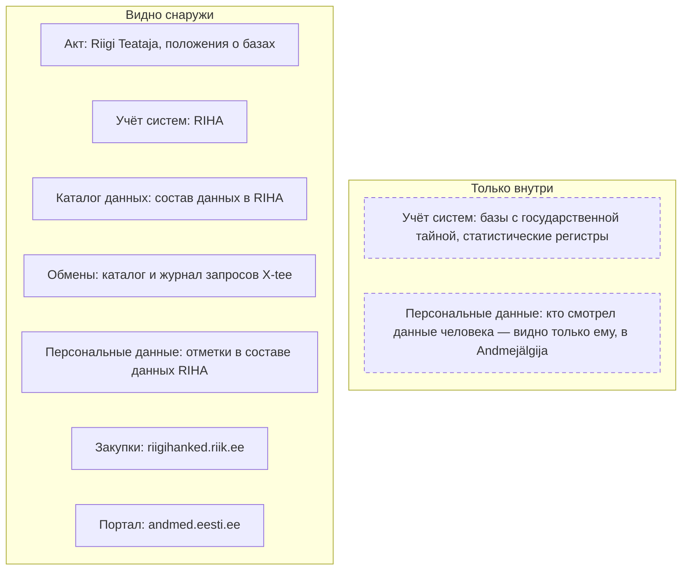
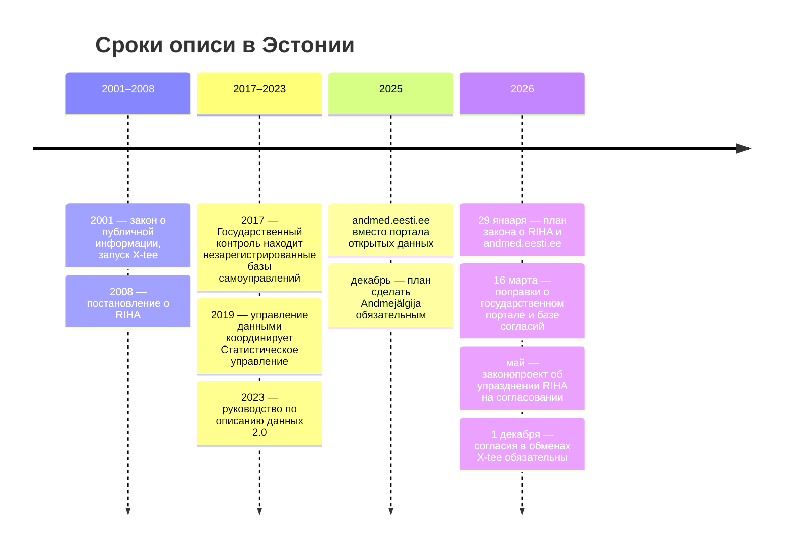

# Эстония

В Эстонии каждую базу данных государства регистрируют в открытом каталоге RIHA до того, как ею начинают пользоваться, а базы обмениваются данными через шину X-tee, у которой открыты и каталог сервисов, и журнал запросов. Поэтому снаружи видно больше, чем в других странах этой части: какие базы ведёт ведомство, из каких полей они состоят и кто на деле к ним обращается. Но запись в каталоге не значит, что она актуальна: половину записей о работающих базах последний раз обновляли до 2021 года, а законопроект 2026 года, судя по отзывам ведомств на него, упраздняет RIHA и переносит описания на портал andmed.eesti.ee. Опись ведомства начинают с его записей в RIHA и сверяют их с положениями о базах в Riigi Teataja, с каталогом и журналом X-tee, с закупками и порталом.

Сведения проверены 28 октября 2026 года, если не указано иное.

## Коротко



Пунктирная рамка — то, чего в открытых каталогах нет: базы с государственной тайной и статистические регистры по закону в RIHA не регистрируют, а журнал обращений к данным человека показывают только ему самому. Те же семь элементов в других странах — на странице [«Двенадцать стран в сравнении»](./00-overview.md).

## Правовая основа

Единица описи — база данных (andmekogu): по закону о публичной информации это упорядоченная совокупность данных в информационной системе, которую ведут для задач, установленных законом или актом на его основании. У каждой базы есть положение (põhimäärus) в Riigi Teataja: в нём названы ответственный обработчик, состав данных и поставщики данных. Собирать одни и те же данные в разных базах запрещено, а основные данные (põhiandmed) — уникальные данные базы — другие базы берут у неё, а не копируют.

| Акт простыми словами | Что требует | Что даёт описи |
|----------------------|-------------|----------------|
| **Закон о публичной информации** (2000) | Базу регистрируют в RIHA до запуска; ответ на запрос — за пять рабочих дней; у каждого учреждения открытый регистр документов | Перечень баз; договоры и переписка учреждения |
| **Постановление о RIHA** (2008) | Проверка «не собирают ли это уже», согласование пятью ведомствами, описание до объектов данных | Запись о базе: основание, владелец, состав, персональные данные |
| **Постановление об управлении информацией** (2017) | Ведомство держит свои записи в RIHA актуальными; Статистическое управление пишет руководство по описанию данных | Кто отвечает за свежесть записи |
| **Постановление о шине X-tee** (2016) | Обмен между базами — через X-tee; RIA публикует обезличенную статистику обменов | Связи «кто — у кого — какой сервис» |
| **Закон о государственной статистике** (2010) | Перечень статистических работ утверждает правительство; статистика берёт данные прежде всего из баз | Потоки данных в статистику; статистические регистры — не базы, их нет в RIHA |
| **Закон о государственных закупках** (2017) | Объявления и сведения о договорах — в регистре закупок, открыто, если нет ограничения | Подрядчики и состав работ по системам |

Номера RT, параграфы и редакции — в приложении [«Нормативная база»](../09-appendices/02-legal-framework.md#эстония).



## Реестры и платформы

### RIHA

RIHA (Riigi infosüsteemi haldussüsteem) — система учёта государственной информационной системы, её ведёт Управление информационной системы (RIA). В RIHA регистрируют все базы, кроме баз с государственной тайной, — и открытые, и закрытые, а пользоваться незарегистрированной базой запрещено. Каталог [riha.ee](https://www.riha.ee) открыт без входа, его программный интерфейс отдаёт все записи одним запросом. На 28 октября 2026 года в нём 1373 записи 446 организаций: 1096 — в работе, 65 — создаются, 186 — завершены.

**Согласование до создания.** Сначала владелец проверяет, не собирают ли эти сведения уже в другой базе, — опись работает против дублей. Затем документацию базы за 20 рабочих дней согласуют пять ведомств: RIA смотрит состав данных и их источники, Инспекция по защите данных — ограничения доступа и персональные данные, Статистическое управление — состав данных, Управление земли и пространственного развития — пространственные данные, Национальный архив — передачу данных в архив. Без согласования базу не создают. Базы только для внутренней работы учреждения, не входящие в государственную информационную систему, закон от согласования освобождает.

**Что в записи.** Владелец с кодом из коммерческого регистра, краткое имя, цель, статус и дата подключения к X-tee, класс защиты, ссылки на акты, документация, классификаторы и файл состава данных; ошибку в записи владелец исправляет за три рабочих дня. В файле состава — объекты и элементы данных с отметками «персональные данные», «особые категории» и «основные данные», а для заимствованных элементов — из какой системы они взяты. Из всех файлов собран поиск по элементам данных: на 28 октября 2026 года — 1 230 893 элемента. Так находят, в какой базе лежит поле и кто берёт его у другой базы.

**Описание данных.** С 2019 года управление данными государства координирует Статистическое управление. Его руководство по описанию данных 2023 года построено на DCAT-AP и доводит описание до элемента данных ([«Стандарты описания»](../05-frameworks/02-metadata-standards.md)). В 2025 году управление вместе с 19 ведомствами провело 276 проектов описания.

**Насколько полна запись.** Подсчёт по программному интерфейсу для 1096 работающих записей:

- **Состав данных** есть у 519, ссылки на акты — у 729, отметка о подключении к X-tee — у 679.
- **Свежесть.** 545 записей последний раз обновляли до 2021 года, 294 — в 2025–2026 годах.
- **Согласования.** У 624 записей последнее решение — «зарегистрирована автоматически», видимо при переносе из прежней версии RIHA; согласование ввода в эксплуатацию отмечено у 280.

Слабости известны и самому государству. Государственный контроль (Riigikontroll) в 2017 году насчитал у волостей и городов не меньше 925 баз; регистрацию в RIHA прошли 175, 81% не были зарегистрированы. Статистическое управление в отчёте за 2025 год пишет, что RIHA мало что дал ведомствам, и переносит описания на andmed.eesti.ee. Министерство юстиции и цифровизации в плане закона от 29 января 2026 года называет согласование ручным, а регистрацию — дублем согласования положения о базе.

### X-tee

X-tee — шина обмена данными между системами государства и компаний. Участник X-tee записан кодом из коммерческого регистра, его подсистема — база или система, которая выставляет сервисы или обращается к чужим. Для описи открыты два источника.

- **Каталог сервисов** [x-tee.ee/catalogue/EE](https://www.x-tee.ee/catalogue/EE) обновляется ежечасно и выгружается одним файлом JSON. На 28 октября 2026 года — 1995 подсистем 1038 участников, у государственных участников — 895 подсистем 260 организаций. Сервисы описаны у 424 подсистем (4333 SOAP-метода) и у 143 (386 REST-сервисов); остальные подсистемы сервисов не выставляют или каталог не получил их описание.
- **Журнал запросов** — открытые данные мониторинга X-tee на [logs.x-tee.ee/EE](https://logs.x-tee.ee/EE/): по строке на запрос, с кодами клиента и поставщика, сервисом и успехом. Данные выходят с задержкой в 10 дней, время округлено до часа. Запросы для внутренних нужд, Полиции безопасности и Службы внешней разведки удалены. На дату проверки доступны дни с 18 мая по 18 октября 2026 года.

Каталог показывает, что база умеет отдавать, журнал — кто реально берёт и сколько; оба сверяют с записями RIHA и положениями о базах ([«Как методы проверяют друг друга»](../02-approaches/02-methods.md#как-методы-проверяют-друг-друга)).

### Портал andmed.eesti.ee

Портал данных (andmete teabevärav) создан в 2025 году на месте портала открытых данных, чтобы показать, какие данные есть у государства, с описаниями и условиями повторного использования. На 28 октября 2026 года в нём 8517 записей: 8469 наборов и 48 сервисов данных. Записи есть у 107 из 2898 зарегистрированных держателей, а 84% записей — таблицы двух учреждений: Статистического управления (4447) и Института развития здоровья (2694). Открытыми помечены 5727 записей, с ограниченным доступом — 13, у 2777 доступ не указан; отметку «данные высокой ценности» имеют 34.

Описания закрытых баз ведут в RIHA, а не здесь. Законопроект, который Министерство юстиции и цифровизации разослало на согласование 1 мая 2026 года, это меняет: по отзывам ведомств, он упраздняет согласование и саму систему RIHA, а базы и их описания переводит на andmed.eesti.ee. План закона ждал вступления в силу во втором полугодии 2026 года, но на 28 октября закона в Riigi Teataja нет.

### Регистр закупок

Регистр государственных закупок [riigihanked.riik.ee](https://riigihanked.riik.ee/rhr-web/) ведёт Министерство финансов, сведения в нём открыты, если нет ограничения по закону. Объявления и сведения о договорах выгружаются по месяцам в XML формата eForms. В объявлениях с января по 28 октября 2026 года — 7323 процедуры, из них 287 с основным кодом CPV раздела 72 (ИТ-услуги). Программы и лицензии покупают под кодами раздела 48, поэтому ищут по обоим разделам и по названию базы ([«Государственные данные»](../04-sources/02-government.md#госзакупки)).

### Другие источники

- **Andmejälgija** на портале eesti.ee показывает человеку, какие ведомства смотрели его данные и зачем. На 16 декабря 2025 года подключены 15 из примерно 300 баз; министерство готовит закон, по которому подключение станет обязательным для баз в X-tee.
- **Регистр документов учреждения** (dokumendiregister) — по закону открытый, с полнотекстовым поиском; письма и договоры в нём появляются на следующий рабочий день. Здесь находят переписку о согласовании баз, договоры на разработку и ответы на чужие запросы.
- **Сервер классификаторов** [klassifikaatorid.stat.ee](https://klassifikaatorid.stat.ee/) — классификаторы, на которые ссылаются записи RIHA.

## Где искать данные

### Государственные

- **Портал** andmed.eesti.ee — только с фильтром по держателю, иначе выдачу заполнят таблицы статистики.
- **Статистика.** Статистическое управление, [andmed.stat.ee](https://andmed.stat.ee) — программный интерфейс PxWeb без ключа. Перечень статистических работ на 2026–2030 годы утвердило правительство 18 декабря 2025 года: 18 областей, у каждой — число выходных показателей, стоимость по годам, правовое основание, периодичность, министерство, которое представляет общественный интерес, и изменения методики. Какие базы служат источниками, перечень не называет. Обезличенные данные ведомствам и научным учреждениям выдаёт служба обмена данными Статистического управления.
- **Регистры.** Коммерческий регистр (Äriregister): 12 наборов открытых данных в JSON и XML, большинство обновляются ежедневно. С 1 ноября 2024 года в них нет личных кодов, с 10 июля 2026 года — сведений о бенефициарах. В регистре есть и государственные учреждения, с теми же кодами, что у владельцев в RIHA и участников X-tee.
- **Нормативные акты** — Riigi Teataja: сайт — приложение на JavaScript, тексты в txt и XML отдаёт открытый программный интерфейс.
- **Архивы.** Национальный архив ведёт систему AIS с описаниями архивных фондов и согласует в RIHA передачу данных баз в архив; ra.ee из сети проверки не открылся.

<details>
<summary>Проверить самому</summary>

```bash
# RIHA: все записи одним запросом (поле totalElements) и запись о базе по краткому имени
curl "https://www.riha.ee/api/v1/systems?size=2000&page=0"
curl "https://www.riha.ee/api/v1/systems/rr"
# RIHA: элементы данных, взятые из регистра населения (поле totalElements)
curl -G "https://www.riha.ee/api/v1/systems/data-objects" --data-urlencode "filter=infosystem,ilike,%Rahvastikuregist%" --data-urlencode "size=1"
# X-tee: каталог подсистем и сервисов, обновляется ежечасно
curl "https://www.x-tee.ee/catalogue-data/EE/index.json"
# X-tee: журнал запросов — какие дни доступны
curl "https://logs.x-tee.ee/EE/api/date_range"
# andmed.eesti.ee: записи держателя (поле metadata.total)
curl "https://andmed.eesti.ee/api/datasets/search?limit=75&informationHolderSlug=siseministeerium"
# Регистр закупок: объявления за месяц, XML eForms
curl "https://riigihanked.riik.ee/rhr/api/public/v1/opendata/notice/2026/month/9/xml"
# Riigi Teataja: текст закона о публичной информации
curl "https://www.riigiteataja.ee/public-api/api/v1/akt/130062026009/txt"
```

</details>

### Общественные

- **Сводный поиск по регистрам документов** [dokumendiregistrid.karlerss.com](https://dokumendiregistrid.karlerss.com/) — независимый проект: на 28 октября 2026 года 326 829 документов примерно 50 учреждений, есть программный интерфейс. Найденный документ сверяют с регистром самого учреждения ([«Общественные данные»](../04-sources/03-public.md#первоисточник)).
- **Связанные данные о сервисах X-tee**, которые собрал Тартуский университет, на andmed.eesti.ee последний раз обновлены 23 ноября 2022 года: пример копии, которая отстала от первоисточника.
- **OpenStreetMap** — выгрузка по Эстонии на Geofabrik обновляется ежедневно.

### Коммерческие

- **Inforegister** (Register OÜ) и **Creditinfo Eesti** — сведения о компаниях и их рисках, у Inforegister — программный интерфейс. Первоисточник открыт, поэтому коммерческую копию сверяют с коммерческим регистром ([«Коммерческие данные»](../04-sources/04-commercial.md)).

## Как провести инвентаризацию

### Чем владеем: опись министерства

Порядок шагов и что каждый даёт реестру — на странице [«Двенадцать стран в сравнении»](./00-overview.md#чем-владеем-общий-порядок). Где их пройти в Эстонии:

| Шаг | Где | Видно снаружи? |
|-----|-----|----------------|
| **1. Полномочия** | Положение о министерстве и законы в Riigi Teataja; положения о базах | ● да |
| **2. Учёт систем** | Записи RIHA министерства и подведомственных учреждений — по кодам из коммерческого регистра | ● да |
| **3. Каталог данных** | Файлы состава данных и поиск по элементам в RIHA; описания на andmed.eesti.ee | ◐ частично: состав есть у 519 из 1096 работающих записей |
| **4. Обмены** | Каталог X-tee, журнал запросов X-tee, связи между записями RIHA | ● да, кроме запросов спецслужб и внутренних |
| **5. Закрытое и персональные данные** | Отметки и класс защиты в составе данных RIHA; Andmejälgija | ◐ частично: отметки ставит владелец, журнал доступа видит только сам человек |
| **6. Формы сбора** | Перечень статистических работ; поставщики данных в положениях о базах | ● да |
| **7. Закупки** | riigihanked.riik.ee; договоры в регистре документов | ● да |
| **8. Опубликованное** | Наборы министерства на andmed.eesti.ee, сайт министерства | ● да |
| **9. Опрос** | Владельцы баз, ответственные за управление данными; проекты описания со Статистическим управлением | — |

Шаги 1–4 дают почти готовую опись, и главная работа — сверка. Положение о базе есть в Riigi Teataja, а записи в RIHA нет. Подсистема министерства обращается к X-tee каждый день, а базы с таким именем в RIHA не найти. Состав данных в RIHA старше последней правки положения. Отдельно добавляют то, чего в RIHA нет по закону: статистические регистры, базы с государственной тайной и системы для внутренней работы, которые не согласуют ([«Что считать записью»](../03-process/05-registry.md#что-считать-записью)).

### Где найти нужное

Общий порядок — на странице [«Двенадцать стран в сравнении»](./00-overview.md#где-найти-нужное-общий-порядок). Что в Эстонии иначе:

- **Первая остановка — RIHA, а не портал.** В нём есть и закрытые базы. Поиск по элементам данных подсказывает, в какой базе лежит нужное поле: элементов со словом «isikukood» (личный код) в имени — 1351.
- **Кто пользуется** — журнал X-tee: какие организации обращаются к сервису базы и как часто. Их можно спросить о данных, если владелец не отвечает.
- **Запрос** — по закону о публичной информации, ответ за пять рабочих дней, при продлении — до 15 ([«Запрос владельцу»](../03-process/06-access.md#запрос-владельцу)). В запросе называют краткое имя базы в RIHA и код сервиса X-tee. Сначала ищут в регистре документов учреждения: ответ на похожий запрос мог уже быть.
- **Если закрыто** — служба обмена данными Статистического управления для исследований; данные регистра населения по закону выдают лицам с законным интересом.

## Что особенного

- **Регистрация — условие работы базы, и каталог открыт целиком.** Закрытые базы описаны рядом с открытыми и доступны по программному интерфейсу до элементов данных — то, что книга требует от любого реестра ([«Закрытые наборы — тоже в реестре»](../03-process/06-access.md#закрытые-наборы--тоже-в-реестре)).
- **Журнал обменов — открытые данные.** Видно не только, какие сервисы есть, но и кто к ним обращался, по дням. Это проверка «объявлено — используется» по самим обращениям, а не по соглашениям и разрешениям на обмен.
- **Не всё, что есть, — база по закону.** Статистические регистры законом выведены из числа баз, а системы для внутренней работы не согласуют. Опись, построенная только по RIHA, их пропустит.
- **Учёт меняют на ходу.** Если законопроект примут, описания переедут на andmed.eesti.ee. Записывать стоит постоянные признаки базы — краткое имя, код владельца, положение в Riigi Teataja, — а не ссылку на карточку RIHA.

## Пример

Регистр населения (rr) — одна из главных баз государства. Вот что о нём говорит запись RIHA на 28 октября 2026 года:

| Поле RIHA | Значение | Поле реестра |
|-----------|----------|--------------|
| Владелец | Министерство внутренних дел, код 70000562; сервер X-tee размещает его ИТ-центр SMIT | Организация-владелец |
| Краткое имя, название | rr, «Eesti rahvastikuregister» | Информационная система |
| Статус | В работе с 1 января 2002 года, в X-tee — с 30 апреля 2002 года | Статус |
| Создана, обновлена | 9 июля 2008 года; 5 марта 2026 года | Дата изменения |
| Согласования | Создание — 23 января 2014 года, ввод в эксплуатацию — 14 апреля 2014 года; последнее обсуждение — 2016 год | Отметка о контроле |
| Класс защиты | K3T2S2, уровень H | Режим доступа |
| Основание | 11 ссылок на акты — на редакции 2014–2019 годов | Нормативный акт |
| Состав данных | Файл от 28 марта 2025 года: 594 элемента в 30 объектах; 91 — персональные данные, 3 — особых категорий, 60 — из других систем | Схема данных |

Запись даёт почти всю карточку. Сверка с другими источниками добавляет пять наблюдений:

- **Состав отстаёт от положения.** Состав данных установлен постановлением правительства № 129 от 20 декабря 2018 года, его меняли 11 раз. Правки вступили в силу 18 октября и 2 декабря 2025 года — после файла в RIHA. Например, появились сведения о проверке контактных данных; в файле RIHA таких элементов нет. Состав берут из действующей редакции положения, а RIHA — как подсказку.
- **Сервисы — под другим кодом.** В каталоге X-tee сервисы регистра выставляет не министерство, а SMIT (код 70008440): 205 SOAP-методов и 4 REST-сервиса. У министерства своя подсистема rr-stat — отчёты регистра для Статистического управления. Связь между RIHA и X-tee ищут по краткому имени, а не по коду владельца.
- **Журнал показывает настоящих пользователей.** 15 октября 2026 года 140 организаций через 314 подсистем обратились к сервисам регистра 723 827 раз; чаще всего — к сервису основных сведений о человеке RR404_isik (190 877 раз). 64 компании сделали 60 326 запросов. Из 286 разных кодов этих подсистем с кратким именем записи в RIHA совпадают 103.
- **Ссылки на источник — свободным текстом.** Поиск по элементам RIHA находит 3171 элемент в 209 системах, взятый из регистра населения. Источник при этом записан 48 способами: «Eesti rahvastikuregister», «Rahvastikuregister», «Rahvastikuregister/Äriregister» и так далее ([«Один набор под разными именами»](../03-process/05-registry.md#один-набор-под-разными-именами)).
- **Есть часть, которой нет в учёте.** 11 сентября 2026 года SMIT объявил закупку лицензий Tableau для хранилища данных регистра населения на 2027 год, с оценкой 70 000 евро и кодом CPV 48460000, а не 72. У хранилища есть подсистема X-tee RR_ANDMELADU и сервис просмотра в подсистеме rr — 41 533 запроса 15 октября. Отдельной записи в RIHA у хранилища нет: часть ли оно базы rr, выясняют у владельца.

На andmed.eesti.ee у министерства четыре открытых набора — данные о смертях (обновлены 1 октября 2026 года), о браках, статистика населения и имена из регистра. Описания самого регистра на портале нет. Даже у образцовой базы запись в каталоге — начало описи, а состав, пользователей и части системы проверяют по актам, журналу X-tee и закупкам.

## Частые ошибки

| Ошибка | Что происходит | Как исправить |
|--------|----------------|---------------|
| **Запись RIHA принята за текущую опись** | В реестр попадают старые составы и основания | Смотреть дату изменения записи, состав сверять с действующей редакцией положения в Riigi Teataja |
| **Сервисы базы ищут по коду владельца** | В X-tee их не находят: сервисы выставляет обработчик, например ИТ-центр министерства | Искать по краткому имени и названию; в записи RIHA смотреть, кто размещает сервер X-tee |
| **andmed.eesti.ee принят за каталог всех данных государства** | Ждут описаний закрытых баз, а находят таблицы статистики | Закрытые базы — в RIHA; на портале — фильтр по держателю |

Сквозные ошибки — в главе [«Практики и антипаттерны»](../08-practices/01-practices-and-anti-patterns.md).

## Ограничения

- Числа RIHA, X-tee и andmed.eesti.ee — снимок 28 октября 2026 года; совпадение подсистем X-tee с записями RIHA по краткому имени — грубая оценка: имена совпадают не всегда, а системы компаний регистрировать в RIHA не обязаны.
- Законопроект об упразднении RIHA и закон об обязательном Andmejälgija на 28 октября 2026 года в Riigi Teataja не найдены, законопроект в Riigikogu — тоже. Сведения о нём — по плану закона и отзывам ведомств на согласование.
- Журнал X-tee хранит около пяти месяцев и не показывает запросы спецслужб и внутренние запросы.
- Отдельного открытого реестра обработок персональных данных не найдено; отметки о персональных данных в составе RIHA ставит сам владелец, и их не проверяли.
- Самоуправления описаны только по проверке Государственного контроля 2017 года.

## Источники

- Законы и постановления — через программный интерфейс Riigi Teataja (`public-api/api/v1/akt/номер/txt` и `xml`), 28 октября 2026 года: [закон о публичной информации](https://www.riigiteataja.ee/akt/130062026009), §§ 11, 12, 18, 19, 28, 29, 43¹–43¹⁰; [поправки RT I, 06.03.2026, 1](https://www.riigiteataja.ee/akt/106032026001), § 3 — сроки вступления в силу; [закон о государственной статистике](https://www.riigiteataja.ee/akt/111032022002), §§ 4, 6, 16, 17, 19, 20¹, 29; [распоряжение правительства № 236 от 18 декабря 2025 года](https://www.riigiteataja.ee/akt/320122025002) — перечень статистических работ на 2026–2030 годы, приложение; [закон о государственных закупках](https://www.riigiteataja.ee/akt/103072026006), § 181; [закон о регистре населения](https://www.riigiteataja.ee/akt/130062026025), §§ 3, 44–46; [постановление № 129 о составе регистра населения](https://www.riigiteataja.ee/akt/125112025005), редакция с 2 декабря 2025 года. Постановления о RIHA, об управлении информацией и о X-tee — в приложении [«Нормативная база»](../09-appendices/02-legal-framework.md#эстония).
- [RIHA](https://www.riha.ee): программный интерфейс `api/v1/systems` — 1373 записи, статусы, даты, согласования, полнота полей; `api/v1/systems/rr`, `rr/issues`, `rr/relations` и файл состава данных регистра населения; `api/v1/systems/data-objects` — элементы данных. 28 октября 2026 года.
- [Каталог X-tee](https://www.x-tee.ee/catalogue/EE) — файл `catalogue-data/EE/index.json` от 28 октября 2026 года; [журнал запросов X-tee](https://logs.x-tee.ee/EE/) — запросы к подсистеме GOV/70008440/rr за 15 октября 2026 года; [описание открытых данных мониторинга](https://andmed.eesti.ee/datasets/x-tee-teenuste-monitooringu-avaandmed) на andmed.eesti.ee.
- [andmed.eesti.ee](https://andmed.eesti.ee): программный интерфейс `api/datasets/search` и `api/information-holders/search` — 8517 записей, держатели, доступ, 28 октября 2026 года.
- [Avaliku teabe seaduse muutmise seaduse eelnõu väljatöötamiskavatsus](https://cms.advokatuur.ee/app/uploads/2026/02/Lisa-1-Avaliku-teabe-seaduse-muutmise-eelnou-valjatootamiskavatsus.pdf) — Министерство юстиции и цифровизации, 29 января 2026 года, копия на сайте Адвокатуры; [отзыв Налогово-таможенного департамента на законопроект](https://dokumendiregistrid.karlerss.com/dokumendid/1038777/seisukoht-avaliku-teabe-seaduse-ja-teiste-seaduste-muutmise-seaduse-eelnou-kohta) от 22 мая 2026 года — по сводному поиску регистров документов; [Riik muudab inimeste andmete kasutamise läbipaistvaks](https://www.justdigi.ee/uudised/riik-muudab-inimeste-andmete-kasutamise-labipaistvaks-andmejalgija-muutub-asutustele) — Министерство юстиции и цифровизации, 16 декабря 2025 года.
- Статистическое управление: [годовой отчёт за 2025 год](https://www.stat.ee/sites/default/files/2026-03/Aastaaruanne_2025_0.pdf), с. 16–17; [andmed.stat.ee](https://andmed.stat.ee/api/v1/et/stat). [Ülevaade valdades ja linnades peetavatest andmekogudest](https://riigikontroll.ee/sites/default/files/arhivaalid/2420/RKTR_2420_2-1.4_2175_001-3.pdf) — Riigikontroll, 31 января 2017 года.
- Регистр закупок: [открытые данные](https://riigihanked.riik.ee/rhr-web/#/open-data) — объявления за январь — октябрь 2026 года, закупка 314207 «Rahvastikuregistri andmelao Tableau litsentside hankimine 2027 aastaks»; [открытые данные коммерческого регистра](https://avaandmed.ariregister.rik.ee/et/avaandmete-allalaadimine).
- Общественные и коммерческие: [dokumendiregistrid.karlerss.com](https://dokumendiregistrid.karlerss.com/), [Geofabrik — Estonia](https://download.geofabrik.de/europe/estonia.html), [Inforegister](https://www.inforegister.ee/), [Creditinfo Eesti](https://creditinfo.ee/).
- Главы [«Зарубежные методики»](../05-frameworks/04-international-practice.md), [«Государственные данные»](../04-sources/02-government.md); приложение [«Нормативная база»](../09-appendices/02-legal-framework.md#эстония).
- Как проверяли. 28 октября 2026 года из сети проверки не открылись ra.ee и ais.ra.ee (соединение отклонено); teatmik.ee вернул пустую страницу; inforegister.ee на запрос curl ответил ошибкой 403, при повторной проверке другим инструментом открылся; andmed.eesti.ee после частых запросов временно ограничил доступ, выгрузку закончили позже. Страницы eesti.ee — приложение на JavaScript, сведения об Andmejälgija взяты из новостей министерства. Из эстонской сети адреса не проверяли.
