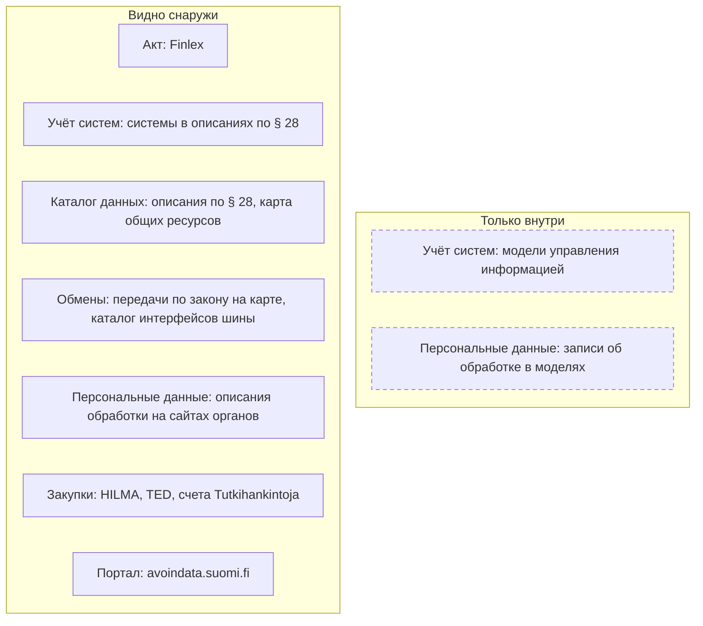
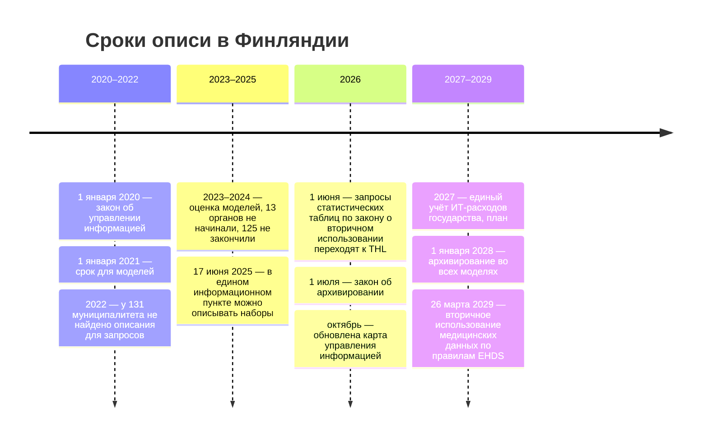

# Финляндия

В Финляндии опись — обязанность каждого органа по закону: орган ведёт внутреннюю модель управления информацией и публикует на сайте описание своих информационных ресурсов, чтобы по нему писали запросы. Модель снаружи не видна, а описание для запросов — короткий текст о ресурсах, а не перечень наборов. Зато открыты следы, которые его дополняют: карта общих ресурсов и передач данных по закону, каталог интерфейсов государственной шины обмена, портал открытых данных и счета государственных закупок с поставщиками. Поэтому опись органа начинают с его описания по § 28 и проверяют каждый ресурс по порталу, интерфейсам, шине и закупкам; анкета уточняет наборы, таблицы вне систем и качество.

Сведения проверены 28 октября 2026 года, если не указано иное.

## Коротко



Пунктирная рамка — то, что орган записывает в свою модель управления информацией, но публиковать не обязан. Те же семь элементов в других странах — на странице [«Двенадцать стран в сравнении»](./00-overview.md).

## Правовая основа

Основная единица описи — информационный ресурс (tietovaranto): совокупность данных, которыми орган пользуется для своих задач, в системах или на бумаге. Ресурс крупнее набора: у Статистического управления их 11, у Управления социального страхования Kela — 14. Ресурс, который ведут для многих органов и данные которого передают дальше, закон называет общим (yhteinen tietovaranto).

| Акт простыми словами | Что требует | Что даёт описи |
|----------------------|-------------|----------------|
| **Закон об управлении информацией в государственном управлении** (2019, действует с 2020 года) | Модель управления информацией в каждом органе; опубликованное описание ресурсов для запросов (§ 28); карта общих ресурсов у Министерства финансов | Внутренняя опись органа и её открытая часть — готовая основа реестра |
| **Закон об открытости деятельности органов власти** (1999) | Ответ на запрос не позже двух недель, при большом объёме — месяца; орган помогает найти документ | Запрос со ссылкой на ресурс из описания |
| **Закон об архивировании** (2026) | Национальный архив решает, что архивировать; с 1 июля 2026 года архивирование — часть модели | Сроки хранения и судьба данных выведенных систем |
| **Закон о вторичном использовании данных здравоохранения и соцобеспечения** (2019) | Разрешения Findata; держатели готовят описания своих ресурсов для исследователей | Описанная закрытая часть — медицинские и социальные данные |
| **Закон о статистике** (2004) | Органы передают статистике данные из своих ресурсов; статистика объявляет о сборе сведений | Что орган отдаёт статистике и что статистика собирает сама |
| **Закон о государственных закупках** (2016) | Объявления в HILMA, выше порогов ЕС — также в TED | Подрядчики и состав систем |

Номера, параграфы и редакции — в приложении [«Нормативная база»](../09-appendices/02-legal-framework.md#финляндия).



## Реестры и платформы

### Модель управления информацией и описание для запросов

[Модель управления информацией](../09-appendices/01-glossary.md#модель-управления-информацией) (tiedonhallintamalli) обязан вести каждый орган — министерства и агентства, суды, муниципалитеты, университеты. В ней процессы с ответственными, информационные ресурсы со связями с процессами и системами и сведениями из записей об обработке персональных данных, архивирование, системы с интерфейсами и способами передачи данных, меры безопасности. Модели нужно было составить к 1 января 2021 года и обновлять перед каждым крупным изменением или новой системой. Это внутренняя опись органа; публиковать её закон не требует.

Наружу выходит [описание для доступа к документам](../09-appendices/01-glossary.md#описание-для-доступа-к-документам) (asiakirjajulkisuuskuvaus) по § 28. Закон задаёт пять пунктов: системы с делами и сведениями об услугах; кто решает о выдаче и куда писать; данные по группам; поисковые признаки; что доступно через открытый интерфейс. Формата и срока обновления закон не задаёт, поэтому описания разные:

- **Статистическое управление** — страница и PDF от 1 декабря 2023 года: 11 ресурсов с назначением, данными по группам, системами, поисковыми признаками и отметкой об интерфейсе; в конце — около 145 названий описаний обработки персональных данных.
- **Kela** — страница, обновлённая 12 марта 2026 года: 14 ресурсов — от обслуживания клиентов до исследований — и служба архивирования документов закрывшихся медицинских организаций.

Описание отвечает на вопрос «о чём просить», а не «какие наборы есть»: полей, объёмов и дат в нём нет. Но это единственная обязательная открытая опись в каждом органе, и начинают с неё.

### Совет по управлению информацией

Совет по управлению информацией в государственном управлении (Julkisen hallinnon tiedonhallintalautakunta) работает при Министерстве финансов (valtiovarainministeriö, VM). Он оценивает, как органы исполняют закон, в том числе ведут модель и описание по § 28, и получает для этого сведения несмотря на тайну. Наказывать совет не может — только «обратить внимание» органа; раз в два года он отчитывается министерству.

Оценки показывают, насколько полна обязательная опись:

- **2022 год** — у 131 муниципалитета описания для запросов на сайте нет или его не удалось найти.
- **2023–2024 годы** — оценка моделей в государственных органах, муниципалитетах и регионах благосостояния (hyvinvointialueet), которые с 2023 года отвечают за здравоохранение и соцобеспечение. В 13 органах модель не начинали, в 125 не закончили, часть не ответила совету — почти через четыре года после срока.
- **2025 год** — после передачи служб занятости муниципалитетам 1 января 2025 года совет запланировал проверить описания по § 28 на сайтах 45 органов занятости, 15 региональных центров и их сервисного центра KEHA.

Оценка проверяет, есть ли модель и описание, а не что в них: полноту описи совет не измеряет. Его отчёты и планы публикуются в реестре проектов правительства Hankeikkuna.

### Карта управления информацией

Карту управления информацией государственного управления (julkisen hallinnon tiedonhallintakartta) по закону ведёт Министерство финансов, а каждое министерство отвечает за актуальность своей части. Карта опубликована на сайте Государственного казначейства tutkihallintoa.fi и обновлена 6 октября 2026 года. В ней три части:

- **Общие ресурсы** — название, части, назначение, данные, акт и его пункт, кто ведёт, кто контролёр персональных данных, профильное министерство.
- **Передачи данных** — кто передаёт, из какого ресурса, какие данные, кому, для какой задачи и по какому акту, в том числе за границу.
- **Задачи органов по закону** — государственных агентств, муниципалитетов и регионов благосостояния, с актом и пунктом.

Карта собрана из законов, а не из систем: в ней то, что предписано, а не то, что работает. Министерство предупреждает, что карта не первичный источник и не полна: ресурсов, не установленных законом, нет, задачи перечислены выборочно. Карта открывается в Power BI, только по-фински, таблицы выгружаются. Для описи это готовые шаги 1 и 4: задачи органа с основаниями и законные потоки данных между ресурсами ([«Как читать полномочия»](../03-process/03-owners-and-mandates.md#как-читать-полномочия)).

### avoindata.suomi.fi и единый информационный пункт

Портал открытых данных avoindata.suomi.fi ведёт Агентство цифровизации и сведений о населении (Digi- ja väestötietovirasto, DVV). Портал на CKAN 2.11.6 отдаёт каталог через программный интерфейс без ключа: 2790 записей, из них 2611 наборов 199 организаций, остальное — в основном интерфейсы и приложения. Больше всего записей у каталога пространственных данных (248), Хельсинки (242), Турку (238) и Министерства финансов (220). Но записи министерства — не данные: 53 рекомендации JHS, 38 руководств VAHTI по безопасности, стандарты ISO, OGC и SFS. Около 200 наборов — счета закупок 65 муниципалитетов и других организаций.

Рядом DVV ведёт suojattudata.suomi.fi — [единый информационный пункт](../09-appendices/01-glossary.md#единый-информационный-пункт) по регламенту ЕС об управлении данными для описаний закрытых данных. Описывать наборы там можно с 17 июня 2025 года, но 28 октября 2026 года в пункте 0 наборов и 14 организаций: четыре муниципалитета, регион благосостояния, пенсионная компания, частные фирмы и «testi org» — министерств и агентств нет. Перечня закрытого, как в Польше или Корее, отсюда не получить ([«Закрытые наборы — тоже в реестре»](../03-process/06-access.md#закрытые-наборы--тоже-в-реестре)).

### Госзакупки

Объявления выше национальных порогов публикуют в HILMA, hankintailmoitukset.fi, выше порогов ЕС — ещё и в TED, где ИТ-услуги ищут по кодам CPV раздела 72. Казначейство показывает объявления HILMA на tutkihallintoa.fi по заказчикам и отмечает пробел: в июне 2023 года обязательное объявление о заключённом договоре было лишь у 10% предварительных объявлений о прямых закупках 2022 года.

Финская особенность — открытые счета. Набор Tutkihankintoja на avoindata.suomi.fi, который ведёт государственный центр закупок Hansel, содержит строки счетов бюджетных учреждений государства с 2016 года: учреждение, поставщик с кодом предприятия, бухгалтерский счёт, сумма, дата. Не входят Полиция безопасности, Пограничная служба, Полицейское управление и оборонное ведомство; файл за 2025 год — 3,48 млн строк. По счетам «ИТ-специалисты и сопровождение» и «лицензии» находят подрядчиков и платформы учреждения ([«Государственные данные»](../04-sources/02-government.md#госзакупки)).

### Другие источники

- **Каталог интерфейсов шины** Palveluväylä (финская X-Road) — liityntakatalogi.suomi.fi, 1492 подсистемы 600 организаций; из подсистем 787 муниципальных, 366 государственных, 227 коммерческих. Сервисы описаны лишь у 126; у остальных видны только организация и название подсистемы.
- **Платформа интероперабельности** DVV — общие словари, классификаторы и модели данных на sanastot.suomi.fi, koodistot.suomi.fi и tietomallit.suomi.fi. Из сети проверки они отвечали ошибкой 403.
- **Каталог услуг Suomi.fi** (palvelutietovaranto) — органы обязаны описывать в нём свои услуги: 30 246 услуг 1774 организаций, интерфейс без ключа. Услуга подсказывает, какие данные орган собирает.
- **ИТ-расходы** — отчёт «Valtion ICT-menot» на tutkihallintoa.fi по учреждениям за пять лет; внешние ИТ-расходы государства в 2024 году — 1,24 млрд евро. Расходы по системам учреждения учитывают не меньше чем пятью способами, и перечня систем из бухгалтерии не получить.
- **Перечни систем** публиковали отдельные города: у Оулу — 205 систем на 2023 год с назначением и поставщиком. Государственный портфель систем открывали один раз — за 2014 год, и ответили не все органы.

## Где искать данные

### Государственные

- **Портал** avoindata.suomi.fi (см. выше); европейский портал data.europa.eu показывает 2956 финских наборов.
- **Статистика** — Статистическое управление (Tilastokeskus): база StatFin через программный интерфейс PxWeb без ключа — 135 статистик и около 1540 таблиц; интерфейс классификаций — 74 серии, 460 версий. Опросы и сборы сведений перечислены на stat.fi/kyselyt, микроданные для исследователей выдаёт служба разрешений lupa.stat.fi.
- **Закрытые медицинские и социальные данные** — Findata выдаёт разрешения, когда нужны данные нескольких держателей, частных поставщиков или общенациональных медицинских служб Kanta. В 2026 году, на 26 октября, подано 104 заявки и принято 251 решение, 86% положительные; разрешение — два-четыре месяца, данные — ещё три-шесть. Описания переменных — в каталоге aineistokatalogi.fi, выданные разрешения с 2020 года — на findata.fi. Запросы анонимных статистических таблиц с 1 июня 2026 года принимает Институт здоровья и благополучия (THL). С 26 марта 2029 года вторичное использование медицинских данных в ЕС пойдёт по регламенту о Европейском пространстве медицинских данных (EHDS).
- **Регистры** — сведения о компаниях через открытый интерфейс YTJ Патентно-регистрационного управления (PRH), без ключа; сведения о населении DVV выдаёт по разрешению.
- **Акты** — Finlex и интерфейс opendata.finlex.fi: консолидированные тексты в XML, без ключа.
- **Финансы** — tutkihallintoa.fi: бюджет, отчётность муниципалитетов и регионов, ИТ-расходы, открытые интерфейсы Казначейства.
- **Архивы** — Национальный архив (Kansallisarkisto) и его служба Astia.

<details>
<summary>Проверить самому</summary>

```bash
# avoindata.suomi.fi: сколько наборов (поле result.count)
curl "https://avoindata.suomi.fi/data/api/3/action/package_search?rows=0"
# Наборы организации — например, Статистического управления
curl "https://avoindata.suomi.fi/data/api/3/action/package_search?fq=organization:tilastokeskus&rows=50"
# Единый информационный пункт: организации и число их наборов
curl "https://suojattudata.suomi.fi/api/3/action/organization_list?all_fields=true"
# Каталог интерфейсов шины: подсистемы организации
curl "https://liityntakatalogi.suomi.fi/api/3/action/package_search?q=organization:tilastokeskus&rows=50"
# StatFin: таблицы по запросу
curl "https://pxdata.stat.fi/PxWeb/api/v1/fi/StatFin/?query=*&filter=*"
# Закон 906/2019 — консолидированный текст
curl "https://opendata.finlex.fi/finlex/avoindata/v1/akn/fi/act/statute-consolidated/2019/906/fin@"
```

</details>

### Общественные

- **OpenStreetMap** — выгрузка по Финляндии на Geofabrik; рядом с официальными пространственными данными её используют как копию и сверяют с первоисточником ([«Первоисточник»](../04-sources/03-public.md#первоисточник)).
- **Журналисты** — программа расследований MOT телерадиокомпании Yle запросила у Kela базу прямых выплат частным клиникам за 2011–2014 годы — 863 млн евро — и выложила её на avoindata.suomi.fi вместе со сводкой субсидий компаниям на 6,3 млрд евро.
- **Портал запросов** tietopyynto.fi на движке Alaveteli, который вели вместе с Open Knowledge Finland, 28 октября 2026 года не ответил, как и сайт okf.fi.

### Коммерческие

- **Кредитная информация** — Asiakastieto группы Enento: кредитные истории и рейтинги компаний и людей; сведения торгового реестра в них — копии.
- **Платформы данных о компаниях** — Vainu продаёт сведения о компаниях Северных стран для отделов продаж, больше 550 полей, с программным интерфейсом. Первоисточник — открытый интерфейс YTJ, коммерческую копию сверяют с ним ([«Сервисы на государственных реестрах»](../04-sources/04-commercial.md#сервисы-на-государственных-реестрах)).

## Как провести инвентаризацию

### Чем владеем: опись ведомства

Порядок шагов и что каждый даёт реестру — на странице [«Двенадцать стран в сравнении»](./00-overview.md#чем-владеем-общий-порядок). Где их пройти в Финляндии:

| Шаг | Где | Видно снаружи? |
|-----|-----|----------------|
| **1. Полномочия** | Finlex; задачи органа по закону на карте управления информацией | ● да |
| **2. Учёт систем** | Модель управления информацией; снаружи — системы в описании по § 28, клиенты в каталоге интерфейсов | ◐ частично |
| **3. Каталог данных** | Ресурсы в модели; снаружи — описание по § 28, общие ресурсы на карте | ◐ частично |
| **4. Обмены** | Интерфейсы и способы передачи в модели; снаружи — передачи по закону на карте, подсистемы шины | ◐ частично |
| **5. Закрытое и персональные данные** | Записи об обработке в модели; снаружи — описания обработки, отметки о тайне в § 28, каталоги Findata | ◐ частично |
| **6. Формы сбора** | Опросы и сборы Статистического управления; услуги органа в каталоге Suomi.fi | ● да |
| **7. Закупки** | HILMA, TED, счета Tutkihankintoja, ИТ-расходы на tutkihallintoa.fi | ● да |
| **8. Опубликованное** | Наборы и интерфейсы органа на avoindata.suomi.fi, его собственные интерфейсы | ● да |
| **9. Опрос** | Ответственный за управление информацией, владельцы ресурсов из модели | — |

Внутри органа модель даёт почти готовую опись, и главная работа — сверка её со следами. Ресурс есть в описании, а наборов из него на портале нет; клиент к чужому реестру есть в каталоге интерфейсов, а в описании такого источника нет; лицензия крупной платформы оплачена, а система не названа ([«Как методы проверяют друг друга»](../02-approaches/02-methods.md#как-методы-проверяют-друг-друга)). Ресурс крупнее набора, поэтому по каждому ресурсу анкетой выясняют наборы ([«Что считать записью»](../03-process/05-registry.md#что-считать-записью)).

### Где найти нужное

Общий порядок — на странице [«Двенадцать стран в сравнении»](./00-overview.md#где-найти-нужное-общий-порядок). Что в Финляндии иначе:

- **Первая остановка** — описание по § 28 органа, который ведёт нужные данные: ресурс, системы, поисковые признаки и куда писать. Опубликованное ищут потом — на портале и в интерфейсах органа.
- **Кто собирает** — карта управления информацией: общие ресурсы с основаниями, задачи органов и законные передачи, по которым видно, у кого копии.
- **Запрос** — по закону об открытости: как можно скорее, не позже двух недель, а если документов много или в них есть закрытые части — не позже месяца ([«Запрос владельцу»](../03-process/06-access.md#запрос-владельцу)). Причину и имя называть не нужно. В запросе называют ресурс и систему из описания и поисковый признак.
- **Если закрыто** — медицинские и социальные данные нескольких держателей — через Findata; микроданные статистики — через lupa.stat.fi. Единый информационный пункт пуст, поэтому о закрытом спрашивают сам орган.

## Что особенного

- **Опись — часть права на доступ.** Описание по § 28 пишут не для учёта, а для тех, кто составляет запрос: это общедоступная часть описи, которую закон обязывает выложить ([«Полный реестр и общедоступная часть»](../03-process/09-result-and-upkeep.md#полный-реестр-и-общедоступная-часть)).
- **Внешняя оценка без санкций.** Совет считает, у кого нет модели и описания, но наказать не может. Почти через четыре года после срока 138 органов модель не закончили или не начинали.
- **Карта из законов.** Карта управления информацией описывает предписанные ресурсы и передачи, а не работающие системы. Это ориентир «что должно быть», и опись проверяет по ней, что есть на деле.
- **Счета открыты строками.** Счета бюджетных учреждений с поставщиками и бухгалтерскими счетами за десять лет — редкий источник: по нему подрядчиков и платформы находят без запроса.

## Пример

Опись Статистического управления Финляндии снаружи — его описание по § 28 и открытые следы, 28 октября 2026 года:

| Источник | Что в нём о Статистическом управлении | Что даёт описи |
|----------|---------------------------------------|----------------|
| **Описание по § 28**, 1 декабря 2023 года | 11 ресурсов: 4 обеспечивающих и 7 статистических; открытый интерфейс отмечен у двух — пространственных данных и метаданных | Основа реестра: ресурс, системы, поисковые признаки, кто решает о выдаче |
| **Описания обработки** в том же файле | Около 145 названий, больше 50 — у ресурса сведений о людях | Закрытые наборы с персональными данными по названиям |
| **avoindata.suomi.fi** | 17 наборов и 4 интерфейса: StatFin, выборы, сетки населения, почтовые индексы | Опубликованное; запись StatFin ведёт на старый адрес pxnet2.stat.fi, он не ответил |
| **Программные интерфейсы** | StatFin — 135 статистик, около 1540 таблиц; классификации — 74 серии, 460 версий | Производные продукты, которых нет в описании |
| **Каталог интерфейсов шины** | 8 подсистем без описанных сервисов: клиенты к реестрам PRH, изменениям сведений о населении, жилищной системе, Ryhti, учёту ущерба от дичи | Входящие потоки данных — шаг «Обмены» |
| **Счета Tutkihankintoja**, 2025 год | Закупки — 26,0 млн евро; ИТ-специалисты — 5,55 млн, государственный ИТ-центр Valtori — 6,52 млн, лицензии — 2,46 млн, из них SAS — 0,91 млн | Подрядчики и платформы |
| **TED, коды CPV раздела 72** | 31 объявление с 2018 года; в 2025 году — прямая закупка лицензий SAS, консультации о системе сбора опросов и системе отчётности | Планы замены систем |
| **Findata** | Через Findata — только сведения о причинах смерти, остальное — через lupa.stat.fi | Путь к закрытым данным |

Три наблюдения показывают, как работать с описанием по § 28:

- **Описание называет ресурсы, а не продукты.** У пяти статистических ресурсов написано «нет открытого интерфейса», хотя из них построены 1540 таблиц StatFin, а сам StatFin в описании не упомянут. Тайна относится к первичным сведениям, а не к статистике. В реестре ресурс и производный продукт связывают явно, иначе опубликованное выпадет из описи ([«Один набор под разными именами»](../03-process/05-registry.md#один-набор-под-разными-именами)).
- **Описание отстаёт от систем.** Клиенты шины к Ryhti, новой системе сведений о застроенной среде, и к учёту ущерба от дичи появились в октябре 2024 и мае 2025 года, а описание датировано декабрём 2023 года. Дату описания сравнивают с датами следов.
- **Платформы видны только в закупках.** Описание называет системы по функциям — Herttua, Yty, Suti, KTMT, Hits, UKK, — а счета называют поставщиков. Совпадение одно: Hygraph из описания — это GraphCMS GmbH в счетах, 0,11 млн евро. Крупнейшая лицензия, SAS, в описании не упомянута; на какой системе она стоит, выясняют у владельца.

Описание по § 28 быстро даёт скелет описи, но проверять его приходится теми же следами, что и в странах без такого описания.

## Частые ошибки

| Ошибка | Что происходит | Как исправить |
|--------|----------------|---------------|
| **Описание по § 28 принято за перечень наборов** | В реестре 11 записей вместо сотен наборов, опубликованная статистика не учтена | Ресурс — группа записей; наборы выяснять по порталу, интерфейсам и анкете |
| **Число записей avoindata.suomi.fi как мера открытого** | Министерство финансов выглядит крупным издателем данных | Смотреть тип записи: у министерства — рекомендации и стандарты, у муниципалитетов — счета |
| **Карта управления информацией принята за реестр всех ресурсов** | Ресурсы, не установленные законом, пропадают | Карта — только общие ресурсы и передачи по закону; для органа — его модель и описание |

Сквозные ошибки — в главе [«Практики и антипаттерны»](../08-practices/01-practices-and-anti-patterns.md).

## Ограничения

- Модели управления информацией не публикуются, поэтому полноту описаний по § 28 снаружи не проверить.
- Итоговый отчёт совета об оценках 2024–2025 годов не найден; число органов без моделей взято из плана оценки на 2025 год.
- HILMA через её интерфейс не проверена: объявления с кодами CPV взяты из TED, то есть только выше порогов ЕС. Ресурсы и передачи на карте не подсчитаны: она открывается только в Power BI.
- Счета Статистического управления — платежи без договоров; какие системы за ними стоят, кроме Hygraph, не установлено.

## Источники

- Законы — Finlex, консолидированные тексты прочитаны через opendata.finlex.fi 28 октября 2026 года: [906/2019](https://www.finlex.fi/fi/lainsaadanto/2019/906), § 2, 4–6, 10, 11, 19, 22, 24, 28, 30, с изменением [530/2026](https://www.finlex.fi/fi/lainsaadanto/saadoskokoelma/2026/530); [621/1999](https://www.finlex.fi/fi/lainsaadanto/1999/621), § 13, 14; закон об архивировании [529/2026](https://www.finlex.fi/fi/lainsaadanto/2026/529), § 6–15, 25; [552/2019](https://www.finlex.fi/fi/lainsaadanto/2019/552), § 4, 10–12; закон о статистике [280/2004](https://www.finlex.fi/fi/lainsaadanto/2004/280), § 6, 7, 14; [1397/2016](https://www.finlex.fi/fi/lainsaadanto/2016/1397); закон о вспомогательных службах электронного обслуживания [571/2016](https://www.finlex.fi/fi/lainsaadanto/2016/571), § 6.
- Совет по управлению информацией — документы в Hankeikkuna: [протокол 4/2022](https://api.hankeikkuna.fi/asiakirjat/8e9b8e45-f1e9-4b39-8eb2-a7c3b74de39f/587838c3-ec03-42e8-9598-cc22f41b2914/POYTAKIRJA_20220524073929.PDF) от 11 мая 2022 года; [отчёт о деятельности за 2023 год](https://api.hankeikkuna.fi/asiakirjat/8e9b8e45-f1e9-4b39-8eb2-a7c3b74de39f/1fe9e5dd-6d8e-4d91-95c4-ad2c1049281b/KIRJE_20240212123846.PDF); [план оценки на 2025 год](https://api.hankeikkuna.fi/asiakirjat/d1e8a587-542a-4914-a547-4de5b3c2d6ea/4ddad7e7-1a1c-4031-a5b6-a6da34a85edd/SUUNNITELMA_20250211081213.PDF) от 3 декабря 2024 года, раздел 2.
- Описания по § 28: [Статистическое управление](https://stat.fi/fi/tietoa-meista/tutustu-tilastokeskukseen/lainsaadanto/asiakirjajulkisuuskuvaus) и [файл описаний ресурсов](https://media.stat.fi/A7H6ohk0S8qafyCM4bfDaz/cmlkq65ofqyq307vs2ks0evar) от 1 декабря 2023 года; [Kela](https://www.kela.fi/asiakirjajulkisuuskuvaus), страница от 12 марта 2026 года.
- [Карта управления информацией](https://www.tutkihallintoa.fi/tiedonhallintakartta/) — обновлена 6 октября 2026 года; [описание полей, версия 4](https://cdn.valtiokonttori.fi/wordpress/sites/7/2025/11/Julkisen-hallinnon-tiedonhallintakartta-sisallon-kuvaus-v4.pdf) от 20 ноября 2025 года.
- Порталы и каталоги, программные интерфейсы, 28 октября 2026 года: [avoindata.suomi.fi](https://avoindata.suomi.fi/data/api/3/action/package_search?rows=0) — счёт по `current_package_list_with_resources` и `package_list`; [suojattudata.suomi.fi](https://suojattudata.suomi.fi/api/3/action/organization_list?all_fields=true) и [описание службы](https://kehittajille.suomi.fi/services/restricted-data); [каталог интерфейсов шины](https://liityntakatalogi.suomi.fi/api/3/action/package_search?rows=0); [каталог услуг Suomi.fi](https://api.palvelutietovaranto.suomi.fi/api/v11/Service?page=1); [data.europa.eu](https://data.europa.eu/data/datasets?country=fi).
- Статистика: [StatFin](https://pxdata.stat.fi/PxWeb/api/v1/fi/StatFin/) — счёт таблиц обходом дерева и запросом; [классификации](https://data.stat.fi/api/classifications/v2/classifications?content=data&meta=max&lang=fi&format=json); [опросы](https://stat.fi/fi/kyselyt); [служба разрешений](https://lupa.stat.fi/).
- Закупки и расходы: [Tutkihankintoja](https://avoindata.suomi.fi/data/fi/dataset/tutkihankintoja-data) — файл за 2025 год, строки Статистического управления сверены с хранилищем данных портала (4349 строк); TED — поиск через программный интерфейс по заказчику и кодам CPV, например [объявление о прямой закупке лицензий SAS](https://ted.europa.eu/en/notice/396097-2025/pdf) от 19 июня 2025 года; [HILMA](https://www.hankintailmoitukset.fi/fi/); [объявления на tutkihallintoa.fi](https://www.tutkihallintoa.fi/julkiset-hankinnat/hankinnoista-ilmoittaminen/); [Valtion ICT-menot](https://www.tutkihallintoa.fi/valtio/taloustiedot/talousarviotalous-eli-budjettitalous/valtion-ict-menot/); [итоговый отчёт рабочей группы по учёту ИТ-расходов](https://api.hankeikkuna.fi/asiakirjat/8ceb1620-376f-4cbb-bba3-881450c8a047/803b113b-1956-4e61-b747-4c69196ab1f1/KIRJE_20260618050905.PDF) от 17 июня 2026 года; перечни систем [Оулу](https://avoindata.suomi.fi/data/fi/dataset/oulun-kaupungin-tietojarjestelmaluettelo) и [Вантаа](https://avoindata.suomi.fi/data/fi/dataset/vantaan-kaupungin-tietojarjestelmaluettelo); [портфель систем 2014 года](https://avoindata.suomi.fi/data/fi/dataset/valtionhallinnon-tietojarjestelmasalkku-2014).
- [Findata](https://findata.fi/): [данные и держатели](https://findata.fi/aineistot/), [выданные разрешения](https://findata.fi/luvat/myonnetyt-luvat/), статистика заявок на главной от 26 октября 2026 года; [открытый интерфейс YTJ](https://avoindata.prh.fi/); [Astia](https://astia.narc.fi/uusiastia/).
- Общественные и коммерческие: [OpenStreetMap — выгрузка по Финляндии](https://download.geofabrik.de/europe/finland.html); наборы Yle [о прямых выплатах Kela](https://avoindata.suomi.fi/data/fi/dataset/kelan-sairaanhoitovakuutuksen-suorakorvaukset-2011-2014) и [о субсидиях компаниям](https://avoindata.suomi.fi/data/fi/dataset/mot-yritystukiaineisto-2010-2016); [Asiakastieto](https://www.asiakastieto.fi/); [Vainu](https://www.vainu.com/).
- Главы [«Зарубежные методики»](../05-frameworks/04-international-practice.md), [«Государственные данные»](../04-sources/02-government.md); приложение [«Нормативная база»](../09-appendices/02-legal-framework.md#финляндия).
- Как проверяли. Проверка шла 28 октября 2026 года из сети за пределами Финляндии; часть адресов, которые не ответили, перепроверена из второй сети. Не открылись: vm.fi, dvv.fi, valtioneuvosto.fi, kansallisarkisto.fi и lausuntopalvelu.fi — проверка Cloudflare, обходить её не пытались; sanastot.suomi.fi, koodistot.suomi.fi, tietomallit.suomi.fi, migri.fi — ошибка 403; tietopyynto.fi и okf.fi — соединение отклонено из обеих сетей; pxnet2.stat.fi — нет ответа из обеих сетей. Поиск avoindata.suomi.fi днём 28 октября отвечал ошибкой «Unable to connect to the search server», вечером заработал; счёт совпал. Из финской сети часть этих сайтов, вероятно, открывается.
