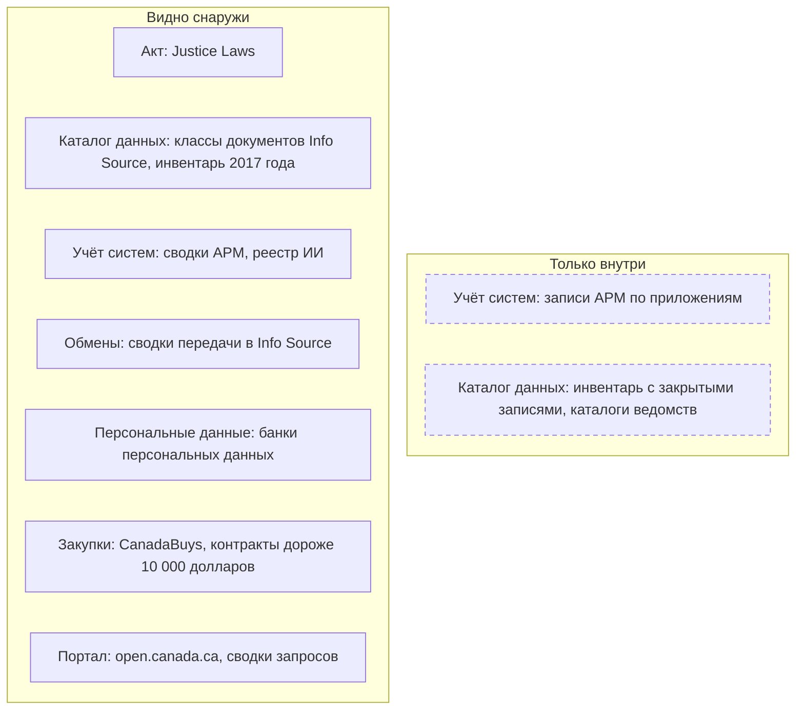
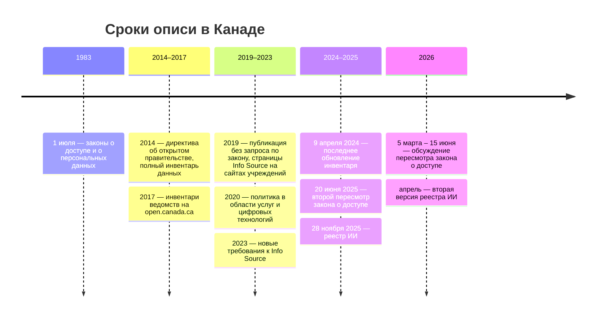

# Канада

В Канаде нет открытого реестра государственных данных или систем, зато с 1983 года закон о доступе требует ежегодно описывать все классы документов каждого федерального учреждения, а закон о персональных данных — все банки персональных данных. Это описание, Info Source, и сводки выполненных запросов о доступе — больше 200 тысяч с 2011 года — показывают, какие записи и системы есть у ведомства, даже если их наборов нет на портале. Инвентарь открытых данных, заведённый по директиве 2014 года, заброшен, а учёт приложений публикуют только сводными числами. Поэтому опись ведомства начинают с его страницы Info Source и сводок запросов, сверяют с порталом open.canada.ca и раскрытыми контрактами, а анкета уточняет системы и наборы внутри классов документов.

Сведения проверены 28 октября 2026 года, если не указано иное.

## Коротко



Пунктирная рамка — сведения, которые видят только ведомства и Секретариат Казначейского совета. Те же семь элементов в других странах — на странице [«Двенадцать стран в сравнении»](./00-overview.md).

## Правовая основа

Закона, который требовал бы вести реестр данных или систем государства, нет. Опись держится на законах о доступе и о персональных данных: они требуют описывать документы и сведения о людях, чтобы человек мог составить запрос. Остальное задают политики Секретариата Казначейского совета (Treasury Board of Canada Secretariat, TBS), обязательные для министерств.

| Акт простыми словами | Что требует | Что даёт описи |
|----------------------|-------------|----------------|
| **Закон о доступе к информации** (1983, поправки 2019 года) | Ежегодное описание программ и всех классов документов каждого учреждения; ответ на запрос за 30 дней; с 2019 года — публикация контрактов, грантов и названий записок министрам без запроса | Классы документов, контракты, названия записок — снаружи |
| **Закон о защите персональных данных** (1983) | Все сведения о людях — в банках персональных данных с ежегодным указателем | Системы со сведениями о людях: цель, использования, связи, сроки хранения |
| **Закон о Библиотеке и архивах Канады** (2004) | Документы уничтожают только с письменного согласия Библиотекаря и архивиста | Номер разрешения на уничтожение в описании банка |
| **Закон о статистике** | Любое ведомство открывает Статистическому управлению свои записи | Административные данные ведомств доходят до статистики |
| **Требования TBS к Info Source** (2023) | Страница на сайте учреждения, цепочка «программа → класс документов», сводки передачи третьим лицам, обновление раз в год | Формат описи и связь записи с полномочием |
| **Директива об открытом правительстве** (2014) и **политика в области услуг и цифровых технологий** (2020) | Полный инвентарь данных ведомства; данные — стратегический актив; учёт услуг | Инвентарь заброшен, перечень услуг открыт |

Номера статей, редакции и сроки ответа — в приложении [«Нормативная база»](../09-appendices/02-legal-framework.md#канада).



## Реестры и платформы

### Info Source

Info Source — описание учреждения для тех, кто пишет запрос. С 2019 года каждое учреждение публикует свою страницу на своём сайте и обновляет её раз в год к назначенной дате: 31 марта, 30 июня, 30 сентября или 31 декабря. TBS ведёт только список учреждений со ссылками: на 28 октября 2026 года в нём 175 ссылок, и не меньше 23 из них вели на ошибку 404.

Страница строится по цепочке «программа → деятельность → класс документов», а к классам добавлены банки персональных данных:

- **Класс документов** — название, описание, виды документов, номер. В видах документов нередко перечислены системы и базы: у TBS класс TBS PM 236 называет 13 кадровых систем. В классе есть и сводка передачи — каким третьим лицам программа передавала персональные данные по контрактам и соглашениям; обязательно указывать соглашения, заключённые или изменённые после 26 октября 2022 года.
- **Банк персональных данных** (personal information bank) — описание сведений, категории людей, цель и основание сбора, допустимые использования, связи с другими системами, срок хранения, номер разрешения Библиотеки и архивов Канады на уничтожение (records disposition authority, RDA) и регистрационный номер TBS. Банки бывают центральными — одно учреждение ведёт их для всего правительства, — собственными и стандартными.
- **Стандартные классы и банки** TBS написал для внутренних служб — кадров, финансов, закупок, ИТ: 33 класса и 49 банков, которые учреждение подключает к своей странице вместо собственного описания.

Объём разный: у TBS на странице от 23 октября 2026 года 88 классов и 43 банка, у Статистического управления в выпуске 2025 года — 55 классов и 62 банка. Сводного машиночитаемого Info Source нет: набор банков персональных данных на open.canada.ca — 1328 банков 120 учреждений — снят в феврале 2020 года и не обновлялся. Разбор одного банка — в [«Примере»](#пример).

### Инвентарь открытых данных

Директива об открытом правительстве 2014 года требует от ведомства полного инвентаря данных и информационных ресурсов, ценных для его работы, чтобы решить, что открыть и в каком порядке. Инвентари ведомств опубликовали на open.canada.ca в марте 2017 года: в сводном файле 11 460 записей 57 организаций, 6563 из них — Статистического управления. Поля — название, описание, издатель, дата, язык, объём, можно ли открыть, дата открытия, ссылка на портал, программа ведомства и число голосов пользователей.

Все 11 460 записей отмечены «можно открыть»: наборы, которые открыть нельзя, в опубликованную часть не попали, хотя руководство TBS требовало вносить и их. Полная версия существует: по запросу A-2020-00601 TBS в июле 2021 года частично выдал «инвентарь открытых данных с записями, признанными не подлежащими открытию» — 3393 страницы. Файл последний раз обновлялся 9 апреля 2024 года, TBS пишет, что инвентарь больше не ведут, а страница поиска по нему 28 октября 2026 года отвечала ошибкой 404. Внутренний аудит Министерства природных ресурсов в 2021 году нашёл, что за 2018–2019 финансовый год в его инвентаре были сведения только одного подразделения.

### Сводки выполненных запросов

Каждое учреждение под законом о доступе в течение 30 дней после конца месяца публикует сводки выполненных запросов: номер, краткое содержание, решение, число страниц. Запросы о собственных персональных данных и о коммерческих сведениях третьих лиц в сводки не входят, и не все учреждения выкладывают их на портал. На 28 октября 2026 года в наборе 205 406 сводок 190 организаций с 2011 года. По 122 842 запросам сведения выданы частично, по 41 744 — полностью, по 34 041 (17%) записей не нашлось, ещё 6779 закрыты целиком изъятиями или исключениями закона.

Это вторая опись, видимая снаружи. Сводка называет запрошенную запись — выгрузку из системы, базу, таблицу Excel, внутренний перечень. Так находится «Перечень административных данных» Статистического управления: его выдали полностью, 72 страницы, в мае 2019 года (запрос A-2018-01217). Ответ «записей нет» отмечает пробел, а повторные запросы одной выгрузки — кандидата на публикацию. Сводки после января 2020 года ищут на search.open.canada.ca; под каждой — форма, по которой копию выданного присылают бесплатно. Это неформальный запрос: требования закона, в том числе сроки, на него не распространяются.

### Активное раскрытие и закупки

С 2019 года часть 2 закона о доступе обязывает публиковать без запроса — это называют активным раскрытием (proactive publication). Учреждения раскрывают контракты дороже 10 000 долларов в течение 30 дней после конца квартала (после четвёртого — 60 дней), гранты и взносы дороже 25 000 долларов, поездки, представительские расходы и переклассификацию должностей. Министры раскрывают названия и номера поданных им записок. Всё это — наборы на open.canada.ca; в наборе контрактов — 99 организаций, у TBS — с 2004–2005 финансового года. В строке контракта — поставщик, сумма, даты, код статьи расходов, код товара или услуги и иногда пояснение, в котором названа система.

Закупки ведут на CanadaBuys — системе учёта с 8 августа 2022 года; объявления и итоги выгружаются файлами CSV. Код товара GSIN (Goods and Services Identification Number) использовали до 2021 года, теперь — UNSPSC (United Nations Standard Products and Services Code): из 7851 итога 2025–2026 финансового года UNSPSC указан в 7615, GSIN — в 122. ИТ ищут по сегменту 43 (оборудование и программы) и семейству 8111 (компьютерные услуги) — 1206 итогов — и по коду 80101507 «консультации по ИТ», который добавляет ещё 91. Состав данных системы находят по контракту и техническому заданию ([«Государственные данные»](../04-sources/02-government.md#госзакупки)).

### Учёт приложений, услуг и ИИ

- **Учёт приложений** (Application Portfolio Management, APM) — инструмент, в котором 44 ведомства, в основном клиенты Shared Services Canada, ведут свои приложения по указанию TBS. Снаружи — только сводные таблицы раз в полгода: в выгрузке от 17 июня 2026 года 7003 приложения, 60% из них — в устаревших центрах обработки данных, 45% — с данными уровня Protected B, у 17% источник не известен. Названий приложений и владельцев нет.
- **Перечень услуг** (GC Service Inventory) — 1733 услуги 82 организаций за 2024–2025 финансовый год: программа, каналы, число обращений, используется ли номер социального страхования (71 услуга) и автоматизированное решение (59).
- **Реестр ИИ** — пробная версия ноября 2025 года, обновлённая в апреле 2026 года: 412 систем 43 организаций с источниками данных, отметкой о персональных данных (у 88 систем) и номерами банков. Его собрали из оценок алгоритмического воздействия, запросов о доступе, банков персональных данных и перечня услуг — из тех же открытых списков, по которым опись строят снаружи.

### Другие источники

- **GC InfoBase** — расходы, численность и результаты по программам. Сайт на tbs-sct.canada.ca из сети проверки не открылся, но данные выложены на open.canada.ca: на 2026 год — 1371 программа и 331 основная обязанность. Это те же программы, к которым привязаны классы документов и услуги.
- **Оценки воздействия на частную жизнь** — их сводки учреждения публикуют на своих сайтах; оценки алгоритмического воздействия — на open.canada.ca, 40 записей.
- **Разрешения на уничтожение документов** Библиотеки и архивов Канады: номер разрешения стоит в описании банка, многоведомственные разрешения опубликованы на сайте архива.
- **Предложения наборов** на open.canada.ca — 310 запросов пользователей со статусом ответа ведомства (выгрузка 2024 года): готовый список спроса.

## Где искать данные

### Государственные

- **Портал** open.canada.ca — 48 185 записей: 37 981 набор и 10 204 публикации. 9799 записей пришли из GeoGratis, 7598 — с Федеральной геопространственной платформы, 6689 — копии провинциальных и муниципальных каталогов. Лицензия Open Government Licence – Canada стоит у 36 150 записей; программный интерфейс CKAN — без ключа.
- **Статистика** — Статистическое управление (Statistics Canada), собственная открытая лицензия. Веб-служба данных (Web Data Service) без ключа отдаёт 8280 таблиц. У таблицы есть код обследования — он же номер записи в метабазе IMDB (Integrated Metadatabase), где указаны статус, периодичность, анкеты и методика; в справочнике веб-службы 906 обследований и программ. В сборе сейчас 124 обследования: 93 — предприятий, 17 — домохозяйств, 14 — сельского хозяйства.
- **Компании** — федеральный реестр корпораций Corporations Canada выгружается ежедневно, с апреля 2026 года — четырьмя файлами; в файле действующих коммерческих корпораций от 28 октября 2026 года 645 581 строка. Компании провинций в нём нет: у каждой провинции свой реестр.
- **Акты** — Justice Laws: консолидированные тексты на английском и французском и их XML; в указателе 971 закон и 4245 постановлений, тексты актуальны на 30 сентября 2026 года.

<details>
<summary>Проверить самому</summary>

```bash
# open.canada.ca: сколько записей, по типам и коллекциям (поля count и search_facets)
curl "https://open.canada.ca/data/api/action/package_search?rows=0&facet.field=%5B%22type%22,%22collection%22%5D&facet.limit=50"
# Сводки выполненных запросов TBS: сколько (поле result.total)
curl "https://open.canada.ca/data/api/action/datastore_search?resource_id=19383ca2-b01a-487d-88f7-e1ffbc7d39c2&filters=%7B%22owner_org%22:%22tbs-sct%22%7D&limit=0"
# Инвентарь открытых данных: записи TBS
curl "https://open.canada.ca/data/api/action/datastore_search?resource_id=d0df95a8-31a9-46c9-853b-6952819ec7b4&filters=%7B%22owner_org%22:%22tbs-sct%22%7D&limit=100"
# Контракты дороже 10 000 долларов: какие организации в наборе (поле result.total)
curl "https://open.canada.ca/data/api/action/datastore_search?resource_id=fac950c0-00d5-4ec1-a4d3-9cbebf98a305&fields=owner_org&distinct=true&limit=1000"
# Статистическое управление: все таблицы с кодами обследований (поле surveyCode)
curl "https://www150.statcan.gc.ca/t1/wds/rest/getAllCubesListLite"
# CanadaBuys: итоги закупок 2025–2026 финансового года (колонки gsin-nibs и unspsc)
curl -O "https://canadabuys.canada.ca/opendata/pub/2025-2026-awardNotice-avisAttribution.csv"
# Justice Laws: указатель законов и постановлений
curl "https://laws-lois.justice.gc.ca/eng/XML/Legis.xml"
```

</details>

### Общественные

- **Secret Canada** газеты The Globe and Mail — национальная база сводок запросов о доступе к федеральным и провинциальным органам, городам, больницам, полиции и школам, с советами, как писать запрос.
- **OpenStreetMap** — проект Building Canada 2020 переносит контуры зданий из Open Database of Buildings Статистического управления: её лицензию признали совместимой с OSM, в версии 3.0 апреля 2025 года около 14,4 миллиона записей.
- **Open North** — некоммерческая организация гражданских технологий; её служба Represent по адресу или почтовому индексу находит избранных представителей и округа всех уровней власти.
- **openparliament.ca** — дебаты, законопроекты и голосования федерального парламента.

### Коммерческие

- **Почтовые индексы** — продукт Canada Post по лицензии, открытыми данными они не являются. Файл соответствия индексов и географии (PCCF) Статистического управления с февраля 2018 года всем, кроме партнёров управления, распространяет Canada Post. Индекс в наборе — повод записать в реестр коммерческую лицензию.
- **Кредитные бюро** — Equifax Canada и TransUnion: сведения о кредитах, которые передают кредиторы; данные платные.
- **Агрегаторы сведений о компаниях** строятся на открытом федеральном реестре и реестрах провинций; копию сверяют с первоисточником ([«Сервисы на государственных реестрах»](../04-sources/04-commercial.md#сервисы-на-государственных-реестрах)).

## Как провести инвентаризацию

### Чем владеем: опись ведомства

Порядок шагов и что каждый даёт реестру — на странице [«Двенадцать стран в сравнении»](./00-overview.md#чем-владеем-общий-порядок). Где их пройти в Канаде:

| Шаг | Где | Видно снаружи? |
|-----|-----|----------------|
| **1. Полномочия** | Закон об учреждении на Justice Laws; программы в GC InfoBase; цепочка «программа → класс документов» в Info Source | ● да |
| **2. Учёт систем** | Записи ведомства в APM; снаружи — сводки APM, системы в классах и банках Info Source, реестр ИИ | ◐ частично |
| **3. Каталог данных** | Классы документов Info Source, инвентарь 2017 года, внутренний каталог ведомства, если он есть | ◐ частично |
| **4. Обмены** | Сводки передачи в классах Info Source (соглашения с октября 2022 года), допустимые использования банков | ◐ частично |
| **5. Персональные данные** | Банки персональных данных Info Source, сводки оценок воздействия на частную жизнь | ● да |
| **6. Формы сбора и статистика** | Метабаза IMDB — обследования Статистического управления; формы ведомства — на его сайте, единого перечня нет | ◐ частично |
| **7. Закупки** | CanadaBuys, контракты дороже 10 000 долларов | ● да |
| **8. Опубликованное** | Наборы ведомства на open.canada.ca, активное раскрытие, перечень услуг | ● да |
| **9. Опрос** | Координатор по доступу и персональным данным, директор по данным, владельцы программ и систем | — |

Главная работа — развернуть классы документов и сверить их со списками. Класс называет систему, а в APM её нет; банк описывает базу, а набора на портале нет; сводки показывают повторные запросы выгрузки, которой нет в инвентаре; ответ «записей нет» — на то, что по описанию должно существовать. Кадры, финансы, закупки и ИТ описаны стандартными классами и банками: их добавляют в опись по анкете, с системами, которыми ведомство пользуется на деле ([«Что считать записью»](../03-process/05-registry.md#что-считать-записью)).

### Где найти нужное

Общий порядок — на странице [«Двенадцать стран в сравнении»](./00-overview.md#где-найти-нужное-общий-порядок). Что в Канаде иначе:

- **Опубликованное** — open.canada.ca с фильтром по коллекции: половина записей — геоданные и копии провинциальных каталогов.
- **Сначала — чужие запросы.** Сводки на search.open.canada.ca: если такую запись уже выдавали, копию присылают бесплатно по неформальному запросу.
- **Где лежит** — страница Info Source учреждения: класс документов и банк с номерами, системы в видах документов и связях банков; реестр ИИ и перечень услуг.
- **Запрос** — по закону о доступе, ответ за 30 дней; продление больше чем на 30 дней — с уведомлением Уполномоченного по информации, пропущенный срок считается отказом ([«Запрос владельцу»](../03-process/06-access.md#запрос-владельцу)). В запросе называют номер класса или банка из Info Source и номер похожего выполненного запроса.
- **Если закрыто** — микроданные Статистического управления дают через исследовательские центры данных и удалённый доступ; исследователя оформляют «приравненным служащим» с присягой о тайне.

## Что особенного

- **Опись ради права на доступ живёт, опись ради открытия — нет.** Описание фондов закон требует обновлять каждый год с 1983 года, а инвентарь открытых данных вели с 2017 по 2024 год. Опись держится, когда у неё есть закон и тот, кто ею пользуется ([«Инвентаризация не заканчивается»](../01-basics/04-principles.md#8-инвентаризация-не-заканчивается)).
- **Единица учёта — класс документов, а не набор.** Наборы и системы спрятаны в видах документов и банках, зато класс всегда привязан к программе, а его номер — готовое поле «откуда известно» ([«Где искать полномочия»](../03-process/03-owners-and-mandates.md#где-искать-полномочия)).
- **Государство само публикует, что у него запрашивали.** Сводки 190 организаций — внешняя проверка описи: что ищут, что выдали и где «записей нет».
- **Общая часть для всех учреждений.** Стандартные классы и банки описывают кадры, финансы, закупки и ИТ — то, что польская система учёта SIST по правилам не учитывает ([«Польша»](./05-poland.md#sist)).

## Пример

Секретариат Казначейского совета — координатор и Info Source, и открытого правительства. Вот что о нём видно снаружи на 28 октября 2026 года:

| Список | Что в нём о TBS |
|--------|-----------------|
| **Info Source**, страница от 23 октября 2026 года | 88 классов документов и 43 банка, 36 из них — центральные банки о федеральных служащих; класс TBS PM 236 называет 13 кадровых систем |
| **Инвентарь открытых данных** | 76 записей, последние три — 2017 года; у 21 нет ссылки на портал |
| **open.canada.ca** | 314 записей: 194 набора и 120 публикаций |
| **Сводки запросов** | 4308 сводок за 2012–2026 годы, у 978 — «записей нет» |
| **APM** | Только сводка по 44 ведомствам |

Возьмём одну систему из класса TBS PM 236 — систему информации о должностях и классификации (Position and Classification Information System, PCIS). Её описывает банк TBS PCE 784:

| Поле банка | Значение | Поле реестра |
|------------|----------|--------------|
| Описание | Должности и их классификация из кадровых систем ведомств, идентификатор и данные служащего на должности | Описание, состав |
| Категории людей | Бессрочно нанятые служащие основной публичной администрации | Охват |
| Цель и основание | Управление классификацией и законом об официальных языках; закон о финансовом управлении, политика управления персоналом | Полномочие, нормативный акт |
| Допустимые использования | TBS, Комиссия государственной службы, профсоюзы, Статистическое управление | Обмены |
| Связи | Семь систем TBS и аналитическая среда Комиссии государственной службы | Информационная система |
| Хранение | Приложение хранит только текущие должности; разрешение 93/031, регистрация TBS 002318 | Срок хранения |

Сверка со списками даёт три наблюдения:

- **Info Source видит то, чего нет в других списках.** PCIS нет ни в инвентаре, ни на портале: поиск по названию системы на open.canada.ca ничего не находит. Банк же даёт почти всю запись реестра: владельца, состав, основание, обмены и срок хранения.
- **Сводки показывают спрос.** О PCIS у TBS спрашивали 10 раз с декабря 2019 по апрель 2026 года: девять раз — выгрузку, один раз — описание сокращений и кодов, то есть словарь системы. В октябре 2021 года по одному запросу частично выдали 514 732 страницы. Повторный запрос одной выгрузки — кандидат на публикацию ([«Виды пробелов»](../03-process/08-gaps-and-plan.md#виды-пробелов)).
- **Инвентарь застыл, а данные — нет.** У записи «Disclosure of Contracts over $10,000 by quarter» нет ссылки на портал, хотя набор контрактов на open.canada.ca обновляется постоянно. Запись об Info Source тоже без ссылки, хотя набор банков персональных данных выложен в 2020 году. Статус в инвентаре сверяют с порталом.

Снаружи опись TBS складывается из трёх списков: Info Source даёт системы и основания, сводки запросов — спрос и пробелы, портал — что открыто. Анкета нужна для того, что спрятано внутри классов документов.

## Частые ошибки

| Ошибка | Что происходит | Как исправить |
|--------|----------------|---------------|
| **Инвентарь открытых данных принят за текущий** | В опись попадают записи 2016–2017 годов со старыми статусами, а закрытых наборов в нём нет вовсе | Сверять с порталом и сводками запросов; полную версию запросить по номеру A-2020-00601 |
| **Класс документов — одна строка реестра** | Десятки систем и таблиц одного класса сливаются в одну запись | Разворачивать класс: системы, банки, выгрузки из сводок — отдельными записями со ссылкой на номер класса |
| **ИТ-контракты ищут только по коду** | Поддержка CKAN для портала у TBS записана кодом R019 группы профессиональных услуг, а не D3; GSIN в CanadaBuys почти не ставят | Искать ещё по пояснению к контракту и названию системы, в CanadaBuys — по UNSPSC |

Сквозные ошибки — в главе [«Практики и антипаттерны»](../08-practices/01-practices-and-anti-patterns.md).

## Ограничения

- Политики и директивы TBS и сайт GC InfoBase на tbs-sct.canada.ca из сети проверки не открылись; требования пересказаны по страницам canada.ca и записям open.canada.ca.
- Учёт приложений опубликован только сводными числами: сколько систем у отдельного ведомства, снаружи не установить.
- В сводках нет запросов о персональных данных, а в наборе есть явные ошибки: 12 сводок датированы декабрём 2026 года.
- Программный интерфейс набора контрактов отдаёт каждую строку дважды — так у трёх проверенных организаций, — поэтому число контрактов не посчитано; файл CSV, 642 МБ, из сети проверки не скачался за 10 минут.
- Провинции и территории ведут свои законы о доступе, описи и порталы; глава их не разбирает, кроме копий провинциальных каталогов на open.canada.ca.
- Список страниц Info Source проверен один раз; сайты на canada.ca при частых обращениях переставали отвечать, поэтому 23 нерабочие ссылки — нижняя оценка.

## Источники

- Законы на Justice Laws, тексты актуальны на 30 сентября 2026 года: [Access to Information Act](https://laws-lois.justice.gc.ca/eng/acts/A-1/FullText.html), статьи 5, 7, 9, 10, 74, 86, 87, 93; [Privacy Act](https://laws-lois.justice.gc.ca/eng/acts/P-21/FullText.html), статьи 10 и 11; [Library and Archives of Canada Act](https://laws-lois.justice.gc.ca/eng/acts/L-7.7/FullText.html), статья 12; [Statistics Act](https://laws-lois.justice.gc.ca/eng/acts/S-19/FullText.html), статья 13; [указатель XML](https://laws-lois.justice.gc.ca/eng/XML/Legis.xml). Вступление законов о доступе и о персональных данных в силу 1 июля 1983 года — [страница Агентства доходов Канады](https://www.canada.ca/en/revenue-agency/corporate/about-canada-revenue-agency-cra/access-information-privacy-canada-revenue-agency/your-rights-under-access-information-act-privacy-act.html).
- Info Source: [Info Source Online Publishing Requirements](https://www.canada.ca/en/treasury-board-secretariat/services/access-information-privacy/access-information/access-informatio-policies-guidance/programs-holdings-online-publishing-requirements.html) — разделы 4.1, 4.3, 4.7.3.5 и приложение A; [список учреждений](https://www.canada.ca/en/treasury-board-secretariat/services/access-information-privacy/access-information/info-source/list-institutions.html) — ссылки проверены 28 октября 2026 года; [стандартные классы документов](https://www.canada.ca/en/treasury-board-secretariat/services/access-information-privacy/access-information/info-source/standard-classes-records.html); [стандартные банки](https://www.canada.ca/en/treasury-board-secretariat/services/access-information-privacy/access-information/info-source/standard-personal-information-banks.html) — 15 июля 2026 года; [Info Source TBS](https://www.canada.ca/en/treasury-board-secretariat/corporate/transparency/treasury-board-secretariat-sources-federal-government-employee-information-info-source.html) — 23 октября 2026 года, класс TBS PM 236 и банк TBS PCE 784; [Info Source Статистического управления 2025](https://www.statcan.gc.ca/en/about/transparency/publications-information-holdings/info-source/2025) — 30 апреля 2026 года.
- open.canada.ca, счёт по программному интерфейсу CKAN и файлам 28 октября 2026 года: [Open Data Inventory](https://open.canada.ca/data/en/dataset/4ed351cf-95d8-4c10-97ac-6b3511f359b7); [Completed Access to Information Request Summaries](https://open.canada.ca/data/en/dataset/0797e893-751e-4695-8229-a5066e4fe43c) и [поиск сводок](https://search.open.canada.ca/ati/); [Personal Information Banks](https://open.canada.ca/data/en/dataset/68ce34b7-049e-486e-b374-eedac70ea0cc); [Proactive Publication – Contracts](https://open.canada.ca/data/en/dataset/d8f85d91-7dec-4fd1-8055-483b77225d8b); [GC Application Portfolio Details](https://open.canada.ca/data/en/dataset/46fc3f0a-1b34-4585-b993-dfb600805d24); [GC Service Inventory](https://open.canada.ca/data/en/dataset/3ac0d080-6149-499a-8b06-7ce5f00ec56c); [GC AI Register](https://open.canada.ca/data/en/dataset/fcbc0200-79ba-4fa4-94a6-00e32facea6b); [GC InfoBase – Open Datasets](https://open.canada.ca/data/en/dataset/a35cf382-690c-4221-a971-cf0fd189a46f); [Suggested Dataset Submissions](https://open.canada.ca/data/en/dataset/c2e19896-fe09-432b-85cf-4ab7788a0407); [Federal Corporations](https://open.canada.ca/data/en/dataset/0032ce54-c5dd-4b66-99a0-320a7b5e99f2).
- Открытый инвентарь и его история: [обязательство о расширении открытых данных 2016–2018](https://open.canada.ca/en/commitment/mtsar/2016-2018/commitment-3-expand-and-improve-open-data); [Audit of the Implementation of NRCan's Open Government Strategy](https://natural-resources.canada.ca/corporate/planning-reporting/audit-evaluation/audit-implementation-nrcas-open-government-strategy) — 8 апреля 2021 года; [2025 review of the Access to Information Act](https://www.canada.ca/en/treasury-board-secretariat/services/access-information-privacy/modernizing-access-information/reviewing-access-information-act/2025-review-access-information-act.html) — 17 июня 2026 года.
- Закупки: [CanadaBuys award notices](https://open.canada.ca/data/en/dataset/a1acb126-9ce8-40a9-b889-5da2b1dd20cb) — файл 2025–2026 финансового года, счёт 28 октября 2026 года; [Goods and Services Identification Number](https://open.canada.ca/data/en/dataset/2ce347e5-02fd-4487-975d-67a435efdf9b).
- Статистика: [Web Data Service](https://www150.statcan.gc.ca/t1/wds/rest/getAllCubesListLite) и справочник кодов getCodeSets; [запись IMDB 3302](https://www23.statcan.gc.ca/imdb/p2SV.pl?Function=getSurvey&SDDS=3302); [обследования в сборе](https://www.statcan.gc.ca/en/survey/list) — 23 октября 2026 года; [открытая лицензия](https://www.statcan.gc.ca/en/terms-conditions/open-licence); [Postal Code OM Conversion File](https://www150.statcan.gc.ca/n1/en/catalogue/92-154-X).
- Общественные и коммерческие: [Secret Canada](https://www.secretcanada.com/); [Building Canada 2020](https://wiki.openstreetmap.org/wiki/Canada/Building_Canada_2020) — вики OpenStreetMap; [Represent](https://represent.opennorth.ca/); [openparliament.ca](https://openparliament.ca/); [Postal Code Targeting Terms and Conditions](https://www.canadapost-postescanada.ca/cpc/en/support/kb/company-policies/terms-conditions/postal-code-targeting-terms-and-conditions) — Canada Post.
- Главы [«Зарубежные методики»](../05-frameworks/04-international-practice.md), [«Государственные данные»](../04-sources/02-government.md), [«Три слоя данных»](../04-sources/01-three-layers.md); приложение [«Нормативная база»](../09-appendices/02-legal-framework.md#канада).
- Как проверяли. Наборы и сводки посчитаны по файлам и программному интерфейсу open.canada.ca, итоги закупок — по файлу CanadaBuys, страницы Info Source — по их тексту. 28 октября 2026 года из сети проверки не открылись tbs-sct.canada.ca, в том числе GC InfoBase (ответ «Request Rejected»), registry.open.canada.ca, поиск по коллекции Библиотеки и архивов Канады (ошибка 403), canlii.org (ошибка 403); часть страниц statcan.gc.ca отвечала ошибкой 503, а canada.ca при частых обращениях переставал отвечать. Сеть проверки — не канадская.
