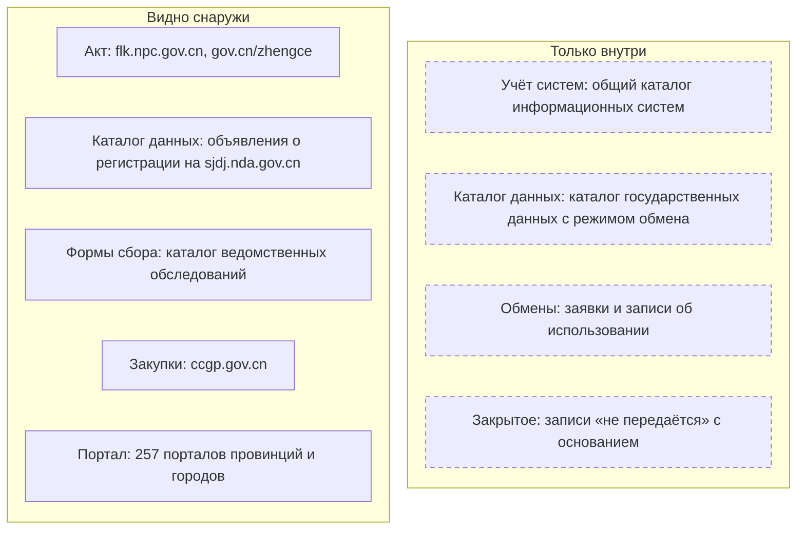
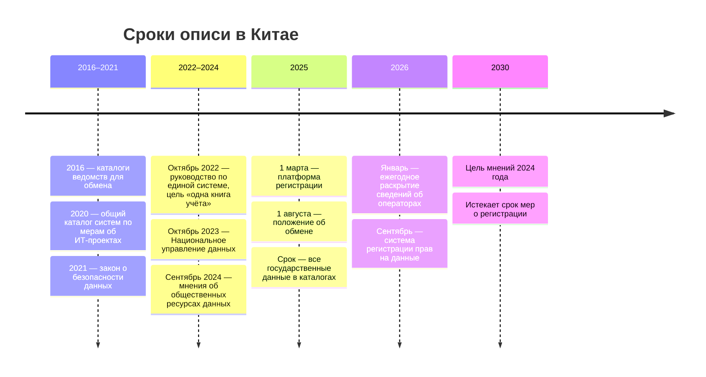

# Китай

В Китае опись данных государства есть, но служит обмену между органами, а не внешнему читателю. Каждое ведомство и каждый регион ведёт каталог государственных данных с режимом обмена у каждой записи, а системы центральных ведомств внесены в общий каталог: без записи в нём система не получает денег на эксплуатацию. Оба каталога закрыты. Снаружи видны объявления о регистрации данных, которые органы передают операторам, порталы открытых данных провинций и городов — национального портала нет — и каталог ведомственных статистических обследований. С них начинают опись снаружи, а изнутри — с каталога государственных данных ведомства.

Сведения проверены 28 октября 2026 года, если не указано иное. Китайские названия даны один раз — по ним ищут на сайтах. Многие государственные сайты из-за рубежа не открываются; какие не открылись — в «Источниках».

В китайских актах два близких понятия. Государственные данные (政务数据) — данные органов власти, собранные при исполнении функций; их каталог служит обмену. Общественные ресурсы данных (公共数据资源) — шире: ещё данные государственных организаций и предприятий, собранные при оказании общественных услуг; их регистрируют и передают операторам. И то и другое — государственный слой, а не слой «общественные данные» этой книги ([«Три слоя данных»](../04-sources/01-three-layers.md)).

## Коротко



Пунктирная рамка — то, что видят только органы. Публичного реестра обработок персональной информации нет. Те же элементы в других странах — на странице [«Двенадцать стран в сравнении»](./00-overview.md).

## Правовая основа

Опись задают постановления Госсовета и документы ведомств; закон среди них один — о безопасности данных. Координирует Национальное управление данных (国家数据局): его создали в 2023 году при Государственном комитете по делам развития и реформы и передали ему обмен и использование ресурсов данных.

| Акт простыми словами | Что требует | Что даёт описи |
|----------------------|-------------|----------------|
| **Положение об обмене государственными данными** (2025) | Каталог государственных данных в каждом ведомстве и регионе, режим обмена у каждой записи, обновление за 10 рабочих дней | Готовая внутренняя опись органа |
| **Меры об управлении государственными ИТ-проектами** (2019) | Каталог информационных ресурсов — условие одобрения проекта; системы центральных ведомств — в общем каталоге | Учёт систем, связанный с бюджетом |
| **Закон о безопасности данных** (2021) | Перечни важных данных в ведомствах и регионах; общегосударственный каталог открытия данных и единая платформа | Обещанный каталог открытия — пока не создан |
| **Меры о регистрации общественных ресурсов данных** (2025) | Регистрация данных, переданных операторам, с публичным объявлением на 10 рабочих дней | Открытый список ресурсов с держателем и оператором |
| **Порядок ведомственных статистических обследований** (2017) | Обследования министерств — с одобрения или регистрации у статистического управления, на 3 или 5 лет | Публичный каталог форм сбора |
| **Положение об открытости государственной информации** (2007, редакция 2019 года) | Указатель и перечень раскрываемой информации, годовой отчёт до 31 января, ответ на запрос за 20 рабочих дней | Документы органа и путь запроса |

Номера, статьи и редакции — в приложении [«Нормативная база»](../09-appendices/02-legal-framework.md#китай). Направление задают мнения ЦК КПК и Госсовета 2024 года об освоении общественных ресурсов данных: к 2025 году — первые правила, к 2030-му — построенная система; там же — каталоги открытия на порталах и раскрытие сведений об операторах.



## Реестры и платформы

### Каталог государственных данных

Каталог государственных данных (政务数据目录) ведёт каждое ведомство через своё подразделение по обмену данными, а уполномоченный орган Госсовета сводит каталоги в общегосударственный. В записи — название, элементы данных, поставщик, формат, частота обновления, режим и способ обмена, условия использования, класс и уровень данных. Режимов обмена (共享属性) три: «без условий», «с условиями» и «не передаётся»; для последнего указывают причину и норму закона, постановления или решения Госсовета. Государственные и служебные секреты к государственным данным не относятся и в каталог не попадают.

Положение 2025 года делает каталог рабочим инструментом:

- **сроки** — после изменения закона или функций каталог обновляют за 10 рабочих дней; на заявку другого органа отвечают за 1 рабочий день по данным «без условий» и за 10 — «с условиями», а данные передают в течение 20 рабочих дней после согласия;
- **ведомство-источник** (数源部门) — если данные собирают несколько органов, назначают один из них, и он собирает и отдаёт данные остальным; повторно собирать то, что можно получить обменом, нельзя;
- **следы** — получатель записывает, как использовал данные, и хранит записи не меньше трёх лет; ошибку исправляют по заявке за 10 рабочих дней.

Обмен идёт через единую систему больших государственных данных «1+32+N»: национальная платформа, платформы 31 провинции и Синьцзянского производственно-строительного корпуса и платформы министерств; новые системы обмена в обход неё строить нельзя. В 2022 году в каталогах было больше 3 млн записей и 20 млн элементов данных, к узлу обмена подключились 5951 орган, а 53 министерства опубликовали в нём 13,5 тыс. ресурсов. Цель на 2025 год — все государственные данные в каталогах, «одна книга учёта» страны.

Каталог неполон. Документ Госсовета 2022 года сам называет состав данных неясным, а каталоги — неполными и составленными не по правилам. Государственное ревизионное управление в отчёте за 2024 год по 18 провинциям и городам нашло: в девяти из них информационные системы 1091 органа не описаны в каталогах, а каталоги 9717 органов не связаны с системами или не указывают условий обмена. Снаружи нет ни записей каталога, ни сводок по нему.

### Общий каталог информационных систем

По мерам об ИТ-проектах (действуют с 1 февраля 2020 года) системы центральных ведомств вносят в подсистему государственных ИТ-проектов на платформе согласования инвестиционных проектов, а ведомства обновляют там свои перечни. Из них складывается общий каталог государственных информационных систем (国家政务信息系统总目录). Системе вне каталога не дают денег на эксплуатацию — как и системе, которая не делится данными или собирает их повторно. Каталог информационных ресурсов — обязательное условие одобрения проекта; в пакете проекта есть ещё сведения об обмене и открытии, прикладные системы и класс защиты, а через полгода после окончания проект принимают с аудиторским отчётом. Каталог систем закрыт; снаружи системы видны по закупкам и отчётам ревизоров.

### Регистрация общественных ресурсов данных

Национальная платформа регистрации общественных ресурсов данных (国家公共数据资源登记平台, sjdj.nda.gov.cn) работает с 1 марта 2025 года вместе с 32 платформами провинций. Регистрация обязательна для данных, которые орган передал оператору в уполномоченную эксплуатацию (授权运营) — для выпуска продуктов на данных; остальные данные регистрируют по желанию. О каждой регистрации платформа 10 рабочих дней показывает объявление, регистрация действует три года. С 2026 года органы и операторы ежегодно до конца марта раскрывают на тех же платформах сведения об уполномоченной эксплуатации за прошлый год.

Объявления — самый крупный открытый список государственных данных Китая. В объявлении — название из региона, отрасли и названия ресурса, держатель и его код, отрасль, вид записи (ресурс или продукт), краткое описание, сроки объявления, регистрирующий орган и оператор. Полей, объёма и условий доступа нет.

На 28 октября 2026 года в общем списке — 337 870 объявлений: 329 757 о ресурсах и 8113 о продуктах и услугах. Распределение неравномерно:

- **Хэбэй** — 176 894 объявления, 52% всех, **Цзянсу** — 74 162, 22%; дальше Хубэй (31 405) и Фуцзянь (23 195);
- **национальная платформа** — 8907, Шанхай — 1046, Пекин — 130;
- **ни одного** — у 9 из 33 платформ, в том числе у провинций Хэнань и Хайнань и у Тибета.

В августе 2026 года Управление сообщало, что регистрацию ведут все провинции, зарегистрировано больше 300 тыс. ресурсов, продуктов и услуг всех 97 разделов классификатора отраслей, а уполномоченная эксплуатация реально идёт в 25 провинциях. Число объявлений показывает, как регион регистрирует, а не сколько у него данных.

### Порталы провинций и городов

Закон о безопасности данных обещает общегосударственный каталог открытия и единую платформу, но национального портала открытых данных нет — адреса data.gov.cn не существует. Открытые данные публикуют провинции и города. По докладу Фуданьского университета и Государственного информационного центра, в июле 2025 года порталы были у 257 администраций — 26 провинций и 231 города, — а действующих наборов на них было почти 480 тыс. В индексе «Открытый лес данных» (开放数林指数) 2025 года впереди провинции Чжэцзян и Шаньдун, из городов — Ханчжоу, Цзинань, Шанхай и Дэчжоу.

Порталы устроены похоже. На data.beijing.gov.cn — 4457 наборов 71 органа и 18 573 записи каталога вместе с прошлогодними. Рядом — годовые планы открытия, раздел каталога общественных данных (названия и поставщики; полную выгрузку дают после регистрации) и местная платформа регистрации sjdj.data.beijing.gov.cn. В карточке набора — поставщик, даты публикации и обновления, периодичность, условие открытия, число записей и поля. На opendata.sz.gov.cn в Шэньчжэне — 4829 записей каталога 88 органов-источников и 2887 программных интерфейсов. Портал Шанхая data.sh.gov.cn из сети проверки отвечал страницей защиты от ботов, порталы Гуйчжоу и Шаньдуна не ответили.

### Раскрытие государственной информации

Каждый орган публикует указатель (公开指南) — как устроена его информация и куда обращаться — и перечень раскрываемой информации (公开目录) с индексом, названием, кратким содержанием и датой документа. До 31 января орган выкладывает годовой отчёт об открытости по единой форме: что раскрыл сам и что ответил на запросы, с разбивкой по основаниям отказа. Отчёт показывает, чего орган «не располагает»: Государственное статистическое управление за 2025 год рассмотрело 325 запросов, по 179 информацию выдало, по 31 — частично, а в 84 случаях ответило, что такой информацией не располагает. Выдают уже созданную информацию: обрабатывать и анализировать её ради запроса орган не обязан.

### Другие источники

- **Аудит.** Отчёты Государственного ревизионного управления об исполнении бюджета — единственная открытая проверка каталогов и систем.
- **Обзор ресурсов данных** (全国数据资源调查报告) выходит ежегодно и считает объёмы: в 2025 году в стране произведено 52,26 зеттабайта данных, хранится 2,53. Перечней наборов в нём нет.
- **Перечни важных данных.** По закону о безопасности данных ведомства и регионы составляют перечни данных, которые охраняют строже; они закрыты.

## Где искать данные

### Государственные

- **Статистика.** Государственное статистическое управление, stats.gov.cn; база data.stats.gov.cn — приложение на JavaScript. По годовому отчёту управления, в его базе опубликованных данных к концу 2025 года — больше 14 млн значений. Микроданные выдают исследователям аккредитованных организаций: к концу 2025 года — больше 120 вузов и институтов, 1009 одобренных исследователей.
- **Ведомственные обследования.** Каталог ведомственных статистических обследований (部门统计调查项目) на stats.gov.cn — по министерствам, с номером одобрения и сроком. Одобряют на три года, регистрируют на пять; номер и срок печатают в углу формы. У Министерства транспорта — 27 одобренных и 10 зарегистрированных строк, среди них истёкшие ещё в 2019 году. За 2025 год управление опубликовало 95 ведомственных и 423 местных обследования.
- **Госзакупки** — China Government Procurement Network (中国政府采购网), ccgp.gov.cn. ИТ ищут по кодам каталога закупок 2022 года: A02010000 — информационное оборудование, C16000000 — ИТ-услуги, в том числе C16010000 — разработка программ, C16020000 — интеграция систем, C16040000 — облачные услуги, C16070000 — эксплуатация. Запасной вход — платформа торгов ggzy.gov.cn ([«Государственные данные»](../04-sources/02-government.md#госзакупки)).
- **Регистр предприятий** — национальная система публикации кредитной информации о предприятиях (国家企业信用信息公示系统), gsxt.gov.cn: регистрационные сведения, годовые отчёты, которые предприятия подают с 1 января по 30 июня, перечень предприятий с нарушениями порядка деятельности.
- **Нормативные акты.** Законы — национальная база flk.npc.gov.cn, постановления и документы Госсовета — библиотека gov.cn/zhengce; положения о функциях, структуре и штатах министерств (三定规定) — на их сайтах.

Объявления о регистрации и карточки пекинского портала отдаются без ключа; объявления фильтруют по платформе и виду записи и проверяют по названию ресурса.

<details>
<summary>Проверить самому</summary>

```bash
# Объявления о регистрации: всего (поле total); queryStatus "0" — объявление идёт, "1" — завершено, "" — все
curl -s -X POST -H "Content-Type: application/json" -d '{"pageNum":1,"pageSize":10,"queryStatus":""}' "https://sjdj.nda.gov.cn/register/dataassets/publicityInfo/queryPublicityDataAssets"
# Только Пекин (platformCode 11000) и только ресурсы (dataRegistType 1; 2 — продукты и услуги)
curl -s -X POST -H "Content-Type: application/json" -d '{"pageNum":1,"pageSize":200,"queryStatus":"","platformCode":"11000","dataRegistType":"1"}' "https://sjdj.nda.gov.cn/register/dataassets/publicityInfo/queryPublicityDataAssets"
# Коды платформ провинций
curl -s -X POST -H "Content-Type: application/json" -d '{}' "https://sjdj.nda.gov.cn/register/dataassets/equipment/queryPlatform"
# Карточка объявления: pduuid и provinceCode — из списка
curl -s -X POST -H "Content-Type: application/json" -d '{"pduuid":"6ce76b3d2e39154c337c019cc52343d0","provinceCode":"110000"}' "https://sjdj.nda.gov.cn/register/dataassets/publicityInfo/queryPublicityDataAssetsDetail"
# Пекинский портал: карточка набора «Назначенные медицинские учреждения»
curl -s "https://data.beijing.gov.cn/zyml/ajg/sybj/17425.htm"
# Каталог обследований Министерства транспорта
curl -s "https://www.stats.gov.cn/fw/bmdcxmsp/bmdcxmml/202302/t20230215_1906998.html"
```

</details>

### Общественные

- **Научные данные.** Open Research Data Пекинского университета, opendata.pku.edu.cn, — 500 наборов в 194 коллекциях, в том числе панельные обследования CHARLS и CFPS; программный интерфейс Dataverse без ключа.
- **Экологический надзор.** Институт общественных и экологических дел (IPE, ipe.org.cn) сводит опубликованные органами записи надзора за предприятиями в карту «Голубое небо» (蔚蓝地图).
- **OpenStreetMap** помогает мало: съёмка без разрешения запрещена законом о геодезии и картографии, а китайские онлайн-карты сдвинуты в систему координат GCJ-02, и данные с них в OpenStreetMap не переносят ([«Wikidata, Википедия и OpenStreetMap»](../04-sources/03-public.md#wikidata-википедия-и-openstreetmap)).

### Коммерческие

- **Сервисы о компаниях** — Qichacha (qcc.com) и Tianyancha (tianyancha.com) собирают сведения регистра предприятий и других открытых реестров ([«Сервисы на государственных реестрах»](../04-sources/04-commercial.md#сервисы-на-государственных-реестрах)). Из сети проверки qcc.com перенаправлял на страницу зарубежного продукта, Tianyancha сообщал, что в регионе недоступен.
- **Биржи данных.** Шанхайская биржа данных, chinadep.com, выставляет продукты на данных только после проверки на соответствие правилам. Она, Пекинская международная биржа больших данных и Шэньчжэньская биржа данных с сентября 2026 года регистрируют права на данные; свидетельство действует пять лет.
- **Продукты операторов.** Операторы уполномоченной эксплуатации продают продукты на государственных данных; в Пекине — не сами записи, а интервалы и метки, как в [примере](#пример-данные-медицинского-страхования-пекина).

## Как провести инвентаризацию

### Чем владеем: опись министерства

Порядок шагов и что каждый даёт реестру — на странице [«Двенадцать стран в сравнении»](./00-overview.md#чем-владеем-общий-порядок). Где их пройти в Китае:

| Шаг | Где | Видно снаружи? |
|-----|-----|----------------|
| **1. Полномочия** | Положение о функциях, структуре и штатах министерства; акты в gov.cn/zhengce и flk.npc.gov.cn | ● да |
| **2. Учёт систем** | Записи министерства в общем каталоге информационных систем | ○ нет |
| **3. Каталог данных** | Каталог государственных данных министерства; снаружи — объявления о регистрации | ◐ частично |
| **4. Обмены** | Заявки на обмен и записи об использовании в единой системе больших государственных данных | ○ нет |
| **5. Закрытое и персональные данные** | Записи «не передаётся» с основанием, перечни важных данных; реестра обработок нет | ○ нет; ◐ ресурсы в уполномоченной эксплуатации — по объявлениям |
| **6. Формы сбора** | Каталог ведомственных статистических обследований | ● да |
| **7. Закупки** | ccgp.gov.cn, коды A02010000 и C16 | ● да, из китайской сети |
| **8. Опубликованное** | Перечень раскрываемой информации, годовые отчёты об открытости, наборы на порталах провинций и городов | ● да |
| **9. Опрос** | Подразделение по обмену данными, владельцы систем, служба открытости | — |

Внутри министерства шаги 2 и 3 дают почти готовую опись: запись каталога государственных данных требует почти тех же сведений, что и запись реестра, а общий каталог систем — перечень систем. Главная работа — сверка, и ревизоры показали, где она нужна. Система есть в каталоге систем, а её данных нет в каталоге данных; ресурс зарегистрирован для оператора, а в каталоге у него режим «не передаётся»; обследование одобрено, а его итогов нет ни на портале, ни в обмене ([«Как методы проверяют друг друга»](../02-approaches/02-methods.md#как-методы-проверяют-друг-друга)).

### Где найти нужное

Общий порядок — на странице [«Двенадцать стран в сравнении»](./00-overview.md#где-найти-нужное-общий-порядок). Что в Китае иначе:

- **Опубликованное** — национального портала нет: ищут на портале провинции и города, в базе статистического управления и в объявлениях о регистрации по названию ресурса.
- **Где лежит** — объявление о регистрации называет держателя и оператора, закупка — систему и подрядчика.
- **Запрос** — по положению об открытости: письменно, с именем, документом и описанием информации — названием или номером документа. Ответ — за 20 рабочих дней, продление ещё до 20 ([«Запрос владельцу»](../03-process/06-access.md#запрос-владельцу)). Просят существующий документ или файл: обрабатывать данные ради запроса орган не обязан.
- **Если закрыто** — продукты операторов и биржи данных; микроданные статистики — через аккредитованную организацию.
- **Доступ из-за рубежа** — сайт закупок, регистр предприятий, портал Шанхая и сервисы о компаниях из-за рубежа не открываются или открываются урезанными. Проверяют из китайской сети и записывают сеть проверки.

## Что особенного

- **Опись ради обмена.** Каталог государственных данных подробен, со сроками в рабочих днях и ответственностью руководителей, но закрыт. Внешнему исследователю он недоступен даже сводкой, и опись снаружи строят по следам: регистрации, закупкам, обследованиям.
- **Деньги привязаны к описи.** Система вне общего каталога не получает денег на эксплуатацию, проект без каталога ресурсов не одобряют, а то, как ведомство делится данными, учитывают при распределении средств на ИТ. Опись здесь — условие бюджета, а не отчёт по просьбе.
- **Открытие — дело регионов.** Общегосударственный каталог открытия есть в законе с 2021 года, но его нет; 257 местных порталов с разными правилами заменяют один национальный.
- **Регистрация показывает закрытое.** Объявления называют и данные, которых нет на порталах, — в том числе сведения о людях, переданные операторам. Открытый список закрытых данных встречается редко; ближайший аналог в книге — перечень защищённых ресурсов [Польши](./05-poland.md#защищённые-данные).

## Пример: данные медицинского страхования Пекина

Что видно снаружи о данных одного органа — Управления медицинского страхования Пекина (北京市医疗保障局) — по четырём открытым источникам на 28 октября 2026 года:

| Источник | Что видно | Чего не видно |
|----------|-----------|---------------|
| **План открытия на 2024 год** (1624 строки 65 органов) | 18 строк управления: перечни медучреждений и аптек, справочники лекарств и услуг, итоги закупок, цены, телефоны; у каждой поля и периодичность; все — «без условий» | Сведений о застрахованных и взносах |
| **Портал data.beijing.gov.cn** | «Назначенные медучреждения»: опубликован 9 декабря 2019 года, обновлён 13 августа 2026 года, ежемесячно, 4877 записей, 6 полей | Словаря данных — «пока не предоставляется» |
| **Объявления о регистрации** | 4 ресурса, объявления 8–21 апреля 2026 года: о работодателях, о застрахованных работниках и об уплате взносов; оператор — Пекинская компания финансовых больших данных (北京金融大数据有限公司) | Полей, объёма, условий |
| **Объявление оператора** | 15–28 октября 2026 года, продукт «метки уплаты взносов предприятием»: на входе название и код предприятия с его согласием, на выходе — интервал месячной суммы взносов | Цены и покупателей |

Три наблюдения:

- **Закрытое видно через регистрацию.** Сведений о застрахованных нет ни в плане, ни на портале, но они есть в объявлениях — с держателем, оператором и датой. В реестр их записывают как закрытые наборы с основанием «уполномоченная эксплуатация» и ссылкой на объявление ([«Закрытые наборы — тоже в реестре»](../03-process/06-access.md#закрытые-наборы--тоже-в-реестре)).
- **Карточки расходятся.** У «Назначенных медучреждений» в плане периодичность — год, на портале — месяц; у «Перечня лекарств медицинского страхования» на портале ровно 1000 записей, и это число стоит проверить по самому файлу. Периодичность записывают по датам фактических обновлений.
- **Держатель — не всегда владелец.** Управление само указано держателем своих ресурсов, а 48 объявлений Пекина — в том числе о данных жилищного фонда, закупок, регистрации предприятий и социального страхования — подал Пекинский центр больших данных, причём с отраслью «прочие финансовые услуги» даже у объявлений о закупках. Владельца с полномочием ищут по названию данных и положению об органе ([«Как читать полномочия»](../03-process/03-owners-and-mandates.md#как-читать-полномочия)).

По центральным правилам запись каталога государственных данных содержит ещё режим и способ обмена, класс и уровень данных. В открытых карточках этих полей нет: это внутренняя часть описи, и в запросе управлению о ней спрашивают отдельно.

## Частые ошибки

| Ошибка | Что происходит | Как исправить |
|--------|----------------|---------------|
| **Ищут национальный портал** | data.gov.cn не существует, и вывод — «Китай данные не публикует» | Искать на порталах провинций и городов и в объявлениях о регистрации |
| **Число объявлений как мера данных региона** | Хэбэй с 52% объявлений выглядит богаче Пекина в тысячу с лишним раз | Сравнивать регионы по порталам и планам открытия, а объявления читать по отдельным ресурсам |
| **Держатель из объявления записан владельцем** | Данные жилищного фонда оказываются за центром больших данных | Владельцем записывать орган с полномочием, центр — держателем копии |

Сквозные ошибки — в главе [«Практики и антипаттерны»](../08-practices/01-practices-and-anti-patterns.md).

## Ограничения

- Каталог государственных данных, общий каталог систем и платформа обмена снаружи недоступны; о них судят по актам, руководству 2022 года и отчёту ревизоров за 2024 год.
- Объявления посчитаны по списку национальной платформы. Если провинция передаёт в него не все свои объявления, нули и малые числа означают неполную передачу, а не отсутствие регистрации.
- Полный каталог общественных данных Пекина выдают после регистрации, его не скачивали. План открытия на 2026 год опубликован в PDF, текст из которого извлечь не удалось, поэтому в примере — план на 2024 год.
- Число порталов и наборов — по докладу Фуданьского университета в изложении агентства Синьхуа; коды ИТ-закупок — по каталогу провинции Аньхой, который ссылается на национальный: страница Министерства финансов и ccgp.gov.cn не открылись.

## Источники

- Акты на gov.cn, 28 октября 2026 года: [положение об обмене государственными данными](https://www.gov.cn/zhengce/content/202506/content_7026294.htm), статьи 3, 11–17, 19–22, 26, 29–31, 38, 39; [положение об открытости государственной информации](https://www.gov.cn/zhengce/content/2019-04/15/content_5382991.htm), статьи 12, 20, 29, 33, 38, 49, 50; [руководство по единой системе больших государственных данных](https://www.gov.cn/zhengce/content/2022-10/28/content_5722322.htm) — масштаб каталогов и узла обмена, «1+32+N», цель 2025 года; [временные меры о регистрации общественных ресурсов данных](https://www.gov.cn/zhengce/zhengceku/202501/P020250121384980006337.pdf); [план реформы органов 2023 года](https://www.gov.cn/zhengce/2023-03/16/content_5747072.htm) — создание Национального управления данных; [временные меры 2016 года](https://www.gov.cn/zhengce/content/2016-09/19/content_5109486.htm) — первые каталоги для обмена.
- [Закон о безопасности данных](http://www.npc.gov.cn/npc/c2/c30834/202106/t20210610_311888.html), статьи 21, 38–42, 55 — сайт ВСНП; [меры об управлении государственными ИТ-проектами](https://www.mee.gov.cn/zcwj/gwywj/202001/t20200122_760798.shtml), 国办发〔2019〕57号, статьи 9, 11, 12, 25, 28 — перепечатка на сайте Министерства экологии, на gov.cn страница не найдена; [мнения ЦК КПК и Госсовета об освоении общественных ресурсов данных](https://paper.people.com.cn/rmrbwap/html/2024-10/10/nw.D110000renmrb_20241010_4-04.htm) — «Жэньминь жибао», 10 октября 2024 года; [порядок ведомственных статистических обследований](https://www.stats.gov.cn/fw/bmdcxmsp/xgfg/202302/t20230215_1906559.html), приказ № 22, статьи 7, 14, 21, 23, 24, 26.
- [Отчёт Государственного ревизионного управления об исполнении центрального бюджета за 2024 год](https://www.audit.gov.cn/n5/n26/c10619920/part/10690741.pdf), 24 июня 2025 года, — раздел о ресурсах данных; сверен 28 октября 2026 года для главы «Зарубежные методики», при проверке этой главы audit.gov.cn отвечал ошибкой 502.
- Платформа регистрации: [sjdj.nda.gov.cn](https://sjdj.nda.gov.cn/) — списки объявлений, платформ и кодов через программный интерфейс, который вызывает сама страница, счёт по платформам и видам записи и карточки пекинских объявлений — 28 октября 2026 года; [платформа Пекина](https://sjdj.data.beijing.gov.cn/portal/announce). Раскрытие сведений об операторах — по [«Кэцзи жибао»](https://www.stdaily.com/web/gdxw/2026-02/11/content_473370.html) и [перепечатке уведомления](https://www.secrss.com/articles/87814), 国数综资源〔2026〕2号; итоги на август 2026 года — [пресс-конференция Управления](https://www.news.cn/fortune/20260826/9ccc34b777294dfb853551c66fc2e306/c.html), Синьхуа, 26 августа 2026 года.
- Порталы: [data.beijing.gov.cn](https://data.beijing.gov.cn/) — главная, [каталог открытых данных](https://data.beijing.gov.cn/zyml/kfml/index.htm), [каталог общественных данных](https://data.beijing.gov.cn/zyml/qlsjmlqd/index.htm), [планы открытия](https://data.beijing.gov.cn/jkfb/kfqs/index.htm) — [план на 2024 год](https://data.beijing.gov.cn/docs/2025-04/2d028dfaf2ca43dfbab53a62af2c046b.xlsx), карточки [«Назначенные медучреждения»](https://data.beijing.gov.cn/zyml/ajg/sybj/17425.htm) и [«Перечень лекарств»](https://data.beijing.gov.cn/zyml/ajg/sybj/97369cde83304d2385999482c6855f1a.htm); [opendata.sz.gov.cn](https://opendata.sz.gov.cn/); [доклад о порталах 2025 года](https://www.news.cn/digital/20251204/8d0062c3a8814d96928d6e70402193ba/c.html) — Синьхуа, 4 декабря 2025 года, и [итоги индекса](https://fddi.fudan.edu.cn/90/d2/c21257a757970/page.htm) — Фуданьский университет.
- Статистика: [годовой отчёт Государственного статистического управления об открытости за 2025 год](https://www.stats.gov.cn/xxgk/gknb/tjj_gknb/202602/t20260202_1962477.html); [каталог ведомственных обследований](https://www.stats.gov.cn/fw/bmdcxmsp/bmdcxmml/) и [строки Министерства транспорта](https://www.stats.gov.cn/fw/bmdcxmsp/bmdcxmml/202302/t20230215_1906998.html), обновлены 7 мая 2026 года; [обзор ресурсов данных за 2025 год](https://www.stdaily.com/web/gdxw/2026-04/29/content_510292.html) — «Кэцзи жибао», 29 апреля 2026 года.
- Закупки и регистр: [каталог централизованных закупок провинции Аньхой на 2026 год](https://cz.huainan.gov.cn/group4/M00/10/5A/rB40qWh4VK6AEIaKAAbyZi8XXDE19.docx), проект, — коды по каталогу закупок 财库〔2022〕31号; [ggzy.gov.cn](https://www.ggzy.gov.cn/); порядок годовых отчётов предприятий — по изложениям положения о публикации информации о предприятиях, сам gsxt.gov.cn не открылся.
- Общественные и коммерческие: [Open Research Data Пекинского университета](https://opendata.pku.edu.cn/) — счёт через программный интерфейс Dataverse; [IPE](https://www.ipe.org.cn/); [OpenStreetMap Wiki: China](https://wiki.openstreetmap.org/wiki/China); [Шанхайская биржа данных](https://www.chinadep.com/); регистрация прав на данные — [«Кэцзи жибао»](https://www.stdaily.com/web/gdxw/2026-09/12/content_580035.html), 12 сентября 2026 года.
- Главы [«Зарубежные методики»](../05-frameworks/04-international-practice.md), [«Государственные данные»](../04-sources/02-government.md); приложение [«Нормативная база»](../09-appendices/02-legal-framework.md#китай).
- Как проверяли. 28 октября 2026 года из сети проверки за пределами Китая не открылись ccgp.gov.cn (ошибка 403 и страница «слишком частые обращения»), gsxt.gov.cn (403), data.sh.gov.cn и creditchina.gov.cn (страница защиты от ботов, обходить её не пытались), data.guizhou.gov.cn и data.sd.gov.cn (не ответили за 25 секунд); qcc.com перенаправлял на страницу зарубежного продукта, tianyancha.com сообщал о недоступности в регионе. flk.npc.gov.cn, nda.gov.cn и data.stats.gov.cn — приложения на JavaScript, их содержимое не читали. Адреса нужно перепроверять из китайской сети.
