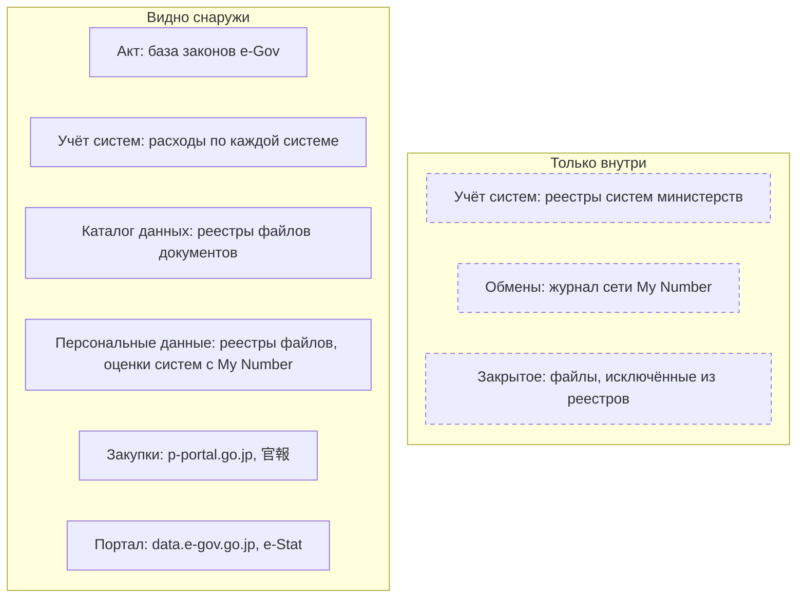
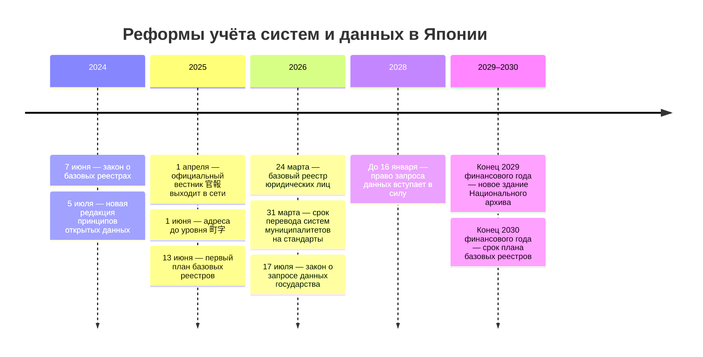

# Япония

В Японии нет описи данных государства, зато есть две обязательные открытые описи с общим поиском по всем министерствам — реестр файлов документов и реестр файлов персональной информации, — а также опубликованные расходы по каждой информационной системе. Учёт систем с составом их данных ведёт каждое министерство, и он закрыт; последнюю общегосударственную опись данных — по административным процедурам — собрали в 2022 году, и она лежит в архиве. Поэтому опись министерства начинают с его строк в перечне расходов на системы, его реестров файлов на e-Gov и его наборов на data.e-gov.go.jp. Связывают их вручную, по названиям: общих идентификаторов у этих списков нет.

Сведения проверены 28 октября 2026 года, если не указано иное. Финансовый год в Японии длится с 1 апреля по 31 марта.

Сокращения главы: e-Gov — портал электронного правительства; PPC — Комиссия по защите персональной информации (個人情報保護委員会); MIC — Министерство внутренних дел и коммуникаций (総務省), в него входит Статистическое бюро; My Number — личный номер жителя (マイナンバー).

## Коротко



Пунктирная рамка — то, что видят только служащие; журнал обменов о себе видит и сам человек. Те же семь элементов в других странах — на странице [«Двенадцать стран в сравнении»](./00-overview.md).

## Правовая основа

Закона об описи данных в Японии нет. Опись складывается из обязанностей вести реестры документов и персональной информации, правил учёта систем и открытия данных по умолчанию. Тексты законов и все их редакции — в базе законов e-Gov с программным интерфейсом.

| Акт простыми словами | Что требует | Что даёт описи |
|----------------------|-------------|----------------|
| **Закон об управлении публичными документами** (2009) | Министерство ведёт и публикует реестр файлов документов; передача в архив или уничтожение — с согласия премьер-министра | Перечень всех файлов министерства со сроками хранения |
| **Закон о защите персональной информации** (2003) | До создания файла с персональными данными — уведомление PPC; реестр файлов публикуется | Открытый перечень систем со сведениями о людях |
| **Закон о номере My Number** (2013) | До создания системы с номером — опубликованная оценка с устройством системы; запись каждого обмена | Подробные описания систем, список разрешённых обменов |
| **Закон о раскрытии информации** (1999) | Документ — по запросу, решение за 30 дней, продление ещё на 30 | Путь к документам о системах и данных |
| **Закон о цифровых процедурах** (2002) | План базовых реестров; с 2028 года — запрос данных государства по одобренному проекту | Эталонные реестры и новый путь к закрытым данным |
| **Закон о статистике** (2007) | Основные (基幹統計) и общие обследования — только с одобрения MIC | Перечень обследований и форм сбора |

Учёт систем держится на руководстве Цифрового агентства (デジタル庁) DS-100, а принципы открытых данных 2017 года (редакция 5 июля 2024 года) велят открывать все данные министерств или по запросу объяснять, почему нельзя. Номера законов, статьи и редакции — в приложении [«Нормативная база»](../09-appendices/02-legal-framework.md#япония).



## Реестры и платформы

### Реестры файлов документов

В реестр файлов документов (行政文書ファイル管理簿) министерство вносит каждую папку документов, бумажную или электронную: классификацию в три уровня, название, срок хранения, что делать по его окончании — передать в Национальный архив или уничтожить, — место хранения, носитель и ответственного. Файлы со сроком хранения меньше года не вносят, закрытые сведения не пишут. Общий поиск по реестрам всех министерств — на e-Gov; из сети проверки он не открылся, сайт ответил «доступ заблокирован».

Классификацию заранее показывают таблицы сроков хранения (保存期間表) на сайтах подразделений. У второго следственного отдела Кюсюского управления по борьбе с наркотиками, например, журнал передачи и уничтожения файлов хранят 30 лет и передают в архив, а документы о наблюдении за наркозависимыми — пять лет и уничтожают.

По отчёту Канцелярии кабинета (内閣府), на 31 марта 2025 года у министерств и ведомств было 20 126 525 файлов, 70,1% из них бумажные. Из 3 676 547 файлов, у которых в 2024 финансовом году истёк срок, передать в архив решили 0,4%, уничтожить — 87,8%. Министерства сообщили о 202 потерянных и 134 ошибочно уничтоженных файлах.

Для описи электронный файл с выгрузками или журналами учёта — след набора, срок хранения подсказывает, сколько живут данные, а название файла — готовая формулировка запроса ([«Запрос владельцу»](../03-process/06-access.md#запрос-владельцу)).

### Персональная информация: реестры файлов и оценки систем

До создания файла персональной информации (個人情報ファイル) — собрания записей о людях, по которым ведут поиск, — национальный орган уведомляет PPC, а затем вносит файл в реестр (個人情報ファイル簿): цель, состав сведений и о ком они, способ сбора, кому их передают. Реестры национальных органов ищут на e-Gov, он не открылся; местные органы публикуют реестры на своих сайтах. На 31 марта 2025 года у национальных административных органов было 93 173 таких файла, у органов местного самоуправления — 207 075; реестр не опубликовали около 5% местных органов, которым он положен.

Не регистрируют файлы о национальной безопасности и дипломатии, о расследованиях и уголовном преследовании, кадровые файлы и файлы меньше чем о тысяче людей. Исключённые файлы описаны внутри по той же форме: Национальное полицейское агентство (警察庁) ведёт на каждый такой файл реестр хранимой персональной информации (保有個人情報管理簿). В 2016 году на запрос агентство открыло в 122 таких документах только названия граф; 3 июня 2025 года Верховный суд вернул часть спора в Высокий суд Токио — закрытость графы «примечания» надо оценивать по частям. Закрытое учтено, но его перечня снаружи добиваются годами ([«Закрытые наборы — тоже в реестре»](../03-process/06-access.md#закрытые-наборы--тоже-в-реестре)).

Подробнее всего описаны системы с номером My Number. До создания файла с номером орган публикует его оценку (特定個人情報保護評価書): сколько людей работает с файлом и сколько в нём записей, что за задача, как устроена система, какие меры защиты. Без опубликованной оценки файл нельзя использовать в обменах. Оценки всех органов ищут на сайте PPC ([«Описания систем с персональными данными»](../04-sources/02-government.md#описания-систем-с-персональными-данными)).

### Учёт систем и расходы по системам

По руководству DS-100 Цифровое агентство присваивает каждой государственной системе идентификатор (情報システムID), а офис управления проектами министерства (PMO) ведёт реестр систем (情報システム台帳): основные сведения, подразделение, устройство, обрабатываемая информация. Реестр закрыт, а общегосударственную базу учёта систем ODB закрыли в конце сентября 2020 года.

Открытая часть — расходы. С 2024 года Цифровое агентство публикует свод по министерствам и свой список, остальные министерства — свои списки. У строки — название системы и три суммы: разработка, эксплуатация, прочее; идентификаторов нет. В 2024 финансовом году на системы потратили 1 182 008 млн иен, больше всех — Министерство здравоохранения, труда и социального обеспечения (369 962 млн) и Цифровое агентство (181 266 млн). Системы, закрытые из соображений национальной безопасности, входят только в итог.

Учёт неполон: Счётная палата (会計検査院) 12 сентября 2025 года доложила, что из 352 проверенных систем у 137 систем 23 органов идентификатора нет. Для внешней описи список расходов — единственный открытый перечень систем министерства: по названиям из него ищут контракты и файлы ([«Как методы проверяют друг друга»](../02-approaches/02-methods.md#как-методы-проверяют-друг-друга)).

### Портал данных и базовые реестры

Портал открытых данных центрального правительства — e-Gov Data Portal (e-Govデータポータル), data.e-gov.go.jp, на CKAN. Он работает с 31 марта 2023 года и сменил каталог data.go.jp 2014 года; старый адрес перенаправляет сюда. На 28 октября 2026 года в каталоге 18 828 наборов 23 национальных органов и городов Фукуока и Сидзуока; у Министерства здравоохранения, труда и социального обеспечения — 2479, у Министерства экономики, торговли и промышленности — 41. Набор здесь часто — страница с документами: у 4883 наборов есть только PDF, таблицы или машиночитаемые файлы — у 7649, а из 621 набора PPC больше 400 — материалы заседаний.

Базовые реестры (ベース・レジストリ, в законе — 公的基礎情報データベース) — данные, на которые ссылаются многие процедуры. Их развивают по плану кабинета от 13 июня 2025 года, обновлённому 21 июля 2026 года, до конца 2030 финансового года.

- **Сайт корпоративных номеров** Национального налогового управления (houjin-bangou.nta.go.jp) — номер, название и адрес каждого зарегистрированного юридического лица и государственного органа. Полный файл — ежемесячно, изменения — ежедневно; программный интерфейс — с бесплатным идентификатором приложения, его выдают от двух недель до месяца. Корпоративный номер (法人番号) есть и у министерств, поэтому он связывает органы, контракты и коммерческие базы.
- **Базовый реестр юридических лиц** — сведения коммерческой регистрации для органов власти вместо выписок; работает с 24 марта 2026 года, снаружи закрыт.
- **Адресный базовый реестр** — с 1 июня 2025 года официальные данные до уровня 町字 (часть города или деревни), проверенные муниципалитетами: CSV на dataset.address-br.digital.go.jp и открытый геокодер. Кварталы, дома и участки пока пробные.

Ни корпоративных номеров, ни адресов набором в каталоге data.e-gov.go.jp нет: базовые реестры живут на своих сайтах.

### Другие источники

- **Сеть обмена My Number** (情報提供ネットワークシステム) записывает каждый запрос и ответ: кто, когда, какие сведения. Журнал о себе человек видит в Mynaportal (マイナポータル). Список разрешённых обменов — кто у кого и для какой задачи запрашивает сведения — с 2024 года утверждён совместным приказом Цифрового агентства и MIC.
- **Обзор бюджетных программ** (行政事業レビュー) на rssystem.go.jp — листы всех бюджетных программ с 2023 финансового года: суммы, движение средств, получатели.
- **Муниципальные системы.** Из 34 366 основных систем 1788 местных органов к концу 2025 финансового года на стандартные перевели 70,9%; перечень 10 013 отстающих опубликован.

## Где искать данные

### Государственные

- **Статистика** — e-Stat (e-stat.go.jp): 748 статистик и 1 721 385 таблиц и файлов, программный интерфейс — после бесплатной регистрации. Основных статистик 54; каждое обследование одобряет MIC по заявке, где сказано, что спрашивают и у кого ([«Статистика и формы сбора сведений»](../04-sources/02-government.md#статистика-и-формы-сбора-сведений)).
- **Закупки** — p-portal.go.jp: годовые планы закупок, запросы сведений у рынка (資料提供招請) и обсуждение технических заданий (意見招請) показывают ИТ-проект до торгов. Итоги торгов — CSV по годам с 2013 финансового: название, дата, цена, код заказчика, победитель и его корпоративный номер. Кодов предмета нет, ИТ ищут по словам в названии ([«Госзакупки»](../04-sources/02-government.md#госзакупки)).
- **Официальный вестник** 官報 (kanpo.go.jp) с 1 апреля 2025 года официально выходит в сети, последние 90 дней — бесплатно; в выпуске «Государственные закупки» — крупные торги.
- **Акты** — laws.e-gov.go.jp: программный интерфейс без ключа отдаёт текст, все редакции и ещё не вступившие изменения. Полномочия министерства — в законе о его учреждении (設置法) и указе о его организации (組織令).
- **Архивы** — цифровой архив Национального архива (国立公文書館), digital.archives.go.jp: каталог переданных файлов.
- **Местные органы.** Цифровое агентство ведёт 31 стандартный открытый набор муниципалитетов (自治体標準オープンデータセット) с описанием полей — от пунктов эвакуации до меню школьных обедов. Открытые данные публикуют 1573 из 1788 префектур и муниципалитетов (88% на 31 октября 2025 года), многие — на платформе BODIK ODCS научного фонда 九州先端科学技術研究所: 18 626 наборов 389 организаций, почти как в национальном каталоге.

<details>
<summary>Проверить самому</summary>

```bash
# data.e-gov.go.jp: сколько наборов (result.count) и у каких организаций
curl "https://data.e-gov.go.jp/data/api/action/package_search?rows=0&facet.field=%5B%22organization%22%5D&facet.limit=100"
# Наборы Цифрового агентства (org_2200) с датами изменения и ссылками на файлы
curl "https://data.e-gov.go.jp/data/api/action/package_search?fq=organization:org_2200&rows=50"
# Наборы, у которых есть только PDF
curl -G "https://data.e-gov.go.jp/data/api/action/package_search" -d rows=0 --data-urlencode "fq=res_format:PDF AND -res_format:(CSV OR XLS OR XLSX OR JSON OR XML OR RDF OR HTML)"
# Закон о цифровых процедурах: все редакции, в том числе ещё не вступившие
curl "https://laws.e-gov.go.jp/api/2/law_revisions/414AC0000000151"
# Итоги торгов за 2025 финансовый год (ZIP с CSV); у Цифрового агентства код заказчика W1
curl -o awards_2025.zip "https://api.p-portal.go.jp/pps-web-biz/UAB03/OAB0301?fileversion=v001&filename=successful_bid_record_info_all_2025.zip"
# Расходы по системам Цифрового агентства за 2024 финансовый год
curl -O "https://www.digital.go.jp/assets/contents/node/basic_page/field_ref_resources/07108ec2-c7ef-4771-b7e6-180f702b637b/70e32449/20260626information_systems_expenditures_2024_digital_agency.xlsx"
```

</details>

### Общественные

- **情報公開クリアリングハウス** (Information Clearinghouse Japan, clearing-house.org) — некоммерческая организация о раскрытии информации и управлении документами: консультации по запросам, разборы, суды, в том числе дело о реестрах полиции.
- **Code for Japan** (code4japan.org) — сообщество гражданских разработчиков; его формат данных о мерах поддержки (支援制度) вошёл в стандартные наборы муниципалитетов.
- **OpenStreetMap Japan** (openstreetmap.jp) — японское сообщество OpenStreetMap: свой сервер карт, руководства по импорту данных ([«Wikidata, Википедия и OpenStreetMap»](../04-sources/03-public.md#wikidata-википедия-и-openstreetmap)).

### Коммерческие

- **Teikoku Databank** (tdb.co.jp) — проверка контрагентов, базы профилей (COSMOS2) и финансовой отчётности (COSMOS1) компаний, статистика банкротств.
- **Tokyo Shoko Research** (tsr-net.co.jp) — больше 10 млн записей о японских компаниях, партнёр Dun & Bradstreet, ежемесячная статистика банкротств.

Коммерческую запись о компании сверяют с сайтом корпоративных номеров по номеру ([«Сервисы на государственных реестрах»](../04-sources/04-commercial.md#сервисы-на-государственных-реестрах)).

## Как провести инвентаризацию

### Чем владеем: опись министерства

Порядок шагов и что каждый даёт реестру — на странице [«Двенадцать стран в сравнении»](./00-overview.md#чем-владеем-общий-порядок). Где их пройти в Японии:

| Шаг | Где | Видно снаружи? |
|-----|-----|----------------|
| **1. Полномочия** | Закон об учреждении министерства (設置法) и указ об организации (組織令) с задачами отделов; база законов e-Gov | ● да |
| **2. Учёт систем** | Реестр систем министерства с идентификаторами Цифрового агентства; снаружи — список расходов по системам | ◐ названия и расходы |
| **3. Каталог данных** | Реестр файлов документов и таблицы сроков хранения; описи наборов нет | ◐ документы, а не данные |
| **4. Обмены** | Список разрешённых обменов My Number; журнал сети; прочие обмены — по договорённостям органов | ◐ только разрешения |
| **5. Персональные данные** | Реестр файлов персональной информации; оценки систем с My Number | ● да, кроме исключённых файлов |
| **6. Формы сбора и статистика** | Обследования по закону о статистике; опись процедур на 31 марта 2021 года | ● обследования; ◐ процедуры — старая версия |
| **7. Закупки** | p-portal.go.jp, выпуск 官報 «Государственные закупки», обзор бюджетных программ | ● да |
| **8. Опубликованное** | data.e-gov.go.jp, e-Stat, сайты базовых реестров и министерства | ● да |
| **9. Опрос** | PMO министерства, ответственные за документы (文書管理者) и за персональную информацию, владельцы систем | — |

Шаги 2, 3 и 5 дают три списка без общих ключей, и главная работа — сверка по названиям. Система есть в расходах, а файлов с её названием в реестре нет; файл персональной информации зарегистрирован, а системы, где он лежит, в расходах не видно. Анкету заранее заполняют найденным ([«Заполнить заранее»](../03-process/04-questionnaires.md#заполнить-заранее)).

### Где найти нужное

Общий порядок — на странице [«Двенадцать стран в сравнении»](./00-overview.md#где-найти-нужное-общий-порядок). Что в Японии иначе:

- **Опубликованное** — статистику ищут сразу в e-Stat, корпоративные номера и адреса — на сайтах базовых реестров, а не в каталоге.
- **Где лежит** — первая остановка — поиск по реестрам файлов документов на e-Gov: название файла и подразделение. Файлов со сроком меньше года в реестре нет, а файл с истёкшим сроком могут уничтожить раньше, чем придёт запрос, поэтому дату находки записывают.
- **Запрос** — по закону о раскрытии информации: 300 иен за бумажный запрос; Цифровое агентство, например, принимает его только лично или почтой. Решение — за 30 дней, продление ещё на 30, при очень большом объёме — 60 дней на значительную часть ([«Запрос владельцу»](../03-process/06-access.md#запрос-владельцу)). В запросе называют файл из реестра.
- **Если закрыто** — данные обследований для исследований выдают по закону о статистике через портал микроданных e-Stat. Не позже 16 января 2028 года появится запрос данных по проекту, одобренному министром: отказ орган будет обязан объяснить.

## Что особенного

- **Опись данных по процедурам.** В 2018–2022 годах министерства описывали данные каждой административной процедуры (行政保有データの棚卸): основание до статьи закона, как хранятся данные, открыты ли и почему нет. Последняя сводка — на 31 марта 2021 года, 64 228 процедур: в базе данных — данные 15% процедур, на бумаге — 26%, у 25% ответ «неизвестно». Открыты 3025, закрыты 27 528, у 4906 причина — «не рассматривали». Это опись от полномочий в масштабе страны ([«1. Анализ полномочий»](../02-approaches/02-methods.md#1-анализ-полномочий)), но её не повторили. Сводка лежит в архиве Цифрового агентства, а записи о прежних сводках в каталоге ведут на несуществующий домен cio.go.jp — копии есть в Wayback Machine ([«Веб-архивы»](../04-sources/06-legacy.md#веб-архивы)).
- **Документы, а не данные.** Обе открытые описи считают папки: реестр документов отвечает, что и сколько хранить, реестр персональной информации — что известно о людях. Базу данных в них видно как электронный файл, но состава полей и формата нет: их берут из технических заданий и оценок систем с My Number.
- **Запрос как канал данных.** В 2025 финансовом году национальные органы получили 233 887 запросов о раскрытии, из них 150 870 — к Министерству юстиции о журналах приёма заявлений на регистрацию недвижимости (不動産登記受付帳): по ним компании узнают о сделках. Документ, который массово запрашивают раз за разом, — первый кандидат в открытые наборы.

## Пример

Цифровое агентство координирует системы государства и ведёт портал данных. Вот что о нём самом говорят открытые списки на 28 октября 2026 года:

| Список | Что видно | Чего не хватает |
|--------|-----------|-----------------|
| **Расходы по системам**, 2024 финансовый год | 69 строк на 181 266 млн иен; крупнейшие — рабочая среда служащих (37 225 млн) и правительственное облако (18 824 млн) | Идентификаторов нет; 7 строк — субсидии, кадры и сборы, а не системы |
| **Итоги торгов**, 2025 финансовый год | 263 контракта на 79,5 млрд иен; 164 из них — со словами о системах, разработке, эксплуатации, облаке или данных, на 59,2 млрд | Ни кода предмета, ни идентификатора системы: связь — только по названию |
| **Реестр файлов документов** | На 31 марта 2025 года — 4958 файлов, 4435 электронных; у 155 не задано, что делать по окончании срока | Поиск на e-Gov не открылся; числа — из отчёта Канцелярии кабинета |
| **data.e-gov.go.jp** | 21 набор: принципы открытых данных, списки муниципалитетов, итоги опросов, документы 2013–2014 годов; 14 не менялись с 2023 года | Ни одного набора из систем агентства; 10 ссылок ведут на исчезнувший cio.go.jp |
| **Реестр файлов персональной информации** | Не проверен: поиск на e-Gov не открылся | Число файлов агентства в открытых сводках не найдено |

Три наблюдения:

- **Реестр сверяют при передаче.** При создании агентства 1 сентября 2021 года ему передали около 2300 файлов прежних органов. Сверка с реестром заняла почти четыре года: 34 файла не нашли, девять из них — без срока хранения, об уже выведенных системах (сообщение агентства от 8 августа 2025 года). При реорганизации реестр сверяют сразу ([«Где искать преемника»](../04-sources/06-legacy.md#где-искать-преемника)).
- **Общего ключа нет.** Строка расходов «Каталог данных» (データカタログ, 121 млн иен) и контракт на эксплуатацию e-Gov Data Portal в 2026 финансовом году (127 млн иен) — по названиям и суммам одна система, но ни один список эту связь не записывает. В реестре данных её хранят в поле «информационная система» с источником ([«Расширенный состав»](../03-process/05-registry.md#расширенный-состав)).
- **Координатор не описывает свои данные.** Расходы на разработку или эксплуатацию есть у 62 строк агентства, в том числе у адресного реестра и e-Gov, а в каталоге — только документы о политике. Состав данных придётся брать из технических заданий и запроса.

## Частые ошибки

| Ошибка | Что происходит | Как исправить |
|--------|----------------|---------------|
| **Число наборов data.e-gov.go.jp как мера открытости** | В отчёт попадают 18 828 наборов, хотя у 4883 только PDF, а сотни — материалы заседаний | Считать наборы с таблицами и машиночитаемыми файлами, по организациям и с датой |
| **Нет в реестре — значит, нет** | Пропадают файлы со сроком меньше года, закрытые сведения, файлы о безопасности и расследованиях | Записать эти категории как известный пробел и спросить о них в запросе |
| **ИТ-закупки ищут по кодам** | В итогах торгов кодов предмета нет, и выборка выходит пустой или случайной | Искать по словам в названии и корпоративному номеру подрядчика, сверять с названиями из расходов по системам |

Сквозные ошибки — в главе [«Практики и антипаттерны»](../08-practices/01-practices-and-anti-patterns.md).

## Ограничения

- Записей реестров файлов документов и персональной информации мы не видели: поиск на e-Gov не открылся. Числа о реестрах взяты из отчётов Канцелярии кабинета и PPC за 2024 финансовый год, пример классификации — из опубликованной таблицы сроков хранения.
- Опись данных по процедурам — снимок на 31 марта 2021 года; повторяли ли её позже, по открытым источникам не видно.
- Связь строки «Каталог данных» с порталом data.e-gov.go.jp — наш вывод, а не запись в источнике.
- Сколько систем закрыто в расходах из соображений национальной безопасности, не сказано.

## Источники

- Законы — через программный интерфейс e-Gov, 28 октября 2026 года: [о публичных документах](https://laws.e-gov.go.jp/law/421AC0000000066) и [указ к нему](https://laws.e-gov.go.jp/law/422CO0000000250); [о защите персональной информации](https://laws.e-gov.go.jp/law/415AC0000000057); [о номере My Number](https://laws.e-gov.go.jp/law/425AC0000000027), статьи 23 и 28, и [приказ о разрешённых обменах](https://laws.e-gov.go.jp/law/506M60004008009); [о раскрытии информации](https://laws.e-gov.go.jp/law/411AC0000000042); [о цифровых процедурах](https://laws.e-gov.go.jp/law/414AC0000000151) с изменением № 57 2026 года; [о статистике](https://laws.e-gov.go.jp/law/419AC0000000053); [об официальном вестнике](https://laws.e-gov.go.jp/law/505AC0000000085).
- Документы и персональная информация: [отчёт Канцелярии кабинета за 2024 финансовый год](https://www8.cao.go.jp/chosei/koubun/houkoku/pdf2024_houkoku.pdf), декабрь 2025 года; [сводка PPC за 2024 финансовый год](https://www.ppc.go.jp/files/pdf/260318_shiryou-3-1.pdf), 18 марта 2026 года; [поиск оценок систем с My Number](https://www.ppc.go.jp/mynumber/evaluationSearch/); [таблица сроков хранения Кюсюского управления по борьбе с наркотиками](https://kouseikyoku.mhlw.go.jp/kyushu/about/johokokai/000188777.pdf), май 2021 года; [реестры префектуры Осака](https://www.pref.osaka.lg.jp/o070060/johokokai/jigyo2/kojinjohofilebo.html); [решение Верховного суда № 令和5(行ヒ)335](https://www.courts.go.jp/hanrei/94152/detail2/index.html), 3 июня 2025 года.
- Системы: [DS-100](https://www.digital.go.jp/resources/standard_guidelines), редакция 12 июня 2026 года, часть 2, глава 7; [расходы по системам](https://www.digital.go.jp/policies/development_management/cost-effectiveness) за 2024 финансовый год, 26 июня 2026 года; [доклад Счётной палаты](https://www.jbaudit.go.jp/pr/kensa/result/7/pdf/070912_point.pdf), 12 сентября 2025 года; [системы муниципалитетов](https://www.digital.go.jp/policies/local_governments), 30 июня 2026 года.
- Портал и реестры: программный интерфейс data.e-gov.go.jp; [запуск портала](https://www.watch.impress.co.jp/docs/news/1490187.html) — Impress Watch, 31 марта 2023 года; [принципы открытых данных](https://www.digital.go.jp/resources/open_data); [архив Цифрового агентства](https://www.digital.go.jp/resources/open_data/archive) с описью процедур (Excel, март 2022 года) и [запись о прежних сводках](https://data.e-gov.go.jp/data/dataset/digi_20220315_0074); [базовые реестры](https://www.digital.go.jp/policies/base_registry), [юридических лиц](https://www.digital.go.jp/policies/base_registry/corporate), [адресов](https://www.digital.go.jp/policies/base_registry_address); [сайт корпоративных номеров](https://www.houjin-bangou.nta.go.jp/download/); [стандартные наборы муниципалитетов](https://www.digital.go.jp/resources/open_data/municipal-standard-data-set-test); [муниципалитеты с открытыми данными](https://data.e-gov.go.jp/data/dataset/digi_20220315_0064); программный интерфейс [BODIK ODCS](https://data.bodik.jp/).
- Статистика, закупки, запросы: [e-Stat](https://www.e-stat.go.jp/) и [портал микроданных](https://www.e-stat.go.jp/microdata/); [перечень основных статистик](https://www.soumu.go.jp/toukei_toukatsu/index/seido/1-3k.htm) на 21 января 2025 года; [итоги торгов p-portal.go.jp](https://www.p-portal.go.jp/pps-web-biz/UAB02/OAB0201) за 2025 финансовый год; [官報](https://www.kanpo.go.jp/); [обзор бюджетных программ](https://rssystem.go.jp/); [отчёт MIC о раскрытии информации](https://www.soumu.go.jp/main_content/001093796.pdf) за 2025 финансовый год.
- Цифровое агентство: [запросы о раскрытии](https://www.digital.go.jp/disclosure); [сообщение о пропавших файлах](https://www.digital.go.jp/assets/contents/node/information/field_ref_resources/53f6f412-f9b2-47ef-a977-759b36aa9792/f828c823/20250805_news_doc_01.pdf), 8 августа 2025 года. [Национальный архив](https://www.archives.go.jp/naj_news/45/special.html) — новое здание и цифровой архив.
- По слоям: [情報公開クリアリングハウス](https://clearing-house.org/); [Code for Japan](https://www.code4japan.org/); [OpenStreetMap Japan](https://openstreetmap.jp/); [BODIK](https://www.bodik.jp/); [Teikoku Databank](https://www.tdb.co.jp/); [Tokyo Shoko Research](https://www.tsr-net.co.jp/).
- Главы [«Зарубежные методики»](../05-frameworks/04-international-practice.md), [«Государственные данные»](../04-sources/02-government.md); приложение [«Нормативная база»](../09-appendices/02-legal-framework.md#япония).
- Как проверяли. 28 октября 2026 года из сети проверки за пределами Японии не открылись портал e-Gov и оба поиска по реестрам (страница «доступ заблокирован»), digital.archives.go.jp, warp.ndl.go.jp и koukai-hogo-db.soumu.go.jp (ошибка 403), japaneselawtranslation.go.jp (ошибка 403). Домена cio.go.jp не существует (NXDOMAIN), файлы описи процедур 2017–2021 годов — в Wayback Machine.
