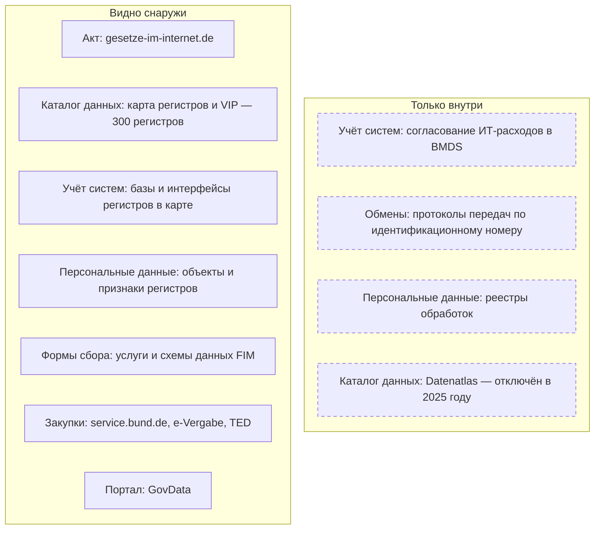
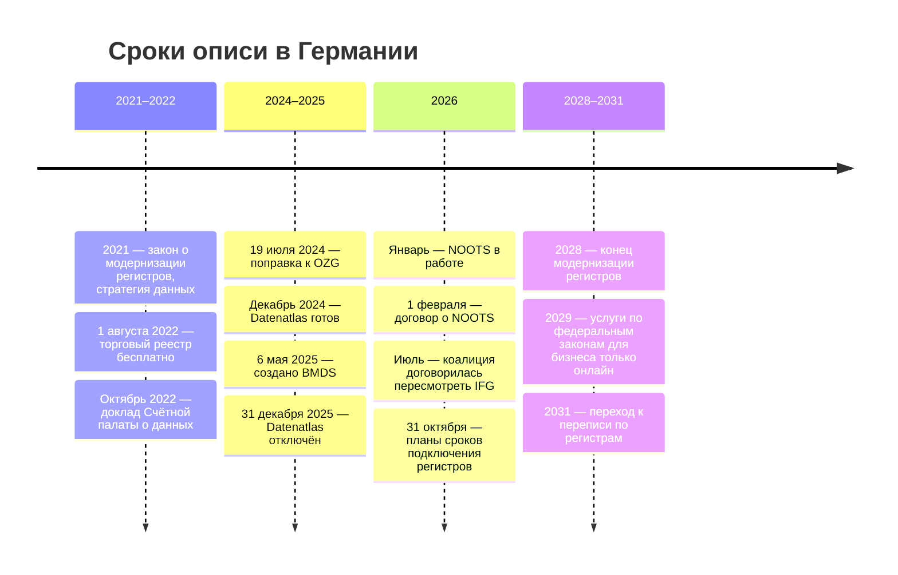

# Германия

В Германии открыто описаны не все данные государства, а его регистры. Федеральное административное ведомство и Федеральное статистическое ведомство ведут общую базу описаний — 300 регистров с правовыми основаниями, держателями, объектами сведений и отметкой об открытости — и отдают её выгрузкой и через программный интерфейс. Формы, которыми органы собирают сведения, тоже открыты: в каталоге FIM лежат описания услуг и схемы данных. Каталог всех данных федеральных органов Datenatlas закрыли через год работы, поэтому опись органа начинают с его строк в карте регистров, а данные вне регистров ищут по закупкам, порталу GovData и запросам.

Сведения проверены 28 октября 2026 года, если не указано иное.

Сокращения главы: BVA — Федеральное административное ведомство (Bundesverwaltungsamt); Destatis — Федеральное статистическое ведомство; KBA — Федеральное ведомство автотранспорта (Kraftfahrt-Bundesamt); BMDS — Министерство цифровых технологий и модернизации государства; FITKO — общее ИТ-агентство Федерации и земель (Föderale IT-Kooperation); VIP — платформа сведений об административных данных (Verwaltungsdaten-Informationsplattform); IFG — закон о свободе информации; OZG — закон об онлайн-доступе к административным услугам.

## Коротко



Пунктирная рамка — то, что видят только сами органы. Протоколы передач человек видит только о себе — в «кабинете защиты данных» (Datenschutzcockpit). Те же элементы в других странах — на странице [«Двенадцать стран в сравнении»](./00-overview.md).

## Правовая основа

Германия — федерация: Федерация, 16 земель и муниципалитеты ведут свои регистры по своим законам, а земли принимают и свои законы о доступе к информации. Федеральные законы задают общее: идентификатор, обзор регистров, порталы услуг и открытые данные федеральных органов.

| Акт простыми словами | Что требует | Что даёт описи |
|----------------------|-------------|----------------|
| **Закон об идентификационном номере** (2021) | Налоговый номер — общий идентификатор в 50 регистрах; BVA составляет обзор всех регистров; передачи по номеру протоколируются | Карта регистров |
| **Закон о федеральной статистике**, платформа VIP | Перед новой статистикой проверять данные администрации; органы по запросу передают метаданные и сообщают об изменениях; сведения публикуются | Описания регистров и их использование статистикой |
| **Закон об онлайн-доступе** (OZG, 2017, поправка 2024 года) | Услуги Федерации и земель — через порталы; человеку показывают передачи его данных между органами | Услуги и формы — каталог форм сбора |
| **Договор о NOOTS** (2025, действует с 2026 года) | Общая техническая система Федерации и земель для передачи сведений из регистров | Какие регистры отдают сведения |
| **Закон об электронном правительстве** | Федеральные органы публикуют необработанные данные, метаданные — в GovData; в каждом органе — координатор открытых данных | Опубликованное и кого спрашивать |
| **Закон о свободе информации** (IFG, 2005) | Доступ к информации федеральных органов в течение месяца; указатели собраний информации — рекомендация | Запрос; изредка — указатель |

Полномочия министерств распределяет распоряжение канцлера об организации правительства; распоряжение от 6 мая 2025 года создало BMDS. Номера Федерального вестника законов, параграфы и редакции — в приложении [«Нормативная база»](../09-appendices/02-legal-framework.md#германия).



## Реестры и платформы

### Карта регистров и VIP

Карту регистров (Registerlandkarte) по закону об идентификационном номере ведёт BVA как ведомство модернизации регистров, платформу VIP — Destatis по закону о федеральной статистике. Обе витрины показывают одну базу, которую ведомства ведут вместе; VIP добавляет, какие статистики пользуются регистром.

**Что о регистре.** Около 50 полей: описание, цель и планы развития; правовые основания и их уровень — Федерация, земля или ЕС; качество и периодичность; объекты сведений и признаки; министерства, держатели и число органов, которые ведут регистр; открытость и причина, если регистр не годится для открытых данных; кто поставляет данные и у кого доступ; базы, интерфейсы, стандарты обмена; дата последнего изменения.

**Счёт.** В карте 300 регистров, из них 9 «связок» однотипных регистров, например регистры актов гражданского состояния. К ним — 686 «особенностей»: как тот же регистр ведут в отдельной земле или у отдельного держателя; поэтому в файле выгрузки 986 строк. В базе — 976 объектов сведений и 22 828 признаков. По 300 регистрам:

- **Основание.** Федеральное право — у 209, право ЕС — у 59, право земли — у 14, не указано — у 18.
- **Открытость.** Не открыт — 194, открыт полностью — 56, частично — 27, не заполнено — 23. Годится для открытых данных — 21, не годится — 125, у остальных не заполнено.
- **Персональные данные.** У 182 регистров есть объекты сведений категории «лица».
- **Техника.** Базы данных указаны у 107 регистров, интерфейсы — у 84.
- **Статистика.** В VIP у 62 регистров отмечено использование в 134 статистиках с номерами по единому перечню статистик (EVAS).
- **Свежесть.** Последнее изменение в 2026 году — у 115 регистров, в 2025-м — у 85, раньше — у 87, без даты — у 13.

**Выгрузка.** CSV (три таблицы: регистры, объекты, признаки), XML и программный интерфейс со страницами до 100 записей, лицензия — CC BY 4.0; VIP выгружает ту же базу со связями со статистикой. Это готовая общедоступная часть реестра регистров: запись почти совпадает с [расширенным составом](../03-process/05-registry.md#расширенный-состав) записи в книге, пример — [ниже](#пример).

### FIM: услуги, формы и поля

FIM (Föderales Informationsmanagement, «федеративное управление информацией») — стандарт описания административных услуг, продукт Совета по ИТ-планированию Федерации и земель (IT-Planungsrat); портал fimportal.de ведёт FITKO. У FIM три части, у каждой свой стандарт XML:

- **Услуги** — каталог услуг LeiKa (Leistungskatalog): у каждой услуги ключ, название, правовые основания и адресаты; всего 15 506 «паспортов услуг» и 49 099 текстов услуг, которые пишут редакции Федерации и земель.
- **Поля данных** — схемы данных форм (стандарт XDatenfelder): 1354 актуальные схемы, в них 19 413 групп и 27 099 полей; утверждены 704 схемы, 438 — черновики.
- **Процессы** — как идёт услуга от заявления до решения: 316 моделей.

Всё отдаётся через программный интерфейс без ключа, схемы — файлами XML. Для описи FIM — открытый слой форм сбора: по услуге и правовому основанию видно, какие сведения органы собирают и по какому акту. Стандарты обмена между системами, например XMeld и XKfz, публикует каталог XRepository.

### NOOTS и модернизация регистров

Модернизация регистров (Registermodernisierung) — программа Федерации и земель: налоговый идентификационный номер становится дополнительным идентификатором в 50 регистрах из приложения к закону, а сведения передаются через национальную техническую систему «однократно» (NOOTS). Систему ввели в работу в январе 2026 года, после того как 6 января вступил в силу регламент о её сети; первый запрос сведений шёл к центральному регистру транспортных средств — для разрешения на парковку жителя. Договор Федерации и земель о NOOTS действует с 1 февраля 2026 года. Планы сроков подключения регистров должны быть готовы к 31 октября 2026 года, масштабное подключение начинается в конце 2026 года, срок модернизации — конец 2028 года. Федеральная счётная палата в 2025 году предупреждала, что сроки под угрозой: по её расчёту, до 2026 года проекту не хватало больше 300 млн евро.

Для описи важнее другое: каждую передачу по идентификационному номеру протоколируют и хранят протокол два года, человек видит передачи о себе в «кабинете защиты данных», но общего открытого журнала обменов нет. Открытого списка регистров, подключённых к NOOTS, не нашлось: подключение видно по текстам описаний в карте регистров, как у регистра транспортных средств.

### GovData

GovData — портал открытых данных Федерации, земель и муниципалитетов, издатель — FITKO; права требовать данные закон об электронном правительстве не даёт. На главной — 145 219 наборов, из них 17 982 — данные высокой ценности; программный интерфейс CKAN в тот же день показывал 145 267.

Шесть порталов земель — Шлезвиг-Гольштейна, Баварии, Бранденбурга, Гамбурга, Рейнланд-Пфальца и Северного Рейна — Вестфалии — дают 120,5 тысячи наборов, или 83%; у Destatis — 3149. GovData собирает метаданные с других порталов, и наборы ведомства числятся за порталом-источником: 361 набор KBA записан за порталом мобильности Mobilithek, а само ведомство видно только в поле издателя.

### Datenatlas: закрытый каталог

Стратегия данных Федерации 2021 года поручила свести данные федеральной администрации в Datenatlas — каталог метаданных для сотрудников федеральных органов. Проектом руководили министерства финансов и внутренних дел вместе с лабораториями данных министерств, разрабатывала Федеральная типография (Bundesdruckerei). Проект завершили 31 декабря 2024 года готовым продуктом, а 31 декабря 2025 года каталог отключили.

Расходы — 26,2 млн евро: 2,1 млн в 2022 году, 6,1 млн в 2023-м, 12,5 млн в 2024-м, 5,3 млн в 2025-м и 0,2 млн в 2026-м за работы 2025 года. Заменой правительство называет GovData, хотя на нём только открытые данные; BMDS обещает учесть опыт в будущих проектах. Запросы на FragDenStaat о коде каталога, договоре на разработку и проверке проекта (декабрь 2025 — январь 2026 года) получили отказы.

**Слабые места германской модели.**

- **Данные вне регистров не описаны.** Федеральная счётная палата в 2022 году опросила 155 федеральных органов и учреждений: у 81% не было каталога данных, у 15% — частичный, полный — у 4%.
- **Норма об указателях — рекомендация.** Закон о свободе информации с 2006 года говорит, что органам следует вести и публиковать указатели своих собраний информации и их целей. Обязательной норма не стала: в 2013 году пользователи FragDenStaat отправили федеральным органам 24 запроса таких указателей, полностью ответили 4 органа, частично — 6, отказали 4.

Карта регистров живёт, потому что нужна модернизации регистров и статистике, а каталог «всех данных» без такой опоры закрыли ([«Инвентаризация не заканчивается»](../01-basics/04-principles.md#8-инвентаризация-не-заканчивается)).

### Другие источники

- **Согласование ИТ-расходов.** С мая 2025 года BMDS получило право согласовывать все существенные ИТ-расходы прямой федеральной администрации, кроме обороны, безопасности и налоговой службы, и отвечает за ITZBund. Открытого перечня систем по этому согласованию нет.
- **Портал прозрачности Гамбурга** (transparenz.hamburg.de) — по закону Гамбурга о прозрачности 2012 года город публикует договоры, решения и данные.
- **Федеральный архив** — поиск invenio по описям: что из документов и данных выведенных систем передано на хранение.

## Где искать данные

### Государственные

- **Портал** GovData — с фильтром по издателю, а не по организации портала.
- **Статистика.** GENESIS-Online Destatis: таблицы — без регистрации, программный интерфейс — после бесплатной регистрации; региональная база земель — regionalstatistik.de. Правовые основания статистик Destatis собрал по темам. Микроданные для исследований выдают центры данных статистических ведомств.
- **Регистры компаний.** Торговый реестр handelsregister.de бесплатен с 1 августа 2022 года: раньше выписка стоила 4,50 евро, документ — 1,50 евро. Отчётность компаний — в Unternehmensregister и Bundesanzeiger.
- **Закупки.** Объявления федеральных заказчиков — на service.bund.de и платформе e-Vergabe, выше порогов ЕС — в TED, где ИТ-услуги помечены кодами CPV раздела 72: в 2025 году немецких объявлений с такими кодами — 6742 ([«Государственные данные»](../04-sources/02-government.md#госзакупки)).
- **Нормативные акты** — gesetze-im-internet.de с отметкой о последнем изменении, recht.bund.de; ответы правительства на запросы депутатов — dserver.bundestag.de.
- **Земли** — свои законы о доступе и порталы; в Баварии и Нижней Саксонии общего закона о доступе к информации нет.

Карта регистров, GovData, FIM, FragDenStaat и TED отвечают через программные интерфейсы без ключа.

<details>
<summary>Проверить самому</summary>

```bash
# Карта регистров: выгрузка CSV (архив из трёх таблиц); XML — /export/xml
curl -L -o rlk.zip "https://registerlandkarte.de/rlk-opendata/export/csv"
# Программный интерфейс: регистры страницами до 100 записей
curl "https://registerlandkarte.de/rlk-opendata/registers?page=0&pageSize=100"
# Выгрузка VIP — с полем о статистике
curl -L -o vip.zip "https://registerlandkarte.de/rlk-opendata/vip-export/csv"
# GovData: сколько наборов (result.count) и сколько у KBA по полю издателя
curl "https://ckan.govdata.de/api/3/action/package_search?rows=0"
curl -G "https://ckan.govdata.de/api/3/action/package_search" --data-urlencode 'fq=publisher_name:*Kraftfahrt*' --data-urlencode 'rows=0'
# FIM: паспорта услуг (total_count); схемы и поля — /schemas, /fields
curl "https://fimportal.de/api/v1/leistung-steckbriefe?limit=1"
# Услуги с основанием FZV — регламент о допуске транспортных средств
curl -G "https://fimportal.de/api/v1/leistung-steckbriefe" --data-urlencode 'rechtsgrundlagen=FZV' --data-urlencode 'limit=50'
# FragDenStaat: запросы к KBA (орган 654)
curl "https://fragdenstaat.de/api/v1/request/?public_body=654&limit=50"
# TED: немецкие объявления с кодами CPV 72 за 2025 год (totalNoticeCount)
curl -X POST "https://api.ted.europa.eu/v3/notices/search" -H 'Content-Type: application/json' \
  -d '{"query":"buyer-country=DEU AND classification-cpv=72* AND publication-date>=20250101 AND publication-date<20260101","fields":["publication-number"],"limit":1}'
```

</details>

### Общественные

- **FragDenStaat** — платформа запросов по законам о свободе информации от Open Knowledge Foundation Deutschland: 290 694 открытых запроса, из них 175 551 — к федеральным органам; в справочнике — 42 230 органов. Архив показывает, какие документы у органа есть, что он выдавал и почему отказывал.
- **OpenStreetMap** — немецкое сообщество, openstreetmap.de: адреса, здания и дороги по наблюдениям участников; это копия, её сверяют с официальными геоданными ([«Общественные данные»](../04-sources/03-public.md#общественные-проекты)).
- **CORRECTIV** — редакция расследований; в октябре 2025 года рассказала о предупреждении Счётной палаты о сроках и деньгах NOOTS со ссылкой на её доклад.

### Коммерческие

- **North Data** — профили компаний по публикациям торгового реестра и Bundesanzeiger: руководители, связи, показатели отчётности. Это копия: дату и первоисточник записывают рядом ([«Сервисы на государственных реестрах»](../04-sources/04-commercial.md#сервисы-на-государственных-реестрах)).
- **Кредитные бюро**, например Creditreform, — сведения о платёжеспособности компаний.

## Как провести инвентаризацию

### Чем владеем: опись федерального органа

Порядок шагов и что каждый даёт реестру — на странице [«Двенадцать стран в сравнении»](./00-overview.md#чем-владеем-общий-порядок). Где их пройти в Германии:

| Шаг | Где | Видно снаружи? |
|-----|-----|----------------|
| **1. Полномочия** | Закон об учреждении ведомства, распоряжение канцлера о полномочиях министерств; gesetze-im-internet.de | ● да |
| **2. Учёт систем** | Базы, интерфейсы и приложения регистров в карте; внутри — согласование ИТ-расходов в BMDS | ◐ только у регистров |
| **3. Каталог данных** | Строки карты регистров, где орган — держатель или министерство; указатель по закону о свободе информации, если есть | ◐ только регистры |
| **4. Обмены** | Поставки и доступ — текстом в карте регистров; протоколы передач по идентификационному номеру | ◐ описания; ○ протоколы |
| **5. Закрытое и персональные данные** | Отметки и причины закрытости в карте, объекты «лица»; реестр обработок по GDPR | ◐ регистры; ○ реестр обработок |
| **6. Формы сбора и статистика** | Услуги и схемы FIM по правовому основанию органа; статистики, которые берут данные регистров | ● да |
| **7. Закупки** | service.bund.de, e-Vergabe, TED | ● да |
| **8. Опубликованное** | Наборы GovData по полю издателя; отчёт правительства об открытых данных раз в два года | ● да |
| **9. Опрос** | Координатор открытых данных, лаборатория данных министерства, уполномоченный по защите данных, владельцы систем | — |

Шаги 3, 5 и 6 дают почти готовую опись регистров, и главная работа — сверка. Регистр органа есть в карте, а его наборов нет на GovData; услуга FIM ссылается на акт органа, а регистра для её сведений в карте нет; поле баз данных пустое — систему ищут в закупках. Таблицы, аналитические базы, кадровые и финансовые системы в карту не попадают, их добавляют по анкете ([«Что считать записью»](../03-process/05-registry.md#что-считать-записью)).

### Где найти нужное

Общий порядок — на странице [«Двенадцать стран в сравнении»](./00-overview.md#где-найти-нужное-общий-порядок). Что в Германии иначе:

- **Опубликованное** — GovData с фильтром по издателю, иначе федеральные наборы теряются среди наборов земель.
- **Кто ведёт** — сначала карта регистров или VIP: держатель, основание, признаки, открытость, какие статистики берут регистр; затем FIM — какие услуги собирают нужные сведения.
- **Федерация или земля** — регистр населения ведут 5283 муниципальных органа по правилам своих земель: запрос идёт к держателю по закону его земли.
- **Запрос** — сначала архив FragDenStaat: такой запрос мог уже быть. По федеральному закону о свободе информации доступ следует дать в течение месяца, но норма рекомендательная; плата — до 500 евро. Если у регистра свой порядок выдачи, он важнее: справку из регистра транспортных средств выдают за плату по закону о дорожном движении ([«Запрос владельцу»](../03-process/06-access.md#запрос-владельцу)). В июле 2026 года коалиция договорилась сузить право запроса до физических лиц и привязать плату к расходам; на конец августа проекта закона не было.
- **Если закрыто** — центры данных статистических ведомств, затем общественные и коммерческие копии.

## Что особенного

- **Опись живёт, пока у неё есть задача.** Карту регистров ведут ради модернизации регистров и статистики, и записи обновляют: у 200 из 300 регистров последнее изменение — в 2025–2026 годах. Каталог «всех данных» без закона закрыли через год, потратив 26,2 млн евро.
- **Два ведомства — одна база.** BVA и Destatis собирают метаданные один раз и показывают в двух витринах — по тому же принципу однократности, ради которого модернизируют регистры.
- **Формы сбора открыты.** FIM публикует схемы данных форм с правовыми основаниями — то, что в других странах видно только по приказам о формах или по самим формам на сайтах.
- **Федерация описывает и регистры земель.** Регистр описан один раз, его земельные варианты — «особенностями», 686 строк. Но держатели у таких регистров часто не названы: у регистра населения поле держателей пустое, есть только их число.

## Пример

Центральный регистр транспортных средств (Zentrales Fahrzeugregister, ZFZR) — запись 151 карты регистров, последнее изменение — 27 июля 2026 года. Вот что она даёт записи реестра:

| Поле карты | Значение | Поле реестра |
|------------|----------|--------------|
| Держатель, министерство | KBA; Министерство транспорта; ведёт один орган | Организация-владелец |
| Правовые основания | Закон о дорожном движении, закон о KBA, регламент о допуске транспортных средств — с параграфами | Нормативный акт |
| Качество, периодичность | Около 71 млн транспортных средств, охват 100%; ведётся ежедневно | Объём, периодичность |
| Объекты и признаки | 29 объектов, 393 признака: владельцы, номера, страхование, техосмотры, розыск | Схема данных |
| Доступ | Органам из списка закона — автоматический запрос; людям и компаниям — справка за плату; открыт — «нет» | Режим доступа |
| Открытые данные | «Не годится»: персональные данные; агрегаты — на GovData и в Mobilithek | Причина ограничения, ссылка |
| Техника | Oracle; SOAP и REST; стандарт XKfz; портал ZEVIS; подключён к NOOTS | Информационная система |
| Статистика (VIP) | Четыре статистики: подготовка переписи по регистрам, грузовые перевозки, расходы на защиту климата, транспорт и окружающая среда | Связанные наборы |

Дальше запись проверили по другим источникам:

- **GovData.** Обещание карты выполнено: по полю издателя у KBA 361 набор, все собраны через Mobilithek. Из них 158 — наборы 25 статистических рядов «FZ» по данным регистра, чаще всего по набору на год; файлы — таблицы Excel, CSV есть у трёх. У 363 из 365 наборов с KBA в поле издателя лицензия в метаданных не указана.
- **FIM.** 57 паспортов услуг ссылаются на регламент о допуске: регистрация, номера, снятие с учёта. Через эти формы сведения собирают местные органы допуска, а не KBA.
- **FragDenStaat.** К KBA с 2011 года — 231 открытый запрос, успешных из них 86. В 2017 году заявитель попросил копию всего регистра без персональных данных и 7 февраля 2017 года получил отказ. Запросы 2020 и 2021 годов о списках номеров Гамбурга тоже отклонили, во втором — со ссылкой на приоритет специального закона.
- **Закупки.** В TED у KBA 16 объявлений с кодами CPV 72 с 2016 года, о самом регистре — ни одного, так что разработчик системы не виден. Зато видны другие системы ведомства: персонализация карт тахографов, хранилище данных для дорожного сбора 2017 года, учёт рабочего времени.
- **Качество записи.** В поле стандарта хранения стоит «doc» — заглушка вместо значения.

Запись карты даёт почти всю строку реестра, кроме типов полей и ссылки на выгрузку; данные доступны только агрегатами. Пробелы — разработчик системы и лицензия агрегатов — записывают и выясняют запросом ([«Как методы проверяют друг друга»](../02-approaches/02-methods.md#как-методы-проверяют-друг-друга)).

## Частые ошибки

| Ошибка | Что происходит | Как исправить |
|--------|----------------|---------------|
| **Карта регистров принята за опись всех данных органа** | Пропадают аналитические базы, таблицы и внутренние системы | Дополнять опросом и закупками |
| **Поиск в GovData по организации портала** | Наборы ведомств, собранные с других порталов, не находятся | Искать по полю издателя |
| **Запрос по федеральному IFG там, где действует специальный закон или закон земли** | Отказ, как в запросах о регистре транспортных средств | Сначала найти порядок выдачи в законе о регистре и закон земли держателя |

Сквозные ошибки — в главе [«Практики и антипаттерны»](../08-practices/01-practices-and-anti-patterns.md).

## Ограничения

- Счёт карты зависит от способа: в программном интерфейсе 300 регистров, в выгрузке CSV — 986 строк вместе с «особенностями».
- Описание — не текущее состояние: описание регистра населения последний раз меняли 7 февраля 2024 года, у 13 регистров даты нет.
- Список регистров, подключённых к NOOTS, и состояние «кабинета защиты данных» в открытых источниках не найдены.
- Законы о доступе, порталы и регистры земель глава не разбирает.
- Сведения о закупках взяты из TED: сервис объявлений oeffentlichevergabe.de из сети проверки не открылся.

## Источники

- Законы на gesetze-im-internet.de, 28 октября 2026 года: [IDNrG](https://www.gesetze-im-internet.de/idnrg/) — § 1, § 3, § 9 и приложение; [BStatG, § 5a](https://www.gesetze-im-internet.de/bstatg_1987/__5a.html); [OZG](https://www.gesetze-im-internet.de/ozg/BJNR313800017.html) — § 1a, § 2 и § 10; [договор о NOOTS](https://www.gesetze-im-internet.de/nootsstvtr/); [EGovG, § 12a](https://www.gesetze-im-internet.de/egovg/__12a.html); [IFG](https://www.gesetze-im-internet.de/ifg/) — § 7 и § 11; [распоряжение канцлера от 6 мая 2025 года](https://www.gesetze-im-internet.de/bkorgerl_2025/BJNR0830A0025.html), разделы XII и XIII.
- Карта регистров — BVA: [выгрузка CSV](https://registerlandkarte.de/rlk-opendata/export/csv) и [описание программного интерфейса](https://registerlandkarte.de/rlk-opendata/webjars/swagger-ui/index.html); VIP — Destatis: [о платформе](https://www.verwaltungsdaten-informationsplattform.de/DE/Home/about), [выгрузка](https://www.verwaltungsdaten-informationsplattform.de/datenexport), записи [ZFZR](https://www.verwaltungsdaten-informationsplattform.de/register/151) и [регистра населения](https://www.verwaltungsdaten-informationsplattform.de/register/286). Файлы от 28 октября 2026 года, подсчёты автора.
- [Портал FIM](https://fimportal.de/) и [его программный интерфейс](https://fimportal.de/docs), версия 0.26.4; [XKfz в XRepository](https://www.xrepository.de/details/urn:xoev-de:kba:standard:xkfz).
- NOOTS: [статусный отчёт](https://www.it-planungsrat.de/fileadmin/beschluesse/2026/Beschluss_2026_09_Steuerungsgruppe_NOOTS_Statusbericht.pdf) за октябрь 2025 — январь 2026 года, решение Совета по ИТ-планированию 2026/09; [статья CORRECTIV](https://correctiv.org/aktuelles/bundesrechnungshof/2025/10/10/bundesrechnungshof-warnt-verwaltungsdigitalisierung-droht-zu-scheitern-ministerium-wiegelt-ab/) от 10 октября 2025 года.
- GovData: [главная](https://www.govdata.de/), [выходные данные](https://www.govdata.de/impressum), [программный интерфейс CKAN](https://ckan.govdata.de/api/3/action/package_search?rows=0) — наборы, поставщики, поле издателя.
- Datenatlas: [ответ правительства](https://dserver.bundestag.de/btd/21/064/2106478.pdf), Drucksache 21/6478 от 11 июня 2026 года, — руководители, сроки, расходы по годам; [страница проекта](https://www.bundesdruckerei.de/de/innovation-hub/projekt-datenatlas). [Datenmanagement in der Bundesverwaltung](https://bundesrechnungshof.de/fileadmin/import/___Alte_Struktur/Downloads/DE/Berichte/2022/datenmanagement-volltext-datenmanagement-volltext.pdf) — Bundesrechnungshof, 13 октября 2022 года.
- [Ответ правительства о торговом реестре](https://dserver.bundestag.de/btd/20/045/2004502.pdf), Drucksache 20/4502; [FAQ Informationsfreiheitsgesetz](https://www.bpb.de/kurz-knapp/hintergrund-aktuell/580791/faq-informationsfreiheitsgesetz/) — bpb, 24 августа 2026 года.
- Destatis: [Rechtsgrundlagen nach Themen](https://www.destatis.de/DE/Methoden/Rechtsgrundlagen/Statistikbereiche/_rechtsgrundlagen-themen.html), [Register census](https://www.destatis.de/EN/Themes/Society-Environment/Register-census/_node.html), [GENESIS-Online](https://www-genesis.destatis.de/datenbank/online); [regionalstatistik.de](https://www.regionalstatistik.de/); [центры данных для исследований](https://www.forschungsdatenzentrum.de/de).
- [service.bund.de](https://www.service.bund.de/); [TED API](https://api.ted.europa.eu/v3/notices/search) — запросы по стране, коду CPV и покупателю; [invenio](https://invenio.bundesarchiv.de/); [transparenz.hamburg.de](https://transparenz.hamburg.de/); [FragDenStaat](https://fragdenstaat.de/) и [его программный интерфейс](https://fragdenstaat.de/api/v1/request/?public_body=654&limit=50) — запросы к KBA, о Datenatlas и об указателях; [openstreetmap.de](https://www.openstreetmap.de/); [North Data](https://www.northdata.de/).
- Главы [«Зарубежные методики»](../05-frameworks/04-international-practice.md), [«Государственные данные»](../04-sources/02-government.md); приложение [«Нормативная база»](../09-appendices/02-legal-framework.md#германия).
- Как проверяли. Сайт карты регистров — приложение на JavaScript, поэтому числа взяты из документированной выгрузки и программного интерфейса. 28 октября 2026 года из сети проверки не открылись oeffentlichevergabe.de (отказ соединения) и creditreform.de (истекло время ожидания); evergabe-online.de без браузера отвечал ошибкой 400; программный интерфейс GENESIS-Online на запрос гостя ответил ошибкой 401. Из германской сети адреса не проверяли.
