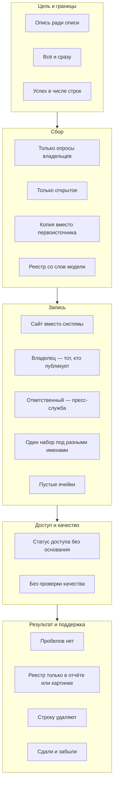

# Антипаттерны

Антипаттерн — ошибка, которая выглядит разумным решением и потому повторяется от проекта к проекту. Анкеты кажутся самым быстрым способом собрать реестр, адрес сайта — самым понятным именем источника, удаление мёртвой ссылки — наведением порядка. Почти все антипаттерны инвентаризации ведут к одному из двух исходов: реестру нельзя верить или им нельзя пользоваться. Каждый нарушает один из восьми [принципов](../01-basics/03-principles.md), и большинство видно по самому реестру — по пустым ячейкам, адресам вместо идентификаторов, статусам без даты — задолго до того, как по нему примут решение. Ниже 18 антипаттернов по этапам работы: как каждый выглядит, чем вредит, как его заметить и как исправить. Частные ошибки отдельных шагов и источников разобраны в разделах «Частые ошибки» глав, здесь — те, что портят весь результат. В конце — запросы, которые находят антипаттерны в реестре за несколько минут, и случаи, когда от правила разумно отступить.

## Коротко

| Антипаттерн | Как заметить | Нарушает принцип |
|-------------|--------------|------------------|
| **[Опись ради описи](#опись-ради-описи)** | В цели нет действия, кроме «провести инвентаризацию»; нет того, кто примет результат | [Цели определяют всё](../01-basics/03-principles.md#1-цели-определяют-всё) |
| **[Всё и сразу](#всё-и-сразу)** | Границы не записаны; первые записи устарели раньше, чем дописаны последние | [Цели определяют всё](../01-basics/03-principles.md#1-цели-определяют-всё) |
| **[Успех в числе строк](#успех-в-числе-строк)** | Результат меряют числом записей, а не ответами на вопросы | [Цели определяют всё](../01-basics/03-principles.md#1-цели-определяют-всё) |
| **[Только опросы владельцев](#только-опросы-владельцев)** | Почти у всех записей «откуда известно» — анкета | [Готовьтесь к разочарованию](../01-basics/03-principles.md#5-готовьтесь-к-разочарованию) |
| **[Только открытое](#только-открытое)** | У всех записей режим доступа «открыто»; реестр повторяет портал | [Учитывают всё, в том числе закрытое](../01-basics/03-principles.md#2-учитывают-всё-в-том-числе-закрытое) |
| **[Копия вместо первоисточника](#копия-вместо-первоисточника)** | Владелец записи — проект или платформа, связи `copy_of:` нет | [Владелец и основание](../01-basics/03-principles.md#3-у-каждого-набора-есть-владелец-и-основание) |
| **[Реестр со слов модели](#реестр-со-слов-модели)** | Записи от модели без пометки или без подтверждения | [Готовьтесь к разочарованию](../01-basics/03-principles.md#5-готовьтесь-к-разочарованию) |
| **[Сайт вместо системы](#сайт-вместо-системы)** | Тип записи — сайт, ссылка ведёт на главную страницу | [Реестр — это данные](../01-basics/03-principles.md#6-реестр--это-данные) |
| **[Владелец — тот, кто публикует](#владелец--тот-кто-публикует)** | Владелец совпадает с хозяином домена, оператором или порталом | [Владелец и основание](../01-basics/03-principles.md#3-у-каждого-набора-есть-владелец-и-основание) |
| **[Ответственный — пресс-служба](#ответственный--пресс-служба)** | В контактах info@, press@, приёмная | [Владелец и основание](../01-basics/03-principles.md#3-у-каждого-набора-есть-владелец-и-основание) |
| **[Один набор под разными именами](#один-набор-под-разными-именами)** | Одинаковые названия или адреса выгрузки у разных записей | [Реестр — это данные](../01-basics/03-principles.md#6-реестр--это-данные) |
| **[Пустые ячейки и значения по умолчанию](#пустые-ячейки-и-значения-по-умолчанию)** | Пустые ячейки в 14 атрибутах; у всех записей одни и те же условия использования | [Готовьтесь к разочарованию](../01-basics/03-principles.md#5-готовьтесь-к-разочарованию) |
| **[Статус доступа без основания](#статус-доступа-без-основания)** | «Закрыто» без ссылки, нормы и даты | [Учитывают всё, в том числе закрытое](../01-basics/03-principles.md#2-учитывают-всё-в-том-числе-закрытое) |
| **[Без проверки качества](#без-проверки-качества)** | Отметка о качестве пуста или пересказывает описание | [Качество — часть инвентаризации](../01-basics/03-principles.md#4-качество--часть-инвентаризации) |
| **[Пробелов нет](#пробелов-нет)** | В результате нет списка того, чего нет, что закрыто и что непригодно | [Готовьтесь к разочарованию](../01-basics/03-principles.md#5-готовьтесь-к-разочарованию) |
| **[Реестр только в отчёте или картинке](#реестр-только-в-отчёте-или-картинке)** | Реестр нельзя выгрузить в таблицу | [Реестр — это данные](../01-basics/03-principles.md#6-реестр--это-данные) |
| **[Строку удаляют, когда источник исчез](#строку-удаляют-когда-источник-исчез)** | Записи прошлой версии пропали без следа в списке изменений | [Инвентаризация не заканчивается](../01-basics/03-principles.md#8-инвентаризация-не-заканчивается) |
| **[Сдали и забыли](#сдали-и-забыли)** | У реестра одна дата — дата сдачи; владельца процесса нет | [Инвентаризация не заканчивается](../01-basics/03-principles.md#8-инвентаризация-не-заканчивается) |



Ошибки первых этапов обходятся дороже всего: опись без цели переделывают целиком, а пропущенное в анкетах ищут заново. Заметны же они чаще всего в конце — когда по реестру пишут запрос или открывают данные. Поэтому проверять стоит дважды: перед началом работ, по [чек-листу «Перед началом»](../09-appendices/04-checklists.md#перед-началом), и перед публикацией — [запросами](#проверить-реестр-запросами) и [чек-листом](../09-appendices/04-checklists.md#перед-публикацией-реестра).

## Цель и границы

### Опись ради описи

**Как выглядит.** Инвентаризацию проводят «потому что надо»: по поручению, к отчётной дате, ради пункта в плане цифровой трансформации. Цель записана как «провести инвентаризацию», результат — отчёт на сотни страниц.

**Чем вредит.** Результатом никто не пользуется: непонятно, на какие вопросы он отвечает, и не с чем сравнить, хорош ли он. Он устаревает до первого применения, а следующую инвентаризацию начинают с нуля.

**Как заметить.** В цели нет другого действия, кроме «провести инвентаризацию»; не назван владелец задачи, который примет результат; вопросов к реестру нет.

**Как исправить.** Начинать с [цели](../01-basics/02-goals.md#как-записать-цель): что сделают с данными и как проверить результат. Если внешней задачи нет, записать хотя бы [вопросы к реестру](../03-process/02-goals-and-questions.md#вопросы-к-реестру) — что о данных должны узнавать из него — и проверять результат по ним.

### Всё и сразу

**Как выглядит.** Описывают все организации, все уровни и все наборы по сотне атрибутов, качество проверяют по всем признакам у всех наборов. Границ нет, очередей нет.

**Чем вредит.** Работа растягивается на месяцы: к последним ответам первые устарели, а до наборов, ради которых всё начинали, не доходят. Колонки «на всякий случай» заполнены у немногих записей, и обновлять реестр становится дороже, чем им пользоваться.

**Как заметить.** Границы не записаны или записаны как «все данные»; в реестре есть колонки, заполненные у меньшей части записей; срок сдвигается, а первой очереди нет.

**Как исправить.** Записать [границы](../03-process/02-goals-and-questions.md#границы) и исключения, разбить тему на [очереди](../03-process/01-steps.md#если-тема-большая), выбрать [глубину описания](../03-process/05-registry.md#глубина-описания) под цель: 14 обязательных атрибутов и только те расширенные, что нужны цели. Подробная проверка качества — только ключевым наборам ([«Что проверять в первую очередь»](../03-process/07-quality.md#что-проверять-в-первую-очередь)).

### Успех в числе строк

**Как выглядит.** Результат меряют числом записей в реестре или опубликованных наборов: «описано 1200 наборов», «открыто на треть больше, чем в прошлом году».

**Чем вредит.** Число легко нарастить — разбить набор на файлы, записать копии и сайты отдельными строками, — и оно ничего не говорит о том, отвечает ли реестр на вопросы. На data.gov 25 октября 2026 года было 431 277 наборов, 36% из них опубликовало Бюро переписи США, а у Бюро статистики труда их 31 ([«Порталы открытых данных»](../04-sources/02-government.md#порталы-открытых-данных)). Число показывает, как ведомство делит данные на файлы, а не сколько у него данных.

**Как заметить.** В отчёте о результате — число строк, а не доля вопросов с ответом и не доля записей с владельцем, основанием и отметкой о качестве; новые записи — выпуски одного ряда или файлы одного набора.

**Как исправить.** Мерить по цели: на сколько вопросов найден ответ или записан пробел, у какой доли записей есть владелец, режим доступа с основанием и отметка о качестве ([«Два подхода»](../02-approaches/01-two-approaches.md), строка «Мера успеха»). Выпуски ряда и форматы одного набора — одна запись ([«Набор данных: где провести границу»](../01-basics/04-what-is-inventoried.md#набор-данных-где-провести-границу)).

## Сбор

### Только опросы владельцев

**Как выглядит.** Реестр собран из анкет, которые заполнили ведомства или подразделения. Других методов не применяли.

**Чем вредит.** В реестр попадает только то, что владелец считает данными и не забыл упомянуть: системы — да, таблицы на общем диске и выгрузки для отчётов — редко. Ответы противоречат реестрам систем и госзакупкам, а «данных нет» не отличить от «не ответили».

**Как заметить.** Почти у всех записей в поле «откуда известно» — анкета; у строк анкет нет итога проверки; в паспорте не записано, кто ответил, а кто нет.

**Как исправить.** [Заполнить анкету заранее](../03-process/04-questionnaires.md#заполнить-заранее) тем, что нашли анализом полномочий, реестрами систем и кабинетными исследованиями, и [проверять ответы](../03-process/04-questionnaires.md#как-проверять-ответы) вторым методом. Анкета — один из [семи методов](../02-approaches/02-methods.md#как-методы-проверяют-друг-друга), а не вся инвентаризация.

### Только открытое

**Как выглядит.** В реестр вносят то, что опубликовано: наборы с портала открытых данных, разделы сайтов. Закрытые системы, служебные таблицы и наборы для внутреннего пользования пропускают — «их всё равно нельзя показать».

**Чем вредит.** Реестр повторяет портал и не отвечает на главные вопросы: что у организации есть, что из этого можно открыть и почему закрыто остальное. Наборы, закрытые без нормы, — кандидаты на открытие — не видны. В подходе «где найти нужное» карта без закрытых источников говорит, что данных нет, хотя они есть, только получить их нельзя.

**Как заметить.** У всех или почти всех записей режим доступа «открыто»; число записей совпадает с числом наборов организации на портале; в реестре нет ни одной информационной системы.

**Как исправить.** Закрытый набор — такая же запись, со статусом «закрыто», основанием и датой ([«Закрытые наборы — тоже в реестре»](../03-process/06-access.md#закрытые-наборы--тоже-в-реестре)). Что из этого показать в общедоступной части, решают отдельно ([«Полный реестр и общедоступная часть»](../03-process/08-result-and-upkeep.md#полный-реестр-и-общедоступная-часть)). Так делает, например, Администрация общих служб США (GSA): 25 октября 2026 года в общедоступной части её инвентаря было 344 записи, из них 33 закрытые — с пометкой, что набор не публикуется, а у 31 из 33 — и с причиной.

### Копия вместо первоисточника

**Как выглядит.** В реестре — набор с Kaggle, из общественного проекта, у агрегатора или карточка поисковика, а первоисточник не записан. Или копия и первоисточник записаны как два независимых источника.

**Чем вредит.** Копия отстаёт, перестаёт обновляться или исчезает вместе с проектом, и в реестре не остаётся следа, где искать дальше. Ошибки пересборки переходят в реестр. Вопрос выглядит хорошо покрытым — «три источника», — хотя данные одни.

**Как заметить.** Владелец записи — проект, платформа или поисковик, а в описании — данные органа власти или компании; у записей с одинаковым содержанием нет связи `copy_of:`; дата изменения у копии старше, чем у первоисточника.

**Как исправить.** По описанию копии найти первоисточник ([«От набора к владельцу»](../04-sources/05-dataset-search.md#от-набора-к-владельцу)) и записать обе записи со связью `copy_of:`; при подсчёте покрытия считать их одним источником ([«Как данные переходят между слоями»](../04-sources/01-three-layers.md#как-данные-переходят-между-слоями)). Пример: 25 октября 2026 года поисковики наборов данных показывали копии реестра воздушных судов США на Kaggle и Hugging Face, а ежедневную выгрузку самого FAA в первых результатах не показал ни один ([«Реестр воздушных судов США»](../04-sources/05-dataset-search.md#реестр-воздушных-судов-сша)).

### Реестр со слов модели

**Как выглядит.** Языковая модель прочитала акты и сайты или ответила на вопрос «какие данные есть у министерства», и её ответ перенесли в реестр без проверки.

**Чем вредит.** В реестре не отличить найденное от додуманного: правдоподобные названия систем и наборов, которых нет, устаревшие редакции актов, «открыто» там, где страница просто есть. Ошибку замечают, когда по записи уже пишут запрос или открывают данные.

**Как заметить.** У записей не отмечено, кто их составил, или отмечена модель, но нет подтверждения; цитаты не находятся в тексте документа; среди систем — названия, которых нет ни в реестре систем, ни в закупках.

**Как исправить.** Давать модели текст документа и требовать дословную цитату, проверять цитаты программой, подтверждать записи вторым методом и человеком и отмечать в поле «откуда известно», что запись составила модель ([«ИИ в инвентаризации»](../02-approaches/03-ai.md#как-делать), [«Ошибки модели и как их ловить»](../02-approaches/03-ai.md#ошибки-модели-и-как-их-ловить)).

## Запись

### Сайт вместо системы

**Как выглядит.** Источник записан доменом: «data.gov.ru».

**Чем вредит.** Под одной строкой оказываются наборы с разными владельцами и режимами доступа, а когда домен или содержимое сайта меняется, связь с данными теряется. По адресу data.gov.ru в 2022 году был портал с более чем 24 тыс. наборов, а с июля 2025 года — новый, меньше чем с 6 тыс.: запись-домен не говорит, о каком из них речь ([«Пример: data.gov.ru»](../04-sources/06-legacy.md#пример-datagovru)).

**Как заметить.** Название записи — домен; тип записи — сайт; ссылка для выгрузки ведёт на главную страницу.

**Как исправить.** Записывать систему, ресурс или набор, а домен — его адресом ([«Система, ресурс, набор и сайт»](../01-basics/04-what-is-inventoried.md#система-ресурс-набор-и-сайт)). Если за сайтом систему найти не удалось, оставить тип «сайт» и записать это как вопрос к владельцу.

### Владелец — тот, кто публикует

**Как выглядит.** Владельцем записывают того, кто показывает данные: хозяина домена, оператора системы, подрядчика, портал или проект, который перепубликовал данные. Бывает и наоборот: у копии, которую ведёт проект, владельцем записан орган власти.

**Чем вредит.** Запрос о доступе уходит не тому, кто решает; один владелец оказывается под тремя именами; копия получает права и обязанности первоисточника. На «Хабе открытых данных» копии данных Росстата записаны на организацию «Федеральная служба статистики»: каталог подталкивает записать владельцем копии орган власти ([«Общественные проекты»](../04-sources/03-public.md#общественные-проекты)).

**Как заметить.** Владелец всегда совпадает с оператором или хозяином домена; у копий из общественных проектов владелец — орган власти; у купленных данных владелец — покупатель.

**Как исправить.** Владельца брать из положения об органе власти, акта о системе или договора; оператор и подрядчик — отдельными атрибутами ([«Владелец, оператор, ответственный»](../03-process/03-owners-and-mandates.md#владелец-оператор-ответственный)). У копии владелец — тот, кто её ведёт, а первоисточник — отдельная запись со своим владельцем.

### Ответственный — пресс-служба

**Как выглядит.** В графе «ответственный» — приёмная, пресс-служба или общий адрес вроде info@.

**Чем вредит.** На вопрос о данных — что значит поле, откуда пропуски, когда следующее обновление — некому ответить. Вопросы теряются в общей почте, запись невозможно обновить.

**Как заметить.** В контактах — общие адреса, в графе «ответственный» — «пресс-служба» или «приёмная»; один и тот же контакт у всех записей организации.

**Как исправить.** Ответственный — конкретный сотрудник, который знает данные: из профильного подразделения или ИТ ([«Ответственный и контакты»](../03-process/05-registry.md#ответственный-и-контакты)). Если сотрудника не узнать, записать подразделение, которое ведёт набор, и пометить, что сотрудник не установлен. В общедоступной части вместо имени — адрес подразделения для вопросов о данных, но и там это не пресс-служба.

### Один набор под разными именами

**Как выглядит.** Полное название, сокращение и адрес сайта — три строки. Чаще всего дубли появляются, когда разные методы находят одно и то же: полномочие — как реестр, поиск — как набор на портале, опрос — как «нашу базу».

**Чем вредит.** Реестр показывает больше данных, чем есть; при обновлении правят одну строку и забывают другие.

**Как заметить.** Одинаковые названия после удаления пробелов и знаков, одинаковые адреса выгрузки, название одной записи в синонимах другой.

**Как исправить.** Идентификатор и синонимы, поиск по ним перед каждым добавлением ([«Один набор под разными именами»](../03-process/05-registry.md#один-набор-под-разными-именами)). Если на обе записи уже ссылаются, оставить старшую, а название и идентификатор второй — в синонимы.

### Пустые ячейки и значения по умолчанию

**Как выглядит.** Где сведение не нашли, ячейку оставляют пустой — или ставят значение, которое «обычно верно»: CC0 вместо «условия не указаны», «ежемесячно» по шаблону, дату первой копии в веб-архиве вместо даты публикации.

**Чем вредит.** Пустая ячейка не отличает «не нашли» от «не искали» и «не бывает». Значение по умолчанию хуже: оно выглядит как найденное и проходит проверку схемы. По нему данные используют без права на это или ждут обновления, которого не будет.

**Как заметить.** Пустые ячейки в 14 обязательных атрибутах; одни и те же условия использования или периодичность у всех записей; дата публикации совпадает с датой первой копии в архиве.

**Как исправить.** Значение, «нет» или «не установлено» с тем, где искать дальше; в кодовых полях — `unknown` ([«Если сведение не найдено»](../03-process/05-registry.md#если-сведение-не-найдено)). Честный пропуск полезнее догадки: он показывает, о чём спросить владельца ([«Частые ошибки» в «Стандартах описания»](../05-frameworks/02-metadata-standards.md#частые-ошибки)).

## Доступ и качество

### Статус доступа без основания

**Как выглядит.** «Закрыто», «открыто» или цвет на карте — без ссылки и даты.

**Чем вредит.** Два составителя ставят одному набору разные статусы. Закрытым считают то, что просто не открылось из-за рубежа или не нашлось на сайте, и кандидатов на открытие не видно.

**Как заметить.** У «закрыто» и «с ограничениями» нет ссылки, нормы или ответа владельца; нет даты проверки; закрытыми отмечены почти все государственные сайты одной страны — частый признак того, что проверяли из чужой сети.

**Как исправить.** [Шкала доступа](../03-process/06-access.md#шкала) с критериями; подтверждение, причина ограничения и дата; государственные сайты — из сети своей страны, а если это невозможно — «не установлено» с пометкой о сети ([«Как записать»](../03-process/06-access.md#как-записать)).

### Без проверки качества

**Как выглядит.** Набор попадает в реестр, потому что он существует.

**Чем вредит.** На этапе использования оказывается, что набор пуст, устарел или противоречит другим данным, — и решение уже построено на нём.

**Как заметить.** Отметка о качестве пуста, пересказывает описание («данные полные, обновляются ежемесячно») или написана словами без чисел и даты данных.

**Как исправить.** Быстрая проверка на самих данных при каждой находке и отметка в реестре с числами, датой данных и итогом для задачи ([«Быстрая проверка»](../03-process/07-quality.md#быстрая-проверка), [«Как записать в реестр»](../03-process/07-quality.md#как-записать-в-реестр)). Если проверить нельзя, записать «не проверено» и почему.

## Результат и поддержка

### Пробелов нет

**Как выглядит.** Результат перечисляет найденное и молчит о ненайденном: на каждый вопрос есть источник, у каждого полномочия — набор, вывод — «данных достаточно».

**Чем вредит.** Заказчик рассчитывает на данные, которых нет, которые закрыты или непригодны, и узнаёт об этом, когда проект уже идёт. А пробелы — часто самая полезная часть результата: они показывают, что открывать, запрашивать или собирать.

**Как заметить.** В результате нет списка пробелов; ни у одного вопроса нет итога «не найдено»; строки полномочий без набора удалены; все режимы доступа — «открыто», все отметки о качестве — «годится».

**Как исправить.** Собрать пробелы в отдельный список — чего нет, что закрыто, что непригодно — с решением по каждому или пометкой, что его принимают ([«Сопоставить цели с данными»](../03-process/01-steps.md#5-сопоставить-цели-с-данными)). Строки «не найдено» оставлять с тем, где искали.

### Реестр только в отчёте или картинке

**Как выглядит.** Результат — документ или интеллект-карта, таблицы нет.

**Чем вредит.** Реестр нельзя проверить программой, обновить, отфильтровать, сравнить с прошлой версией и выгрузить в каталог. Если картинок две, они расходятся, и непонятно, какой верить.

**Как заметить.** Чтобы найти все наборы одного владельца, документ читают глазами; таблица, если есть, собрана из отчёта, а не отчёт из неё.

**Как исправить.** Вести [реестр как данные](../06-tools/03-registry-as-data.md): таблица или файлы данных — первоисточник, отчёты и картинки строят из них.

### Строку удаляют, когда источник исчез

**Как выглядит.** Сайт перестал открываться — запись убрали.

**Чем вредит.** Пропадает знание, что данные были и где их искать. А пропавший источник часто просто переехал: ссылка ведёт на главную страницу нового сайта, и сам набор там находят по названию из копии прежней страницы в веб-архиве ([«Пример»](../04-sources/06-legacy.md#пример)).

**Как заметить.** Идентификаторы прошлой версии пропали, и в списке изменений о них ничего нет; за год в реестре не появилось ни одной записи со статусом `retired` или `url_broken`.

**Как исправить.** Выяснить, что случилось с адресом, менять статус, добавлять ссылку на копию в веб-архиве и связь с преемником ([«Исчезнувшие системы и веб-архивы»](../04-sources/06-legacy.md#как-отметить-в-реестре)).

### Сдали и забыли

**Как выглядит.** Реестр сдали вместе с отчётом, и команда разошлась. У реестра одна дата — дата сдачи, владельца процесса нет, новые системы и контракты в реестр не попадают.

**Чем вредит.** Через год такой реестр вводит в заблуждение сильнее, чем его отсутствие: ему верят. Адреса умирают, ответственные уходят, акты меняются, а запись выглядит так же, как в день сдачи. Следующую инвентаризацию начинают заново.

**Как заметить.** У записей нет даты проверки или она у всех одна; записи не проверяли больше года; файл пересобирают, а записи не проверяют; в реестре нет систем, введённых после сдачи.

**Как исправить.** До публикации назначить владельца процесса и ответственных за записи, записать план обновления и встроить реестр в процессы: создание и вывод систем, закупки ([«Кто отвечает после публикации»](../03-process/08-result-and-upkeep.md#кто-отвечает-после-публикации), [«Что встроить в процессы»](../03-process/08-result-and-upkeep.md#что-встроить-в-процессы)). Если результат поддерживать не будут, его публикуют как снимок — с датой и пометкой, что он не обновляется ([«Снимок или живой реестр»](../03-process/08-result-and-upkeep.md#снимок-или-живой-реестр)).

## Проверить реестр запросами

Двенадцать антипаттернов из восемнадцати видно по самому реестру. Запросы ниже — для [DuckDB](https://duckdb.org/) и колонок [шаблона реестра](../09-appendices/03-templates.md#реестр-данных): `registry.csv` — текущая версия, `registry-2026-04.csv` — прошлая, `changes.csv` — список изменений. Каждый запрос выводит записи, которые стоит посмотреть, а не готовый список ошибок: общий адрес бывает правильным в общедоступной части, а тип «сайт» — у источника карты, за которым систему так и не нашли.

```sql
CREATE TABLE r AS SELECT * FROM read_csv('registry.csv', all_varchar = true);

-- пустые ячейки и значения по умолчанию: сколько пустых в 14 обязательных колонках
SELECT count(*) FILTER (WHERE coalesce(trim(COLUMNS([
  'id', 'title', 'description', 'owner_person', 'owner_contacts',
  'update_frequency', 'access_level', 'download_url', 'format', 'issued',
  'modified', 'quality_check', 'license', 'publisher'])), '') = '')
FROM r;
SELECT license, count(*) FROM r GROUP BY license ORDER BY 2 DESC;

-- только опросы владельцев: каким методом найдены записи
SELECT regexp_extract(known_from, '^[^:;]+') AS method, count(*) FROM r
GROUP BY method ORDER BY 2 DESC;

-- реестр со слов модели: запись составила модель, подтверждения нет
SELECT id, known_from FROM r
WHERE known_from ILIKE '%модель%' AND known_from NOT ILIKE '%подтвержд%';

-- копия без первоисточника: copy_of ведёт на запись, которой нет
SELECT id, related FROM r
WHERE related LIKE '%copy_of:%'
  AND regexp_extract(related, 'copy_of:([^;]+)', 1) NOT IN (SELECT id FROM r);

-- сайт вместо системы: типы записей и ссылки на главную страницу
SELECT type, count(*) FROM r GROUP BY type;
SELECT id, download_url FROM r WHERE regexp_matches(download_url, '^https?://[^/]+/?$');

-- ответственный — пресс-служба, приёмная или общий адрес
SELECT id, owner_person, owner_contacts FROM r
WHERE regexp_matches(owner_contacts, '(^|[^a-z0-9._-])(info|press|pr|mail|office|contact|reception)@')
   OR regexp_matches(lower(owner_person), 'пресс|при[её]мн|канцеляр');

-- один набор под разными именами: одинаковые названия без пробелов и знаков,
-- одинаковые адреса выгрузки, название одной записи в синонимах другой
SELECT string_agg(id, ', ') FROM r
GROUP BY lower(regexp_replace(title, '[^\p{L}\p{N}]', '', 'g')) HAVING count(*) > 1;
SELECT string_agg(id, ', ') FROM r
WHERE regexp_matches(download_url, '^https?://') GROUP BY download_url HAVING count(*) > 1;
SELECT a.id, b.id FROM r a
JOIN (SELECT id, unnest(string_split(aliases, ';')) AS alias FROM r) b
  ON lower(trim(b.alias)) = lower(a.title) AND a.id <> b.id;

-- только открытое: если всё open, закрытого в реестре нет
SELECT access_level, count(*) FROM r GROUP BY access_level;

-- статус доступа без основания или даты
SELECT id, access_level FROM r
WHERE access_level <> 'open'
  AND (coalesce(access_basis, '') = '' OR coalesce(access_checked, '') = '');

-- без проверки качества
SELECT id, quality_check FROM r
WHERE coalesce(quality_check, '') = '' OR quality_check LIKE 'не проверено%';

-- сдали и забыли: записи, которые не проверяли больше года
SELECT id, checked FROM r
WHERE checked < strftime(current_date - INTERVAL 1 YEAR, '%Y-%m');

-- строку удалили: записи прошлой версии, которых нет ни среди записей,
-- ни среди синонимов, ни в списке изменений
SELECT id FROM read_csv('registry-2026-04.csv', all_varchar = true)
EXCEPT SELECT id FROM r
EXCEPT SELECT trim(unnest(string_split(aliases, ';'))) FROM r
EXCEPT SELECT record_id FROM read_csv('changes.csv', all_varchar = true);
```

Запросы проверены на шаблоне реестра с намеренно испорченными записями в DuckDB 1.5. Остальное — есть ли цель и пробелы, проверено ли качество на самих данных, верен ли владелец — программа не проверит. Это делает человек по [чек-листам](../09-appendices/04-checklists.md).

## Когда отступить от правила

- **Картинка без таблицы** уместна на штурме или рабочей встрече: доска быстрее таблицы. Всё, что переживёт встречу, в тот же день переносят в таблицу ([«Интеллект-карты, доски и таблицы»](../06-tools/02-mindmaps-and-boards.md)).
- **Только опросы** — когда других источников нет: внутренние таблицы небольшой компании знает только она сама. Записи помечают «со слов владельца», а часть проверяют по выгрузке или на экране.
- **Полный охват** бывает требованием закона: инвентарь ведомства США по OPEN Government Data Act включает все наборы ведомства ([«Инвентари данных федеральных ведомств США»](../05-frameworks/04-international-practice.md#инвентари-данных-федеральных-ведомств-сша)). Антипаттерн тогда не в охвате, а в том, чтобы делать всё одной очередью.
- **Общий адрес вместо имени** — правило общедоступной части: адрес подразделения для вопросов о данных не меняется при смене сотрудника. В полном реестре — имя и должность.
- **Удалить запись** можно, если набора никогда не было: дубль, ошибка составителя, вымысел модели. Дубль объединяют, оставляя его идентификатор в синонимах; ошибочную запись удаляют и пишут в список изменений, что и почему удалено. Исчезнувший источник — не ошибка, его не удаляют.
- **Снимок без поддержки** нормален для результата на месяц — подборки для хакатона, карты для разового исследования. Нужны только дата и пометка, что он не обновляется.

Список не полный. Частные ошибки шагов и источников — в разделах «Частые ошибки» глав, ошибки модели — в главе [«ИИ в инвентаризации»](../02-approaches/03-ai.md#ошибки-модели-и-как-их-ловить), обратная сторона антипаттернов — [«Хорошие практики»](./01-good-practices.md).

## Источники

- Принципы, нарушение которых описывает глава, — [«Принципы»](../01-basics/03-principles.md); приёмы, которые от них защищают, — [«Хорошие практики»](./01-good-practices.md).
- Портал data.gov.ru в 2022 и 2025 годах — [«Исчезнувшие системы и веб-архивы»](../04-sources/06-legacy.md#пример-datagovru); переехавшая таблица — условный пример той же главы ([«Пример»](../04-sources/06-legacy.md#пример)).
- Число наборов на data.gov и доля Бюро переписи на 25 октября 2026 года — [«Государственные данные»](../04-sources/02-government.md#порталы-открытых-данных).
- Инвентарь GSA на 25 октября 2026 года — [«Результат и поддержка»](../03-process/08-result-and-upkeep.md#полный-реестр-и-общедоступная-часть).
- Поиск реестра воздушных судов США 25 октября 2026 года — [«Поиск наборов данных»](../04-sources/05-dataset-search.md#реестр-воздушных-судов-сша).
- Копии данных Росстата на «Хабе открытых данных» — [«Общественные данные»](../04-sources/03-public.md#общественные-проекты).
- Запросы — [DuckDB](https://duckdb.org/docs/), версия 1.5; колонки — [шаблон реестра](pathname:///templates/registry.csv) и [список изменений](pathname:///templates/changes.csv).
