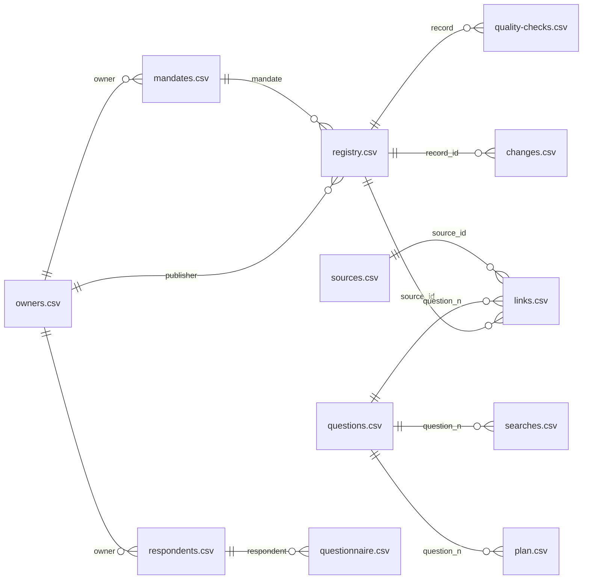

# Шаблоны

Шаблоны — это листы рабочей таблицы инвентаризации и документы для людей, которых вы опрашиваете. Проще всего начать с рабочей таблицы [workbook.xlsx](pathname:///templates/workbook.xlsx): в ней все листы, подсказки к колонкам и выпадающие списки кодов. CSV-файлы нужны программам — для проверки реестра и выгрузок. Анкету, письма и памятки удобнее править в Word. Всё сразу — архивом [data-inventory-templates.zip](pathname:///templates/data-inventory-templates.zip).

## Коротко

Шаг — номер шага из главы [«Семь шагов»](../03-process/01-steps.md): 1 — цели, 2 — подход, 3 — найти и описать данные, 4–6 — пробелы и план, 7 — собрать и опубликовать результат. Строки-примеры есть в самих шаблонах, а разобранные образцы — в главах.

| Файл | Для чего | Шаг | Глава с образцом |
|------|----------|-----|------------------|
| [goal-and-scope.docx](pathname:///templates/goal-and-scope.docx), [questions.csv](pathname:///templates/questions.csv) | Карточка «цель и границы», вопросы к данным с порогом «годится» | 1 | [«Цели и вопросы»](../03-process/02-goals-and-questions.md#пример) |
| [workbook.xlsx](pathname:///templates/workbook.xlsx) | Все листы в одной таблице: подсказки, списки кодов, примеры | 2–7 | [Рабочая таблица](#рабочая-таблица) ниже |
| [registry.csv](pathname:///templates/registry.csv), [registry.schema.json](pathname:///templates/registry.schema.json) | Реестр данных и схема для проверки программой | 2–3 | [«Реестр данных»](../03-process/05-registry.md#карточка-записи-faa): запись FAA |
| [owners.csv](pathname:///templates/owners.csv), [mandates.csv](pathname:///templates/mandates.csv) | Владельцы и полномочия с цитатой из акта | 3 | [«Владельцы и полномочия»](../03-process/03-owners-and-mandates.md#пример): полномочие FAA |
| [questionnaire.docx](pathname:///templates/questionnaire.docx), [cover-letter.docx](pathname:///templates/cover-letter.docx), [interview-guide.docx](pathname:///templates/interview-guide.docx) | Анкета для владельца, письмо к ней, памятка для интервью | 3 | [«Опросные листы и интервью»](../03-process/04-questionnaires.md#анкета-глазами-адресата) |
| [questionnaire.csv](pathname:///templates/questionnaire.csv), [respondents.csv](pathname:///templates/respondents.csv) | Ответы анкеты и адресаты — для составителя | 3 | [«Опросные листы и интервью»](../03-process/04-questionnaires.md#как-записать) |
| [access-request.docx](pathname:///templates/access-request.docx) | Запрос чужому владельцу по закону о доступе к информации | 3 | [«Доступ и ограничения»](../03-process/06-access.md#запрос-владельцу) |
| [vendor-questions.docx](pathname:///templates/vendor-questions.docx) | Вопросы поставщику коммерческих данных | 3 | [«Коммерческие данные»](../04-sources/04-commercial.md#что-спросить-у-поставщика) |
| [searches.csv](pathname:///templates/searches.csv) | Журнал поиска | 3 | [«Поиск наборов данных»](../04-sources/05-dataset-search.md#как-записать) |
| [quality-checks.csv](pathname:///templates/quality-checks.csv) | Проверки качества, по строке на проверку | 3, 5 | [«Качество данных»](../03-process/07-quality.md#пример-проверки): проверка FAA |
| [sources.csv](pathname:///templates/sources.csv), [links.csv](pathname:///templates/links.csv), [map.yaml](pathname:///templates/map.yaml) | Карта данных: источники, пары «вопрос — источник», заготовка карты | 3, 5 | [«Карты данных»](../02-approaches/04-data-maps.md#пример) |
| [plan.csv](pathname:///templates/plan.csv) | План: пробел, вид пробела, решение, кто, срок, статус | 6 | [«Пробелы и план»](../03-process/08-gaps-and-plan.md#шаг-6-план) |
| [dcat-mapping.csv](pathname:///templates/dcat-mapping.csv) | Сопоставление колонок реестра с DCAT-AP и DCAT-US | 7 | [«Стандарты описания»](../05-frameworks/02-metadata-standards.md) |
| [passport.yaml](pathname:///templates/passport.yaml), [changes.csv](pathname:///templates/changes.csv) | Паспорт результата и список изменений | 7 | [«Результат и поддержка»](../03-process/09-result-and-upkeep.md#условный-пример-доступность-медицинской-помощи) |
| [anti-patterns.sql](pathname:///templates/anti-patterns.sql) | Запросы, которые находят в реестре признаки антипаттернов | 7 | [«Практики и антипаттерны»](../08-practices/01-practices-and-anti-patterns.md) |

## Как открыть CSV

CSV-шаблоны сохранены в кодировке UTF-8 без метки BOM, разделитель — запятая: так их без настройки читает любая программа. Excel с русскими настройками ждёт точку с запятой и другую кодировку, поэтому по двойному щелчку покажет файл одной колонкой или с нечитаемыми буквами. Есть три пути:

- **Взять рабочую таблицу** [workbook.xlsx](pathname:///templates/workbook.xlsx) — в ней те же листы.
- **Импортировать в Excel:** «Данные» → «Из текстового/CSV-файла», кодировка «65001: Юникод (UTF-8)», разделитель — запятая. Сохранять обратно — в формате «CSV UTF-8».
- **Открыть в LibreOffice Calc или Google Таблицах.** Calc при открытии спрашивает кодировку и разделитель, Google Таблицы при импорте определяют их сами.

Колонки с кодами и датами при импорте делайте текстовыми, иначе таблица превратит `2026-10` в дату. Что ещё портит электронная таблица — в разделе [«Как таблица портит данные»](../06-tools/01-from-spreadsheet-to-catalog.md#как-таблица-портит-данные).

## Рабочая таблица

[workbook.xlsx](pathname:///templates/workbook.xlsx) — все листы инвентаризации в одном файле. Открывается в Excel, LibreOffice Calc и Google Таблицах.

- **Листы.** «Как заполнять», двенадцать листов по CSV-шаблонам — от «Реестра» до «Изменений», «Колонки» со всеми подсказками и «Справочники» с кодами и их значениями.
- **Шапка.** В первой строке — название колонки по-русски, во второй — её код, как в CSV. Обязательные колонки отмечены звёздочкой и оранжевой шапкой. Подсказка появляется в примечании к названию и при выборе ячейки.
- **Списки.** Коды выбирают из выпадающих списков: режим доступа, периодичность, тип записи, отметки анкеты, итоги проверок. В колонках-ссылках список берёт идентификаторы с другого листа: владельца — с листа «Владельцы», адресата — с листа «Адресаты».
- **Удобство.** Шапка и первые колонки закреплены. Цвет режима доступа и итога проверки ставится сам по коду: цвет без кода при выгрузке в CSV пропал бы.
- **Примеры.** Строки с третьей — примеры из книги: реестр воздушных судов FAA и условный пример о доступности медицинской помощи. Перед работой их удаляют.

Чтобы отдать лист программе, удалите строку с русскими названиями и сохраните лист как CSV UTF-8: колонки совпадут с CSV-шаблоном.

## Как связаны файлы

Листы ссылаются друг на друга идентификаторами. Подпись у линии — колонка, в которой записан идентификатор строки другого файла: в `mandates.csv` колонка `owner` хранит `id` владельца из `owners.csv`.



Ещё несколько ссылок на схеме не показаны, чтобы она читалась:

- **внутри файла:** у записи реестра `related` — другая запись (агрегат, копия, преемник), у владельца `successor` — преемник, у источника `copy_of` — первоисточник;
- **в реестре** `domain` — подразделение из `owners.csv`, если реестр ведут домены;
- **строка анкеты**, вписанная заранее, получает `id` записи реестра;
- **проверка качества** может ссылаться на вопрос (`question`), а запрос журнала поиска — на найденные записи (`found`).

Зачем хранить реестр несколькими связанными таблицами и как программа проверяет ссылки — в главе [«Реестр как данные»](../06-tools/03-registry-as-data.md#что-хранить).

## Цель и границы

[goal-and-scope.docx](pathname:///templates/goal-and-scope.docx) — карточка на одну страницу: цель, владелец задачи, как проверить результат, вид результата, подход, границы и что исключено, кто согласовал. Под карточкой — лист вопросов с порогом «годится», который записывают до проверки. Образец заполнен условным примером книги — так же, как в главе [«Цели и вопросы»](../03-process/02-goals-and-questions.md#пример). Сами вопросы ведут листом [questions.csv](pathname:///templates/questions.csv) — он описан ниже, в разделе [«Карта данных»](#карта-данных).

## Реестр данных

[registry.csv](pathname:///templates/registry.csv) — реестр: 14 обязательных атрибутов из главы [«Реестр данных»](../03-process/05-registry.md#минимальный-состав), дата проверки и «откуда известно», которые тоже обязательны у каждой записи, и расширенные колонки. Номер в первой колонке таблицы — номер атрибута в главе. Первая строка-пример — реестр воздушных судов FAA, его [карточка с пояснениями](../03-process/05-registry.md#карточка-записи-faa) — в главе; две другие — условный регистр медицинских работников и его агрегат.

| № | Колонка | Что писать | Обязательно |
|--:|---------|------------|-------------|
| 1 | `id` | Идентификатор: латиница, цифры, дефис; не меняется | да |
| 2 | `title` | Наименование | да |
| 3 | `description` | Описание: что такое строка набора, период, территория, чего нет | да |
| 4 | `owner_person` | Ответственный — сотрудник, который знает данные | да |
| 5 | `owner_contacts` | Контакты ответственного | да |
| 6 | `update_frequency` | Периодичность: `continuous`, `daily`, `weekly`, `monthly`, `quarterly`, `annual`, `irregular`, `never`, `unknown` | да |
| 7 | `access_level` | Режим доступа: `open`, `unstructured`, `restricted`, `closed`, `unknown` ([шкала](../03-process/06-access.md#шкала)) | да |
| — | `access_basis` | Чем подтверждён режим доступа: ссылка, акт с пунктом, ответ владельца с датой | — |
| — | `access_restriction` | Причина ограничения: `personal_data`, `state_secret`, `official`, `confidential`, `third_party`, `owner_decision`, `none`, `unknown`; несколько — через «;» | — |
| — | `access_conditions` | Условия доступа: кто, как, за сколько и за какой срок | — |
| — | `access_checked` | Дата проверки режима доступа | — |
| 8 | `download_url` | Ссылка для выгрузки — прямой адрес файла или интерфейса | да |
| 9 | `format` | Формат распространения | да |
| 10 | `issued` | Дата публикации | да |
| 11 | `modified` | Дата последнего изменения данных | да |
| 12 | `quality_check` | Отметка о контроле качества | да |
| 13 | `license` | Условия использования | да |
| 14 | `publisher` | Организация-владелец — `id` из `owners.csv`. Название колонки взято из DCAT, но [издатель](./01-glossary.md#издатель) на портале — не всегда владелец: сюда пишут владельца по документу | да |
| — | `domain` | Домен — подразделение из `owners.csv`, если реестр ведут домены ([«Data Mesh»](../05-frameworks/03-data-mesh.md#как-записать)) | — |
| — | `aliases` | Синонимы: другие названия и прежние адреса, через «;» | — |
| — | `type` | Тип записи: `dataset`, `resource`, `system`, `site`, `group` | — |
| — | `schema` | Схема данных или ссылка на описание полей | — |
| — | `data_contract` | Контракт данных или «нет» ([«Контракт данных»](../05-frameworks/03-data-mesh.md#контракт-данных)) | — |
| — | `information_system` | Информационная система | — |
| — | `operator` | Оператор системы | — |
| — | `mandate` | Полномочие — `id` из `mandates.csv` или формулировка | — |
| — | `legal_act` | Нормативный акт | — |
| — | `personal_data` | Персональные данные: `yes`, `no`, `unknown` | — |
| — | `related` | Связанные записи: `aggregate_of:`, `copy_of:` или `successor_of:` и `id` | — |
| — | `status` | Статус записи: `active`, `retired`, `url_broken` ([«Как отметить в реестре»](../04-sources/06-legacy.md#как-отметить-в-реестре)) | — |
| — | `archive_url` | Копия в веб-архиве с датой | — |
| — | `known_from` | Откуда известно: метод и документ. Подтверждение владельца — сюда же: «подтверждено владельцем: кто, чем, дата». У записи, которую составила языковая модель, — какая, когда, подтверждена ли | да, всегда |
| — | `checked` | Дата проверки записи | да, всегда |

В обязательных колонках пустых ячеек нет. Пишут значение, «нет», если сведения не существует, или «не установлено» и где искать дальше; в колонках с кодами — `unknown` ([«Если сведение не найдено»](../03-process/05-registry.md#если-сведение-не-найдено)). Семь колонок названы как свойства DCAT-US v1.1; сопоставление всех колонок с DCAT-AP и DCAT-US — в файле [dcat-mapping.csv](pathname:///templates/dcat-mapping.csv) и главе [«Стандарты описания»](../05-frameworks/02-metadata-standards.md).

[registry.schema.json](pathname:///templates/registry.schema.json) — схема реестра в формате Table Schema: обязательные колонки, коды из справочников, вид идентификатора, дат и связей ([«Схема»](../06-tools/03-registry-as-data.md#схема)). Добавили свою колонку или код — допишите их и в схему. Ссылки между листами и правила между колонками, например «дата изменения не раньше даты публикации», схема не проверяет: это делает скрипт ([«Проверки»](../06-tools/03-registry-as-data.md#проверки)).

<details>
<summary>Проверить самому</summary>

Проверка реестра по схеме программой [Frictionless](https://framework.frictionlessdata.io/):

```bash
frictionless validate registry.csv --schema registry.schema.json
```

</details>

## Владельцы и полномочия

Два листа из главы [«Владельцы и полномочия»](../03-process/03-owners-and-mandates.md#как-записать):

- [owners.csv](pathname:///templates/owners.csv) — владельцы: полное и короткое название, уровень, слой данных (`government`, `public`, `commercial`), вышестоящая организация, подразделение, контакты, документ о полномочиях, статус (`active`, `abolished`) и преемник, дата проверки;
- [mandates.csv](pathname:///templates/mandates.csv) — полномочия: владелец, полномочие и дословная цитата, акт и пункт, ожидаемые данные, итог (`found`, `partial`, `not_found`, `transferred`), найденные записи, откуда известно, дата проверки. Строка-пример — регистрация воздушных судов FAA.

## Опросный лист для владельцев

Для людей — три документа Word из главы [«Опросные листы и интервью»](../03-process/04-questionnaires.md):

- [questionnaire.docx](pathname:///templates/questionnaire.docx) — анкета: короткая инструкция, отметки «подтверждаю», «исправляю», «не наше», «не ведём», карточка-образец, карточка для следующего набора, таблица новых наборов и три вопроса о том, чего в анкете нет. Если ответа нет, адресат пишет «не знаю» и, если может, кто знает;
- [cover-letter.docx](pathname:///templates/cover-letter.docx) — сопроводительное письмо на 8–10 строк от имени владельца задачи: зачем опрос, кто поручил, срок, время интервью, кто увидит ответы и что попадёт в общедоступную часть реестра;
- [interview-guide.docx](pathname:///templates/interview-guide.docx) — памятка для интервью на 15–30 минут: подготовка, план по минутам, что спросить и что сделать после разговора.

Для составителя — два листа:

- [questionnaire.csv](pathname:///templates/questionnaire.csv) — анкета, по строке на набор: адресат, отметка (`confirmed`, `corrected`, `new`, `not_ours`, `not_kept`, `needed`), откуда строка, ответы на девять вопросов анкеты, комментарий, дата ответа;
- [respondents.csv](pathname:///templates/respondents.csv) — адресаты: владелец, подразделение, роль, адресат и его контакты, даты отправки, напоминания, ответа и интервью, итог (`answered`, `no_data`, `refused`, `no_answer`, `redirected`), кому переадресовано и дата проверки.

## Запросы владельцам и поставщикам

- [access-request.docx](pathname:///templates/access-request.docx) — запрос чужому владельцу по закону о доступе к информации ([«Запрос владельцу»](../03-process/06-access.md#запрос-владельцу)): пять вопросов о конкретном наборе — ведут ли, опубликован ли, на каких условиях его получить, на какой норме основано ограничение, кто отвечает. Закон и сроки ответа в своей стране — в приложении [«Нормативная база»](./02-legal-framework.md).
- [vendor-questions.docx](pathname:///templates/vendor-questions.docx) — десять вопросов поставщику коммерческих данных: кого покрывают данные, какая методика, на каких условиях, можно ли получить образец. У каждого вопроса — поле реестра, куда ложится ответ.

## Проверки качества

[quality-checks.csv](pathname:///templates/quality-checks.csv) — лист из главы [«Качество данных»](../03-process/07-quality.md#как-записать-в-реестр), по строке на проверку: запись реестра, вопрос, если проверка нужна только ему, признак (`completeness`, `uniqueness`, `timeliness`, `validity`, `consistency`, `accuracy`, `format`, `fitness`), что проверяли, порог, результат, влияние (`none`, `caveat`, `blocking`), дата данных, кто и когда проверял. Строки-примеры — проверки реестра воздушных судов FAA и листа ожидания из условного примера. Сводку записывают в колонку `quality_check` реестра, итог для пары «вопрос — набор» — в колонку `quality` листа «Связи».

## Карта данных

Для подхода «где найти нужное» — три листа ([«Реестр как данные»](../06-tools/03-registry-as-data.md#что-хранить)):

- [sources.csv](pathname:///templates/sources.csv) — источники: тип, владелец, основание, уровень, слой данных, адрес, синонимы, первоисточник у копии и откуда известно ([«Как записать»](../04-sources/01-three-layers.md#как-записать));
- [questions.csv](pathname:///templates/questions.csv) — вопросы: постоянный номер, текст, типовая тема, задача, приоритет и порог «годится» ([«Порог „годится“»](../03-process/02-goals-and-questions.md#порог-годится)). Строки-примеры — пять вопросов условного примера книги;
- [links.csv](pathname:///templates/links.csv) — пары «вопрос — источник»: доступ с основанием, итог проверки качества (`fit`, `fit_with_caveats`, `unfit`, `not_checked`) с оговоркой и дата ([«Годится ли для задачи»](../03-process/07-quality.md#годится-ли-для-задачи)).

[map.yaml](pathname:///templates/map.yaml) — заготовка карты данных одним файлом YAML: паспорт карты и вопросы со ссылками на источники из `sources.csv`. Поля описаны в комментариях самого файла.

## План закрытия пробелов

[plan.csv](pathname:///templates/plan.csv) — план шестого шага ([«Пробелы и план»](../03-process/08-gaps-and-plan.md#шаг-6-план)), по строке на пробел: вопрос, которому он мешает, пробел, его вид и решение, что именно сделать, кто, срок, статус и дата проверки. Коды:

- **вид пробела** — `no_data` — данных нет ни у кого, `closed` — есть, но закрыты, `unfit` — есть, но не годятся, `no_owner` — владелец не установлен, `unknown` — не установлено;
- **решение** — `request` — запрос владельцу, `agreement` — договор о доступе, `own_collection` — собственный сбор, `system_change` — доработка системы, `accept` — принять;
- **статус** — `planned`, `in_progress`, `done`, `cancelled`.

Строки-примеры — из плана условного примера в главе.

## Журнал поиска

[searches.csv](pathname:///templates/searches.csv) — лист из главы [«Поиск наборов данных»](../04-sources/05-dataset-search.md#как-записать), по строке на запрос: вопрос, поисковик или каталог, запрос дословно, язык, фильтры, дата, сколько результатов просмотрено, итог (`original`, `copy`, `lead`, `none`), что найдено и пометка. Пустые запросы не удаляют: они показывают, что набор искали и не нашли.

## Паспорт и список изменений

Два файла из главы [«Результат и поддержка»](../03-process/09-result-and-upkeep.md#как-записать) — их ведут рядом с реестром или картой:

- [passport.yaml](pathname:///templates/passport.yaml) — паспорт: цель и владелец задачи, подход и границы, методы и охват опроса, состав, покрытие вопросов, пробелы, правило общедоступной части, владелец процесса, план обновления, версия, даты, лицензия, стандарт и файлы;
- [changes.csv](pathname:///templates/changes.csv) — список изменений, по строке на изменение: версия, дата, запись, вид изменения (`new`, `changed`, `status`), поле, прежнее и новое значение, почему и кто внёс.

Значения в обоих файлах — условный пример книги: паспорт первой версии и изменения, найденные при обновлении через полгода. Версию удобно называть месяцем выпуска — `2026-10`.

## Скачать всё

[data-inventory-templates.zip](pathname:///templates/data-inventory-templates.zip) — все шаблоны этой страницы одним архивом, в папке `data-inventory-templates`:

- рабочая таблица `workbook.xlsx`;
- CSV: `registry.csv`, `owners.csv`, `mandates.csv`, `questionnaire.csv`, `respondents.csv`, `quality-checks.csv`, `questions.csv`, `sources.csv`, `links.csv`, `searches.csv`, `plan.csv`, `changes.csv`, `dcat-mapping.csv`;
- схема и YAML: `registry.schema.json`, `passport.yaml`, `map.yaml`;
- документы Word: `goal-and-scope.docx`, `questionnaire.docx`, `cover-letter.docx`, `interview-guide.docx`, `access-request.docx`, `vendor-questions.docx`;
- запросы `anti-patterns.sql`.

Шаблоны распространяются по той же лицензии, что и книга, — CC BY 4.0.
