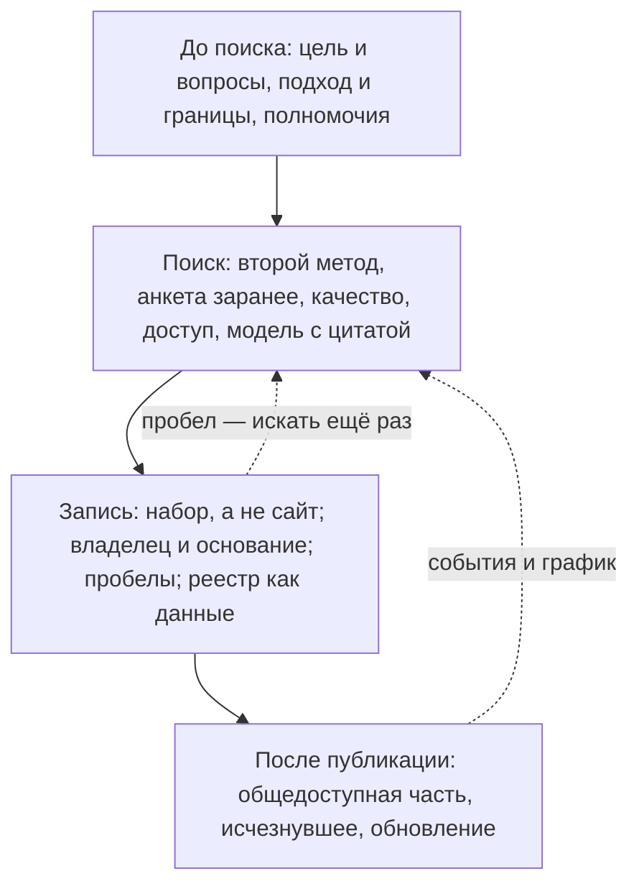

# Хорошие практики

Хорошая инвентаризация отвечает на задачу, ради которой её начали, и через год всё ещё понятна. По каждой записи видно, кто владелец, на каком основании ведутся данные, можно ли их получить, годятся ли они и откуда это известно, — даже если часть адресов умерла. [Принципы](../01-basics/03-principles.md) говорят, что для этого важно; здесь — пятнадцать приёмов, которыми этого добиваются. Они разложены по этапам: до поиска, во время поиска, при записи и после публикации. Почти каждый приём дёшев в начале и дорог задним числом: владельцев карт атласа 2018–2019 годов в 2026 году пришлось восстанавливать по доменам, а карту «Авиация» не удалось перенести в данные. Те же приёмы встречаются в работающих описях разных стран: в полных инвентарях ведомств США, реестрах активов Великобритании, перечнях данных Франции, Польши, Южной Кореи и в каталоге цифровых данных Казахстана. Если времени мало, пять из них нельзя пропускать ([ниже](#если-времени-мало)). Что бывает, когда приёмы не соблюдают, — в главе [«Антипаттерны»](./02-anti-patterns.md).

## Коротко

| Практика | Что сделать | Готово, когда | Защищает от |
|----------|-------------|---------------|-------------|
| **До поиска** | | | |
| **[1. Начинать с цели и вопросов](#1-начинать-с-цели-и-вопросов)** | Записать цель, 10–20 вопросов и порог «годится» у главных | Владелец задачи согласовал цель и вопросы; порог записан до проверки | [Описи ради описи](./02-anti-patterns.md#опись-ради-описи) |
| **[2. Выбрать главный подход и границы](#2-выбрать-главный-подход-и-границы)** | Назвать главный подход, методы и границы, в том числе что исключено | Понятно, где искать, кого спрашивать и чего не описывать | Методов, которые не видят нужных данных |
| **[3. Начинать поиск с полномочий](#3-начинать-поиск-с-полномочий)** | Выписать, какие данные должны быть у владельцев в границах | У каждого полномочия — цитата и итог: найдено, частично, не найдено, передано | [Только опросов владельцев](./02-anti-patterns.md#только-опросы-владельцев) |
| **Во время поиска** | | | |
| **[4. Подтверждать вторым методом](#4-подтверждать-вторым-методом)** | Сочетать методы и записывать, откуда известно | У каждой записи — метод и документ; ключевые подтверждены двумя методами | [Только опросов владельцев](./02-anti-patterns.md#только-опросы-владельцев) |
| **[5. Заполнять анкету заранее](#5-заполнять-анкету-заранее)** | Вписать найденное в анкету, владелец отмечает каждую строку | Строк без отметки владельца нет | Анкеты, которая подтверждает догадки составителя |
| **[6. Проверять качество при находке](#6-проверять-качество-при-находке)** | Быстрая проверка на самих данных, итог у пары «вопрос — набор» | Каждый нужный цели набор проверен или помечен «не проверено» с причиной | [Набора без проверки качества](./02-anti-patterns.md#без-проверки-качества) |
| **[7. Проверять доступ на деле](#7-проверять-доступ-на-деле)** | Статус по шкале, с причиной и датой, из сети своей страны | Статус отвечает критерию шкалы, у каждого «закрыто» есть причина или вопрос владельцу | [Статуса доступа без основания](./02-anti-patterns.md#статус-доступа-без-основания) |
| **[8. Давать модели текст и требовать цитату](#8-давать-модели-текст-и-требовать-цитату)** | Модели — документ, ответ — в полях реестра с цитатой | Цитаты проверены программой, записи — вторым методом и человеком | [Реестра со слов модели](./02-anti-patterns.md#реестр-со-слов-модели) |
| **При записи** | | | |
| **[9. Записывать набор, а не сайт](#9-записывать-набор-а-не-сайт)** | Запись — система или набор с идентификатором; домен — адрес, синонимы — колонкой | Нет записей-доменов и дублей под разными именами | [Сайта вместо системы](./02-anti-patterns.md#сайт-вместо-системы), [одного набора под разными именами](./02-anti-patterns.md#один-набор-под-разными-именами) |
| **[10. Записывать владельца и основание](#10-записывать-владельца-и-основание)** | Владелец из документа, ответственный по имени, основание с номером акта | По каждой записи понятно, кому писать и почему данные существуют | [Ответственного — пресс-службы](./02-anti-patterns.md#ответственный--пресс-служба) |
| **[11. Записывать пробелы](#11-записывать-пробелы)** | Список того, чего нет, что закрыто и что непригодно; «не установлено» вместо пустых ячеек | У каждого вопроса — источник или записанный пробел | Результата, который обещает, что данных хватит на всё |
| **[12. Вести реестр как данные](#12-вести-реестр-как-данные)** | Таблица или файлы, сопоставленные со стандартом; проверки — программой | Реестр выгружается в DCAT и проходит проверки без ошибок | [Реестра только в отчёте или картинке](./02-anti-patterns.md#реестр-только-в-отчёте-или-картинке) |
| **После публикации** | | | |
| **[13. Строить общедоступную часть из полного реестра](#13-строить-общедоступную-часть-из-полного-реестра)** | Выборка записей и полей программой; закрытое — с объяснением | Правило выборки записано в паспорт, части не расходятся | Двух копий, которые разошлись, и пропавших закрытых наборов |
| **[14. Не удалять исчезнувшее](#14-не-удалять-исчезнувшее)** | Статус, дата, копия в веб-архиве, связь с преемником | Ни одна запись не удалена из-за того, что адрес не открылся | [Удаления строки, когда источник исчез](./02-anti-patterns.md#строку-удаляют-когда-источник-исчез) |
| **[15. Встроить обновление в работу](#15-встроить-обновление-в-работу)** | Дата у реестра и записей, владелец процесса, график и события | Реестр меняется вместе с системами, контрактами и структурой организации | Реестра, у которого одна дата — дата сдачи отчёта |

## До поиска

### 1. Начинать с цели и вопросов

Цель записывают до поиска так, чтобы по ней можно было проверить результат: что сделают с данными, кто примет результат, где границы и к какому сроку всё должно быть готово. Из цели выводят 10–20 вопросов к данным. У главных вопросов заранее записывают порог «годится»: какой период, подробность и свежесть нужны. Порог, записанный после проверки, подгоняют под найденное.

- В цели есть действие, кроме «провести инвентаризацию»: открыть, передать партнёрам, запустить услугу, ответить на вопросы руководства ([«Как записать цель»](../01-basics/02-goals.md#как-записать-цель)).
- Вопросы собирают с владельцем задачи и согласуют до поиска ([«Цели и вопросы»](../03-process/02-goals-and-questions.md#как-проверить-список)).
- Порог пишут рядом с вопросом: «по регионам, за пять лет, не старше года» ([«Что проверять в первую очередь»](../03-process/07-quality.md#что-проверять-в-первую-очередь)).

Пример: «собрать все данные по здравоохранению» — опись ради описи. «Найти источники для ответа на 15 вопросов руководства о доступности медицинской помощи в регионах и показать, каких данных нет» — цель, по которой видно, когда работа закончена.

### 2. Выбрать главный подход и границы

«Чем владеем» и «где найти нужное» требуют разных методов: опросы владельцев не найдут чужих данных, поиск по сайтам — закрытых систем. Когда нужны и свои данные, и чужие, подходы сочетают, но один делают главным: он задаёт методы, состав реестра и глубину описания ([«Как выбрать подход»](../02-approaches/01-two-approaches.md#как-выбрать-подход)). Границы записывают так же явно, как цель: организации и уровни, территория, слои данных, период и что исключено.

- Что исключено, записывают, а не подразумевают: иначе при проверке не отличить пропуск от решения ([«Границы»](../03-process/02-goals-and-questions.md#границы)).
- Методы выбирают под подход и слой данных ([«Какой метод для какого подхода»](../02-approaches/02-methods.md#какой-метод-для-какого-подхода)).
- Широкую тему делят на очереди и начинают с той, что нужна главной цели ([«Если тема большая»](../03-process/01-steps.md#если-тема-большая)).

Пример: карты атласа составлены в подходе «где найти нужное» — данные чужие. Поэтому в источниках сведений карт — система координации информатизации, сайты органов власти и компаний и экспертный анализ, а опросов владельцев нет ([«Как записать, откуда известно»](../02-approaches/02-methods.md#как-записать-откуда-известно)).

### 3. Начинать поиск с полномочий

До поиска систем выясняют, кто в границах отвечает за тему, и выписывают из положений и отраслевых законов, какие данные у каждого должны быть. Получается список ожидаемого — ещё до первой найденной системы. Его проверяют реестрами систем, госзакупками, сайтами и опросами, и у каждой строки появляется итог: найдено, найдено частично, не найдено, передано.

- У полномочия — дословная цитата, акт, пункт и редакция: пересказ через год не проверить ([«Как читать полномочия»](../03-process/03-owners-and-mandates.md#как-читать-полномочия)).
- Строку «не найдено» не удаляют: она ведёт в анкету владельцу и подсказывает, где искать при обновлении ([«От полномочия к набору»](../03-process/03-owners-and-mandates.md#от-полномочия-к-набору)).
- Итог «найдено» ставят только после подтверждения вторым методом или владельцем: набор, который «должен быть», ещё никто не видел.

Пример: опись реестров польского государства — «более 1000» публичных реестров и других информационных ресурсов — начинали с обзора законов, которые создают реестры, учёты и перечни. Потом её сверяли с учётом систем SIST, анкетой о главных системах государства и карточками ИТ-проектов ([«Открытие данных в Польше»](../05-frameworks/04-international-practice.md#открытие-данных-в-польше)).

## Во время поиска

### 4. Подтверждать вторым методом

Запись, которую подтвердили два независимых метода, надёжна. Запись, которую один метод нашёл, а другой нет, — вопрос, и ответ на него часто важнее самой записи. Поэтому методов всегда больше одного, а у каждой записи отмечают, каким методом она найдена и чем это подтверждается: статьёй акта, номером контракта, адресом страницы, датой интервью.

- Минимальный набор — три метода, которые закрывают слепые пятна друг друга ([«Если времени мало»](../02-approaches/02-methods.md#если-времени-мало)).
- Расхождение между методами не стирают, а разбирают: оно становится вопросом владельцу или пробелом ([«Как методы проверяют друг друга»](../02-approaches/02-methods.md#как-методы-проверяют-друг-друга)).
- Поле «откуда известно» заполняют у каждой записи, а не у реестра целиком ([«Как записать, откуда известно»](../02-approaches/02-methods.md#как-записать-откуда-известно)).

Пример: отраслевые описи баз данных, которые служба Etalab опубликовала во Франции в 2021 году, составлены кабинетным исследованием, а с частью держателей — ещё и интервью. В ограничениях описи прямо сказано: где интервью не было, выше вероятность ошибки в происхождении данных и владельце ([«Политика данных Франции»](../05-frameworks/04-international-practice.md#политика-данных-франции)). У карт атласа источник сведений записан у карты, а не у источника, и какой источник найден каким методом, теперь не восстановить.

### 5. Заполнять анкету заранее

Владельцу отправляют не пустую анкету, а заполненную тем, что уже нашли: полномочиями с итогом «не найдено», системами из реестра и контрактов, опубликованными наборами, журналами из номенклатуры дел, записями прошлой инвентаризации. Владелец не вспоминает, а подтверждает, исправляет и дополняет. Это быстрее для него и надёжнее для реестра: пустая анкета возвращается с тем, что владелец вспомнил и считает данными.

- У каждой строки — отметка владельца: подтверждаю, исправляю, новое, не наше, не ведём, не хватает. Строка без отметки — не ответ, иначе вписанное заранее принимают молча ([«Заполнить заранее»](../03-process/04-questionnaires.md#заполнить-заранее)).
- У каждой вписанной строки — откуда она: владелец спорит с документом, а не с составителем.
- Новые строки владельца подтверждают выборкой, документом или на экране, а «всё открыто» без ссылки и «закрыто» без основания проверяют отдельно ([«Как проверять ответы»](../03-process/04-questionnaires.md#как-проверять-ответы)).

Пример: на интервью для описей Etalab держатели подтверждали каждую базу, найденную кабинетным исследованием, и давали недостающие сведения. В трёх описях — 161, 172 и 135 баз, у каждой по 28 полей ([«Политика данных Франции»](../05-frameworks/04-international-practice.md#политика-данных-франции)). В подходе «где найти нужное» анкеты почти не работают — данные чужие, и владельцу пишут запрос о конкретном наборе ([«Вопрос чужому владельцу»](../03-process/04-questionnaires.md#вопрос-чужому-владельцу)).

### 6. Проверять качество при находке

Найденный набор проверяют сразу и на самих данных, а не по описанию: число записей, пустые поля, повторы, коды, даты, суммы, свежесть. Быстрая проверка занимает от нескольких минут до часа, и её проходит каждый набор, нужный для цели ([«Быстрая проверка»](../03-process/07-quality.md#быстрая-проверка)). Итог ставят не набору вообще, а паре «вопрос — набор»: годится, годится с оговорками, не годится, не проверено.

- Признаки выбирают под цель и сравнивают с порогом, записанным до проверки ([«Годится ли для задачи»](../03-process/07-quality.md#годится-ли-для-задачи)).
- В отметку записывают признаки, числа, дату данных и дату проверки — так, чтобы проверку можно было повторить ([«Как записать в реестр»](../03-process/07-quality.md#как-записать-в-реестр)).
- Подробную оценку со сверкой выборки по независимому источнику делают только для наборов, на которых строится решение.
- Доступ и качество записывают отдельно: открытый набор бывает заброшенным ([«Доступ — не качество»](../03-process/06-access.md#доступ--не-качество)).

Пример: в реестре воздушных судов США по выгрузке от 23 октября 2026 года — 317 999 записей, год выпуска пуст у 22,4% из них, ещё у 150 стоит «0000». Реестр годится, чтобы посчитать суда по штатам, и лишь с оговорками — чтобы оценить возраст парка ([«Пример проверки»](../03-process/07-quality.md#пример-проверки)).

### 7. Проверять доступ на деле

Статус доступа ставят по тому, что получилось сделать, а не по заявлению на сайте или словам владельца: файл скачан и открыт, интерфейс ответил, условия прочитаны. Проверяют от самого открытого способа к самому закрытому и останавливаются на первом, который сработал ([«Порядок проверки»](../03-process/06-access.md#порядок-проверки)). У каждого «закрыто» и «с ограничениями» — причина: норма с номером и статьёй, условие договора или «нормы нет».

- Статус — код из шкалы с критериями, а не цвет ([«Шкала»](../03-process/06-access.md#шкала)).
- Государственные сайты проверяют из сети своей страны. Если такой возможности нет, итог — «не установлено» с пометкой о сети, а не «закрыто».
- У результата — дата: порталы закрываются и открываются снова, как data.gov.ru, который не работал с марта 2023 по июль 2025 года ([«Как записать»](../03-process/06-access.md#как-записать)).

Пример: из 201 пары атласа с отметкой «данные доступны» 104 ведут к сайтам, которые 23 октября 2026 года не открылись из сети проверки. А fbsege.ru — адрес федеральной базы свидетельств о результатах ЕГЭ — ответил, но на домене теперь сторонний сайт онлайн-казино. Ни «не открылся», ни «ответил» ещё не говорят, доступны ли данные.

### 8. Давать модели текст и требовать цитату

Языковая модель ускоряет методы, где нужно много читать: акты, технические задания, контракты, сайты, каталоги. Но её вывод — гипотеза. Поэтому модели дают текст документа, а не вопрос «какие данные есть у министерства», и просят ответ в полях реестра с дословной цитатой. Цитаты проверяет программа, записи — второй метод и человек ([«Как делать»](../02-approaches/03-ai.md#как-делать)).

- Начинают с проверочной выборки: одно-два положения размечают вручную и сравнивают с ответом модели — сколько она пропустила и сколько добавила лишнего.
- В поле «откуда известно» записывают документ и цитату, модель, её версию, дату и инструкцию, а также подтверждена ли запись.
- Существует ли набор, кто за него отвечает, какой у него режим доступа и есть ли в нём персональные данные, подтверждает человек: по этим записям открывают данные и отказывают в доступе.
- Содержимое закрытых систем не отправляют во внешний сервис без решения владельца ([«Закрытые данные и внешние модели»](../02-approaches/03-ai.md#закрытые-данные-и-внешние-модели)).

Пример: если ИИ-агент не открыл сайт, это не доказывает, что данных нет, — так же, как скрипт проверки адресов из-за рубежа ([«Ошибки модели и как их ловить»](../02-approaches/03-ai.md#ошибки-модели-и-как-их-ловить)).

## При записи

### 9. Записывать набор, а не сайт

Запись реестра — система, ресурс или набор, а домен — только его адрес ([«Система, ресурс, набор и сайт»](../01-basics/04-what-is-inventoried.md#система-ресурс-набор-и-сайт)). Сайты переезжают, а данные остаются. У каждой записи — постоянный идентификатор, через который на неё ссылаются задачи, вопросы и полномочия. Сокращения, прежние названия и адреса хранят в колонке синонимов.

- Перед добавлением записи ищут по синонимам, адресу выгрузки и паре «владелец — предмет»: дубли появляются, когда разные методы находят одно и то же ([«Один набор под разными именами»](../03-process/05-registry.md#один-набор-под-разными-именами)).
- Одна строка — одна запись: не пишут несколько наборов в одну ячейку и одну запись в несколько строк.
- Агрегат и полный набор, копия и первоисточник — разные записи, связанные между собой ([«Что считать записью»](../03-process/05-registry.md#что-считать-записью)).

Пример: rosminzdrav.ru теперь перенаправляет на minzdrav.gov.ru, а восемь его поддоменов с карты 2018 года исчезли. Биржа на карте «Нефть и газ» записана старым доменом micex.ru; в данных атласа это один источник с адресом moex.com и синонимом micex.ru.

### 10. Записывать владельца и основание

У каждой записи — организация-владелец, ответственный сотрудник и основание: закон, полномочие или договор, ради которого данные собирают. Владелец отвечает на вопрос «кому писать», основание — на вопросы «почему данные существуют» и «на каких условиях их получить». Владельца берут из документа, а не по домену: оператор системы, подрядчик и проект, который перепубликует данные, владельцами не становятся ([«Владелец, оператор, ответственный»](../03-process/03-owners-and-mandates.md#владелец-оператор-ответственный)).

- Ответственный — конкретный сотрудник, который знает данные: из профильного подразделения или ИТ, а не приёмная и не пресс-служба. В общедоступной части вместо его имени — адрес для вопросов о данных, который не меняется при смене сотрудника.
- Владельца, которого не удалось установить по документам, так и помечают — «не сверено» — и вносят в план сверки.
- Когда сотрудник уходит, его записи передают вместе с делами.

Пример: в Великобритании у каждого информационного актива министерства есть владелец-руководитель (Information Asset Owner), и министерства публикуют списки таких владельцев. По политике Государственной цифровой службы (GDS) от 27 мая 2026 года у каждого критически важного актива данных — названный владелец и план действий по качеству ([«Реестры информационных активов Великобритании»](../05-frameworks/04-international-practice.md#реестры-информационных-активов-великобритании)). На картах атласа 2018–2019 годов владельцев не было: в данных их заполнили по доменам и пометили как не сверенные.

### 11. Записывать пробелы

Чего нет, что закрыто и что непригодно — тоже результат, и часто главный. Пробелы собирают в отдельный список с видом каждого и задачей, которой он мешает ([«Сопоставить цели с данными»](../03-process/01-steps.md#5-сопоставить-цели-с-данными)). Ненайденное сведение записывают как «не установлено» с тем, где искали, а не оставляют пустую ячейку: по ней не отличить «не нашли» от «не искали» и «не бывает» ([«Если сведение не найдено»](../03-process/05-registry.md#если-сведение-не-найдено)).

- Виды пробелов различают: данных нет ни у кого; данные есть, но закрыты; доступны, но непригодны; статус не установлен.
- Прежде чем записать пробел, ищут ещё раз другим методом — по аналогии, у другого ведомства, в веб-архиве.
- Пробелы показывают заказчику отдельным разделом результата, у каждого — как его закрыть или пометка, что его принимают ([«Спроектировать обновление от задач»](../03-process/01-steps.md#6-спроектировать-обновление-от-задач)).

Пример: на карте «Здравоохранение» 2018 года на 5 вопросов из 20 не нашлось ни одного доступного источника — о заболеваемости, показателях деятельности медицинских учреждений, регистрах больных и инвалидов, заболевших и медицинских работниках. Для аналитика этот список — главный вывод карты ([«Здравоохранение»](../08-atlas/04-health.md)).

### 12. Вести реестр как данные

Первоисточник — таблица или файлы данных с датами у реестра и у каждой записи, а отчёты, карты и страницы строят из них ([«Реестр как данные»](../06-tools/03-registry-as-data.md)). В первый же день колонки реестра и справочники значений сопоставляют со стандартом описания — DCAT, DCAT-AP или DCAT-US. Тогда общедоступную часть выгружает программа, а не переписывают руками ([«Сопоставление с реестром»](../05-frameworks/02-metadata-standards.md#сопоставление-с-реестром)).

- Начинают с шаблона [registry.csv](pathname:///templates/registry.csv) с 14 обязательными атрибутами ([«Шаблоны»](../10-appendices/03-templates.md#реестр-данных)).
- Как только записей больше нескольких десятков, проверки отдают программе: пустые обязательные поля, повторы, коды из справочников, ссылки между записями, живые ли адреса ([«Как вести реестр»](../03-process/05-registry.md#как-вести-реестр)).
- Если записей тысячи, а владельцев десятки, реестр ведут сами владельцы по общим правилам, а центр собирает описания и проверяет их программой. Так data.gov собирает инвентари федеральных организаций США ([«Федеративный инвентарь США»](../05-frameworks/03-data-mesh.md#федеративный-инвентарь-сша)).

Пример: карты атласа 2018–2019 годов существовали только как картинки. Четыре из них перенесли в данные вручную, а карту «Авиация» перенести не удалось: по небольшой картинке нельзя надёжно прочитать адреса источников. Теперь карты хранятся в файлах данных, скрипт проверяет их при каждой сборке книги и строит из них таблицы, CSV и раздел «Что изменилось» ([«Проверки»](../06-tools/03-registry-as-data.md#проверки)).

## После публикации

### 13. Строить общедоступную часть из полного реестра

В полном реестре бывают имена и телефоны сотрудников, описания закрытых систем, внутренние адреса. Поэтому у реестра две части: полная — для владельца и тех, кто работает с данными, и общедоступная — для всех. Общедоступную часть строит программа выборкой записей и полей из полного реестра при каждом обновлении; если вести её отдельной копией, через полгода две части разойдутся ([«Полный реестр и общедоступная часть»](../03-process/08-result-and-upkeep.md#полный-реестр-и-общедоступная-часть)).

- Закрытое не убирают, а объясняют: наименование, описание, владелец и режим доступа с основанием. Запись не показывают, только если тайна — сам факт существования набора.
- Правило выборки — какие записи и поля входят в общедоступную часть и кто это решил — записывают в паспорт результата ([«Паспорт»](../03-process/08-result-and-upkeep.md#паспорт)).
- Описание без данных обычно безопасно, но перечень систем с версиями программ и внутренними адресами помогает атакующему.

Пример: в общедоступной части инвентаря Администрации общих служб США (GSA) 25 октября 2026 года было 344 записи по схеме DCAT-US 3.0, из них 33 закрытые, и у 31 из 33 записано, почему набор закрыт. Портал data.go.kr в Южной Корее публикует перечень данных, которые учреждения ещё не открыли, с годом открытия — 9987 строк в версии от 10 февраля 2026 года. Пользователь видит не только то, что можно скачать, но и то, что существует и когда его ждать.

### 14. Не удалять исчезнувшее

Сайт перестал открываться — это сведение о данных, а не повод удалить строку. Выясняют, что случилось с адресом: переехал, заброшен, выведен из эксплуатации, домен потерян или установить не удалось. Записи меняют статус и добавляют дату и сеть проверки, ссылку на последнюю рабочую копию в веб-архиве и связь с преемником ([«Как отметить в реестре»](../04-sources/06-legacy.md#как-отметить-в-реестре)).

- Статусы — из справочника: `active` у переехавшего и заброшенного, `retired` у выведенного из эксплуатации, `url_broken` — когда что случилось, не установлено.
- Прежний адрес уходит в синонимы, у преемника — связь `successor_of:` с прежней записью.
- Перенаправление на главную страницу — не новый адрес: сам сервис надо искать заново.

Пример: шесть адресов Росздравнадзора в атласе — главный сайт и пять сервисов — ведут на главную страницу roszdravnadzor.gov.ru. А три вопроса атласа потеряли единственный источник: graduate.edu.ru о трудоустройстве выпускников, kurort.rosminzdrav.ru о курортах и санаториях и gmo.rosminzdrav.ru о ГМО. Последние копии всех трёх в Internet Archive — 2022 года ([«В атласе»](../04-sources/06-legacy.md#в-атласе)). Удали эти строки — и пропало бы знание, что такие данные были и где искать их следы.

### 15. Встроить обновление в работу

У реестра и каждой записи — дата проверки, у процесса — владелец и график. Но самое дешёвое обновление происходит само: запись появляется или меняется, когда проектируют систему, заключают контракт, выводят систему из эксплуатации, реорганизуют ведомство, публикуют набор или уходит сотрудник ([«Что встроить в процессы»](../03-process/08-result-and-upkeep.md#что-встроить-в-процессы)). Новые системы проектируют от данных: описание данных вносят в реестр до запуска, и система появляется уже инвентаризированной.

- Полная проверка — не реже раза в год, адреса и даты данных — раз в месяц или квартал программой, а ещё по событиям и перед каждым важным использованием ([«Когда проверять»](../03-process/08-result-and-upkeep.md#когда-проверять)).
- Версия — с датой, у каждой версии — список изменений ([«Версии и список изменений»](../03-process/08-result-and-upkeep.md#версии-и-список-изменений)).
- Разовый результат публикуют как снимок — с датой и пометкой, что он не обновляется ([«Снимок или живой реестр»](../03-process/08-result-and-upkeep.md#снимок-или-живой-реестр)).

Пример: в США набор, который ведомство создало или выявило, вносят в инвентарь не позднее чем через 90 дней (44 U.S.C. § 3511(a)(3)). В Казахстане паспорт данных нового или развиваемого цифрового объекта составляют до ввода в промышленную эксплуатацию ([«Каталог цифровых данных»](../07-countries/01-kazakhstan.md#каталог-цифровых-данных)). Без владельца процесса обещания не работают: реестр информационных активов Министерства транспорта Великобритании обещает ежегодное обновление, но последняя версия на 25 октября 2026 года — от 19 апреля 2022 года.

## Если времени мало

Под срочную задачу — подборку для хакатона, первую оценку отрасли — практики совмещают, но пять пропустить нельзя:

1. **Записанная цель с вопросами** ([практика 1](#1-начинать-с-цели-и-вопросов)) — без неё неясно, что искать.
2. **Откуда известно** у каждого источника ([практика 4](#4-подтверждать-вторым-методом)) — без него запись нельзя ни проверить, ни обновить.
3. **Владелец и режим доступа с основанием** ([практики 7](#7-проверять-доступ-на-деле) и [10](#10-записывать-владельца-и-основание)) — без них непонятно, кому писать и можно ли получить данные.
4. **Список пробелов** ([практика 11](#11-записывать-пробелы)) — без него неясно, хватает ли найденного.
5. **Дата** у результата и у записей ([практика 15](#15-встроить-обновление-в-работу)) — без неё через полгода не понять, чему ещё можно верить.

Остальные атрибуты заполняют только для ключевых источников, а результат публикуют таблицей с датой ([«Если времени мало»](../03-process/01-steps.md#если-времени-мало)).

## Где практики стали правилами

В нескольких странах часть практик закреплена законом или политикой. На эти нормы удобно ссылаться, когда практику нужно обосновать перед заказчиком.

| Страна | Что закреплено | Какие практики | Подробно |
|--------|----------------|----------------|----------|
| **США** | Полный инвентарь всех данных, которые ведомство создаёт, собирает, контролирует или хранит; схема DCAT-US 3.0 — переход до 30 сентября 2026 года по меморандуму OMB M-25-05; публикация всего, что нельзя скрыть по закону о свободе информации; 90 дней на внесение нового набора | 12, 13, 15 | [Инвентари данных федеральных ведомств США](../05-frameworks/04-international-practice.md#инвентари-данных-федеральных-ведомств-сша) |
| **Великобритания** | Владелец у каждого информационного актива и реестр в каждом министерстве; с 2026 года — критически важные активы с названным владельцем, метаданными и планом качества и ежегодный отчёт о них в GDS | 6, 10, 15 | [Реестры информационных активов Великобритании](../05-frameworks/04-international-practice.md#реестры-информационных-активов-великобритании) |
| **Франция** | Перечень основных документов с публичной информацией и ежегодная публикация его обновлённой версии (статья L322-6 CRPA); администратор данных в каждом министерстве (циркуляр № 6264/SG от 27 апреля 2021 года); отраслевые описи с подтверждением на интервью | 4, 5, 10, 15 | [Политика данных Франции](../05-frameworks/04-international-practice.md#политика-данных-франции) |
| **Польша** | Уполномоченный по открытости данных в министерствах (статья 37 закона об открытых данных 2021 года); полугодовые графики открытия с годовыми отчётами; опись реестров государства несколькими методами | 3, 4, 10, 15 | [Открытие данных в Польше](../05-frameworks/04-international-practice.md#открытие-данных-в-польше) |
| **Южная Корея** | Перечень публичных данных обязателен, министерство проверяет его на пропуски; 15 дней на регистрацию новых данных; перечень того, что ещё не открыто; ежегодная оценка с баллами | 4, 13, 15 | [Публичные данные Южной Кореи](../05-frameworks/04-international-practice.md#публичные-данные-южной-кореи) |
| **Казахстан** | Каталог цифровых данных и паспорта данных на архитектурном портале, менеджер по данным в организации, паспорт нового объекта — до ввода в эксплуатацию (постановление Правительства от 22.09.2026 № 830); сведения о цифровых объектах размещают и поддерживают сами владельцы (статья 71 Цифрового кодекса) | 10, 12, 15 | [Каталог цифровых данных](../07-countries/01-kazakhstan.md#каталог-цифровых-данных) |

Закон не заменяет владельца процесса: и обязательный реестр устаревает, если его некому обновлять. Реестр британского Министерства транспорта не обновлялся с апреля 2022 года. В общедоступной части инвентаря GSA 121 запись обещает ежеквартальное обновление, и у всех 121 дата изменения старше года ([«Что устаревает»](../03-process/08-result-and-upkeep.md#что-устаревает)). В польском списке ключевых реестров у некоторых внедрение до сих пор «планируется на 10.2021». А корейская оценка 2025 года показывает, что перечни и порядок наладить проще, чем открыть данные: средний балл за систему управления — 89,5 из 100, за открытие и использование — 59,2.

## Пример: атлас книги через семь лет

Карты атласа составлены в 2018–2019 годах и в 2026 году перенесены в данные. По ним видно, какие практики тогда соблюдались, какие нет и чего это стоило через семь лет.

| Практика | В картах 2018–2019 годов | Чего это стоило в 2026 году | Как сделано в данных атласа |
|----------|--------------------------|-----------------------------|-----------------------------|
| **[1. Цель и вопросы](#1-начинать-с-цели-и-вопросов)** | Каждая карта строилась от вопросов | Вопросы четырёх карт перенесены с полными формулировками | Вопросы пронумерованы, скрипт проверяет порядок |
| **[4. Второй метод](#4-подтверждать-вторым-методом)** | Источник сведений записан у карты | Какой источник найден каким методом, не восстановить | Поле `info_sources` — у карты, как на исходной |
| **[7. Доступ на деле](#7-проверять-доступ-на-деле)** | Доступность — цветом по легенде, без причины и даты | 104 из 201 пары «данные доступны» ведут к сайтам, которые не открылись из сети проверки; нужна проверка из российской сети | Результат проверки адреса — с датой и сетью; шкала из пяти статусов — при сверке карт |
| **[9. Набор, а не сайт](#9-записывать-набор-а-не-сайт)** | Источники названы доменами и сайтами, одна группа — по-разному на разных картах | Домены переехали или исчезли, а с ними связь с данными | Источник описан один раз, у него тип и синонимы |
| **[10. Владелец и основание](#10-записывать-владельца-и-основание)** | Владельцев нет | Владельцы восстановлены по доменам и не сверены | Поле `owner` с пометкой, что по документам не сверено |
| **[12. Реестр как данные](#12-вести-реестр-как-данные)** | Только картинки | Четыре карты перенесены вручную, «Авиация» — нет | Файлы в `data/`, проверка при каждой сборке, таблицы и CSV строятся из них |
| **[14–15. Исчезнувшее и обновление](#14-не-удалять-исчезнувшее)** | Дата проверки — у карты, обновления не было | Из 136 адресов у 28 исчезли домены, 13 перенаправляют на другие адреса | Исчезнувшие источники остаются с результатом проверки; раздел «Что изменилось» строится из файла карты |

Лучше всего семь лет пережила практика 1: вопросы карт понятны и сегодня. Дороже всего обошлись пропущенные практики 10 и 12: владельцев нельзя надёжно восстановить без документов, а карту — без исходного файла.

## Ограничения

- **Практики — не форма для отчёта.** Заполненные поля ещё не делают реестр полезным: проверять его надо по цели — отвечает ли он на вопросы, ради которых его начали.
- **Масштаб меняет приёмы.** Для нескольких десятков записей хватает таблицы и ручной проверки, для тысяч нужны программа и федеративный реестр ([«Data Mesh»](../05-frameworks/03-data-mesh.md#когда-подходит)).
- **Подход меняет приёмы.** В подходе «где найти нужное» анкеты владельцам почти не работают, а общедоступная часть и встраивание в процессы организации чаще всего не нужны: данные чужие.
- **Разовому результату хватает даты.** Подборку для хакатона не поддерживают: её публикуют снимком с датой и пометкой, что она не обновляется.
- **Примеры стран — не готовые рецепты.** Нормы США, Великобритании, Франции, Польши, Южной Кореи и Казахстана работают внутри своих законов и институтов; переносить стоит приём, а не норму.

Как проверить работу по шагам — в приложении [«Чек-листы»](../10-appendices/04-checklists.md).

## Источники

- Главы книги, из которых взяты приёмы и примеры: [«Принципы»](../01-basics/03-principles.md), [«Семь методов»](../02-approaches/02-methods.md), [«ИИ в инвентаризации»](../02-approaches/03-ai.md), [«Семь шагов»](../03-process/01-steps.md), [«Владельцы и полномочия»](../03-process/03-owners-and-mandates.md), [«Опросные листы и интервью»](../03-process/04-questionnaires.md), [«Реестр данных»](../03-process/05-registry.md), [«Доступ и ограничения»](../03-process/06-access.md), [«Качество данных»](../03-process/07-quality.md), [«Результат и поддержка»](../03-process/08-result-and-upkeep.md), [«Исчезнувшие системы и веб-архивы»](../04-sources/06-legacy.md), [«Зарубежные методики»](../05-frameworks/04-international-practice.md), [«Реестр как данные»](../06-tools/03-registry-as-data.md).
- Проверка адресов атласа 23 октября 2026 года — [«Как читать атлас»](../08-atlas/01-how-to-read.md#адреса-источников-в-октябре-2026-года); данные атласа — [data/](https://github.com/ivbeg/data-inventory/tree/main/data), результат проверки — [data/source-checks.yaml](https://github.com/ivbeg/data-inventory/blob/main/data/source-checks.yaml).
- [44 U.S. Code § 3511](https://www.law.cornell.edu/uscode/text/44/3511) — полный инвентарь данных ведомства, что из него публикуют, срок 90 дней для новых наборов.
- [open.gsa.gov/data.json](https://open.gsa.gov/data.json) — общедоступная часть инвентаря GSA по схеме DCAT-US 3.0; посчитано 25 октября 2026 года.
- [The role of information asset owners in government](https://www.gov.uk/government/publications/information-asset-owner-role-guidance) — Кабинет министров Великобритании, 2013, обновлено 1 октября 2025 года; [Data asset management policy in government](https://www.gov.uk/government/publications/data-asset-management-policy-in-government) — GDS, 27 мая 2026 года; [Department for Transport information asset register](https://www.gov.uk/government/publications/department-for-transport-information-asset-register) — последняя версия от 19 апреля 2022 года, проверено 25 октября 2026 года.
- Описи Etalab, статья L322-6 CRPA, программа открытия данных Польши и опись её реестров, перечень ещё не открытых данных и оценки Южной Кореи, требования по управлению цифровыми данными Казахстана — первоисточники с датами проверки в главах [«Зарубежные методики»](../05-frameworks/04-international-practice.md#источники) и [«Казахстан»](../07-countries/01-kazakhstan.md#источники).
