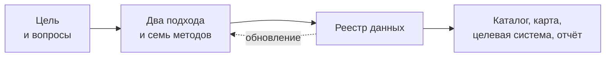

# Инвентаризация данных

*Как выяснить, какие данные у вас есть, и найти те, которых не хватает.*

**Инвентаризация данных** — выявление и описание данных: какие наборы есть, где они хранятся, кто ими владеет, на каком основании их собирают, доступны ли они и какого качества. Результат — реестр данных, из которого строят каталог, карту данных, новую систему или отчёт ([«Что такое инвентаризация данных»](./01-basics/01-what-is-data-inventory.md)).

Через книгу проходят два подхода. **«Понять, чем владеем»** — опись собственных данных организации. **«Понять, где найти нужное»** — поиск данных под задачу, в том числе у других.

*Опорная схема книги в миниатюре. Подробно — в разделе [«Коротко»](./01-basics/01-what-is-data-inventory.md#коротко) первой главы.*

**Для кого книга.** Для руководителей цифровой трансформации и директоров по данным в государстве и компаниях, аналитиков и команд продуктов на данных, координаторов открытых данных, исследователей и журналистов. Специальной подготовки не нужно: термины объяснены при первом упоминании и собраны в [глоссарии](./09-appendices/01-glossary.md). Примеры — из Казахстана, России, США, Европейского союза, Великобритании, Франции, Польши и Южной Кореи.

**Автор — Иван Бегтин**, основатель и директор АНО «Информационная культура», основатель и технический директор поисковика по наборам данных [Dateno](https://dateno.io/), автор книги [«Каталоги данных»](https://datacatalogs.begtin.tech/). Открытыми данными и данными государства занимается с 2009 года. Подробнее — в главе [«Об авторе»](./10-about-the-author.md).

Редакция октября 2026 года, черновик. Текст доступен по лицензии [CC BY 4.0](#об-издании).

**Скачать книгу в PDF:** [data-inventory-book.pdf](pathname:///data-inventory-book.pdf).

## С чего начать

Книгу не нужно читать подряд. Выберите свою задачу: под ней главы в порядке чтения и то, что будет у вас в конце.

<strong>Я новичок</strong> — понять, что это и зачем · 3 главы, около 10 мин

1. [Что такое инвентаризация данных](./01-basics/01-what-is-data-inventory.md) — опорная схема, одна запись реестра, путь от цели к результату.
2. [Два подхода](./02-approaches/01-two-approaches.md#коротко), раздел «Коротко» — чем опись своего отличается от поиска нужного.
3. [Что инвентаризируют](./01-basics/02-what-is-inventoried.md#пример), раздел «Пример» — одно полномочие министерства, разложенное по элементам реестра.

**В конце у вас:** понимание, что такое реестр данных и с какой стороны начинать.

<strong>Описать данные своего ведомства или компании</strong> — подход «чем владеем» · 8 глав, около 170 мин

1. [Семь шагов](./03-process/01-steps.md) — порядок работы от цели до опубликованного результата.
2. [Владельцы и полномочия](./03-process/03-owners-and-mandates.md) — какие данные следуют из полномочий и кто за них отвечает.
3. [Опросные листы и интервью](./03-process/04-questionnaires.md) — как опросить владельцев, заполнив анкету заранее найденным.
4. [Реестр данных](./03-process/05-registry.md) — что считать записью и как заполнить 14 атрибутов.
5. [Доступ и ограничения](./03-process/06-access.md) — режим доступа с основанием и что закрыть нельзя.
6. [Качество данных](./03-process/07-quality.md) — быстрая проверка и годится ли набор для задачи.
7. [Пробелы и план](./03-process/08-gaps-and-plan.md) — чего не хватает, кто и как это закроет.
8. [Результат и поддержка](./03-process/09-result-and-upkeep.md) — общедоступная часть, паспорт, кто и когда обновляет реестр.

**В конце у вас:** реестр данных с владельцами, режимами доступа, отметками о качестве и планом обновления.

<strong>Найти данные для аналитики, продукта или исследования</strong> — подход «где найти нужное» · 7 глав, около 120 мин

1. [Два подхода](./02-approaches/01-two-approaches.md) — как выбрать подход по четырём вопросам.
2. [Цели и вопросы](./03-process/02-goals-and-questions.md) — как превратить задачу в границы и вопросы к данным.
3. [Семь методов](./02-approaches/02-methods.md) — что видит каждый метод и как их сочетать.
4. [Три слоя данных](./04-sources/01-three-layers.md) — государственные, общественные и коммерческие источники, копии и первоисточники.
5. [Государственные данные](./04-sources/02-government.md) — порталы, статистика, реестры систем, закупки и акты.
6. [Поиск наборов данных](./04-sources/05-dataset-search.md) — поисковики по наборам и путь от карточки к владельцу.
7. [Карты данных](./02-approaches/04-data-maps.md) — как оформить результат и найти на карте пробелы.

Если вам нужна не методика, а сами данные, начните с поиска в [Dateno](https://dateno.io/) — поисковике по наборам данных из тысяч каталогов, проекте автора книги.

**В конце у вас:** список вопросов, источники ответов с доступностью и пробелы, которые нечем закрыть.

<strong>Готовите открытие данных или обмен данными</strong> · 5 глав, около 120 мин

1. [Зачем: цели](./01-basics/03-goals.md) — как цель меняет глубину, проверки и результат.
2. [Реестр данных](./03-process/05-registry.md) — что записать о каждом наборе для открытия и обмена.
3. [Доступ и ограничения](./03-process/06-access.md) — что можно открыть, что закрыто и на каком основании.
4. [Стандарты описания](./05-frameworks/02-metadata-standards.md) — DCAT, DCAT-AP, DCAT-US и наборы высокой ценности.
5. [Результат и поддержка](./03-process/09-result-and-upkeep.md) — внутренний каталог, публичный портал и описания закрытых наборов.

**В конце у вас:** перечень наборов-кандидатов на открытие с основаниями и описаниями по стандарту.

<strong>Строите управление данными в государстве</strong> · 7 глав, около 135 мин

1. [Принципы](./01-basics/04-principles.md) — восемь правил от цели и владельца до непрерывности.
2. [DAMA-DMBOK и управление метаданными](./05-frameworks/01-dama-dmbok.md) — место инвентаризации в управлении данными.
3. [Data Mesh](./05-frameworks/03-data-mesh.md) — федеративный реестр: ведомства ведут записи по общим правилам.
4. [Зарубежные методики](./05-frameworks/04-international-practice.md) — как устроены инвентари США, ODIN, GovEx и ODI и чему учат модели других стран.
5. [От таблицы до каталога метаданных](./06-tools/01-from-spreadsheet-to-catalog.md) — чем вести реестр и когда переходить на каталог.
6. [Реестр как данные](./06-tools/03-registry-as-data.md) — файлы, схема, проверки программой и история версий.
7. [Двенадцать стран в сравнении](./07-countries/00-overview.md) — кто координирует, что открыто и с чего начинать.

**В конце у вас:** понимание, как сделать инвентаризацию постоянным процессом, а не разовой описью.

## Восемь принципов

Те же восемь принципов подробно — в главе [«Принципы»](./01-basics/04-principles.md).

1. **[Цели определяют всё](./01-basics/04-principles.md#1-цели-определяют-всё).** Инвентаризацию начинают с задачи, а не с описи.
2. **[Учитывают всё, в том числе закрытое](./01-basics/04-principles.md#2-учитывают-всё-в-том-числе-закрытое).** Реестр из одного открытого повторяет портал открытых данных.
3. **[У каждого набора есть владелец и основание](./01-basics/04-principles.md#3-у-каждого-набора-есть-владелец-и-основание)** — кому писать и почему данные существуют.
4. **[Качество — часть инвентаризации](./01-basics/04-principles.md#4-качество--часть-инвентаризации).** Найти набор мало: нужно понять, годится ли он для задачи.
5. **[Готовьтесь к разочарованию](./01-basics/04-principles.md#5-готовьтесь-к-разочарованию).** Данных может не быть; пробелы записывают, а не прячут.
6. **[Реестр — это данные](./01-basics/04-principles.md#6-реестр--это-данные).** Отчёты и картинки строят из таблицы, а не наоборот.
7. **[Data-first в проектировании](./01-basics/04-principles.md#7-data-first-в-проектировании).** Новые системы проектируют от данных, а не от экранов.
8. **[Инвентаризация не заканчивается](./01-basics/04-principles.md#8-инвентаризация-не-заканчивается).** У реестра есть владелец процесса и график обновления.

## Содержание

- **[I. Что такое инвентаризация данных](/basics/)** · 4 главы, 35 мин — определение и опорная схема, что инвентаризируют, цели, принципы.
- **[II. Подходы и методы](/approaches/)** · 4 главы, 60 мин — два подхода, семь методов, ИИ, карты данных.
- **[III. Как провести инвентаризацию](/process/)** · 9 глав, 185 мин — семь шагов, вопросы, владельцы, опросы, реестр, доступ, качество, [пробелы и план](./03-process/08-gaps-and-plan.md), результат.
- **[IV. Где искать данные](/sources/)** · 6 глав, 130 мин — три слоя данных, государственные, общественные и коммерческие данные, поиск наборов, исчезнувшие системы.
- **[V. Стандарты и зарубежный опыт](/frameworks/)** · 4 главы, 110 мин — DAMA-DMBOK, стандарты описания, Data Mesh, зарубежные методики.
- **[VI. Инструменты](/tools/)** · 3 главы, 65 мин — от таблицы до каталога, интеллект-карты и доски, реестр как данные.
- **VII. Страновые практики** · 13 страниц, 290 мин — [Двенадцать стран в сравнении](./07-countries/00-overview.md), Казахстан, Россия, Великобритания, Франция, Польша, Южная Корея, Эстония, Финляндия, Канада, Китай, Япония, Германия.
- **VIII. Практики** · 1 глава, 20 мин — [Практики и антипаттерны](./08-practices/01-practices-and-anti-patterns.md): что делать, чего избегать и как заметить ошибку по реестру.
- **[Приложения](/appendices/)** — глоссарий, нормативная база, шаблоны, чек-листы, литература.

## Как устроены главы

- **Сначала вывод**, подробности и примеры — ниже. Последний раздел главы — «Источники».
- **Метод общий, примеры из разных стран.** Страновые подробности — в части «Страновые практики» и в приложении о нормативной базе.
- **Даты у фактов.** Сайты, законы и платформы меняются, поэтому факты записаны «на октябрь 2026 года».
- **Готовые материалы** — [шаблоны реестра и опросного листа](./09-appendices/03-templates.md) и [чек-листы](./09-appendices/04-checklists.md).

## Откуда материал

Книга обобщает опыт автора по инвентаризации данных в государственных проектах разных стран. Часть глав перенесена из предыдущей версии книги — «Карты данных», выросшей из черновика «Методика составления карт данных», который «Информационная культура» публиковала на GitBook. Нормативные акты, адреса и ключевые цифры сверены в октябре 2026 года; что сверить не удалось, помечено в тексте.

## Об издании

**Автор** — [Иван Бегтин](./10-about-the-author.md). **Редакция** — черновик, октябрь 2026 года.

**Лицензия.** Текст распространяется по лицензии [Creative Commons «Атрибуция» 4.0 Международная (CC BY 4.0)](https://creativecommons.org/licenses/by/4.0/deed.ru). Его можно копировать, переводить и использовать в своих материалах, в том числе коммерческих, если указать автора и дать ссылку на книгу.

**Исходный текст** — в репозитории [ivbeg/data-inventory](https://github.com/ivbeg/data-inventory). Замечания и исправления можно прислать туда же.

**Как цитировать.**

> Бегтин И. Инвентаризация данных: как выяснить, какие данные у вас есть, и найти те, которых не хватает. — Редакция октября 2026 г. (черновик). — URL: https://datainventory.begtin.tech/ (дата обращения: ДД.ММ.ГГГГ).
